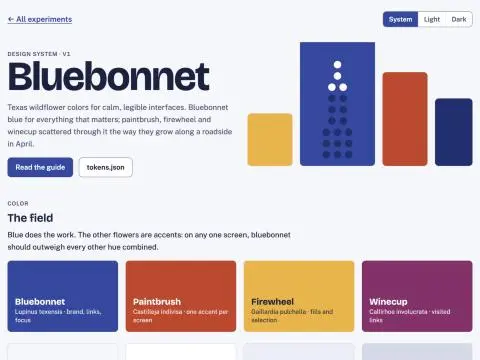
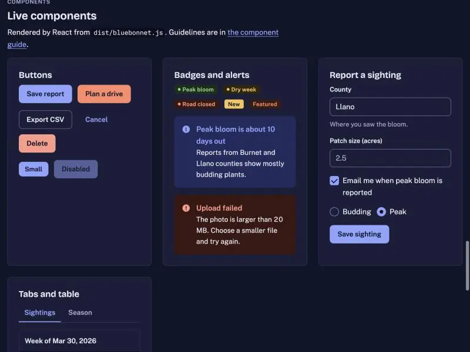
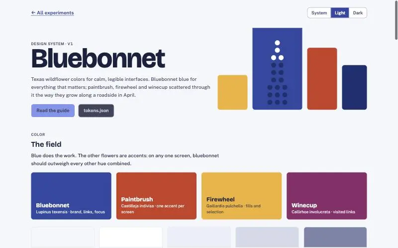
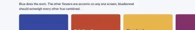
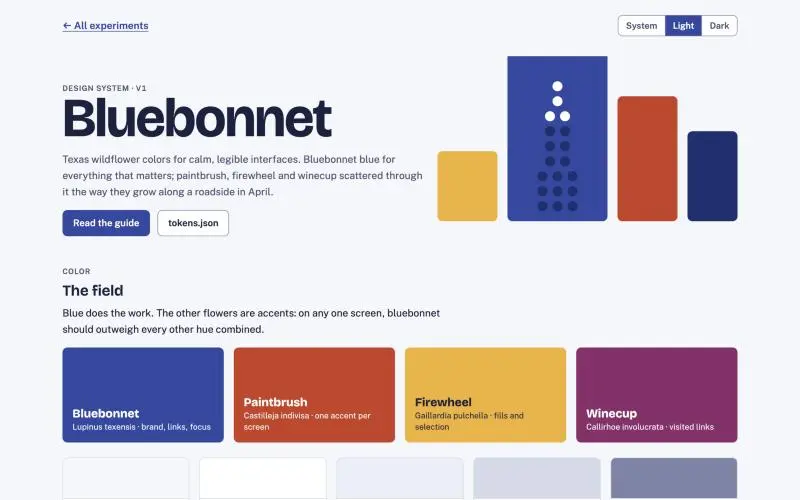

# Prompts

- **Model:** claude-opus-5-5
- **Effort:** medium
- **Session(s):** a59f9fb5-23b6-4bf4-8e89-b7ac8912916b
- **Tokens:** input 76, output 52509, cache read 5770948, cache write 141553
- **Cost (tokscale estimate):** $3.34

## You

Lets come up with a new design system that I can use in Claude and with other projects. We can build this on top of an existing lightweight system, with our own twists.

I want to call it the Bluebonnet Design system, taking inspiration from the colors of texas wildflowers.

## Claude

Palette and base picked (Pico-style classless layer, Texas wildflower colors). Writing tokens and components now.

Now the brand book README.

I've published Bluebonnet as a Claude design system: https://claude.ai/artifact/ErAUuMP6rR6fDjwrewPu7m. I haven't opened it in a browser yet, so the cover and component previews are unchecked. It's private, so other people can't open the link until you share it from its Share menu.

**The base:** it copies Pico CSS's approach rather than loading Pico itself, because the artifact viewer only loads its own files and Google Fonts. Plain HTML (headings, links, code, rules) looks right with no classes, and that base styling never overrides your own classes. Controls use a small set of `bb-` classes.

**The colors:**
- **Bluebonnet blue** is the brand. It covers primary buttons, links, the selected tab and the focus ring.
- **Indian paintbrush** orange-red is the one warm accent, used at most once per screen.
- **Firewheel gold** (the yellow tip of the Indian blanket) is used as a fill only, and is also the text-selection color.
- **Winecup magenta** is used for visited links. A bluebonnet's white spot turns wine-red once a bee has visited it, and links do the same.
- **Backgrounds and text** are a faint blue-tinted limestone white with deep navy text. Dark mode is a night-sky version of the same palette.
- **Success, warning and danger** are separate from the flower colors, and each always comes with an icon or a word.

**The rest:**
- **Type:** Bricolage Grotesque for headings, Public Sans for text, IBM Plex Mono for code and coordinates.
- **Scales:** spacing in 4px steps, four corner radii, and two shadows used only for menus and dialogs.
- **Components:** Button, Field, Choice (checkbox and radio), Badge, Alert, Tabs and Table, each with guidelines and a live preview. The examples use Texas wildflower sightings.
- **Cover:** a bluebonnet flower spike made of stacked discs, white at the tip.
- **Accessibility:** I checked text contrast by hand against WCAG targets in both themes.

**Choices I made without asking:**
- There's no logo, so the name is set in plain type.
- There's no icon set. The brand book suggests Lucide icons.
- The copy rules say no emoji and no "y'all" kitsch.

Any of these are easy to change, along with the color values or fonts.

**Using it in other projects:** a project loads the compiled token stylesheet and `bundle.css`. React projects can also load `bundle.js`, which provides `window.Bluebonnet`.

## You

Yes, add to repo

## Claude

Package files and build script done. Building demo page now.

Now landing card, then verify in browser via site-root server.

Demo renders clean in light and dark, no console errors. Now: card screenshot, push danger-color tweak to artifact, write prompt.md.

Page re-saved tokens.json (same values, normalized). Applying the dark danger tweak to that copy and republishing.
