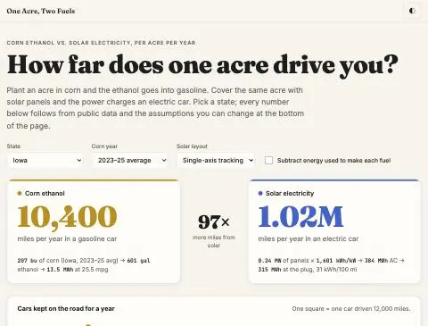
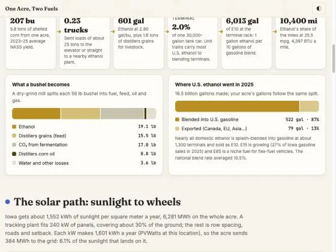
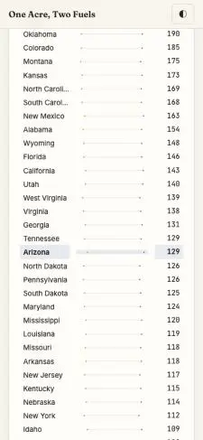
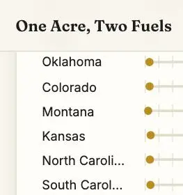
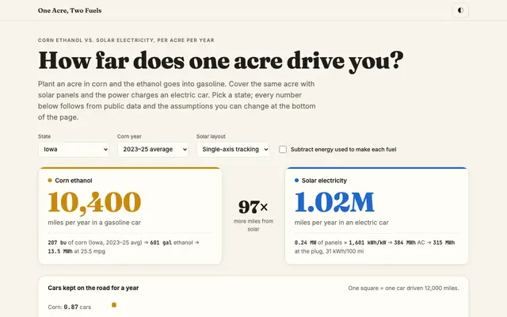
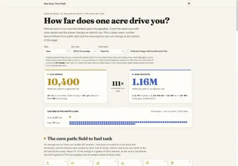
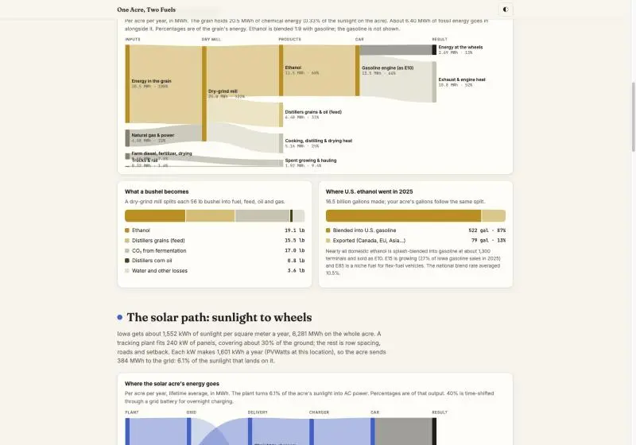
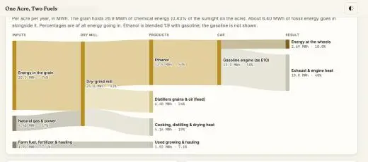
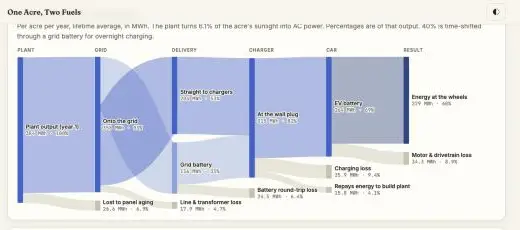
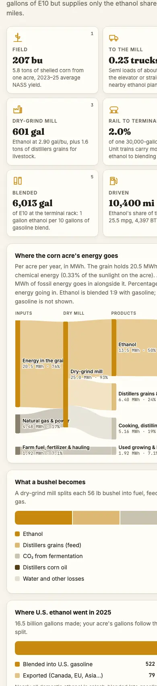

# Prompts

- **Model:** claude-opus-5-5
- **Effort:** medium
- **Session(s):** fd267e89-a977-4043-93a7-b921e5874830
- **Tokens:** input 134, output 77671, cache read 11619743, cache write 162874
- **Cost (tokscale estimate):** $5.18

## You

Let's start a new experiment. Using publicly available data, I'd like to see an HTMLCSSJS visualization made of what 1 acre of corn can produce an ethanol and how that ethanol gets distributed to vehicle fuel. And then compare that to how much solar energy can be produced in the same acre, taking two accounts, different states, solar radiance, and how many miles that can go on the average electric vehicle also taking into account efficiency losses in transmission, battery storage and energy conversion, etc..

## Claude

Gathering public data (NASS corn yields, LBNL solar land density, USDA ethanol energy balance). Then building page.

Testing NREL PVWatts API for per-state solar yields.

Data gathered (NASS yields, Open-Meteo irradiance calibrated to NREL/NLR PVWatts). Checking ethanol distribution numbers, then building.

Data ready: 41 states (NASS 2023–25 corn yields, irradiance + PVWatts-calibrated solar yields). Writing the page now.

Page renders: Iowa corn 10,400 mi vs solar 1.02M mi (97×). Checking remaining sections.

Fixing state-chart dot size on phones; rechecking.

Taking a landing-page screenshot with Playwright and adding the card.

Script reproduces data (±1 kWh rounding). Adding landing card.

I built the corn-vs-solar page at [corn-vs-solar/index.html](corn-vs-solar/index.html). It's open in the preview pane on port 8833. I checked it at desktop and phone widths, in light and dark mode, with no console errors. Nothing is committed yet.

**Iowa, with the default assumptions:**
- **Corn:** 207 bu/acre (2023–25 average) makes 601 gal of ethanol. That drives a 25.5 mpg gasoline car about **10,400 miles** a year.
- **Solar:** a tracking plant on the same acre sends 384 MWh to the grid. About 315 MWh reaches the charger, which drives a 31 kWh/100 mi EV about **1.02M miles** a year.
- **Ratio:** solar gives about **97×** the miles. Across the 41 states the ratio runs from about 80× to 213× (Texas is highest).
- **Energy-input option:** subtracting the energy used to make each fuel takes about half off ethanol (USDA puts the return at about 2:1) and about 5% off solar. With that on, Texas reaches 386×.

**What the page has:**
- **Controls:** a state picker, corn year (2023, 2024, 2025 or the average), tracking or fixed-tilt panels, and the energy-input option above.
- **Cars kept on the road:** squares showing how many cars each acre fuels for a year at 12,000 miles each. For Iowa that's 0.87 for corn and 85 for solar.
- **Corn path:** six steps from field to truck, mill, rail, blending terminal and pump. A bar splits a bushel into ethanol, distillers grains (cattle feed), CO₂ and corn oil. Another shows where 2025 U.S. ethanol went: 87% blended into gasoline, 13% exported.
- **Solar path:** each loss shown in turn, from the electricity leaving the plant through panel aging, the grid (5%), grid batteries (40% stored at 82% round trip), charging and the drivetrain.
- **Sunlight to wheels:** on a log scale, corn ethanol keeps about 0.2% of the sunlight on the acre and solar about 6%. At the wheels that's 0.04% versus 3.8%.
- **Every state:** a chart of corn and solar miles side by side for each state, sortable. Click a row to select that state.
- **Assumptions:** every number has a slider with its source. There are EV presets from an efficient sedan to an electric pickup.

**How I estimated solar per state:**
- NREL's PVWatts service is now hosted by NLR (`developer.nlr.gov`), and its free demo key allows only 10 calls an hour. I ran it at 8 locations and used those exact results there.
- For the other 33 states I used a straight-line fit of those results against 10 years of sunlight data (Open-Meteo, 2016–25). It lands within about 4% of PVWatts at the 8 locations.
- Each state is measured at one point in a farming area, for example the Texas Panhandle rather than the whole state.
- 2025 ethanol production and export totals come from trade-press reports of EIA data; I couldn't open the EIA release itself. E15 and E85 are described in words because I found no reliable national split.

Running [build-data.py](corn-vs-solar/build-data.py) rebuilds `data.js` from the sources. I also added a card to `demos.js` (Data section), a screenshot, the preview server config, and `prompt.md`. The `prompt.md` doesn't include this reply, so it should be run again before committing.

Sources:
- [USDA NASS Crop Production 2025 Summary](https://esmis.nal.usda.gov/sites/default/release-files/795725/cropan26.pdf)
- [LBNL Land Requirements for Utility-Scale PV](https://emp.lbl.gov/publications/land-requirements-utility-scale-pv)
- [USDA 2015 Energy Balance for the Corn-Ethanol Industry](https://Usda.Gov/sites/default/files/documents/2015EnergyBalanceCornEthanol.pdf)
- [EPA Automotive Trends highlights](https://www.epa.gov/automotive-trends/highlights-automotive-trends-report)
- [RFA blend rate release](https://ethanolrfa.org/media-and-news/category/news-releases/article/2026/01/u-s-ethanol-blend-rate-tops-11-in-october-as-e15-expansion-continues)
- [RFA Iowa E15 release](https://ethanolrfa.org/media-and-news/category/news-releases/article/2026/03/rfa-iowa-e15-sales-up-60-in-2025-shattering-record)
- [RFD-TV 2025 ethanol production](https://www.rfdtv.com/u-s-ethanol-production-reaches-record-levels-during-2025?p=4)
- [Open-Meteo historical API](https://open-meteo.com/en/docs/historical-weather-api)
- [NLR PVWatts](https://pvwatts.nlr.gov/)

## You

One question - why does Fixed tilt produce more energy that single axis tracking?

## Claude

That's not a bug. The page measures energy per acre, not per panel. Per panel, tracking makes more energy. Per acre, fixed tilt fits more panels.

**Per panel (kWh per kW of panels):** tracking wins. The PVWatts runs gave fixed tilt about 0.855× the tracking output (0.87× in Iowa, 0.84× in Arizona). Tracking panels follow the sun all day, so each one makes about 15–20% more.

**Per acre:** fixed tilt wins. Tracker rows tilt steeply east and west in the morning and evening, so they need wide gaps or they shade each other. Fixed rows can sit closer together. LBNL's survey of real U.S. plants found:
- **Fixed tilt:** 0.35 MW of panels per acre, panels covering about 40–50% of the ground.
- **Tracking:** 0.24 MW of panels per acre, panels covering about 25–40% of the ground.

So the per-acre totals come out as:
- **Fixed:** 0.35 × 0.855 ≈ 0.30 "tracking-equivalent MW" per acre.
- **Tracking:** 0.24.
- Fixed comes out about 25% ahead per acre.

**My model probably overstates that gap.** LBNL also measured actual energy per acre: 447 MWh/acre/yr for fixed tilt and 394 for tracking, only about 13% apart. My numbers likely run high for fixed tilt for two reasons:
- I modelled fixed rows with no allowance for rows shading each other.
- The fixed-tilt plants in LBNL's sample are in different locations from the tracking plants, so the two medians don't line up exactly.

**Why most new U.S. plants still use trackers:** land is usually a small part of a plant's cost. Trackers lower the cost per MWh and produce more in the late afternoon, when power is worth more. Developers build for cost per MWh, not output per acre.

I can match the per-acre gap to LBNL's measured 13% by lowering the fixed-tilt density default to about 0.32 MW/acre. I can also add a note under the layout picker explaining the trade-off. Want either?

## You

Sure

## Claude

Both changes are done and checked in the preview, with no console errors.

- **Fixed-tilt default lowered from 0.35 to 0.32 MW of panels per acre.** Fixed tilt now comes out 14% ahead of tracking per acre, close to the 13% gap LBNL actually measured. For Iowa that's 1.16M miles with fixed tilt versus 1.02M with tracking. The slider's help text and the methods notes explain the change, and the LBNL source line now includes the 394 vs. 447 MWh/acre figures.
- **New note under the controls** explaining the trade-off: each tracking panel makes about 17% more, but tracker rows need wider spacing, so fixed tilt fits more panels per acre. It also says why most new plants still use trackers. Its numbers update when you move the sliders.

I re-ran `prompt.md` so it includes these turns and set the landing card to 3 turns. Nothing is committed yet.

## You

Lets add sankey diagrams showing the losses

## Claude

Adding two Sankeys: corn (grain + fossil inputs → mill → ethanol/coproducts/heat → engine → wheels) and solar (plant → grid → direct/battery → charger → EV → wheels). Using d3-sankey.

Rendering works. Fixing label legibility (text halo), merging two tiny overlapping corn nodes, percentages of total input.

Fixed a note bug. Checking mobile and dark mode, then regenerating prompt.md.

