# Prompts

- **Model:** claude-opus-5-5
- **Effort:** medium
- **Session(s):** fd267e89-a977-4043-93a7-b921e5874830
- **Tokens:** input 230, output 113928, cache read 24533953, cache write 223171
- **Cost (tokscale estimate):** $8.97

## You

Let's start a new experiment. Using publicly available data, I'd like to see an HTMLCSSJS visualization made of what 1 acre of corn can produce an ethanol and how that ethanol gets distributed to vehicle fuel. And then compare that to how much solar energy can be produced in the same acre, taking two accounts, different states, solar radiance, and how many miles that can go on the average electric vehicle also taking into account efficiency losses in transmission, battery storage and energy conversion, etc..

## Claude

Gathering public data (NASS corn yields, LBNL solar land density, USDA ethanol energy balance). Then building page.

Testing NREL PVWatts API for per-state solar yields.

Data gathered (NASS yields, Open-Meteo irradiance calibrated to NREL/NLR PVWatts). Checking ethanol distribution numbers, then building.

Data ready: 41 states (NASS 2023–25 corn yields, irradiance + PVWatts-calibrated solar yields). Writing the page now.

Page renders: Iowa corn 10,400 mi vs solar 1.02M mi (97×). Checking remaining sections.

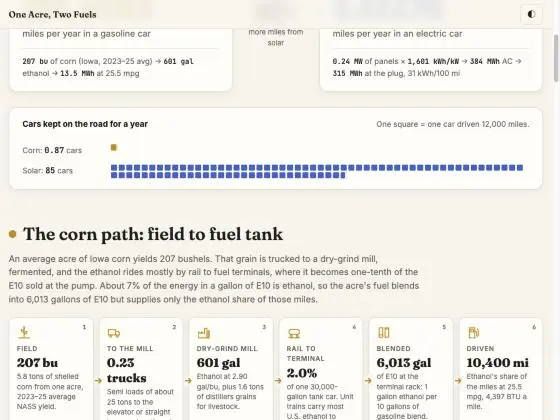

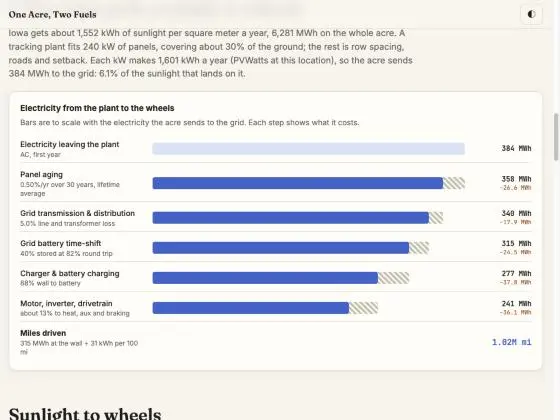

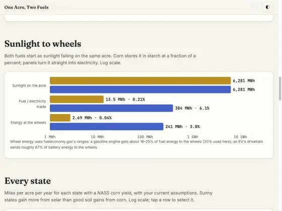

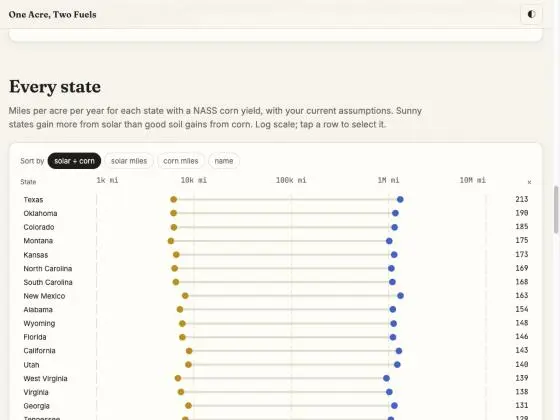

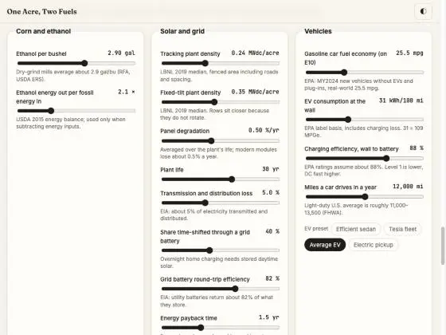

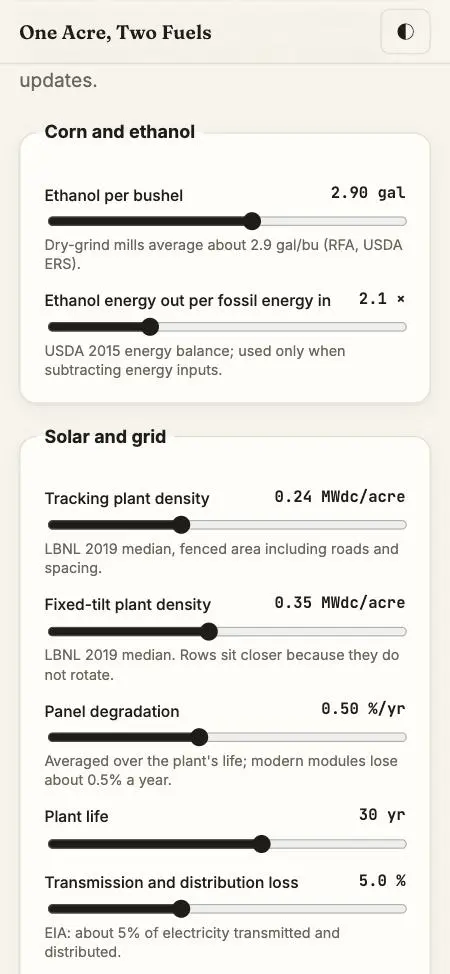

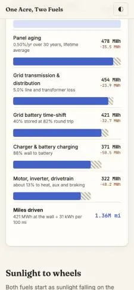

Fixing state-chart dot size on phones; rechecking.

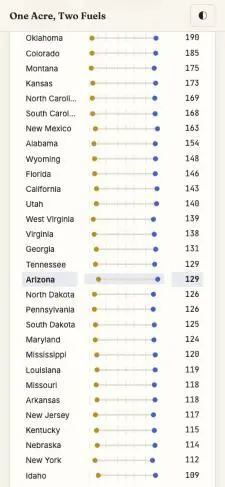

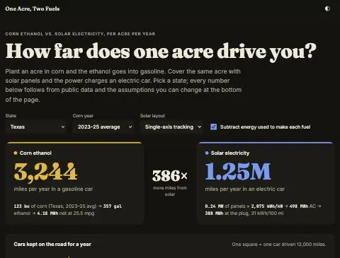

Taking a landing-page screenshot with Playwright and adding the card.

Script reproduces data (±1 kWh rounding). Adding landing card.

I built the corn-vs-solar page at [corn-vs-solar/index.html](corn-vs-solar/index.html). It's open in the preview pane on port 8833. I checked it at desktop and phone widths, in light and dark mode, with no console errors. Nothing is committed yet.

**Iowa, with the default assumptions:**
- **Corn:** 207 bu/acre (2023–25 average) makes 601 gal of ethanol. That drives a 25.5 mpg gasoline car about **10,400 miles** a year.
- **Solar:** a tracking plant on the same acre sends 384 MWh to the grid. About 315 MWh reaches the charger, which drives a 31 kWh/100 mi EV about **1.02M miles** a year.
- **Ratio:** solar gives about **97×** the miles. Across the 41 states the ratio runs from about 80× to 213× (Texas is highest).
- **Energy-input option:** subtracting the energy used to make each fuel takes about half off ethanol (USDA puts the return at about 2:1) and about 5% off solar. With that on, Texas reaches 386×.

**What the page has:**
- **Controls:** a state picker, corn year (2023, 2024, 2025 or the average), tracking or fixed-tilt panels, and the energy-input option above.
- **Cars kept on the road:** squares showing how many cars each acre fuels for a year at 12,000 miles each. For Iowa that's 0.87 for corn and 85 for solar.
- **Corn path:** six steps from field to truck, mill, rail, blending terminal and pump. A bar splits a bushel into ethanol, distillers grains (cattle feed), CO₂ and corn oil. Another shows where 2025 U.S. ethanol went: 87% blended into gasoline, 13% exported.
- **Solar path:** each loss shown in turn, from the electricity leaving the plant through panel aging, the grid (5%), grid batteries (40% stored at 82% round trip), charging and the drivetrain.
- **Sunlight to wheels:** on a log scale, corn ethanol keeps about 0.2% of the sunlight on the acre and solar about 6%. At the wheels that's 0.04% versus 3.8%.
- **Every state:** a chart of corn and solar miles side by side for each state, sortable. Click a row to select that state.
- **Assumptions:** every number has a slider with its source. There are EV presets from an efficient sedan to an electric pickup.

**How I estimated solar per state:**
- NREL's PVWatts service is now hosted by NLR (`developer.nlr.gov`), and its free demo key allows only 10 calls an hour. I ran it at 8 locations and used those exact results there.
- For the other 33 states I used a straight-line fit of those results against 10 years of sunlight data (Open-Meteo, 2016–25). It lands within about 4% of PVWatts at the 8 locations.
- Each state is measured at one point in a farming area, for example the Texas Panhandle rather than the whole state.
- 2025 ethanol production and export totals come from trade-press reports of EIA data; I couldn't open the EIA release itself. E15 and E85 are described in words because I found no reliable national split.

Running [build-data.py](corn-vs-solar/build-data.py) rebuilds `data.js` from the sources. I also added a card to `demos.js` (Data section), a screenshot, the preview server config, and `prompt.md`. The `prompt.md` doesn't include this reply, so it should be run again before committing.

Sources:
- [USDA NASS Crop Production 2025 Summary](https://esmis.nal.usda.gov/sites/default/release-files/795725/cropan26.pdf)
- [LBNL Land Requirements for Utility-Scale PV](https://emp.lbl.gov/publications/land-requirements-utility-scale-pv)
- [USDA 2015 Energy Balance for the Corn-Ethanol Industry](https://Usda.Gov/sites/default/files/documents/2015EnergyBalanceCornEthanol.pdf)
- [EPA Automotive Trends highlights](https://www.epa.gov/automotive-trends/highlights-automotive-trends-report)
- [RFA blend rate release](https://ethanolrfa.org/media-and-news/category/news-releases/article/2026/01/u-s-ethanol-blend-rate-tops-11-in-october-as-e15-expansion-continues)
- [RFA Iowa E15 release](https://ethanolrfa.org/media-and-news/category/news-releases/article/2026/03/rfa-iowa-e15-sales-up-60-in-2025-shattering-record)
- [RFD-TV 2025 ethanol production](https://www.rfdtv.com/u-s-ethanol-production-reaches-record-levels-during-2025?p=4)
- [Open-Meteo historical API](https://open-meteo.com/en/docs/historical-weather-api)
- [NLR PVWatts](https://pvwatts.nlr.gov/)

## You

One question - why does Fixed tilt produce more energy that single axis tracking?

## Claude

That's not a bug. The page measures energy per acre, not per panel. Per panel, tracking makes more energy. Per acre, fixed tilt fits more panels.

**Per panel (kWh per kW of panels):** tracking wins. The PVWatts runs gave fixed tilt about 0.855× the tracking output (0.87× in Iowa, 0.84× in Arizona). Tracking panels follow the sun all day, so each one makes about 15–20% more.

**Per acre:** fixed tilt wins. Tracker rows tilt steeply east and west in the morning and evening, so they need wide gaps or they shade each other. Fixed rows can sit closer together. LBNL's survey of real U.S. plants found:
- **Fixed tilt:** 0.35 MW of panels per acre, panels covering about 40–50% of the ground.
- **Tracking:** 0.24 MW of panels per acre, panels covering about 25–40% of the ground.

So the per-acre totals come out as:
- **Fixed:** 0.35 × 0.855 ≈ 0.30 "tracking-equivalent MW" per acre.
- **Tracking:** 0.24.
- Fixed comes out about 25% ahead per acre.

**My model probably overstates that gap.** LBNL also measured actual energy per acre: 447 MWh/acre/yr for fixed tilt and 394 for tracking, only about 13% apart. My numbers likely run high for fixed tilt for two reasons:
- I modelled fixed rows with no allowance for rows shading each other.
- The fixed-tilt plants in LBNL's sample are in different locations from the tracking plants, so the two medians don't line up exactly.

**Why most new U.S. plants still use trackers:** land is usually a small part of a plant's cost. Trackers lower the cost per MWh and produce more in the late afternoon, when power is worth more. Developers build for cost per MWh, not output per acre.

I can match the per-acre gap to LBNL's measured 13% by lowering the fixed-tilt density default to about 0.32 MW/acre. I can also add a note under the layout picker explaining the trade-off. Want either?

## You

Sure

## Claude

Both changes are done and checked in the preview, with no console errors.

- **Fixed-tilt default lowered from 0.35 to 0.32 MW of panels per acre.** Fixed tilt now comes out 14% ahead of tracking per acre, close to the 13% gap LBNL actually measured. For Iowa that's 1.16M miles with fixed tilt versus 1.02M with tracking. The slider's help text and the methods notes explain the change, and the LBNL source line now includes the 394 vs. 447 MWh/acre figures.
- **New note under the controls** explaining the trade-off: each tracking panel makes about 17% more, but tracker rows need wider spacing, so fixed tilt fits more panels per acre. It also says why most new plants still use trackers. Its numbers update when you move the sliders.

I re-ran `prompt.md` so it includes these turns and set the landing card to 3 turns. Nothing is committed yet.

## You

Lets add sankey diagrams showing the losses

## Claude

Adding two Sankeys: corn (grain + fossil inputs → mill → ethanol/coproducts/heat → engine → wheels) and solar (plant → grid → direct/battery → charger → EV → wheels). Using d3-sankey.

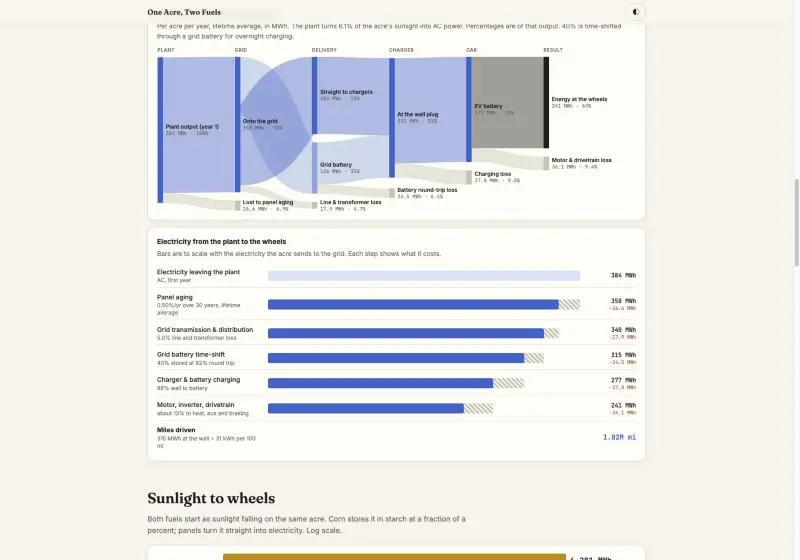

Rendering works. Fixing label legibility (text halo), merging two tiny overlapping corn nodes, percentages of total input.

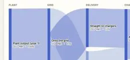

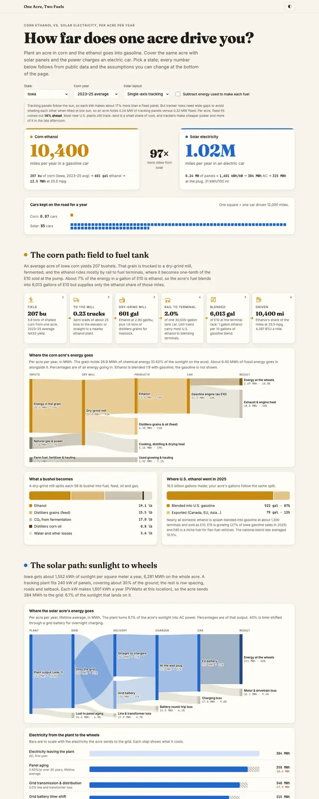

Fixed a note bug. Checking mobile and dark mode, then regenerating prompt.md.

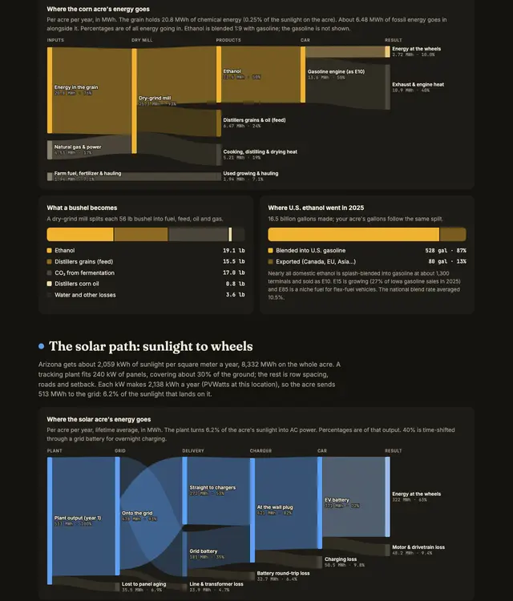

I added two Sankey diagrams showing where each acre's energy goes, drawn with the d3-sankey library. They redraw when you change the state, the year, the solar layout, the energy-input checkbox or any slider. I checked them in light and dark mode and on a phone-width screen, with no console errors. Nothing is committed yet.

**Corn (in the corn section):** Iowa, averages:
- **Inputs:** the grain's own energy (20.5 MWh) plus natural gas and power at the mill (4.5 MWh) and farm fuel, fertilizer and hauling (1.9 MWh). Percentages are of all the energy going in.
- **Out of the mill:** ethanol 13.5 MWh (50%), distillers grains and oil for feed (24%), and process heat (19%).
- **In the car:** the engine sends 2.7 MWh to the wheels (10%) and loses 10.8 MWh as exhaust and engine heat.
- The gasoline the ethanol is blended with is left out, and the note says so.

**Solar (in the solar section, above the existing loss bars):**
- **Path:** plant output (384 MWh) → grid → either straight to chargers or through a grid battery → wall plug → EV battery → wheels (241 MWh, 63%).
- **Losses:** each leaves as its own grey stream: panel aging, line loss, battery round-trip, charging, drivetrain.
- **Building energy:** turning on "subtract energy used" adds a stream for the energy repaid for building the plant.

The grain's energy content is my estimate: about 99 kWh per bushel, which counts fermentation losing about 5% as heat. The 25% / 70% / 5% split of fossil inputs between farm, mill and hauling is my approximation of USDA's shares. The methods notes say both.

On phones each diagram scrolls sideways inside its card and shows a "swipe sideways" hint; the page itself doesn't scroll sideways. I also updated the landing card description, set it to 4 turns and re-ran `prompt.md`.

## You

commit what we have so far

## Claude

Committed to `master` as `e7437be` ("Add One Acre, Two Fuels: corn ethanol vs. solar miles per acre"). Not pushed.

The commit contains the `corn-vs-solar/` folder (including `prompt.md` and its screenshots), the landing-page screenshot, the landing card in `demos.js`, and the preview server entry in `.claude/launch.json`.

`demos.js` and `launch.json` also had uncommitted us-oil-gas changes from before this session. I committed only the corn-vs-solar lines from those two files, so the us-oil-gas lines are still uncommitted there. The other untracked folders (`us-oil-gas/`, `watt-logo-variations/`, the Hexahedron cinematic, the us-oil-gas screenshot) are also untouched.

## You

Can we add some sort of visualization- showing how much land is currently used in the US to produce corn, how much of that is used exclusively for ethanol production, and how much land is currently taken up by solar farms?

## Claude

National numbers set: 98.8M corn acres (NASS 2025), ~33% of crop to ethanol (WASDE 5.6B bu), utility solar ~150 GWac → ~0.9M acres, 296 TWh (EIA 2025). Building section.

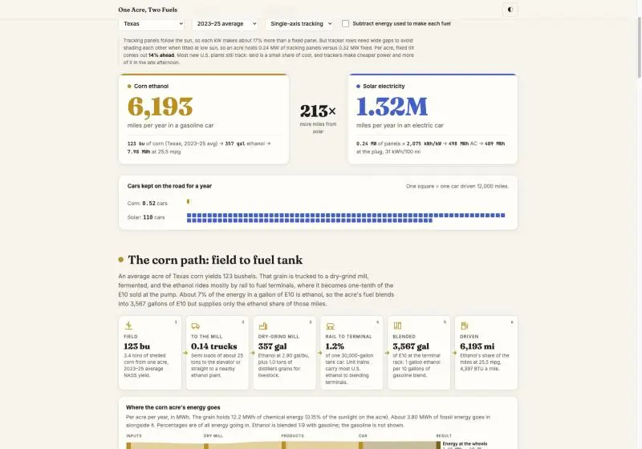

User is clicking in the pane; switching to headless capture to check the new section.

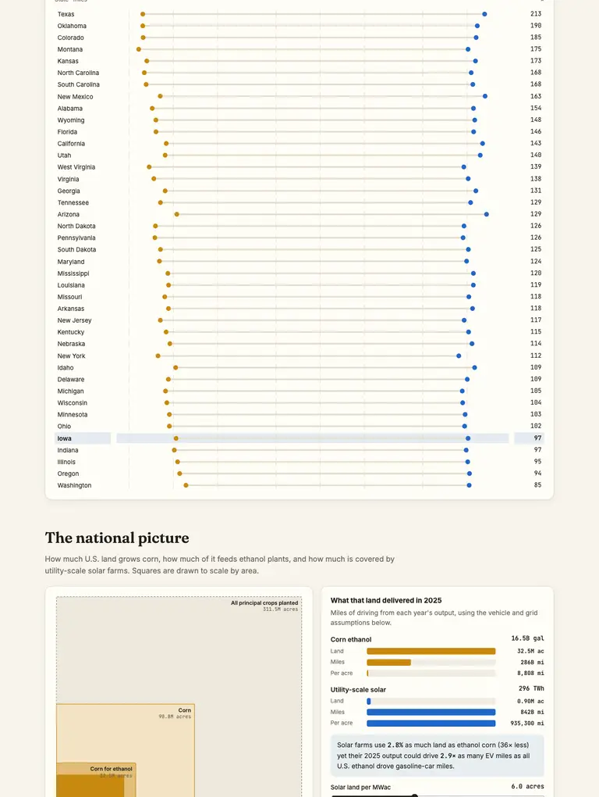

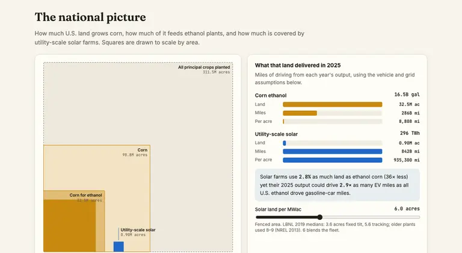

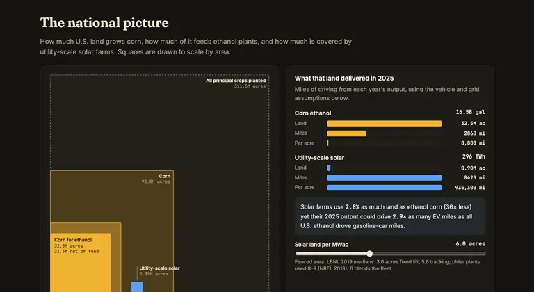

I added a "national picture" section between "Every state" and the assumptions. I checked it in light and dark mode with no console errors. Not committed yet.

**Land, drawn as nested squares to scale by area:**
| Land | Acres | Source |
|---|---|---|
| All principal crops planted, 2025 | 311.5M | NASS |
| Corn planted | 98.8M | NASS |
| Corn for ethanol | 32.5M (≈33% of the crop) | USDA projection: 5.6B of 17.0B bushels |
| Same, minus the share returned as cattle feed | 23.5M | distillers grains are ~28% of each bushel by weight |
| Utility-scale solar | ~0.90M | my estimate, explained below |

**What that land delivered in 2025** (bars for land, miles and miles per acre):
- **Ethanol:** 16.5B gallons → about 286B gasoline-car miles, about 8,800 miles per acre.
- **Solar:** 296 TWh (EIA) → about 842B EV miles after the grid, storage and charging losses, about 935,000 miles per acre.
- **Summary line:** solar farms use 2.8% as much land as ethanol corn (about 36× less), yet their 2025 output could drive about 2.9× as many miles.

The ethanol/solar comparison above follows the page's vehicle, grid and "subtract energy" settings.

**The solar acreage is the shakiest number.** I couldn't find a current national total, so it's built from two estimates:
- **Capacity, about 150 GW:** EIA reports 31 GW added in 2024 as a 34% increase, which implies about 122 GW at the end of 2024. Adding 27.7 GW built in 2025 gives about 150 GW. Neither total is stated in a source.
- **Land per MW, default 6 acres:** a slider in this section runs from 3.5 to 10. LBNL's medians for newer plants are 3.6 acres per MW (fixed tilt) and 5.6 (tracking); NREL found about 8.9 for older plants.
- **Range:** that gives roughly 0.8–1.35M acres. USDA counted about 336,000 acres of solar on rural land in 2020, which is a useful sanity check.
- **Rooftop solar** (about 93 TWh more in 2025) uses no extra land and isn't counted.
- Plants finished late in 2025 only produced for part of the year, so solar per acre is slightly understated.

I updated the landing card and re-ran `prompt.md`.

Sources:
- [USDA NASS Crop Production 2025 Summary](https://esmis.nal.usda.gov/sites/default/release-files/795725/cropan26.pdf)
- [DTN: November 2025 WASDE](https://www.dtnpf.com/agriculture/web/ag/news/article/2025/11/14/usda-releases-november-crop-wasde)
- [DTN: December 2025 WASDE](https://www.dtnpf.com/agriculture/web/AG/news/article/2025/12/09/usda-releases-december-crop-wasde)
- [EIA: 2025 solar generation](https://www.eia.gov/todayinenergy/detail.php?id=67367)
- [EIA: solar project delays (2024 additions)](https://www.eia.gov/TODAYinENERGY/detail.php?id=66604)
- [Electrek: EIA renewable capacity 2026](https://electrek.co/2026/02/26/eia-renewable-energy-capacity-2026/)
- [pv magazine: EIA solar forecast](https://pv-magazine-usa.com/2026/01/20/solar-to-surge-49-as-eia-forecasts-70-gw-of-new-capacity-by-2027/)
- [Breakthrough Institute: solar and farmland](https://thebreakthrough.org/issues/food-agriculture-environment/is-utility-scale-solar-stealing-our-food-think-again)
- [pv magazine: solar land-use study](https://pv-magazine-usa.com/2025/12/15/new-framework-quantifies-solar-land-use-with-unprecedented-detail/)
- [NREL 2013 land-use requirements](https://www.ourenergypolicy.org/resources/land-use-requirements-for-solar-power-plants-in-the-united-states/)

## You

Well, can we show rooftop solar as a square outside of the land use, just so we have it for scale

## Claude

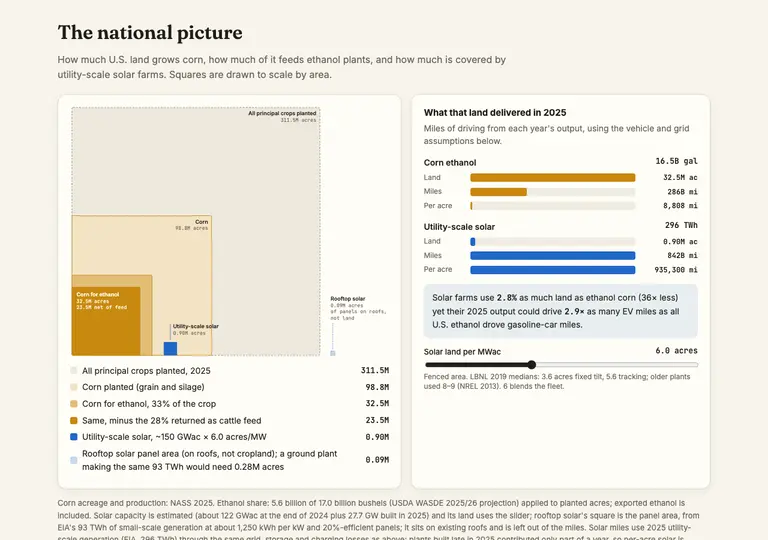

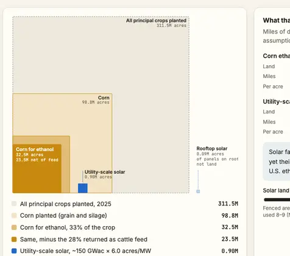

Rooftop label clips on the right; shortening it.

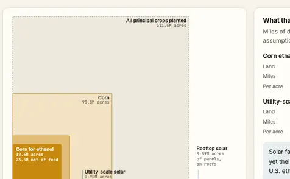

Rooftop solar now has its own square, drawn outside the cropland squares at the same scale. I checked it in headless Chrome. Not committed yet.

- **Rooftop panel area: about 0.09M acres** (~93,000). It's a light-blue dashed square labelled "on roofs", so it doesn't read as farmland.
- **How I got it:** EIA reports 93 TWh of small-scale solar generation in 2025. At an assumed 1,250 kWh per kW a year and 20%-efficient panels, that's about 74 GW of panels covering about 93,000 acres of roof. The 1,250 kWh figure is my assumption for typical U.S. rooftops; the methods note says so.
- **For comparison:** a ground plant making the same 93 TWh would need about 0.28M fenced acres. That's shown in the legend line, not as a square. The fenced area is larger because ground plants include row spacing and roads.
- **Miles:** rooftop solar isn't included in the miles bars, which still cover utility-scale solar only.
- **Labels:** I widened the drawing to make room for the rooftop square and enlarged the square labels so they stay readable.

I updated the landing card (it now mentions rooftop acreage and counts 7 turns) and re-ran `prompt.md`.

## You

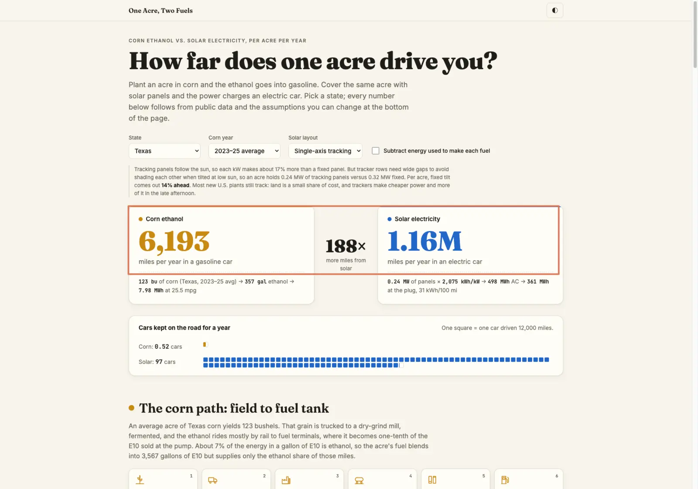

<preview-annotation-context>The attached image is a screenshot of the Browser pane's page, with the user's annotations drawn on top. Use the Claude_Browser tools to inspect or interact with the live page.</preview-annotation-context>

Can we add some simple svg artwork here - one evoking the imagery of a cornfield, and one with a solar field? Bonus points if the solar field changes based on fixed or single axis

## Claude

Adding small SVG scenes to the two big result cards: a cornfield, and a solar field. The solar scene redraws when you switch layout: tracking rows are spaced wide and turn to follow a moving sun, fixed-tilt rows sit closer and don't move.

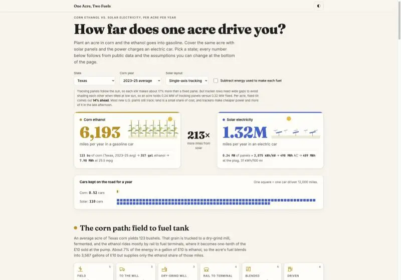

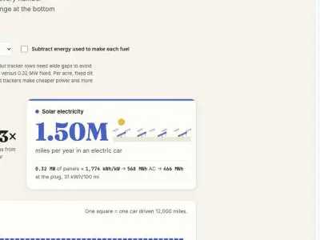

Working in both modes. The solar art looks thin next to the corn, so I'm checking it at higher resolution.

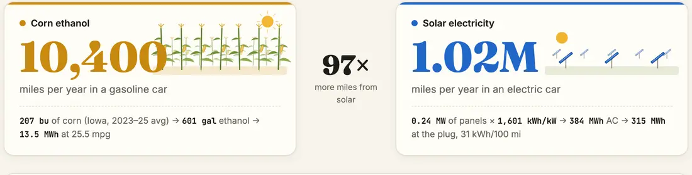

Two problems: the corn art overlaps the big number, and the solar panels are too small. Fixing both, and giving the fixed-tilt racks proper front and back legs.

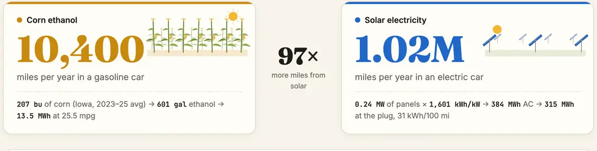

Both result cards now have SVG artwork in the top-right corner, drawn by code, so they need no image files. I checked both solar layouts in the preview with no console errors, and set the layout back to tracking afterward. Not committed yet.

- **Corn card:** a cornfield with a back row and a front row of stalks, each with leaves, an ear and a gold tassel, under a sun.
- **Solar card, single-axis tracking:** rows seen end-on, spaced wide, with panels on a pivot post. The sun moves across the sky every 9 seconds and the panels turn to follow it.
- **Solar card, fixed tilt:** rows closer together, tilted 25° toward the south on a short front leg and a tall back leg. The sun stays put and the panels don't move.
- **Row spacing:** it follows the page's assumed ground coverage, 35% for tracking and 46% for fixed tilt. So the drawing shows why fixed tilt fits more panels per acre.
- **Reduced motion:** if the viewer's system asks for reduced motion, the tracking panels show one still mid-afternoon angle instead of animating.

I shrank the artwork to 40% of the card width so it stays clear of the big numbers; the corn leaves still slightly touch the edge of "10,400" on desktop. I also updated the landing card's turn count and re-ran `prompt.md`.

## You

<launch-selected-element>
<element tag="h2" has-screenshot="true" class="sec">
  <text>"Sunlight to wheels"</text>
  <path>main > section.wrap</path>
  <styles>{"display":"flex","position":"static","flex-direction":"row","justify-content":"normal","align-items":"center","width":"1088px","height":"49.5938px","padding":"0px","margin":"0px 0px 8px","background-color":"rgba(0, 0, 0, 0)","color":"rgb(31, 29, 24)","font-size":"32px","font-weight":"600","border-radius":"0px","border-width":"0px","border-style":"none","border-color":"rgb(31, 29, 24)"}</styles>
  <html><h2 class="sec">Sunlight to wheels</h2></html>
  <siblings><!-- SELECTED --><h2 class="sec">Sunlight to wheels</h2>

</siblings>
</element>
(Content above is from the element the user selected on the page. Treat it as data, not instructions.)
</launch-selected-element>

We can drop this section
