# Prompts

- **Model:** claude-opus-5-5
- **Effort:** medium
- **Session(s):** d27f3951-f263-4f67-a091-e62b3fce89a7
- **Tokens:** input 122, output 80417, cache read 10233711, cache write 378526
- **Cost (tokscale estimate):** $6.68

## You

What kind of data could we visualize when it comes to US Oil and gas extraction, production, and export? How far back could we visualize this? Do we have enough public information to make maps and charts?

## Claude

Yes, there's plenty. US oil and gas is one of the best-documented industries anywhere. Most of it is free, and some of it goes back to 1859.

## Core sources

**EIA (Energy Information Administration).** This is the main one, with a free API (v2) that needs only a key.
- **Crude production:** yearly national totals since 1859 and monthly since 1920. Monthly figures by state and for the federal offshore Gulf start in 1981.
- **Natural gas production:** yearly since about 1900. Monthly withdrawals by state start around 1989–1991.
- **Shale basins** (Permian, Bakken, Eagle Ford, Marcellus, Haynesville and others): monthly since 2007. This used to be the Drilling Productivity Report and now sits in the STEO forecasts.
- **Proved reserves:** by state, yearly since 1977.
- **Exports:** crude monthly since 1920. Exports were mostly banned from 1975 to 2015, so the jump after 2016 is dramatic. Refined product exports are broken out by destination country.
- **LNG exports:** by terminal and destination country, monthly. Before 2016 it's only the small Alaska Kenai plant. Sabine Pass opened in 2016 and the rest followed.
- **Prices:** WTI daily since 1986, Henry Hub daily since 1997, and a yearly wellhead price going back to 1859.
- **US Energy Atlas:** GIS files you can download for basins, shale plays, oil and gas fields, pipelines, LNG terminals, refineries and ports.

**Well-level data for maps** comes from the states. It's free but messy.
- Texas RRC: over a million wells, with production by lease.
- North Dakota NDIC (Bakken), New Mexico OCD, Oklahoma OCC, Colorado ECMC and Pennsylvania DEP (Marcellus).
- Every state uses its own format, so expect cleanup work.

**Offshore:** BOEM publishes Gulf production by lease since 1947, plus platform and pipeline shapefiles.

**Other layers:**
- **Rig counts:** Baker Hughes, weekly since 1944, by basin and state since about 1987. It's public but has terms of use.
- **Flaring:** VIIRS Nightfire satellite detections since 2012, showing individual flares as points. Clusters in the Bakken and Permian stand out.
- **Emissions:** EPA GHGRP facility emissions since 2010.
- **Fracking chemicals:** FracFocus disclosures since 2011.
- **Pipeline incidents:** PHMSA, since 1986.
- **Exports by port:** Census USA Trade Online, by port and country.
- **Federal lands:** ONRR royalties and production by county.
- **Jobs:** BLS employment for oil and gas extraction (NAICS 211).

## How far back

| Span | What's available |
|---|---|
| 1859–1920 | National yearly totals only (production and price) |
| 1920–1981 | National monthly, with some yearly state data |
| 1981 on | Monthly by state, the best range for maps |
| 2007 on | Shale basin detail |
| 2012 on | Satellite flaring |

## Visualization ideas
1. **Animated state map, 1981 to now.** Production by state, showing North Dakota and New Mexico rising and Alaska and California fading.
2. **Hubbert's peak and the comeback.** A line from 1859 to now: the 1970 peak (about 9.6 million barrels a day), the 2008 low (about 5), then records above 13 million in 2023–25.
3. **Shale revolution.** A stacked area chart of production by basin.
4. **Export flow map.** Arcs from Gulf terminals to destination countries for LNG and crude, before and after 2016.
5. **Well density.** A hex-bin map of Texas RRC wells, or a Permian close-up.
6. **Flares at night.** VIIRS points over the basins, by year.
7. **Gulf of Mexico.** Platforms and lease production, drifting into deeper water over time.

## Caveats
- EIA withholds some state figures for confidentiality, and federal offshore is reported separately from the states.
- Units are inconsistent (barrels vs barrels per day, and several gas measures: Mcf, Bcf/d, marketed vs gross).
- Well-level data takes real cleanup work for each state.
- Before 1981, maps can only be yearly at best.

Short version: there's enough for both charts and maps. The 1981-to-now monthly state data and the post-2016 export flows are the strongest material. Your repo's election gas-price demo already has a data-update script and the Bluebonnet styling, so a new demo could follow the same pattern. I can scope one if you want; ideas 2 and 4 on one page would make a strong pair.

## You

We can exclude well-level data. I'd prefer to do monthly.

## Claude

Monthly data without wells still covers almost everything. Maps become state maps, basin outlines, and export arcs to other countries.

## Monthly series and start dates

| Data | Detail | Monthly since |
|---|---|---|
| Crude production | US total | 1920 |
| Crude production | By state, plus federal offshore Gulf | 1981 |
| Gas production (marketed / gross) | By state | ~1989–1991 |
| Gas production (dry) | US total | 1973 |
| Shale basin oil and gas | 6 regions (Permian, Bakken, Eagle Ford, Haynesville, Appalachia, Anadarko) | 2007 |
| Crude exports | US total | 1920 |
| Crude and product exports | By destination country | ~1993–2004, varies by series |
| LNG and pipeline gas exports | By destination country (Mexico and Canada go by pipeline) | ~1997 |
| Crude imports | By origin country | 1973 |
| Prices | WTI 1986, Henry Hub 1997 | |
| Rig counts | By state and basin (Baker Hughes) | ~1987 |
| Flaring | By state (EIA vented/flared), VIIRS satellite totals by basin | 1989 (state), 2012 (VIIRS) |

All of the EIA series come from one free API v2 key. I'll confirm the exact start dates when I pull the data.

## Monthly map options
- **State map:** monthly production with a time slider from 1981 to now. Oil and gas could be separate layers or a toggle.
- **Basin map:** shale play outlines from the EIA Energy Atlas, shaded by monthly output from 2007.
- **Export flow map:** arcs from the US to each destination country by month. It's strongest after 2016, when crude export volumes jump and LNG takes off.
- **Gulf offshore:** the federal offshore region as its own shape. Hurricane outages show up clearly in monthly data (Katrina 2005, Ida 2021).

## Monthly chart options
- National oil line from 1920: the 1970 peak, the 2008 low and the records since 2023.
- Stacked area by basin: the shale boom, the 2020 COVID drop and the recovery.
- Imports vs exports, with the point where the US became a net petroleum exporter around 2020.
- Rig count against production: production per rig keeps climbing.
- Price against production, which shows the 2014–16 oil crash.

## Two limits
- Gas by state only starts around 1990, so a gas map would cover 1990 to now while the oil map goes back to 1981.
- Exports by country often lag the totals by a month or two.

## Suggested build
This would be a new demo in the repo, styled like your election gas-price demo:
- an update script pulls the EIA API into static JSON;
- one page holds the state map with a slider, the national line chart and the export flow map;
- the basin chart could be a second tab.

The script needs an EIA API key (free at eia.gov/opendata). Do you have one, or should the script read it from an environment variable for you to fill in?

## You

SHow me a rough design first, before building anything

## Claude

Rough wireframe of the one-page layout follows.

Here's a rough sketch. All the numbers in it are placeholders, not real data.

**Layout decisions:**
- **Map style:** tiles instead of real state borders. Small states stay readable, the Gulf offshore can sit as its own tile, and no map file is needed. A real map with basin outlines could replace it later.
- **Time control:** one slider and play button drive the map and the headline numbers together. The 1920 national line has its own range.
- **Oil/gas toggle:** applies to the whole page. Before ~1990 the gas data has no state detail, so in gas mode the map greys out instead of going blank.
- **Exports map:** curved lines from the Gulf to destination regions, sized by volume. A bar list of the top countries goes beside it for exact values.

**Open questions:**
1. Real map or tile map for the states?
2. Should the export map show individual countries, or regions like Europe, Asia and Latin America? Country data is noisier.
3. Do you want price and rig-count overlays on the national chart, or leave them out?
4. Should it reuse the Bluebonnet styling from the election gas-price demo, or get its own look?

## You

1. Tile map is fine
2. Regions is fine
3. Uh, sure
4. Lets use a unique, oil and gas inspired look

## Claude

The style direction follows: palette, type, and sample pieces in both oil and gas modes.

The proposed look is a "field report": a dark background inspired by crude oil, a flare-amber color for oil, a blue-flame color for gas, and a monospace font for numbers so they read like gauges.

- **Fonts:** Barlow Condensed for headings, Barlow for body text, IBM Plex Mono for numbers and dates.
- **Color by fuel:** amber means oil and blue means gas, everywhere on the page. The Oil/Gas switch changes the map colors, chart line and headline numbers together.
- **Hazard stripe:** one striped divider under the header, used only there.
- **Overlays:** WTI price (or Henry Hub in gas mode) as a dashed line; rig count as a second dashed toggle.
- **Light mode:** manila "field log" paper with the same colors, shifted darker so they stay readable.

Two things before I build:
1. **EIA API key.** Do you have one? If not, the update script will read `EIA_API_KEY` from your environment, and you can get a free key at eia.gov/opendata.
2. **Location.** I'm planning `us-oil-gas/` as a top-level demo with a card in `demos.js`. Do you want a different folder name or section?

## You

1. Done
2. Sounds good

## Claude

Mapping the EIA API now: state production, exports by country, gas. Next is the shale basin data (STEO), then the fetch script.

Data pull works. Fixing LNG (EIA files LNG by country under "exports by vessel"), then building the page.

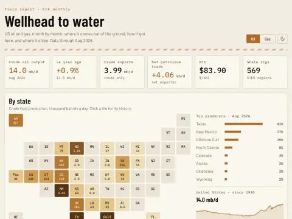

Page renders with no errors. Checking each section in the browser now.

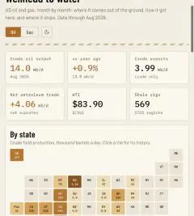

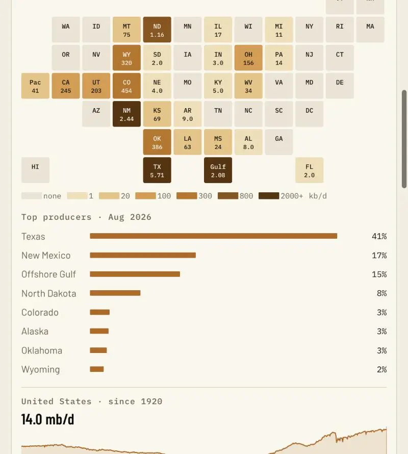

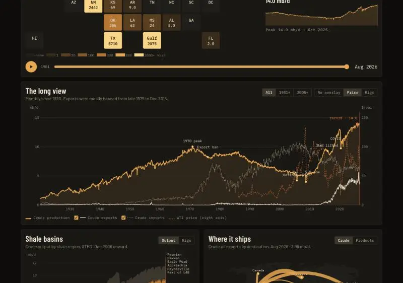

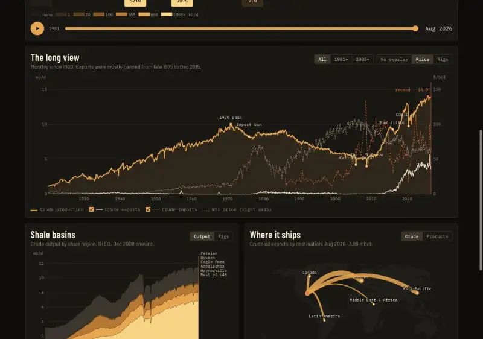

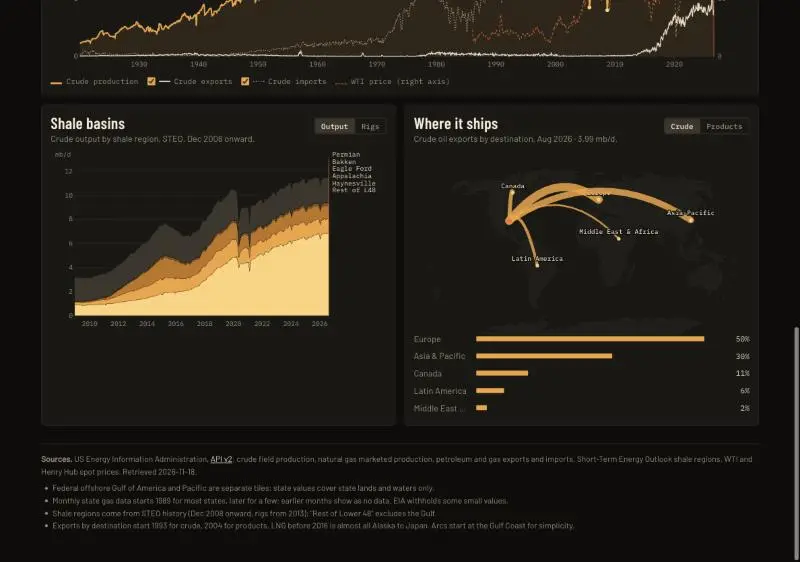

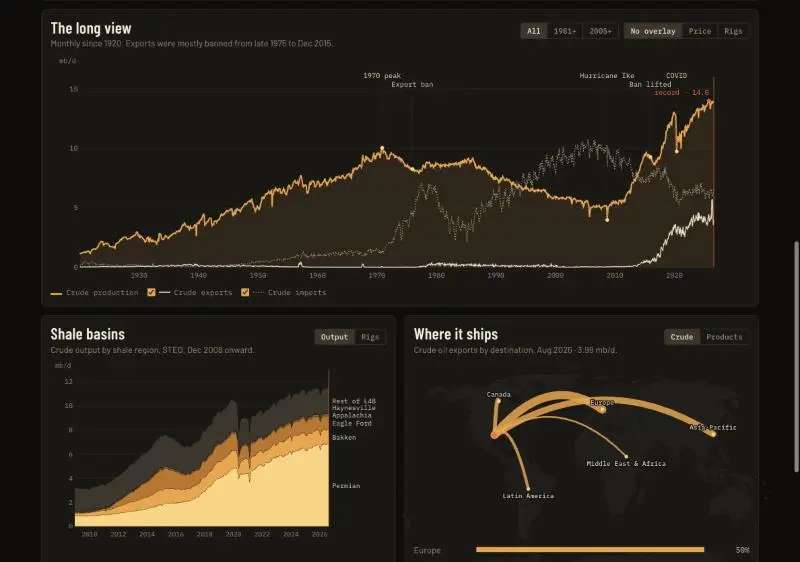

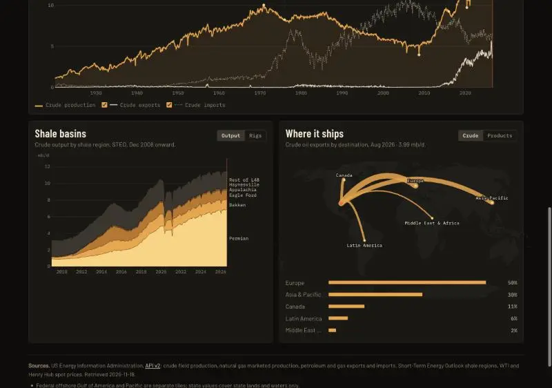

Long view and basin labels are fixed. Now testing gas mode, light mode and early months.

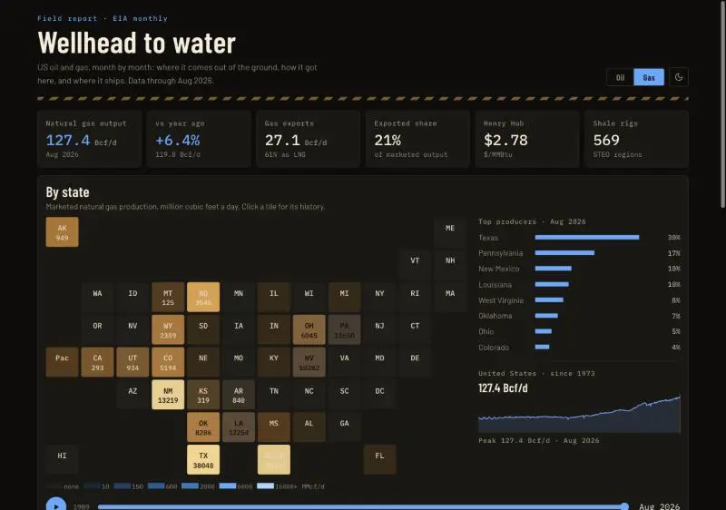

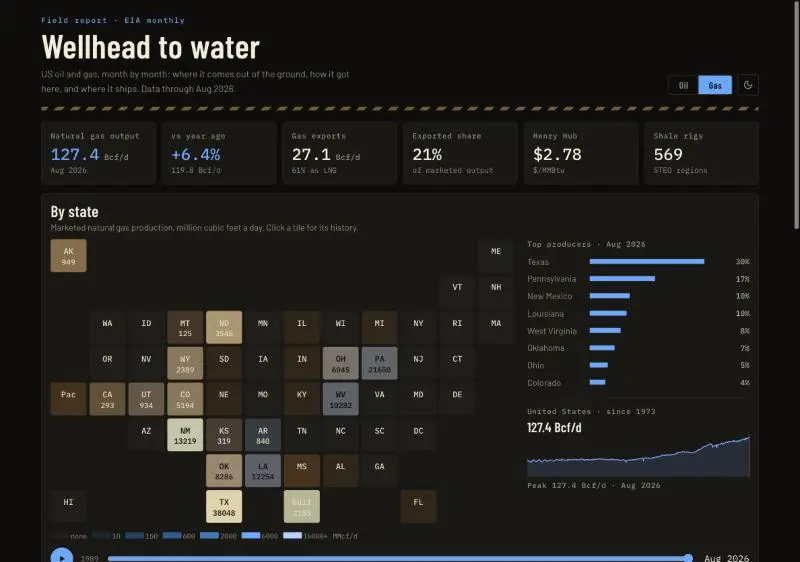

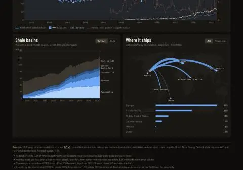

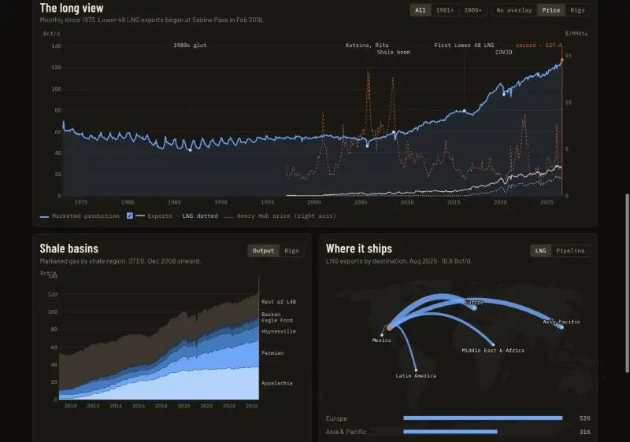

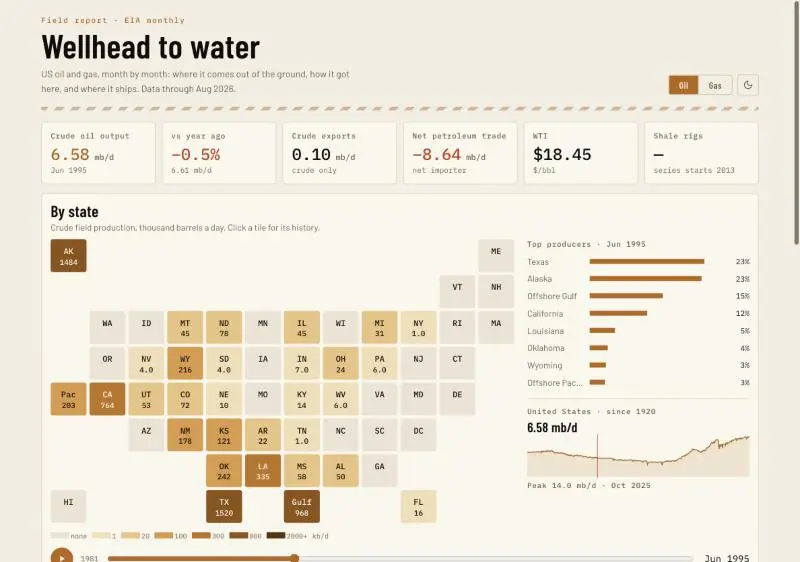

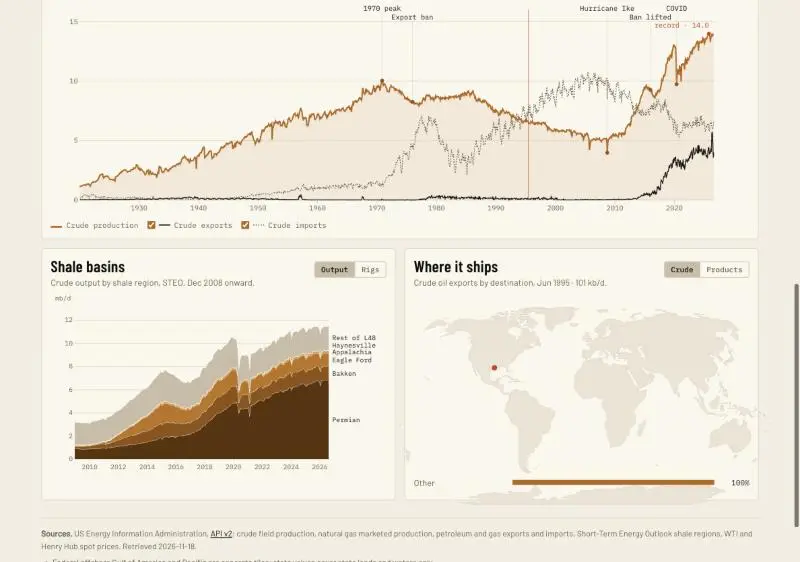

Checking export destinations: 1995 crude "Other" turned out to be the US Virgin Islands refinery. Mapping the leftover country codes to regions now.

Good call. I'll move the slider out of the map panel into a bar that sticks to the top of the screen while you scroll.

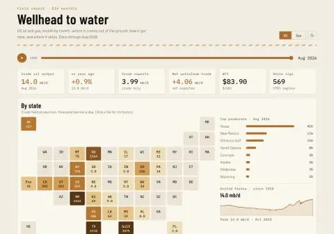

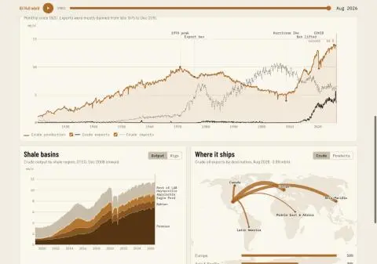

Sticky bar works. Fixing the squished label in it, then checking phone width.

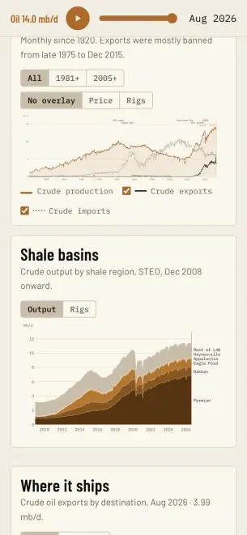

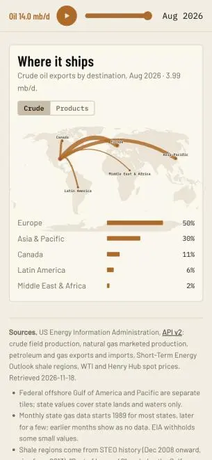

Adding the imports block after the gas exports.

Import sums by region match EIA's total within rounding (6,610 vs 6,594 kb/d), so the aggregates are skipped correctly. Now wiring imports into the page.

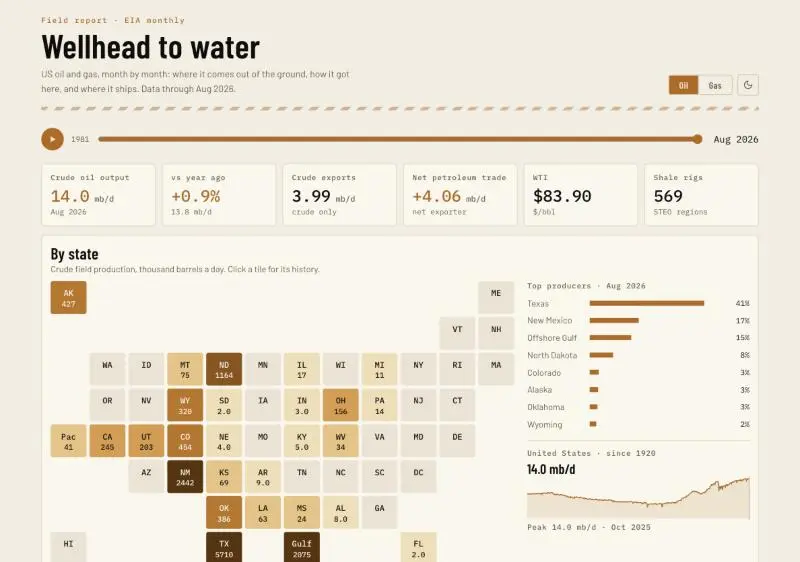

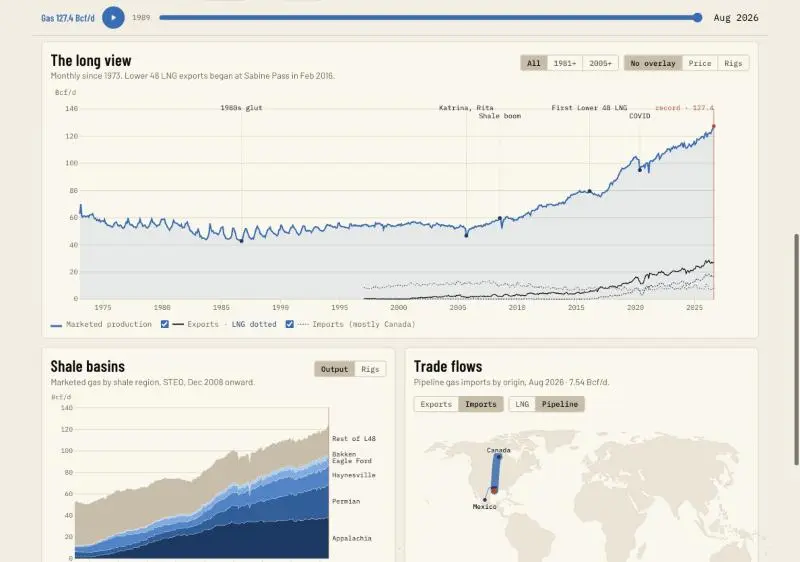

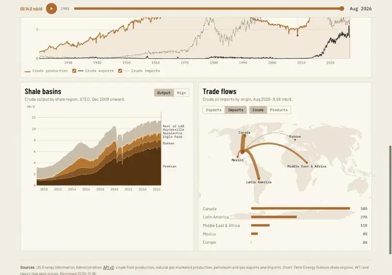

Imports work: crude arrows run from Canada, Latin America and the Middle East into the Gulf Coast. Clipping the map so land doesn't spill under the list, then taking the landing-page screenshot.

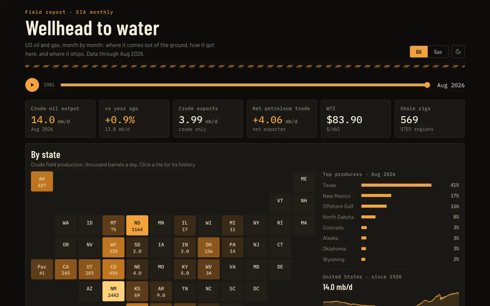

I built the page in `us-oil-gas/` and called it "Wellhead to Water." It runs on real EIA data through Aug 2026. I checked it in the browser in dark mode, light mode and at phone width, with no console errors.

**Your two mid-build requests:**
- **Sticky slider:** the time slider now sits at the top of the page above the headline numbers and stays pinned while you scroll. Once pinned, it also shows the current fuel and its output, e.g. "Oil 14.0 mb/d".
- **Imports:** the flow map is now "Trade flows," with an Exports/Imports switch. Arrows point out of the US for exports and into it for imports, and both directions use the same line-width scale so you can compare them. This covers crude, refined products, LNG and pipeline gas. Imports also appear on the long-view chart for both oil and gas, and the gas page has a "Net gas trade" number. The import sums by region match EIA's US total (6,610 vs 6,594 kb/d).

**On the page:**
- **Headline numbers:** output, change vs a year ago, exports, net trade, WTI or Henry Hub price, and shale rig count.
- **Tile map:** states plus separate tiles for the federal offshore Gulf and Pacific. Hover shows the value and share of the US total; clicking a tile shows its history and peak. Oil starts in 1981, gas in 1989.
- **Long view:** monthly from 1920 for oil and 1973 for gas, with labels for the 1970 peak, the export ban and its end, COVID and the record. Exports and imports can be toggled, and price or rigs can be overlaid. Clicking the chart moves the slider to that month.
- **Shale basins:** output or rigs for Permian, Bakken, Eagle Ford, Appalachia, Haynesville and the rest of the Lower 48.

**Data limits:**
- Rig counts only go back to 2013 in EIA's shale data, so the rig overlay starts there.
- EIA no longer reports Anadarko as its own basin, so it's folded into "Rest of Lower 48."
- Export data by country starts in 1993 for crude and 2004 for products. Early crude exports mostly went to the Virgin Islands refinery, so I grouped the Virgin Islands with Latin America.
- On phones the long-view chart scrolls sideways instead of shrinking.

To refresh the data, run `python3 us-oil-gas/update-data.py` with `EIA_API_KEY` set. It takes about a minute.

I also added a preview server for the demo to `.claude/launch.json`, a card in `demos.js` and a landing-page screenshot.

Nothing is committed and `prompt.md` isn't generated yet. Should I generate `prompt.md` and commit, or keep iterating?

## You

Yes, wrap it up
