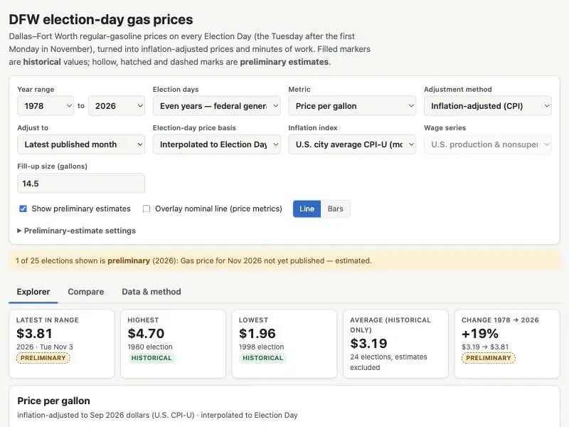
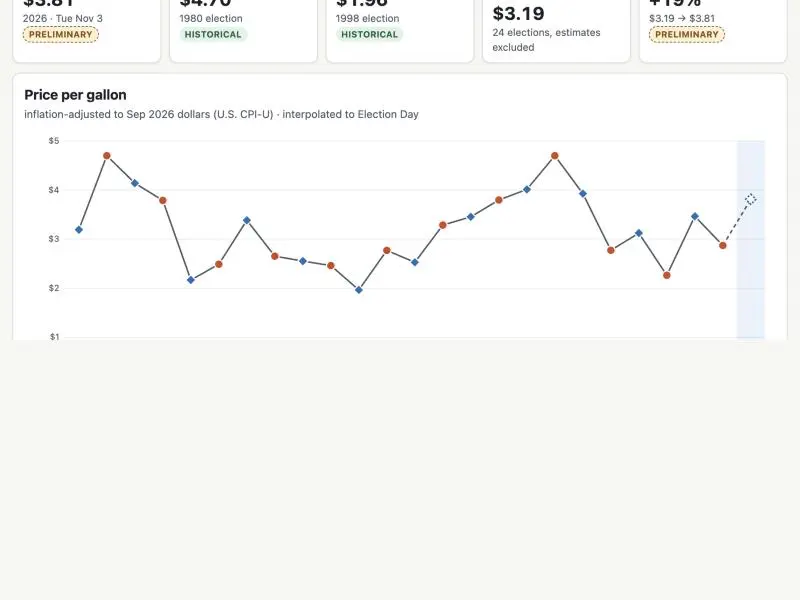
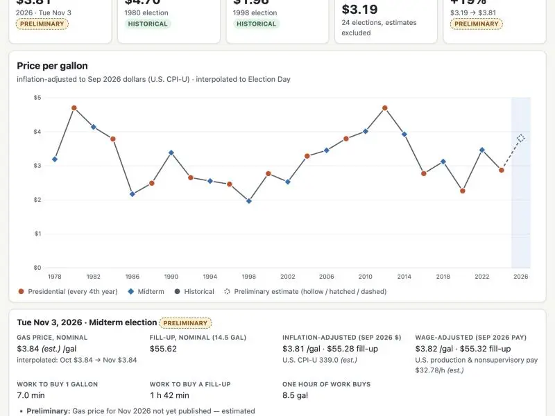
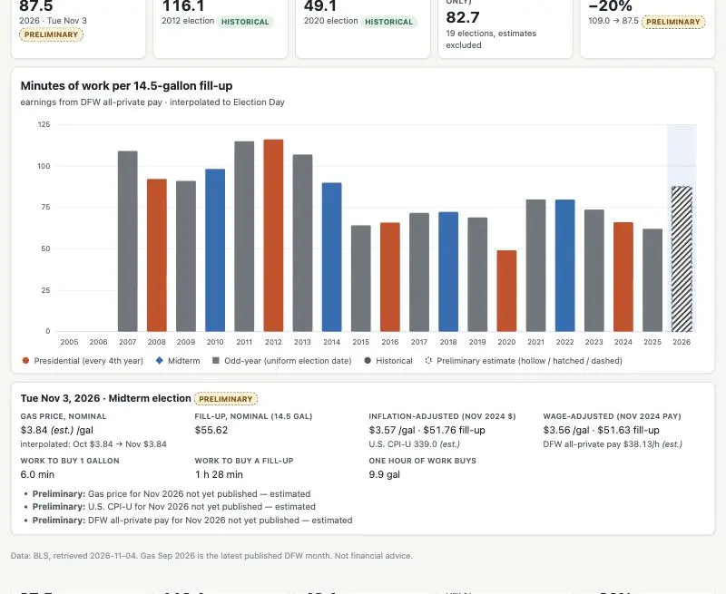
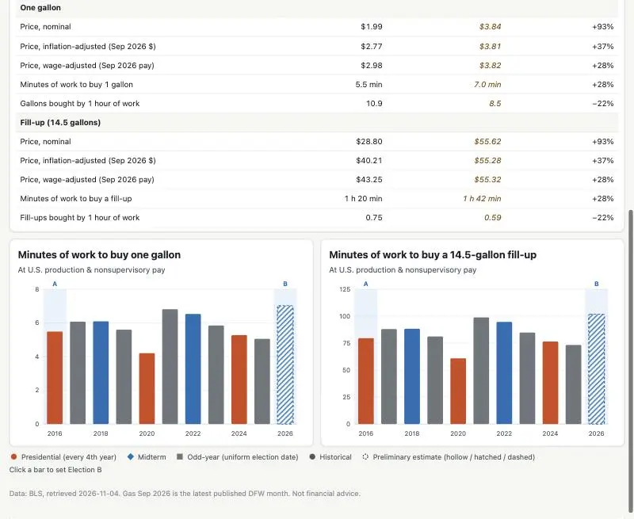
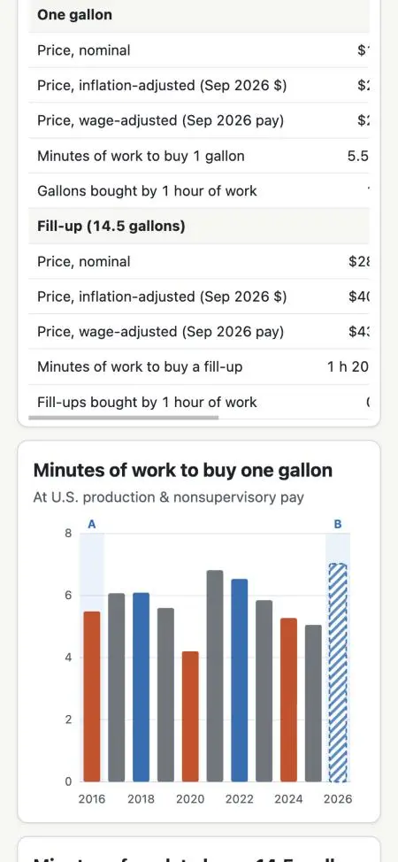
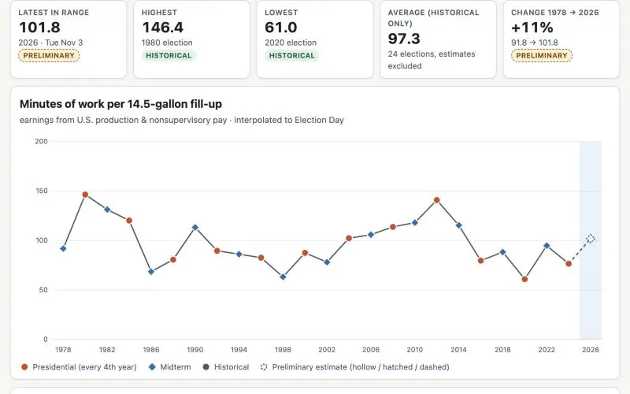

# Prompts

- **Model:** claude-sonnet-5-5
- **Effort:** high
- **Session(s):** 3808fa9e-bca9-4171-87ee-ae0ab1e54078
- **Tokens:** input 58, output 60663, cache read 3733224, cache write 121298
- **Cost (tokscale estimate):** $1.47

## You

Create a single page HTML app that lets me explore Dallas-Fort Worth Metro gasoline prices on election days across years, with the same Tuesday election-day pattern where applicable. Include inflation-adjusted prices, wage-adjusted affordability, and a comparison view showing gallons or minutes of work needed to buy a gallon and a 14.5-gallon fill-up. Let me change the year range, metric, and adjustment method, and preserve the distinction between historical values and preliminary estimates.

Write to directory election-gas-prices-sonnet-5.5-high

## Claude

Page renders and chart works. Checking chart bottom, other tabs, and edge cases now.

Mobile layout holds. Small table fix, then I'll add the index card and run a final check.

Last check: tooltip, then reset the viewport.

Built [election-gas-prices-sonnet-5.5-high/index.html](election-gas-prices-sonnet-5.5-high/index.html). It's one self-contained page with the data inlined. I checked it in the browser at desktop and phone width. The tooltip works and the console shows no errors. I did not commit anything.

**Data**
- **Gas price:** BLS monthly DFW regular-gasoline average, 1978 through Sep 2026. BLS publishes no daily price, so Election Day is approximated two ways you can switch between: the November average, or a straight-line interpolation between the October and November averages.
- **Inflation:** US CPI-U, or DFW CPI-U.
- **Wages:** US production and nonsupervisory pay (1978+), US all private (2006+), or DFW all private (2007+).
- **Election days:** the Tuesday after the first Monday in November, computed per year. A selector switches between even years (federal general elections, the default), presidential years only, and every year including odd-year Novembers.

**What you can change**
- Year range, metric, and adjustment method (nominal, CPI-adjusted, or wage-adjusted), plus a base year to adjust to.
- Fill-up size, default 14.5 gallons.
- Line or bar chart, with an optional nominal overlay.
- Metrics: price per gallon, price per fill-up, minutes of work per gallon, minutes of work per fill-up, and gallons per hour of work.
- Work-time metrics already use wages, so the adjustment menu is greyed out for them.
- The settings are saved in the URL hash.

**Compare tab:** pick election A and election B and get a side-by-side table of one gallon versus one fill-up in price, minutes of work, and gallons per hour. Two charts below cover the whole range, with a toggle between minutes and gallons.

**Historical vs preliminary**
- Historical points are filled markers or solid bars; preliminary ones are hollow, hatched or dashed, with a badge.
- A point is preliminary if any input it uses is unpublished or flagged "P" by BLS.
- A checkbox hides preliminary points.
- Today (Nov 4, 2026), only the Nov 3, 2026 election is preliminary:
  - Gas is held flat at the Sep 2026 figure of $3.836. You can type in a real pump price to replace it.
  - CPI and wages are extended at their trailing 12-month growth rate.
  - It turns historical once BLS publishes the October and November data.
- A web search for AAA's DFW price for election week found nothing reliable, so I didn't use any.

I also added an index card and a preview image, and an `election-gas` entry in `.claude/launch.json`. `prompt.md` isn't generated yet. Per CLAUDE.md I'd run it once you say the demo is done.

## You

Yes, finish up
