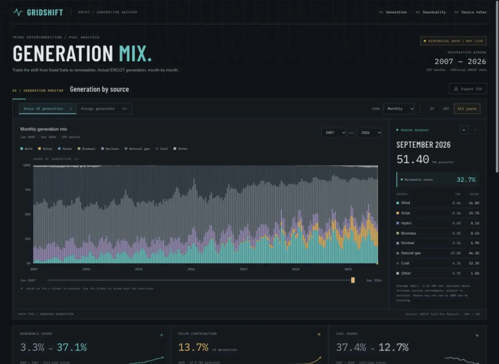

# Prompts

- **Model:** gpt-6.1-sol
- **Effort:** high
- **Session(s):** 01a1aa02-3d9a-76c2-90d8-b0df9ddb3748
- **Cost:** unavailable (tokscale failed)

## You

Create a single-page HTML/CSS/JS data visualization that shows data from ERCOT, going back maybe 10 years if possible (maybe a little further), showing the transition of the Texas grid to renewables. I'd like to be able to see at the very least a monthly distribution of power generation sources

Place into `ercot-renewables-gpt-6.1-sol-high`

## Codex

I’ll look for ERCOT generation history, build an interactive monthly view, and put the finished page in `ercot-renewables-gpt-6.1-sol-high`.

I’m using the Sites skill for the page build and will keep it local in the folder you named. I’ll check ERCOT’s historical fuel-mix reports for monthly data.

ERCOT has monthly fuel-mix reports back to 2007, so there’s enough history to go well beyond ten years. I’m building views for both generation volume and percentage share, plus a month-by-month breakdown and a seasonal view.

The data now covers 237 months, from January 2007 through September 2026. I also found that ERCOT includes storage charging in its reported total; I’m keeping that separate so generation shares describe the sources producing electricity.

The page is built. The charts switch between monthly and annual data, and between percentages and terawatt-hours. I’m checking the controls and mobile layout, including the labels that distinguish partial 2026 data from complete years.

The data checks and browser checks passed, including layouts down to 320 pixels wide. The folder also includes a CSV download, source notes, and a script for refreshing the ERCOT snapshot.

Created [index.html](index.html) with **237 months of official ERCOT data, January 2007–September 2026**.

Includes monthly source distributions, percentage/TWh views, annual summaries, date filters, a seasonal heatmap, and CSV download.

Desktop/mobile checks and data integrity tests passed. Open `index.html` in a browser—no build needed.

## You

Can I change the theme up here? I'm a bit tired of the repetitive sites I am getting from GPT that all look the same.

## Codex

Yes—we can change this ERCOT page’s entire visual direction: layout, typography, colors, and charts.

The current serif headline, sage palette, rounded cards, and oversized introduction follow a familiar generated-site formula. A different palette alone won’t fix that.

Three stronger directions:

- **Grid control room:** charcoal background, condensed type, dense charts, restrained amber and cyan.
- **Energy atlas:** white background, technical typography, fine rules, oversized charts, minimal decoration.
- **Data newspaper:** bold headlines, compact columns, annotated charts, black ink with one accent color.

I’d choose **Energy atlas**, putting the monthly generation chart first and removing the marketing-style introduction.

Which direction appeals to you?

## You

Sure, lets try Grid control room

## Codex

I’ll give it a grid control room feel: charcoal surfaces, compact typography, amber and cyan accents, and a layout that puts the generation data first.

The chart now leads the page, with the long-term comparisons underneath it. I’m also revising the chart colors, labels, and month readout so the control room style runs through the whole interface.

The dark theme is in place, and the chart controls still work. I found a cramped readout on very narrow phones; I’m moving the renewable percentage onto its own row at that size.

Applied **Grid Control Room**: charcoal panels, condensed headings, monospaced readouts, cyan and amber charts, and a compact layout with the generation chart first.

Refresh your open page to see it. Desktop/mobile checks and data tests passed.

## You

Lets run the prompt-md script on this conversation, then add this to the main index.html with a screenshot

## Codex

I’ll run the prompt-md script for this conversation, then add the ERCOT visualization to the main gallery with a screenshot.

