# Prompts

- **Model:** claude-opus-5-5
- **Effort:** high
- **Session(s):** 17f610a7-f369-423d-87f9-412dab3dd19b
- **Tokens:** input 334, output 174648, cache read 29206514, cache write 381670
- **Cost (tokscale estimate):** $12.39

## You

Create a single-page HTML/CSS/JS data visualization that shows data from ERCOT, going back maybe 10 years if possible (maybe a little further), showing the transition of the Texas grid to renewables. I'd like to be able to see at the very least a monthly distribution of power generation sources.

Place into ercot-renewables-opus-5.5-high. Do not look at the repo for any other style choices or prior art. Do use a well established CSS framework instead of rolling your own.

## Claude

Data found: ERCOT Fuel Mix Report, 2007–2026, 15-min data. Writing aggregation script now.

Picking a colorblind-safe palette for the 7 fuel series; then building the page.

Writing data build script; running it now.

Data verified against ERCOT's published annual shares (e.g. 2024 wind 24%, solar 10%, coal 13%). Building the page.

Page built; checking it in browser.

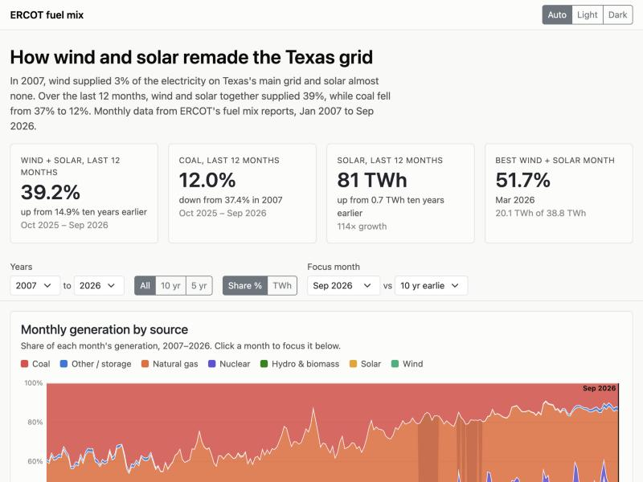


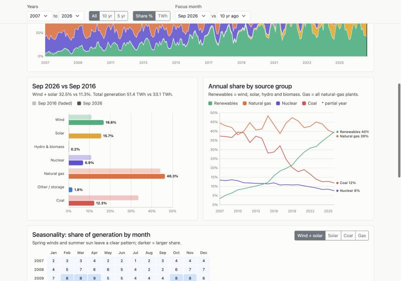

Charts render, no console errors. Checking details (axis labels, heatmap, dark mode, mobile).

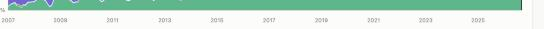

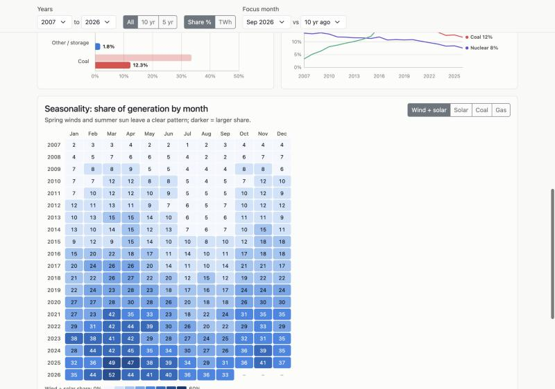

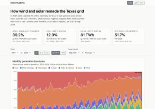

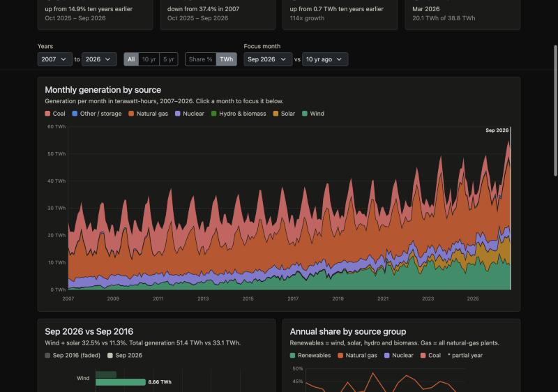

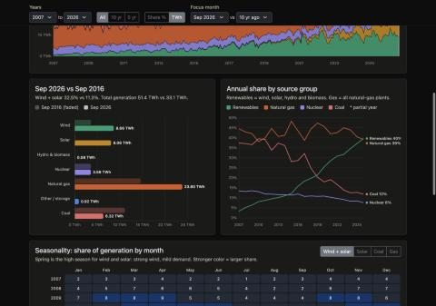

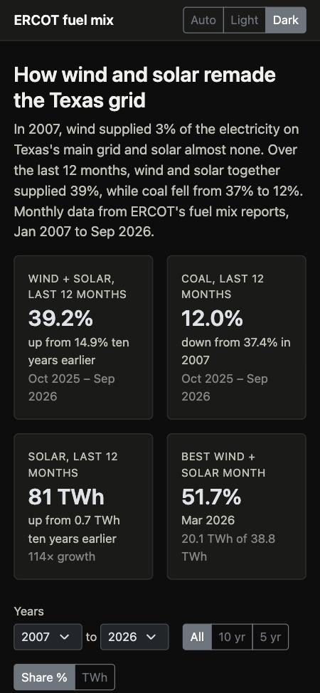

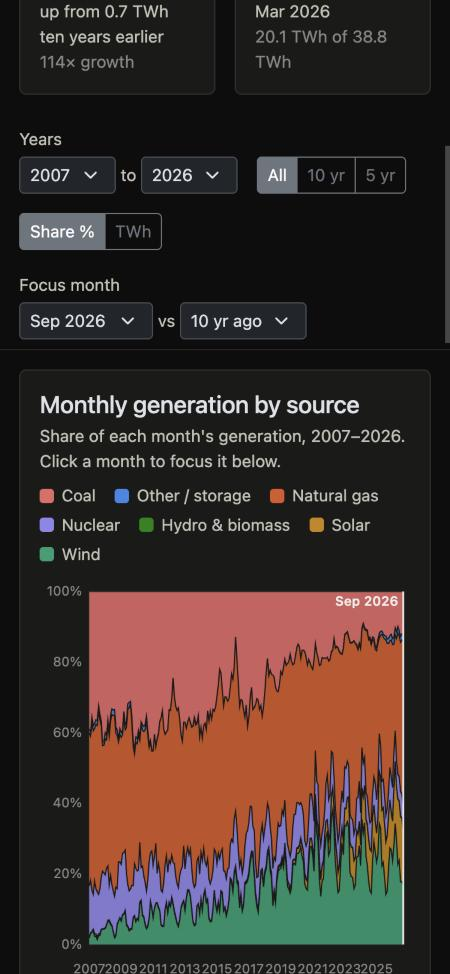

Mobile: sticky filter bar too tall, x-axis years crowd. Fixing.

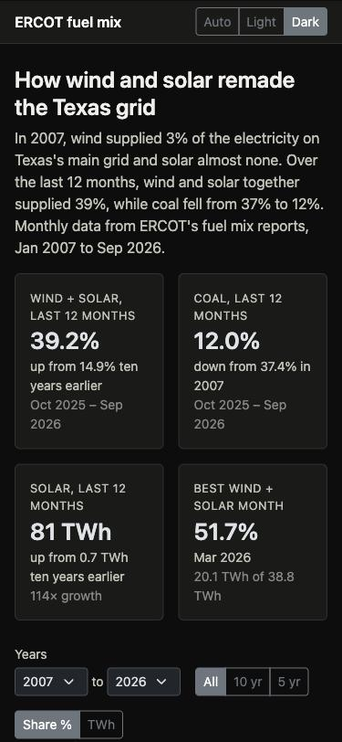

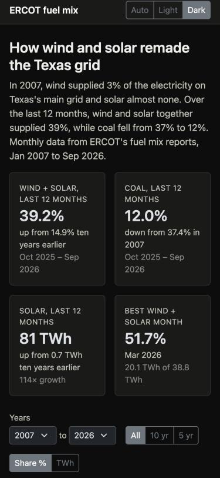

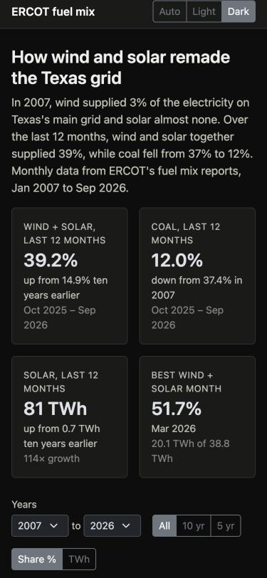

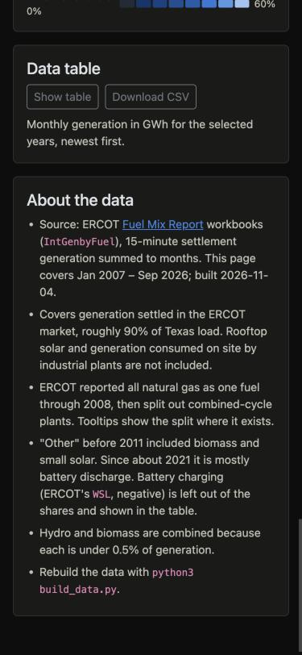


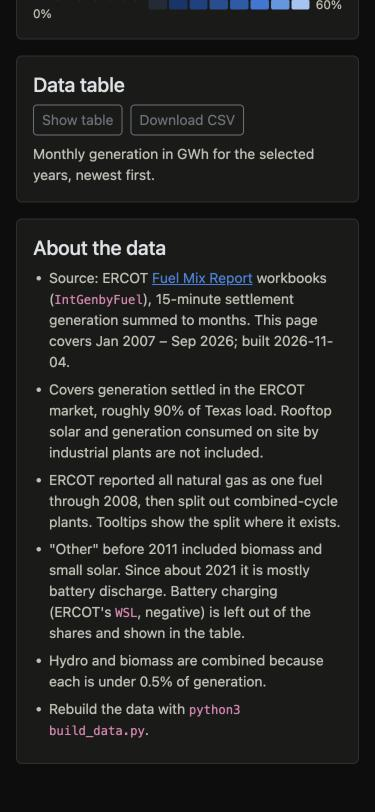

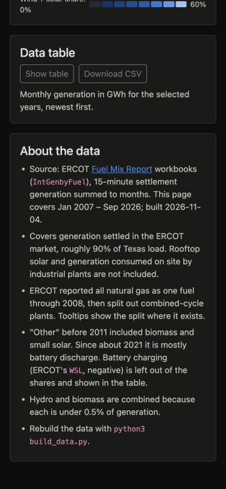

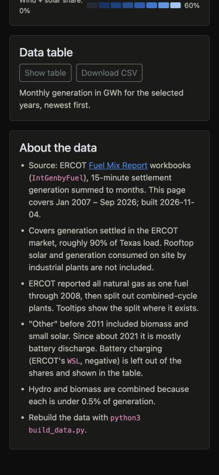

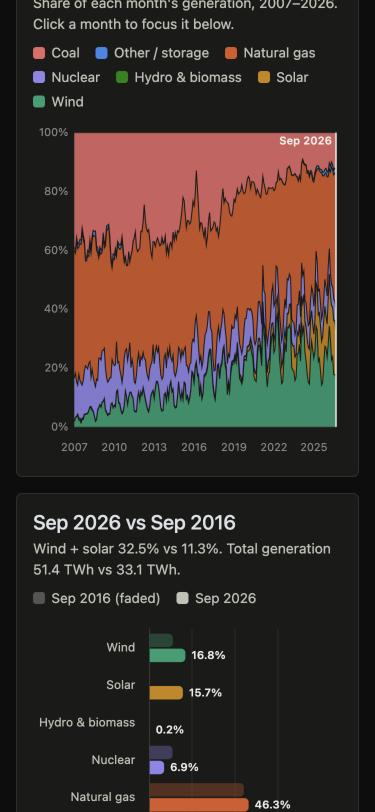

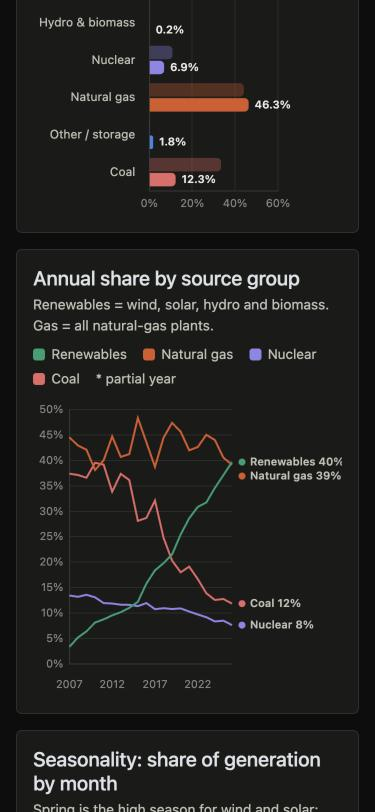

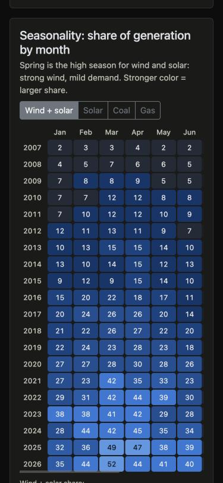

Mobile layout good; fixing a clipped line label, then testing hover/click.

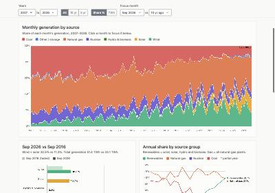

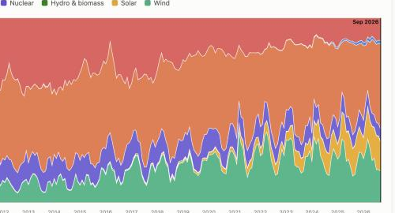

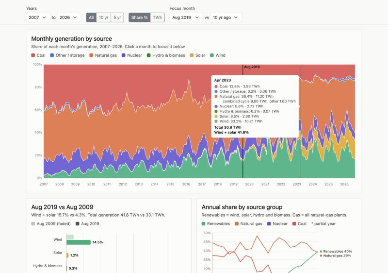

Hover tooltip, focus marker and click-to-focus all work. Adding landing-page card next.

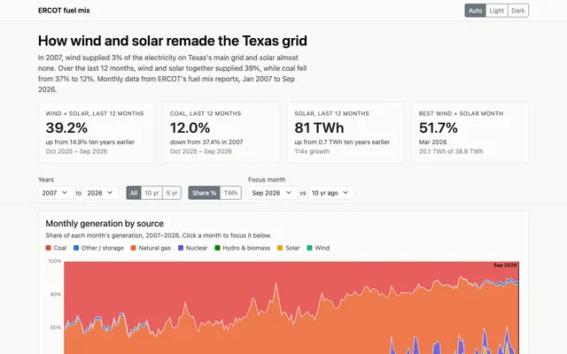

Now landing card, then prompt.md.

The page is built in [ercot-renewables-opus-5.5-high/](ercot-renewables-opus-5.5-high/index.html) and shows ERCOT generation by fuel for every month from Jan 2007 to Sep 2026, which is a bit more than the 10 years you asked for. I checked it in the browser at desktop and phone widths, in light and dark mode, with no console errors.

**Data.** It comes from ERCOT's own Fuel Mix Report workbooks, which give generation by fuel in 15-minute steps; [build_data.py](ercot-renewables-opus-5.5-high/build_data.py) downloads them and adds them up into monthly totals. Over the years ERCOT changed the sheet layouts and fuel names, and the script handles all the versions. Every month from 2007 on is complete. The yearly shares match ERCOT's published figures (2024: wind 24%, solar 10%, coal 13%).

**What's on the page** (Bootstrap 5.3 for layout, Chart.js 4.4 for charts):
- **Headline numbers:** wind + solar supplied 39.2% of generation over the last 12 months, up from 14.9% ten years earlier. Coal fell from 37.4% in 2007 to 12.0%, and the best month so far was 51.7% wind + solar (Mar 2026).
- **Monthly generation by source:** a stacked chart that switches between share (%) and TWh. Hovering shows each month's numbers, and clicking a month picks it for the comparison chart below.
- **Month comparison:** one month next to the same month 1, 5, 10 or 15 years earlier.
- **Yearly share:** lines for renewables, natural gas, nuclear and coal, labelled at their right-hand ends.
- **Seasonal grid:** year × month, coloured by wind + solar, solar, coal or gas share. Spring stands out every year.
- **Data table** of the monthly figures in GWh, plus a CSV download of the full dataset.
- A year-range picker (all / 10 yr / 5 yr) applies to every chart, and the theme follows your system with a manual light/dark switch.

**Data caveats** (also listed on the page):
- ERCOT reported all natural gas as a single fuel before 2009.
- Since about 2021, "Other" is mostly battery discharge. Battery charging is left out of the percentages but appears in the table.
- The data only covers the ERCOT market (about 90% of Texas). Rooftop solar isn't included.

**Also changed:**
- Added a card to the root `index.html` and a preview image in `screenshots/projects/`.
- Added an `ercot-renewables-opus` dev-server entry (port 8815) to `.claude/launch.json`.
- Generated `prompt.md` with 26 screenshots; tokscale puts the cost at about $3.69.

## You

Commit the working tree changes with a sensible message.

## Claude

Other sessions' work (prismine, GPT ERCOT demo) also uncommitted; staging only this demo's hunks.

Committed as `75fa185` on master. Nothing pushed.

Message:
```
Add ERCOT renewables transition explorer (Opus 5.5 high)
```

Commit contains only this demo:
- `ercot-renewables-opus-5.5-high/`, with prompt.md and its screenshots
- landing-page preview image
- one `index.html` card line
- one `launch.json` entry

Other sessions' work still sits uncommitted, so I left it out:
- `ercot-renewables-gpt-6.1-sol-high/` and its screenshot
- `screenshots/games/prismine-opus-5.5-high.webp`
- their lines in `index.html` and `.claude/launch.json`

## You

Can we add to this something that shows the flattening of the "duck curve"? This might require getting more granular data. We only need to go back to at most 2022, since battery storage in Texas is still very recent.

Basically, I want to see a chart that shows daily average power usage - maybe we want monthly or seasonal toggles - a line chart with the horizonal axis being time of day, and the vertical being total usage, and then one series per year.

## Claude

Status: found 15-min interval data already in ERCOT fuel-mix workbooks (batteries show up as "Other" discharge + "WSL" charging). Building per-month time-of-day profiles for 2022+ now.

Profiles built (2022-01 to 2026-09, 110 KB). Sanity-checking battery numbers before wiring chart.

Battery numbers check out (Aug discharge peak 0.2 GW in 2022, 9.9 GW in 2026). Now wiring chart into page.

Colors validated (ordinal blue ramp, newest year darkest in light / brightest in dark). Adding the card now.

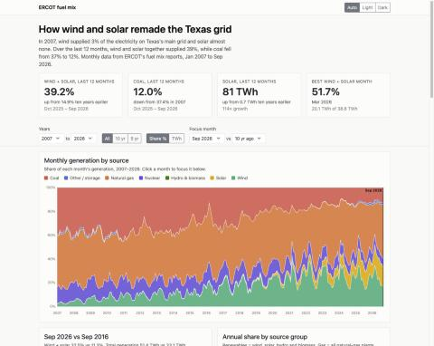

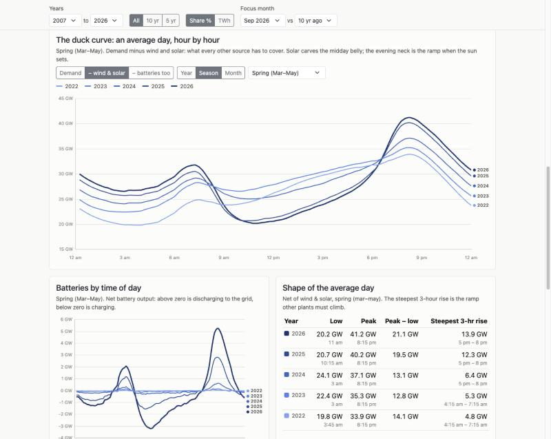

Chart renders. Checking "minus batteries" view, hover, and summer.


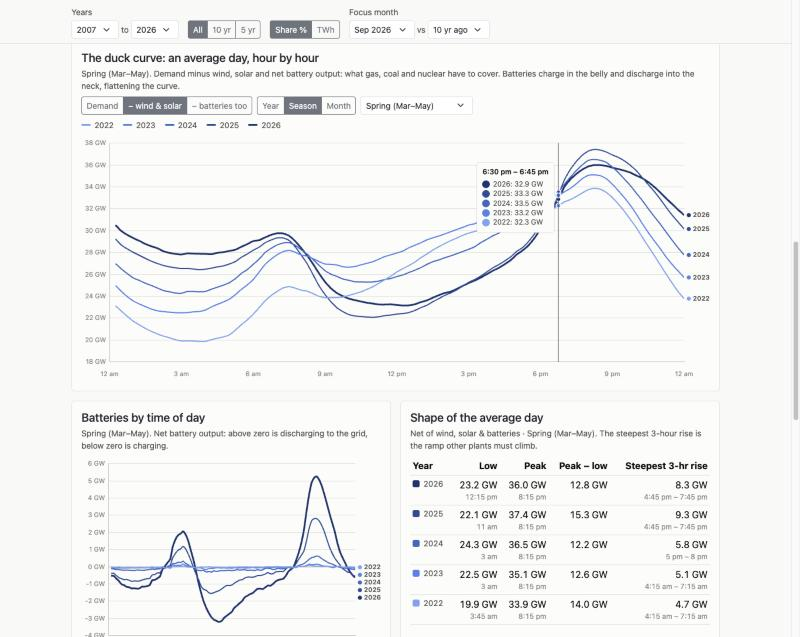

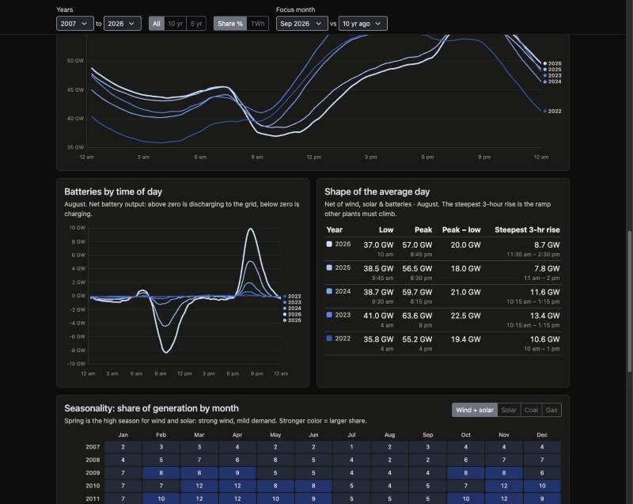

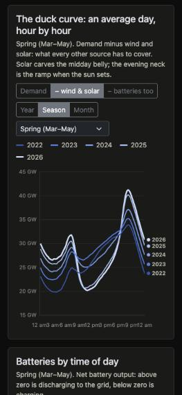

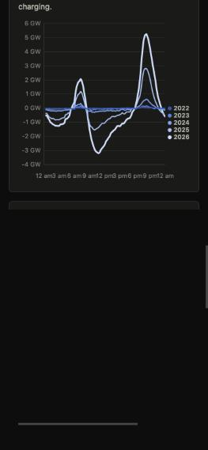

Desktop, dark mode and toggles all work. Fixing crowded time labels on phone width.

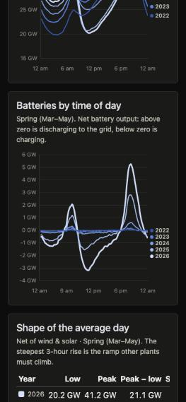

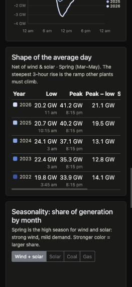

Mobile good now. Final desktop check, then update landing-page blurb and prompt.md.

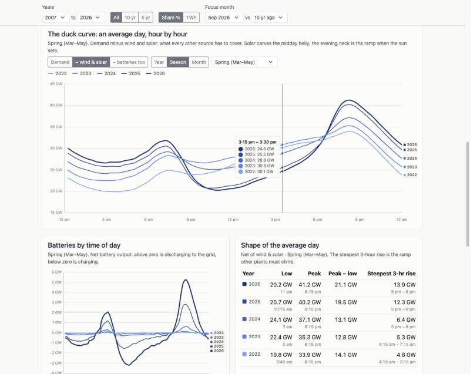

I added the duck curve section to the ERCOT page. No new download was needed: the workbooks I was already using have 15-minute data, and batteries show up in them as "Other" (discharging) and "WSL" (charging). It works at desktop and phone widths, in light and dark mode, with no console errors. Nothing is committed yet.

**Main chart:** time of day on the x-axis, power in GW on the y-axis, one line per year from 2022 to 2026. Older years are lighter, and the newest is darker in light mode or brighter in dark mode.
- **Period:** Year, Season or Month. Season and Month each get a dropdown.
- **Three views:**
  - **Demand:** the chart you described. On its own it doesn't show the duck much.
  - **Minus wind & solar:** the classic duck curve. It opens on this view, set to Spring.
  - **Minus batteries too:** what gas, coal and nuclear still have to cover. This is where the flattening shows.
- **Missing years:** a year only appears when every month of the period has data. The data ends in Sep 2026, so 2026 is left out of Fall and Year, and the subtitle says so.
- **Seasons:** each season uses months from one calendar year, so winter is Jan, Feb and Dec of the same year.

**Below it:**
- **Batteries by time of day:** net battery output per year, charging below zero and discharging above. In August the evening discharge peak goes from 0.2 GW in 2022 to about 10 GW in 2026.
- **Shape of the average day:** a table giving each year's low, peak, peak minus low, and steepest 3-hour rise, each with its time. In Spring 2026 the evening ramp is 13.9 GW net of wind and solar, and 8.3 GW once batteries are taken out.

**Files:**
- `build_data.py` now also writes `profiles.js`: the average for each 15-minute slot, per month, from 2022 on (110 KB).
- `app.js` and `index.html` have the new section, plus a note on the method under "About the data".
- In `demos.js` I changed only this demo's description. Another session's Tarrant line is also uncommitted there, and I left it alone.
- `prompt.md` is regenerated; the estimated cost is now $6.21.

## You

Commit it

## Claude

Committed as `92d7c04` on master: "Add duck curve view to ERCOT renewables explorer". Not pushed.

Commit has:
- All changes in `ercot-renewables-opus-5.5-high/`: build script, the new `profiles.js`, page, JS, `prompt.md` (refreshed first) and 10 new screenshots.
- Only this demo's description line in `demos.js`.

Left uncommitted, from another session: its Tarrant line in `demos.js` and the `tarrant-judicial-rolloff/` folder.

## You

Lets do this.... lets focus just on the demand curve. Produce an annotated animation showing what all of this means.

## Claude

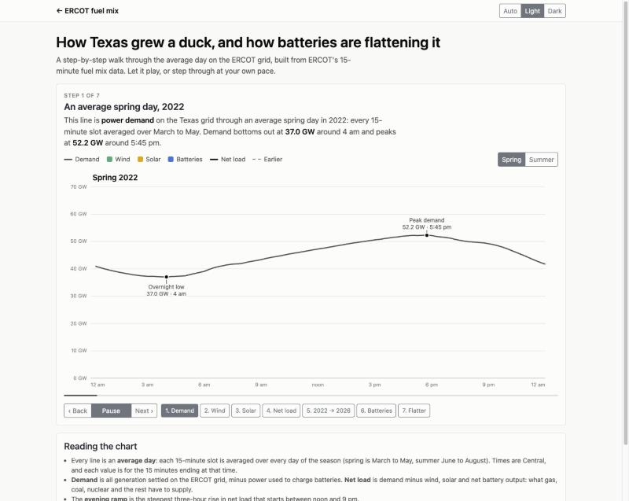

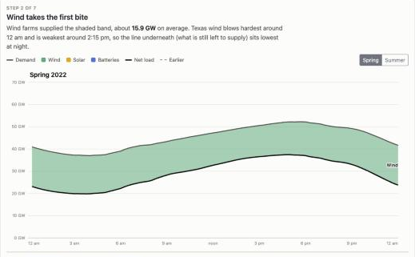

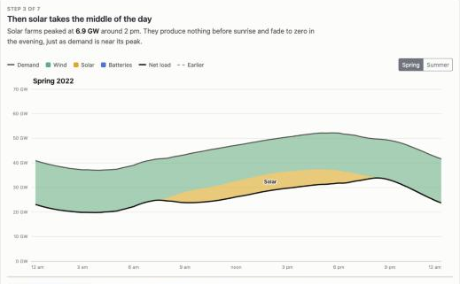

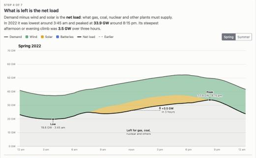

Story scenes 1–4 render correctly. Checking 5–7 now, after fixing where the wind label sits.

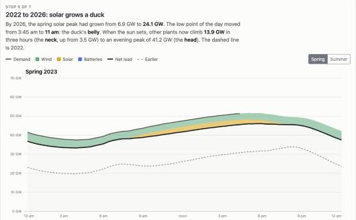

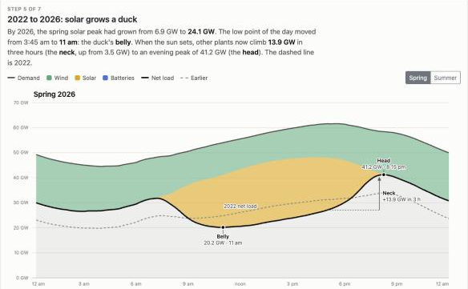

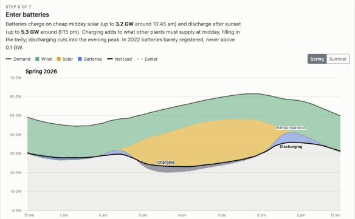

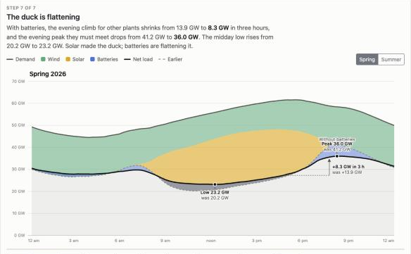

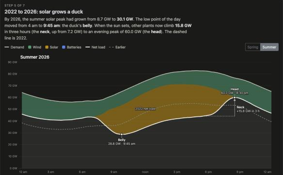

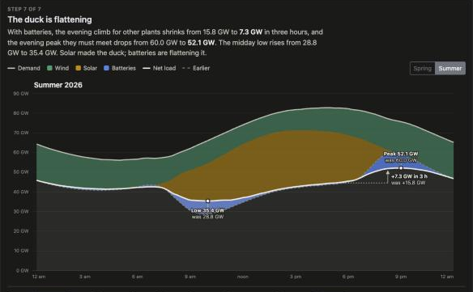

Summer and dark mode work. Checking phone width.

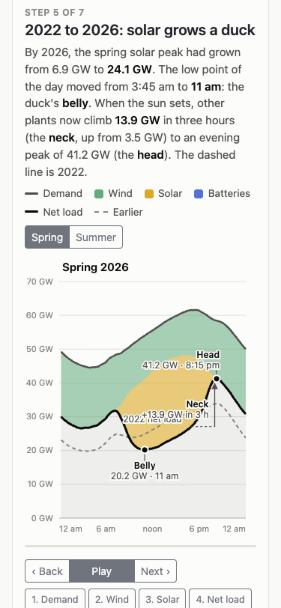

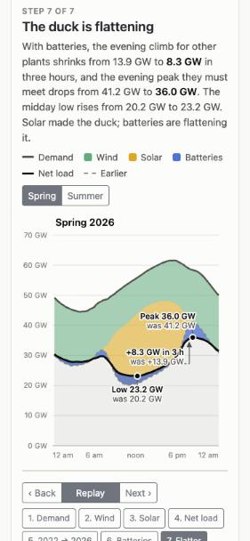

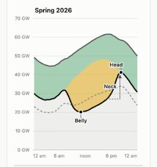

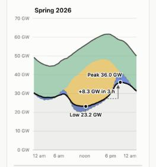

Phone layout clean now. Checking that autoplay advances and pause holds.

Autoplay, pause and resume all behave. Linking it in.

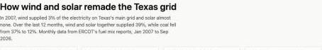

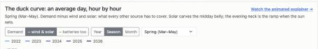

I built the animated explainer as a new page: `ercot-renewables-opus-5.5-high/duck.html`. It walks through the demand curve in 7 annotated steps, playing on its own with Back, Pause and Next buttons, a progress bar, and buttons to jump to any step. I checked it at desktop and phone widths, in light and dark mode, and confirmed autoplay advances and pause/resume hold. Nothing is committed yet.

The steps, using spring numbers:
1. **Demand in 2022:** the line draws itself in, with the overnight low (37.0 GW, 4 am) and the peak (52.2 GW, 5:45 pm) labelled.
2. **Wind:** a band peels off the top. Wind is strongest at night.
3. **Solar:** a midday bite out of what's left, peaking at 6.9 GW.
4. **Net load:** the shaded area left over is what gas, coal and nuclear must supply. It shows its low, its peak and the evening ramp (+3.5 GW in 3 hours).
5. **2022 → 2026:** the curve morphs year by year while the year label counts up, with 2022 kept as a dashed line. The low point moves from 3:45 am to 11 am, and the parts are labelled **belly**, **neck** (+13.9 GW in 3 hours) and **head** (41.2 GW).
6. **Batteries:** a blue band shows charging at midday (3.2 GW) and discharging in the evening (5.3 GW). A dashed line shows the curve without batteries.
7. **Flatter:** the evening ramp drops from 13.9 to 8.3 GW, the peak from 41.2 to 36.0 GW, and the midday low rises from 20.2 to 23.2 GW.

- **Summer:** there's a Spring/Summer switch, and all the text comes from the data. Batteries matter even more in summer: the ramp falls from 15.8 to 7.3 GW, and the peak from 60.0 to 52.1 GW.
- **Phones:** the chart shows only short labels; the full numbers are in the text above it.
- **Reduced motion:** if the device asks for it, the page doesn't autoplay and steps change without animating.
- **Library:** I used D3 7.9.0 for the animation and Bootstrap for the layout. The page shares the light/dark setting with the main page.

The explorer's duck curve card now links to it ("Watch the animated explainer →"), and so does the landing-page card in `demos.js`. I regenerated `prompt.md`; the estimated cost is now $8.41.

## You

Commit it

## Claude

Committed as `abc87bf` on master: "Add animated duck curve explainer to ERCOT renewables demo". Not pushed.

The commit includes:
- `duck.html` and `duck.js`, the new explainer page
- the explainer link added to the explorer page
- `prompt.md`, refreshed first, plus its new screenshots
- in `demos.js`, only the new "duck curve explainer" link

Left uncommitted, from another session: its Tarrant line in `demos.js` and the `tarrant-judicial-rolloff/` folder.

## You

Lets add a voiceover. I have voicebox running locally at `http://127.0.0.1:17493`. Use the `Heart` voice. Make the voiceover optional. Compress as opus, mono, voice profile.

## Claude

Voicebox has a `Heart` preset on the kokoro engine, and ffmpeg has libopus. Testing how it reads times and numbers first.

Voicebox works: about 11 s to render 14 s of speech, and 24 kbps Opus is about 44 KB per clip. Writing the narration builder.

Fourteen clips, 888 KB in total, mono Opus at 24 kbps. Wiring the optional voiceover into playback.

Voiceover plays and drives the progress bar. Checking that pause holds and the next step starts when the clip ends.

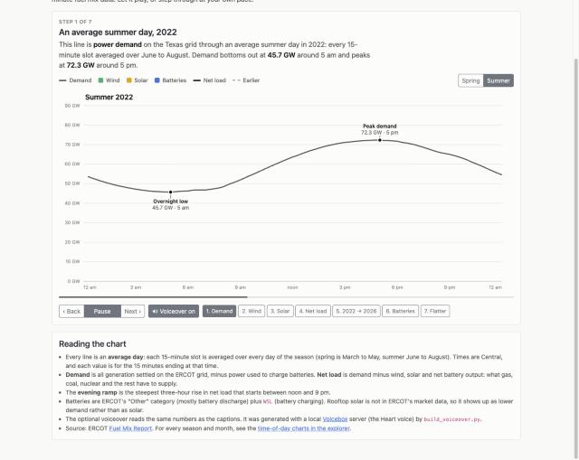

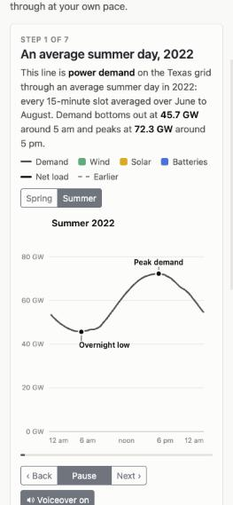

The explainer now has an optional voiceover in the Heart voice. It's off by default and turned on with the "Voiceover" button next to Back / Pause / Next. I tested it in the built-in browser (Chromium) only; I haven't tried Safari. I also couldn't listen to the clips, so how Heart pronounces the times (like "5:45") and the decimals is unchecked. Nothing is committed yet.

**Audio:**
- 14 clips: 7 steps, for spring and for summer.
- 13–28 seconds each, about 2.5 minutes of narration per season.
- 888 KB in total, in `voiceover/`.
- Encoded as you asked: Opus, mono, 24 kbps, with ffmpeg's speech (VoIP) setting, in `.webm` files.

**Script:** the narration is written for listening rather than read from the captions. Numbers are rounded ("about 14 gigawatts") and times are spoken ("5:45 in the evening"). The figures come from the same averages the chart uses.

**How it plays:**
- Turning it on starts playback from the beginning of the current step's clip.
- While it's on, each step moves on a moment after its clip ends, and the progress bar follows the audio.
- Pause and Play pause and resume the audio. Back, Next, the step buttons and the Spring/Summer switch all change the clip.
- Turning it off goes back to the timed captions.
- If the browser can't play the audio, the button changes to "Voiceover unavailable" and the page carries on silently.

**To rebuild:** `python3 build_voiceover.py` calls Voicebox at `127.0.0.1:17493` and deletes each generation from Voicebox's history after downloading it. Re-run it after `build_data.py` so the spoken numbers stay in sync with the data.

**Other changes:** I added a credit line to "Reading the chart" that links to Voicebox, and regenerated `prompt.md` (the estimated cost is now $10.26).

## You

Commit it

## Claude

Committed as `c967593` on master: "Add optional voiceover to the ERCOT duck curve explainer". Not pushed.

Commit has only this demo's files:
- `build_voiceover.py`
- the 14 `.webm` clips and `voiceover/voiceover.js` in `voiceover/`
- the updated `duck.html` and `duck.js`
- `prompt.md`, refreshed first, plus its screenshots

Left uncommitted, from other sessions: the Tarrant line in `demos.js`, edits in `tarrant-2026/`, and the `tarrant-judicial-rolloff/` folder.

## You

Is there anything we can do to add a chart that shows the cost of electricity over the past N years? Especially if there is a way to show it as a time-of-day?

## Claude

Yes, both are possible, using ERCOT's wholesale prices. These come from the same site as the fuel mix data, are free, and need no login:

| Report | Detail | Years | Size |
|---|---|---|---|
| Day-ahead market prices | hourly | 2010–2026 | about 2 MB per year |
| Real-time market prices | 15-minute | 2010–2026 | about 14 MB per year |

Both cover the trading hubs, including the hub average (`HB_HUBAVG`), and the load zones (Houston, North, South, West, Austin, San Antonio and others).

**Quick test, spring 2025, day-ahead hub average, average $/MWh by hour:**

```
12am $28 · 4am $24 · 7am $35 · 11am $17 · 2pm $21 · 6pm $33 · 8pm $80 · 9pm $77 · 11pm $40
```

That's the duck again, this time in price: power is cheapest at midday when solar floods the grid, and most expensive around 8 pm when solar fades and other plants have to ramp up. That gap is the money batteries earn by charging at midday and discharging in the evening.

**What I'd build in the explorer:**
1. **Monthly wholesale price, 2011–now.** I'd show the median next to the mean, because scarcity spikes skew the average. February 2021 (Winter Storm Uri) had days stuck at the $9,000/MWh price cap and would flatten everything else, so it gets an annotation and the chart caps its scale.
2. **Price by time of day, one line per year from 2022.** Same Year / Season / Month toggles as the duck chart, so the two can be read together. This one should show the midday price falling and the evening peak shifting.

Prices and gigawatts stay on separate charts; I wouldn't put both on one chart with two axes.

**Caveat:** these are wholesale prices, not what households pay. Retail rates in Texas (EIA's monthly residential cents per kWh) need a free EIA API key, and they have no time-of-day detail because most Texas retail plans charge a flat rate. Retail could be a third chart later if you get a key.

I'd use the day-ahead prices for both charts: hourly is fine-grained enough for a time-of-day curve, and the files are a seventh the size of the real-time ones.

## You

Build both

## Claude


Both price charts are verified at phone width too. Updating the landing-page blurb and prompt.md.
