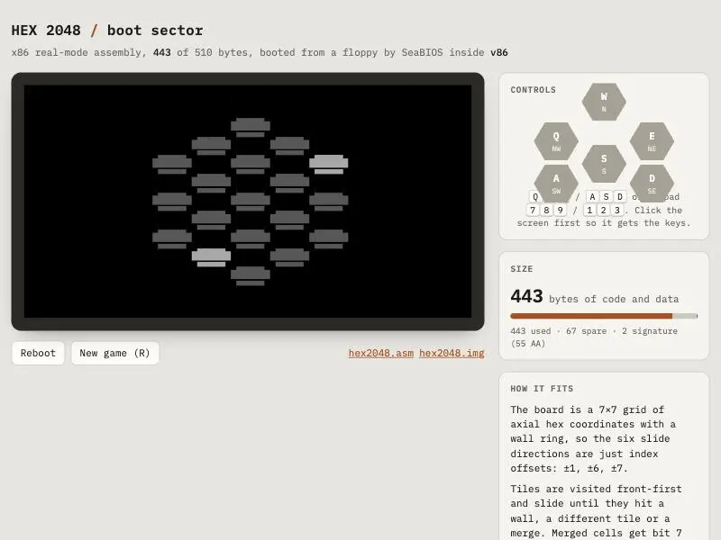
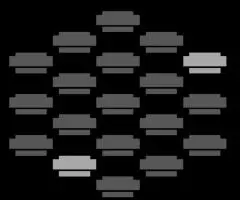
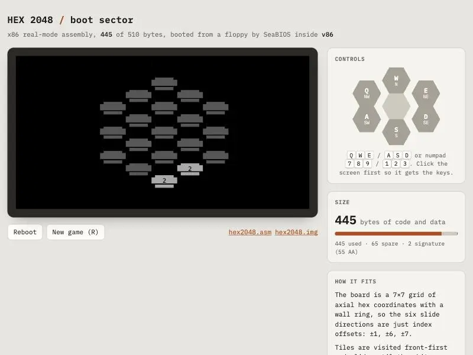
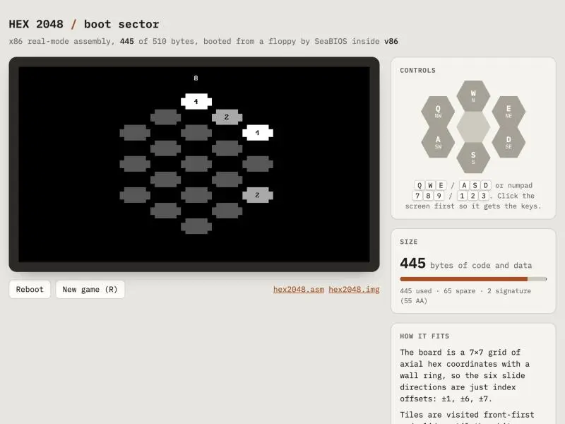
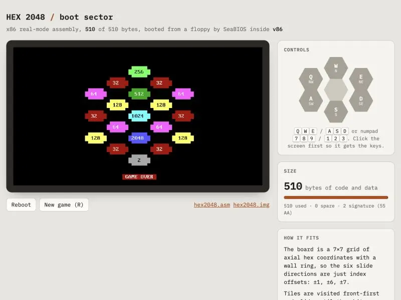
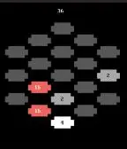
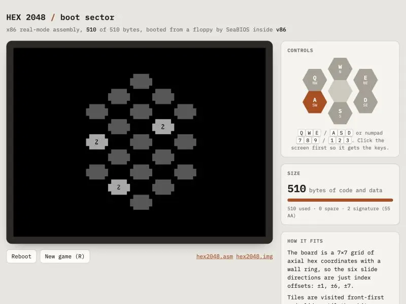
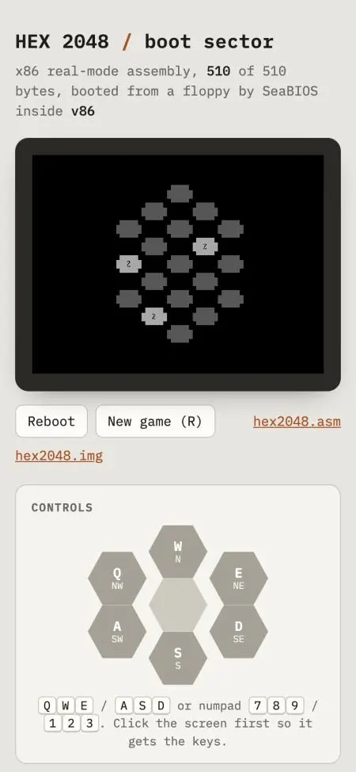
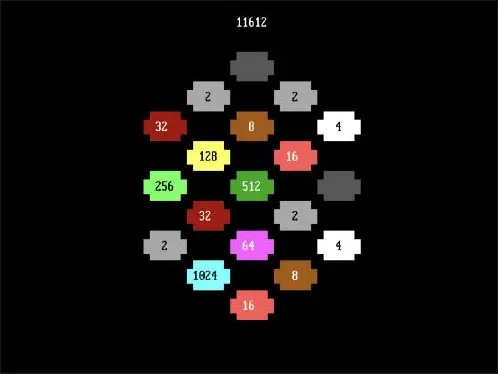

# Prompts

- **Model:** claude-opus-5-5
- **Effort:** medium
- **Session(s):** 0eb928f4-9e2e-48b0-a967-f0291aa1adea
- **Tokens:** input 76, output 49736, cache read 4641624, cache write 115364
- **Cost (tokscale estimate):** $2.85

## You

lets do another hex 2048 demo. write something in x86 asm, that can fit within a 512 byte bootloader. ru it inside an emulator in the browser

## Claude

Boot sector assembles: 443 of 510 bytes used. Next: browser page with v86 emulator.

Page up on localhost:8791. Checking it boots.

Numbers render now. Switching v86 to real VGA-font canvas so half-blocks join into hexes.

Game plays: moves, merges, score (8). Using spare bytes for game-over detection, plus 4:3 CRT aspect on page.

Exactly 510 bytes now, zero slack. Testing game over by poking a near-full board into RAM.

Game over works, every tile color shows. Checking merge order (2,2,2 → 4 at front, 2 behind) and R restart.

Merges correct (2,2,2 → 2,4; 8,8,8,8 → 16,16), score 36 matches. Now 4:3 aspect and mobile check.

Desktop and phone layouts both fine. Adding landing card + screenshot.

I built the hex 2048 boot sector. It is exactly 510 bytes of x86 code and data plus the `55 AA` signature, with 0 bytes to spare. The page boots it from a floppy image with SeaBIOS inside v86 at `localhost:8791`. I played it in the browser and moves, merges, score, game over and restart all work.

**Program** ([hex2048.asm](games/2048-boot-opus-5.5/hex2048.asm))
- **Board:** 19 cells stored in a 7×7 grid of hex coordinates with a ring of wall cells around them. That makes the six slide directions fixed jumps in the array: ±1, ±6, ±7.
- **Sliding:** tiles are moved front-first. Bit 7 marks a tile that has already merged this move so it can't merge twice, and the redraw clears it. I checked this in the browser: three 2s slide to 4 and 2, and four 8s slide to 16 and 16.
- **Drawing:** 80×25 colour text mode. Each hex is three rows: `▄▄▄▄▄`, a coloured face with the number centred, then `▀▀▀▀▀`. Blink is switched off so the faces can use bright background colours.
- **Controls:** QWE/ASD, or numpad 7 8 9 / 1 2 3. R reboots the program, which also clears the screen.
- **Game over:** it ends when no cell is empty and no two neighbours match. I tested this by writing a nearly full board straight into memory.

**Page** ([index.html](games/2048-boot-opus-5.5/index.html))
- v86 renders the screen with the real VGA font, shown at the 4:3 shape of an old monitor.
- There's a clickable hex pad for the six directions, a bar showing how many bytes are used, and a hex dump of all 512 bytes.
- The page works at phone width.

**Repo changes**
- I installed `nasm` with Homebrew to build it.
- v86 and the two BIOS files (about 2.4 MB) are copied into the demo's `v86/` folder.
- Added a landing card in `demos.js`, the screenshot `screenshots/games/2048-boot-opus-5.5.webp`, a `2048-boot` entry in `.claude/launch.json`, and `prompt.md` with its `prompt-assets/` folder.

`prompt.md` was generated before this final reply, so it doesn't include it; I'll re-run the script before committing so it does.

## You

Commit the working tree changes with a sensible message.
