# Prompts

- **Model:** claude-fable-5-2
- **Effort:** medium
- **Session(s):** 87751557-64de-4e72-b82f-bca486992149
- **Tokens:** input 54, output 86828, cache read 4610606, cache write 171395
- **Cost (tokscale estimate):** $7.14

## You

Build me a game of 2048, but on a hexagonal grid. Let store this in games/2048-fable-5.2-medium-all-out.

Platform: Runnable as a browser-based game.

Look at all of the other hex-2048 games. Take the best features from them, and make them even better.

One observation - having the hex oriented such that there are points to the top and bottom of the screen, as opposed to flat on the top and bottom, tends to have a better control style, like `2048-opus-5.5-max`.

Go all out, I am really interested in seeing how well this can be designed.

Feel free to ask a few questions.

## Claude

Engine written. Now bot tuning run in background while writing UI.

Markup done. Stylesheet next, then app logic.

Engine verified (replay, link codec, save/restore all deterministic). Rush mode changed to real clock, since bot sims showed move-limited scores barely vary. Writing app logic now.

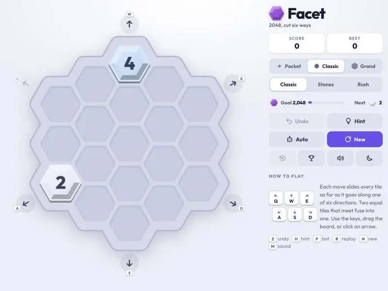

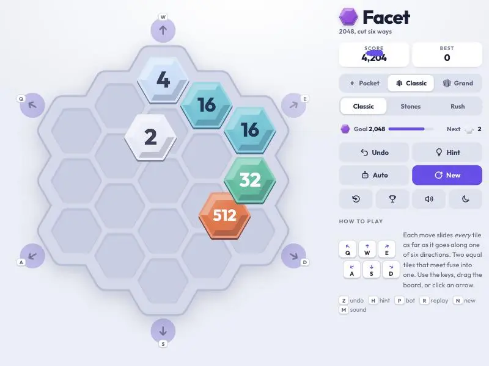

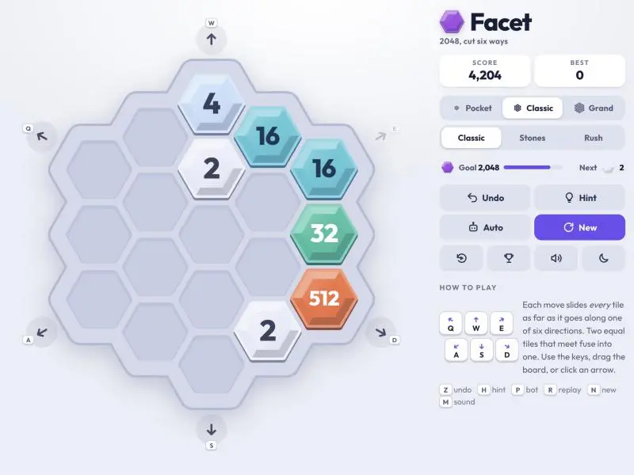

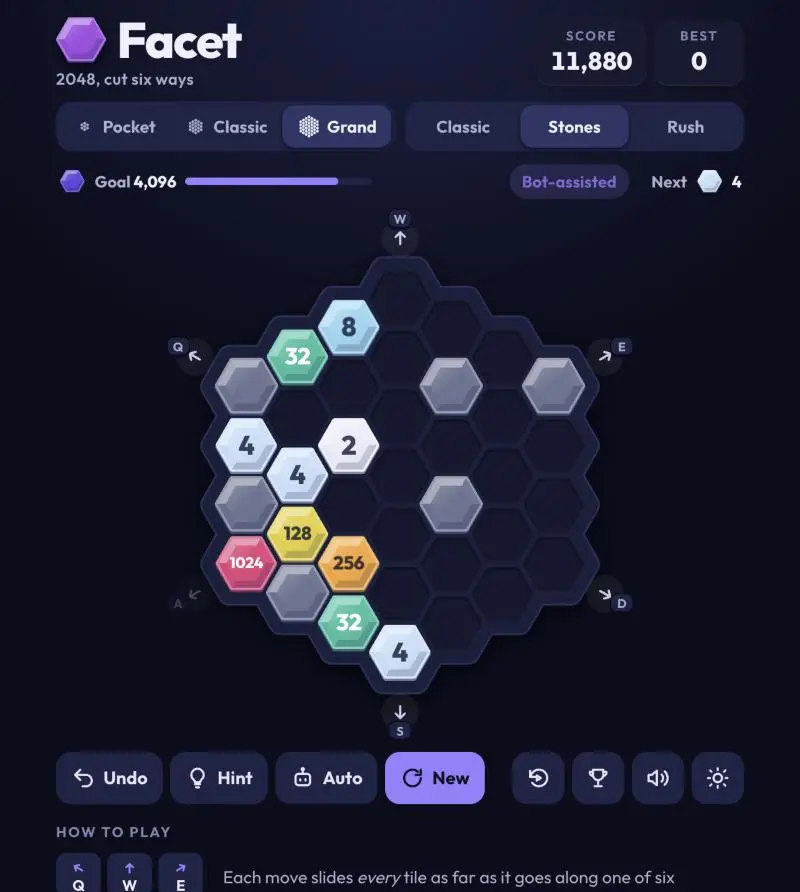

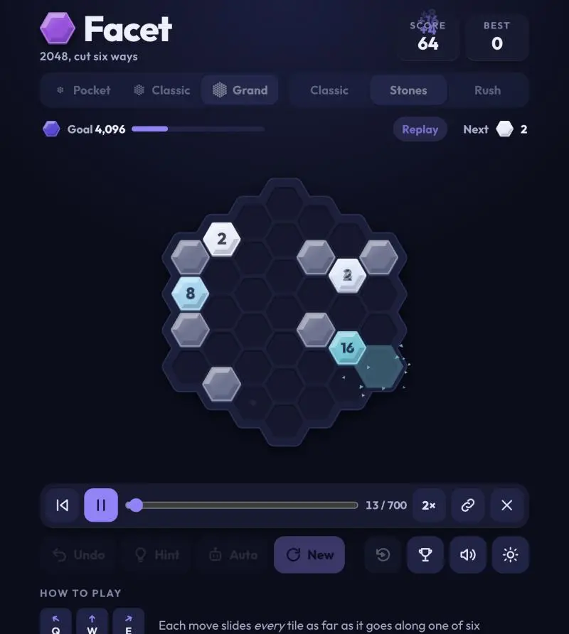

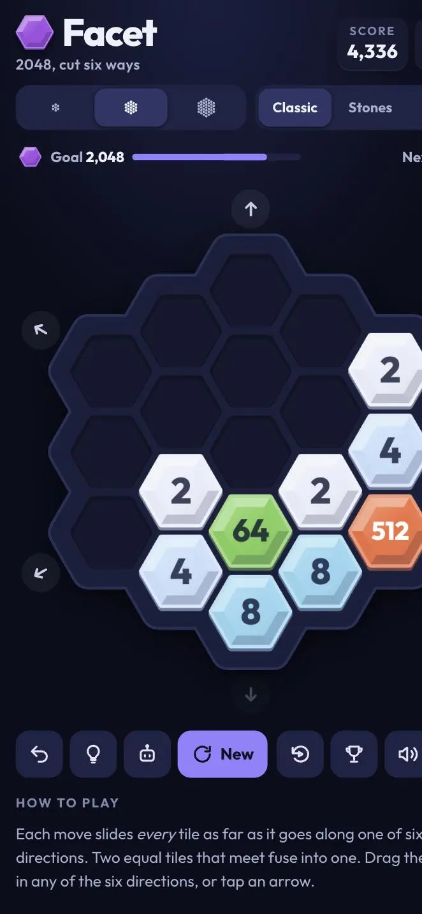

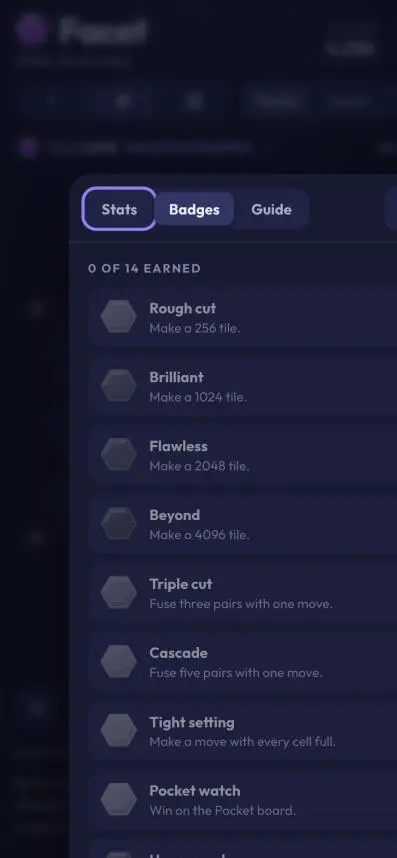

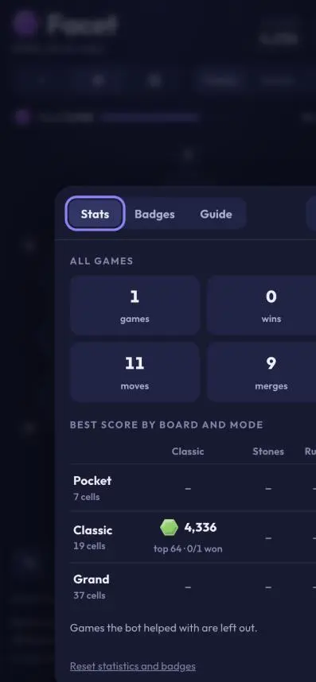

Core game, dark theme, Stones, replay, stats sheet all render. Checking phone layout metrics and drag input next.

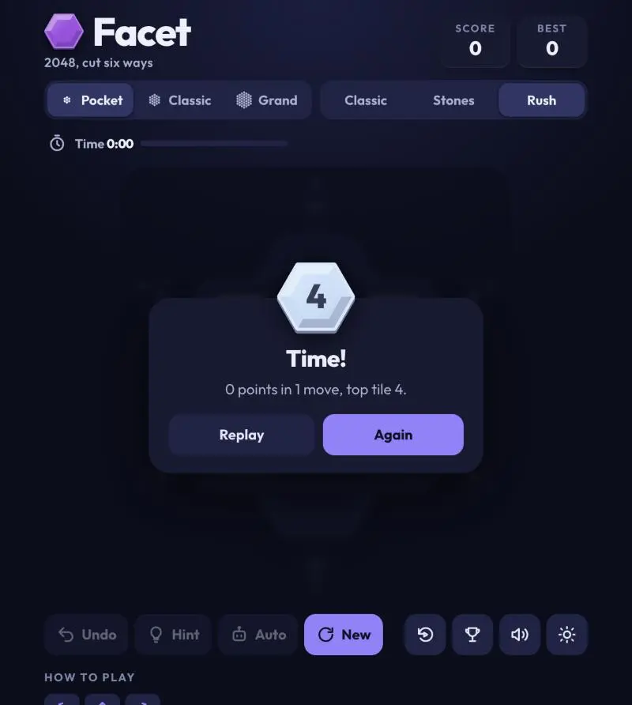

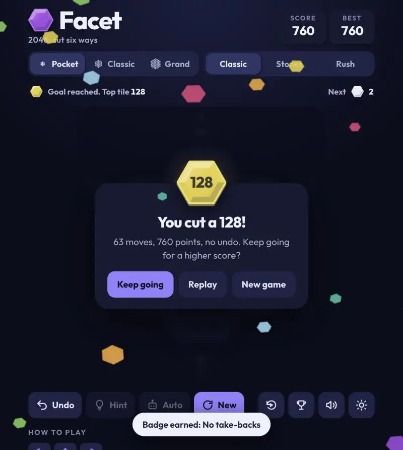

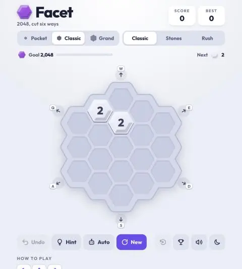

Game verified end to end. Final look check, then prompt.md.

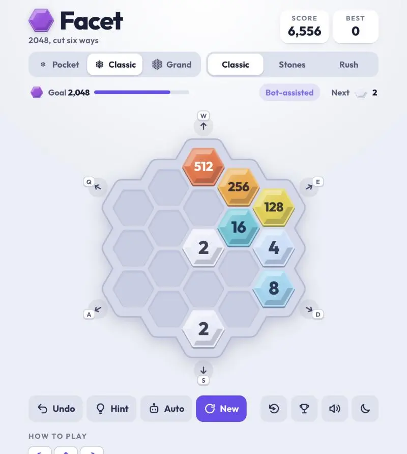

Built **Facet**: [games/2048-fable-5.2-medium-all-out/index.html](games/2048-fable-5.2-medium-all-out/index.html). Running in Browser pane on `localhost:8802` (launch config `facet-hex-2048`). No libraries needed in the end, only a Google font with system fallback.

**Kept from `2048-opus-5.5-max`**
- Board standing on a point, Q W E / A S D cluster, numpad and U I O / J K L alternates.
- Unlimited undo with seeded tile spawns, so undo never re-rolls.
- Expectimax hint, synth sound, light/dark theme, win confetti, blocked-arrow fading.

**Made better or new**
- **Drag-follow tiles:** tiles slide under finger toward where move would put them. Drag back to cancel.
- **Look:** cut-gem tiles with lit facets, spectrum palette, shard particles on merges.
- **Boards:** Pocket (7 cells, goal 128), Classic (19, goal 2048), Grand (37, goal 4096).
- **Modes:** Classic, Stones (fixed blocker cells, new each game), Rush (clock: 45 / 90 / 120 s).
- **Bot autoplay:** three speeds. Bot games marked "Bot-assisted" and excluded from bests and badges.
- **Replay:** any game plays back from move one, with scrubber, speed and copyable link.
- **Stats + badges:** best score and top tile per board and mode, totals, 14 badges.
- **Next-tile chip**, goal progress meter, "Sure?" confirm before discarding game in progress.

**Decisions worth knowing**
- Rush was first move-limited. Bot sims showed scores barely vary with skill that way (about 1,110 every game), so switched to real clock.
- Bot almost never loses on Grand, so its 4096 goal is set by game length, not difficulty.
- Stones goals (64 / 2048 / 4096) and "Quick hands" badge threshold (2,500 in Classic Rush) are estimates, not tuned by human play.

**Verified:** engine self-test (replay, link codec, save/restore on all 9 board/mode combos), then in browser: moves, drag commit and cancel, Rush expiry, win card, badges, replay from link, stats sheet, both themes. Phone layout checked by element bounds only (no overflow); emulated screenshot was cropped. Not tested on real touch device, and sound/haptics not heard.

**Also changed:** [demos.js](demos.js) entry (no screenshot image yet), [.claude/launch.json](.claude/launch.json), `prompt.md` + `prompt-assets/` generated (cost shown: $6.89). `prompt.md` lacks this final reply; re-run `scripts/prompt-md.sh` before committing if wanted complete.

## You

Commit the working tree changes with a sensible message.
