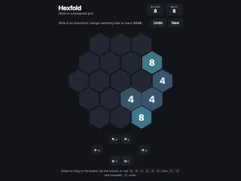
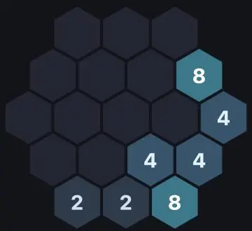
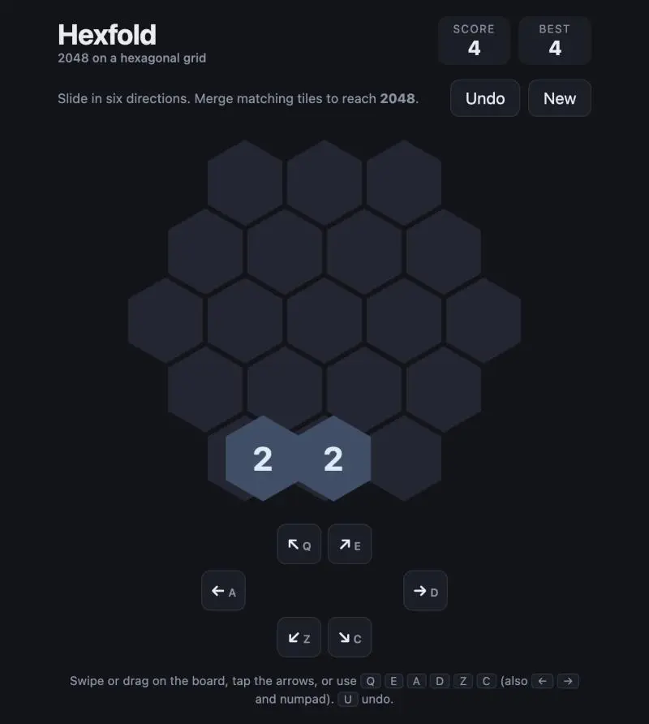
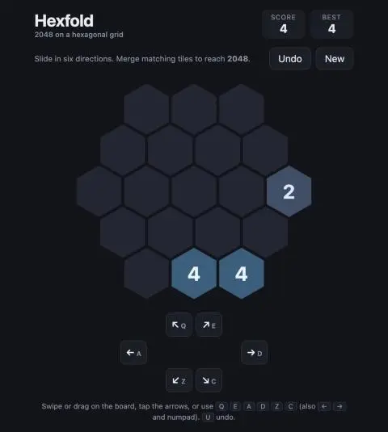

# Prompts

- **Model:** claude-fable-5-2
- **Effort:** medium
- **Session(s):** be50c01b-945c-4222-af3d-cc7e8de8647c
- **Tokens:** input 32, output 18310, cache read 1449578, cache write 56674
- **Cost (tokscale estimate):** $1.93

## You

Build me a game of 2048, but on a hexagonal grid. Let store this in games/2048-fable-5.2-medium.

Platform: Runnable as a browser-based game.

Do not look in this repository for prior art, work on this in isolation.

## Claude

Game file written. Now checking it in browser.

Game built: [games/2048-fable-5.2-medium/index.html](games/2048-fable-5.2-medium/index.html). Single file, no dependencies. Titled "Hexfold".

**Game**
- 19-cell hex grid (radius 2), pointy-top hexes, six slide directions.
- Standard rules: tiles slide until blocked, equal pair merge once per move, new 2 (90%) or 4 (10%) spawn after each move.
- Win overlay at 2048 with "Keep going"; game-over when board full and no adjacent equal pair.
- One-step undo, score, best score, game saved in `localStorage`.

**Controls**
- Keys: `Q` `E` `A` `D` `Z` `C`, also `←` `→`, numpad `7 9 4 6 1 3`, `U` undo.
- Swipe or mouse drag on board, snapped to nearest of six directions.
- On-screen arrow buttons.

**Verified in browser**
- Slide and merge logic correct on hand-built board (row `2 2 2 2 4` slid east gives `4 4 4`, score 8).
- Keyboard moves, score display, tile render work; no console errors.
- Not exercised: swipe/drag input, win overlay, game-over overlay.

**Repo**
- Entry added to [demos.js](demos.js) in games section. No thumbnail image, so card shows text fallback.
- `prompt.md` not generated yet.
- Nothing committed.

## You

Yes, write prompt.md

## Claude

[prompt.md](games/2048-fable-5.2-medium/prompt.md) written.

- Model `claude-fable-5-2`, effort medium, cost $1.76 (tokscale estimate, available).
- Four screenshots saved in `games/2048-fable-5.2-medium/prompt-assets/`.
- Only this demo's prompts in transcript, nothing dropped.
- Transcript ends at "Yes, write prompt.md"; this reply not included. Re-run script if more prompts follow.
- [demos.js](demos.js) card now has prompt link. Link change not checked in browser.
- Nothing committed.

## You

Commit the working tree changes with a sensible message.
