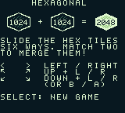
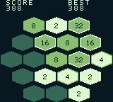
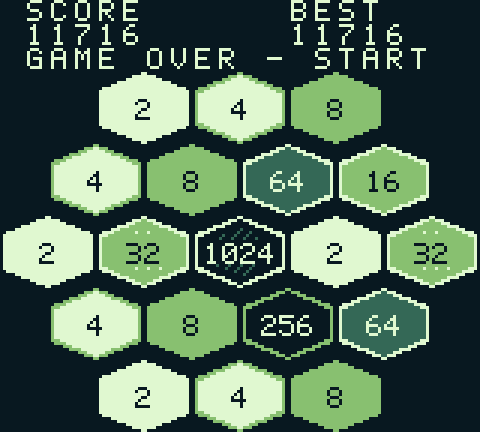
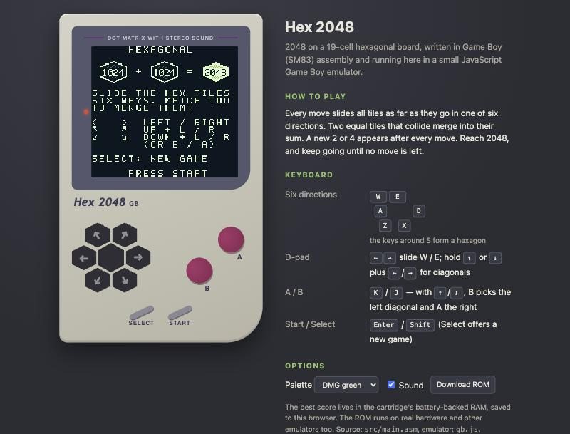
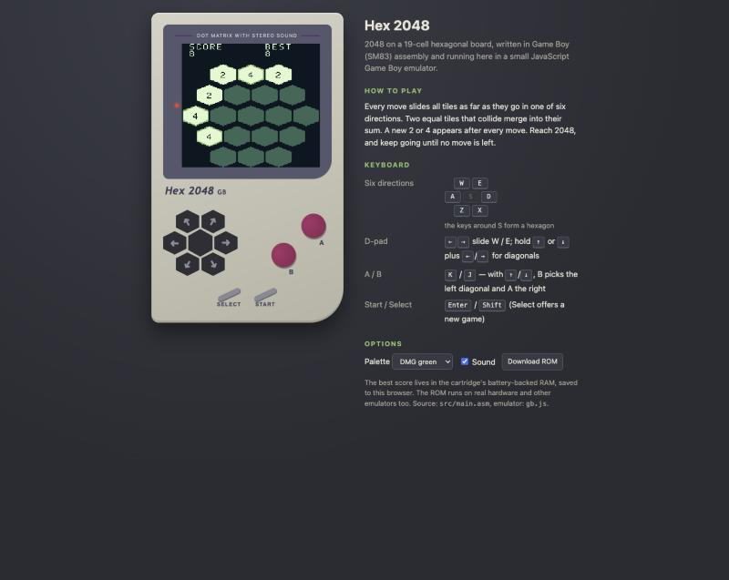
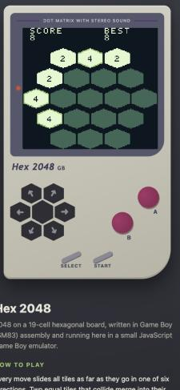
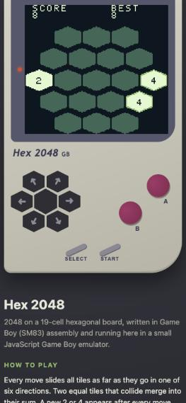

# Prompts

- **Model:** claude-opus-5-5
- **Effort:** high
- **Session(s):** 316054d2-3be0-4bed-a769-5960d6d18b47
- **Tokens:** input 82, output 118297, cache read 6825903, cache write 170530
- **Cost (tokscale estimate):** $5.1

## You

Build me a game of 2048, but on a hexagonal grid. Let store this in `games/2048-gba-opus-5.5-high`.

Platform : Gameboy assembly. Run in the browser via a JS emulator.

Do not reference any other code in this project

## Claude

Toolchain ready (RGBDS installed, generator works). Now writing game in SM83 assembly.

My script dropped both includes. Re-add.

Ass­embled clean. Now the JS emulator.

Debugging boot: ROM stuck in memory clear loop. Tracing.

Bug found: `LcdOff` waits for VBlank while LCD already off — hangs (real hardware would too). Fix.

400 moves match JS rules model, zero errors. Check visuals + longer run with game overs.

Game logic verified (3000 moves, 5 full games, 0 mismatches). Now web page + controls.

Page served. Checking it in browser.

Return tap not registered: key down+up inside one frame never reaches game. Need minimum hold. Fixing input latch + key legend layout.

Keyboard play works. Check touch hex-pad and phone width.

Mobile overflows (content cut left). Fix main width.

Touch pad works, no overflow at 375px. Quick audio sanity check in Node.

Tests pass. Generating `prompt.md`.
