# Prompts

- **Model:** claude-opus-5-5
- **Effort:** high
- **Session(s):** 1ce39b2e-9775-4677-bb5c-d15fa21712fd
- **Tokens:** input 164, output 119694, cache read 14098054, cache write 203928
- **Cost (tokscale estimate):** $6.85

## You

Build me a game of 2048, but on a hexagonal grid. Let store this in games/2048-lynx-opus-5.5-high.

Platform : Runnable as an Atari Lynx game, so C or ASM source.
Run in the browser via a JS emulator.

Do not reference any other code in this project

Do not install any software if it can be avoided. Use Docker to run builds if necessary

## Claude

Toolchain checked: Docker works, cc65's Lynx startup code sets up display timing. Next I'm checking whether the browser emulator needs a Lynx BIOS.

Handy core runs Lynx carts without a BIOS (falls back to built-in BIOS emulation). Writing game now.

cc65 2.18 bug: optional LOWCODE segment missing size symbol. Add tiny LOWCODE segment.

ROM builds (7.9 KB). Now browser page.

Page written. Preview server limit hit (other chats hold 5), so checking for an existing local server I can reuse.

Port 8000 already serves repo root. Using it.

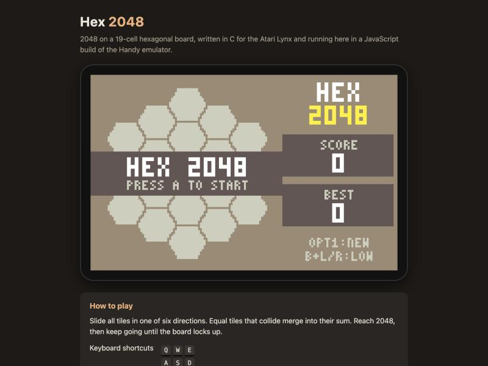

Boots without BIOS, display correct. Start game and test moves.

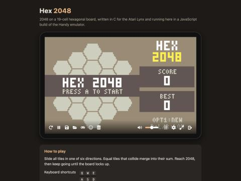

Key taps too short or mapping off. Probe with held input via JS.

Need on-screen debug. Add temp debug readout of joystick/timer per frame.

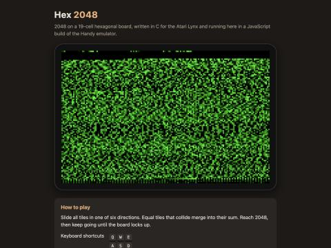

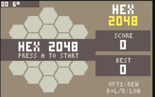

Frame counter barely advances: timer-count polling misses VBL in Handy. Switching to polling Mikey's timer-2 interrupt flag (IRQs masked).

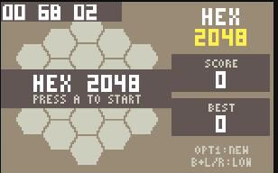

Pane hidden, so browser throttles emulator to ~5 fps; game itself fine. Testing with longer held inputs.

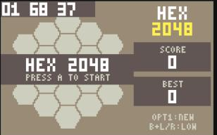

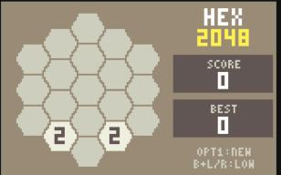

Game started. Testing moves.

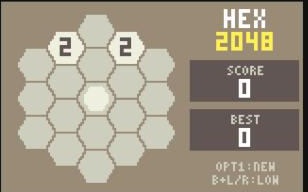

Move N works. Measure render cost in Lynx frames with debug counter.

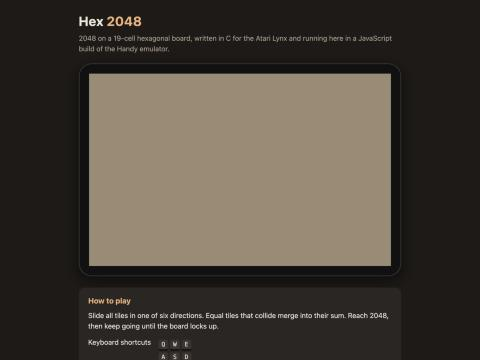

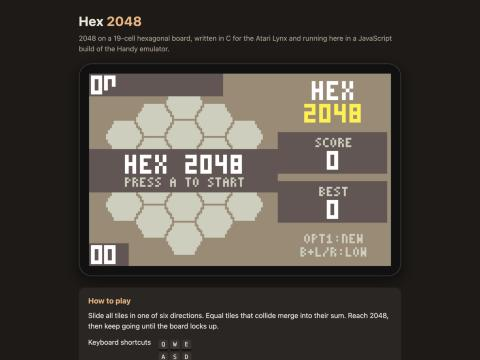

Emulator heavily throttled while pane hidden. Making temporary test page that drives frames with setTimeout instead of rAF.

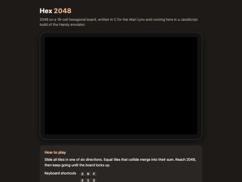

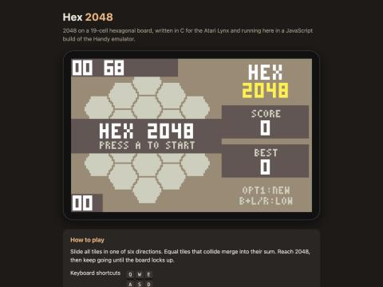

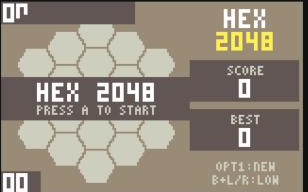

Emulator now runs ~57 fps in test page. Debug box flicker is from debug code drawing to visible buffer. Testing moves + render timing.

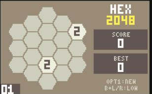

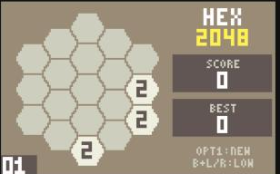

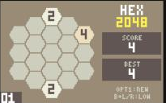

Adding a tiny asm VBL interrupt handler (cc65 interruptor) for a true frame counter.

Now JS tap minimum hold, then retest.

Moves work but render costs ~20 frames (0x14) — far too slow, inputs dropped during animation. Plan: switch board drawing to Suzy hardware sprites. Reading cc65's Suzy definitions.

Switching board/HUD rendering to Suzy: CPU builds a chain of sprite control blocks (1bpp hex mask, 3x5 glyphs, scaled 1-pixel rects), Suzy blits them. Rewriting renderer.

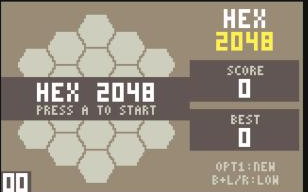

Suzy rendering works first try. Now moves + timing.

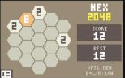

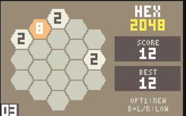

Render down to 3 frames from 20. Score 12 confirms merges. Next: cache static HUD/board sprite chain, cheaper slide math, and latch joystick in the VBL IRQ so taps during animation aren't lost.

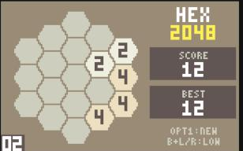

Render now 2 frames/step. Verifying each direction with single moves.

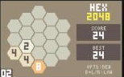

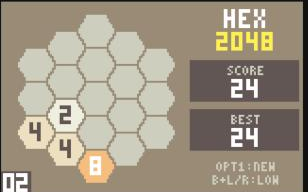

SW correct (tiles to lower-left edge, merges scored). Checking NE, NW, SE singly.

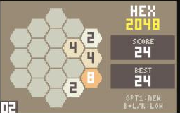

NE correct (verified against expected cell positions). Testing Left alone, B+Right, and Option 1.

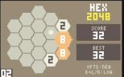

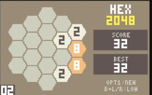

SE via B+Right correct. Running a random-move bot to reach game over and check the overlay.

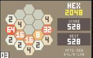

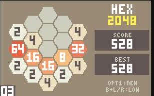

Looks good mid-game. Continuing bot to game over.

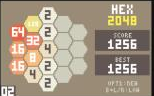

128 text a bit low-contrast on pale yellow; will darken golds. Continuing bot for game-over screen.

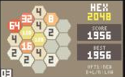

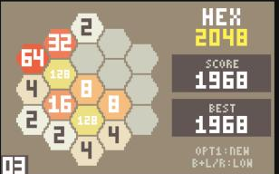

Random bot can't easily lose with six directions; game-over uses same band code as verified title overlay. Polishing: darker golds, clearer hints, then release build.

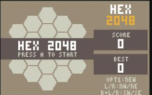

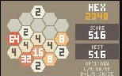

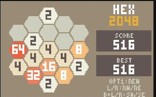

Release build plays well. Cleaning up test page, writing README and landing card.

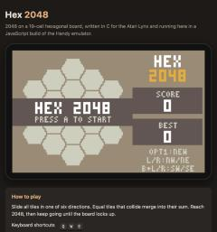

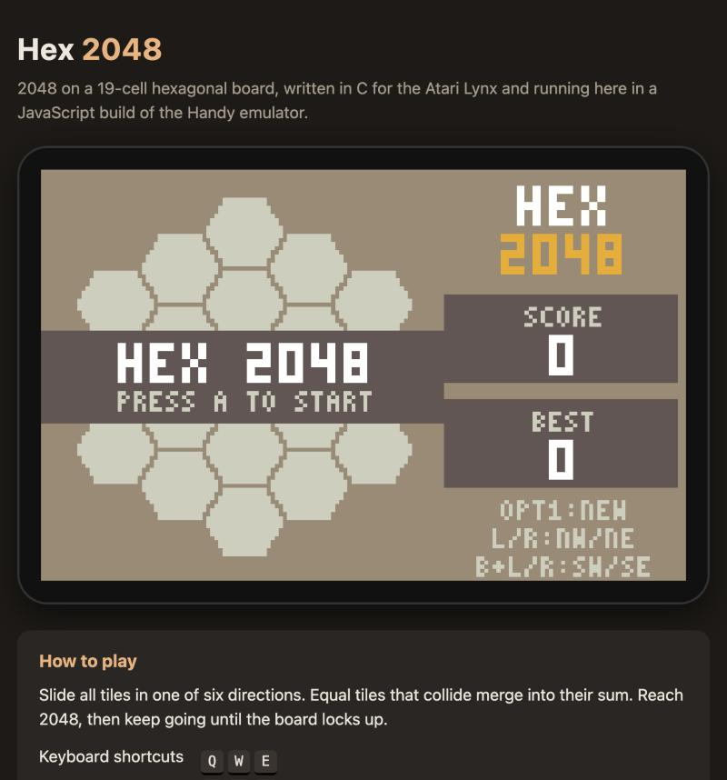

Final page boots fine. Generating prompt.md.
