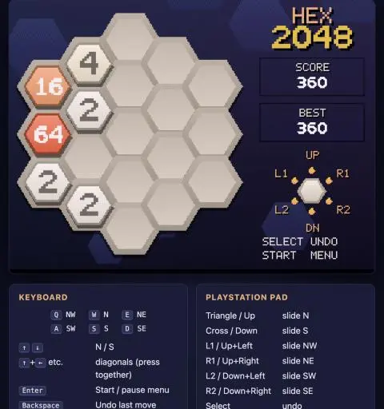
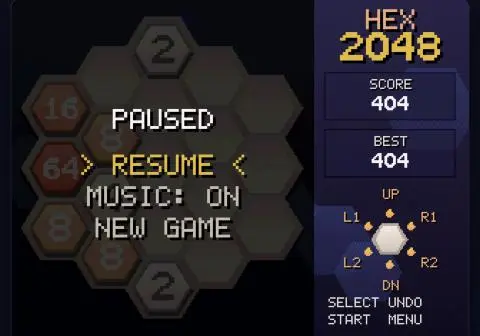
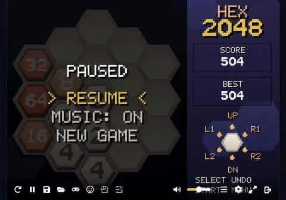

# Prompts

- **Model:** claude-opus-5-5
- **Effort:** high
- **Session(s):** 97ad9a87-bc0e-4f4c-b55b-17df68a3c0eb
- **Tokens:** input 290, output 174246, cache read 31273574, cache write 447750
- **Cost (tokscale estimate):** $13.32

## You

Build me a game of 2048, but on a hexagonal grid. Let store this in games/2048-ps1-opus-5.5-high.

Platform : Runnable as a PlayStation 1 game, so C or ASM source.
Run in the browser via a JS emulator.

Do not reference any other code in this project

Do not install any software if it can be avoided. Use Docker to run builds if necessary

## Claude

Docker Desktop installed but not running. Starting it.

Toolchain image built. Now writing game source.

Writing sound driver, then game logic.

Built (18 KB). Checking for non-R3000 instructions.

Clean MIPS I output. Now the browser page.

Page loads; clicking play to boot emulator.

Boots and renders in PCSX-ReARMed. Testing pad input.

Input not reaching game. Adding on-screen pad debug to diagnose SIO.

Debugging pad input; capturing debug readout.

Pad responds (41 5A). Testing Start now with fresh ROM.

Still chasing pad input — reading emulator source to see how it latches buttons.

Keyboard input works — game started. Simulated-input API was the culprit, not the ROM. Testing moves.

Pane hidden, so emulator is throttled. Using longer key holds.

Moves work. Running a longer sequence to check merges/score.

Merges + score work. Fixing panel overlaps, removing debug.

Adding a temporary test hook (Square fills near-win board) to verify win/game-over screens.

Win screen works. Continuing to test game-over.

Gameplay solid. Testing undo + pause menu.

Game-over overlay OK. Removing test hook; then testing arrow-key chords.

Chords work (tiles pushed to NE edge, merged to 4). Now README, landing card, prompt.md.

Hex 2048 runs as a real PlayStation 1 game, in [games/2048-ps1-opus-5.5-high](games/2048-ps1-opus-5.5-high). It boots in your browser through EmulatorJS, which runs a PS1 emulator (PCSX-ReARMed) with a built-in BIOS replacement, so no Sony BIOS file is needed. I played it there and checked: title screen, sliding and merging, score and best score, undo, the pause menu, the win screen and the game-over screen. I couldn't check the sound by ear.

**How it's built**
- It's bare-metal C plus a short assembly startup file. There's no PS1 SDK and no BIOS calls; the game drives the console's hardware directly for graphics, controller and sound.
- The board has 19 hex cells and six slide directions. The hexes are shaded polygons, and the numbers come from a font I drew in code, so the text can scale smoothly when tiles pop.
- Tiles animate when they slide, merge and appear, and merges play musical notes.
- The output is a standard PS1 program file, [hex2048.exe](games/2048-ps1-opus-5.5-high/hex2048.exe) (18 KB), so it should also run in other PS1 emulators. I only tested it in this one.

**Build:** `./build.sh` compiles everything inside a Docker container with Debian's cross-compiler, so nothing gets installed on your machine. I did have to start Docker Desktop, which was installed but not running.

**Controls:** On the keyboard, Q W E / A S D are the six directions (NW, N, NE / SW, S, SE). The arrow keys also work, with Up+Left and similar pairs for the diagonals. Enter is Start/pause and Backspace is undo. On a PS1 pad, Triangle and Cross slide N and S, the four shoulder buttons do the diagonals, and Select is undo.

**One fix along the way:** EmulatorJS caches a game by its file size. PS1 program files are padded to fixed block sizes, so the size never changed and it kept serving old builds. I turned its cache off in `index.html`; the game is tiny, so it costs nothing.

**Also done:**
- Added a [README.md](games/2048-ps1-opus-5.5-high/README.md).
- Generated `prompt.md` (estimated cost $5.92) with its screenshots.
- Added a card to the root `index.html`.
- Added a `2048-ps1-opus-5.5-high` local server entry to `.claude/launch.json`.

There are uncommitted changes in other demos (`2048-gba`, `hexahedron`) that aren't from this work, and I left them alone.

## You

Lets build the prompt.md using the shell script.

## Claude

I re-ran `scripts/prompt-md.sh games/2048-ps1-opus-5.5-high`, which rewrote [prompt.md](games/2048-ps1-opus-5.5-high/prompt.md) with this whole session.

- **Header:** model claude-opus-5-5, effort high. tokscale puts the cost at about $6.11.
- **Prompts:** your two prompts, word for word: the original request and this one. None were unrelated, so I didn't drop any.
- **Screenshots:** 27, saved in `prompt-assets/` and all linking correctly. A few are blank black frames, taken while the emulator was still booting.

Commit `prompt-assets/` along with `prompt.md`.

## You

Commit it

## Claude

Committed on a new branch, `2048-ps1`. You were on `master`, and I branch before committing rather than commit straight to it. The branch isn't merged or pushed.

The commit has 47 files:
- the whole `games/2048-ps1-opus-5.5-high/` folder: source, build scripts, `hex2048.exe`, `README.md`, `prompt.md` and `prompt-assets/`
- the landing card in the root `index.html`
- the server entry in `.claude/launch.json`

The `build/` output folder is ignored. The uncommitted changes in `2048-gba` and `hexahedron` stay out of the commit and are untouched in your working tree.

## You

What would it look like for us to add music to this? I am not familiar with how music on the PS1 works.

## Claude

The PS1 has no synth chip. The NES and Game Boy generate tones in hardware; the PS1 only plays back recorded sound.

## How PS1 sound works

The sound chip is called the SPU. It has three main pieces:

- **512 KB of sound RAM** holding short samples. They're stored compressed in Sony's ADPCM format, which packs 28 samples into 16 bytes.
- **24 voices.** Each voice plays one sample from that RAM. You give it a pitch (playback speed, which sets the musical note), left/right volume, and a volume envelope. The envelope (ADSR) controls how a note swells in and dies away, which is much of what makes something sound like a pluck or a pad. A sample can loop, so one waveform cycle can hold a note forever.
- **Hardware reverb** for echo and room sound. It needs a chunk of sound RAM as a work area.

Commercial games did music in one of two ways:

1. **Sequenced music.** A bank of instrument samples sits in sound RAM, plus a MIDI-like score. Sony's formats for these were called VAB and SEQ. The CPU runs a small sequencer every frame that starts and stops notes on voices. This uses little memory, and most games did it.
2. **Streamed audio from the CD.** This is either regular CD-audio tracks or a compressed format called XA. It's full-quality recorded music, but it needs a disc image. We only ship a bare `.exe`, so this is out unless we also build a bin/cue disc.

## What we already have

[spu.c](games/2048-ps1-opus-5.5-high/src/spu.c) is a tiny version of option 1. It uploads a single looping sine-wave cycle and plays notes from it on 8 voices, with delays for short jingles. Music means growing that into a real sequencer.

## What adding music would look like

1. **Instruments.** At boot, generate a few single-cycle waveforms into sound RAM: square/pulse, triangle and saw, alongside the sine. The SPU also has a built-in noise mode we can use for drums. Each instrument is a waveform plus an envelope and a volume. Together that gives a warm chiptune-plus-reverb sound.
   - Real recorded instruments (piano, strings) would need an ADPCM encoder. That could be a small Python script run in the Docker build, so nothing gets installed.
2. **Song format.** A tracker-style grid: each channel has rows of note, instrument and volume, and the tempo is a number of frames per row. I'd write the song as readable text in the repo, and a small converter in the build would turn it into a C array.
3. **Playback.** The main loop already calls `spu_update()` once per frame, so the sequencer would advance a row there. Splitting the voices keeps music and sound effects from cutting each other off, for example voices 0–5 for music and 6–13 for effects. I'd also turn on hardware reverb.
4. **Game hooks.** A title theme, an in-game loop, quieter music during pause, and a music on/off option in the pause menu. The in-game music could also speed up or add a layer as your highest tile grows.

That's about 250–350 lines of C plus a converter script. A few minutes of song data is a few KB, so the `.exe` stays tiny.

**The music would be original**, written for this game, not a copy of an existing game's tune.

**I can't hear it.** I can check that it builds, that the emulator runs it without errors, and that it never runs out of voices. Whether it sounds good is your call, so expect a round of feedback to tune the melody, tempo or mix.

## You

Sure, lets go with the sequencer option. I'd like to have something written in 6/4 time, and leans into the idea of 6's, given the hex nature of this.

## Claude

Plan: sample bank + song generated by a Python script at build time, tracker-style sequencer in C. Fetching SPU reverb presets first (psx-spx docs).

Using "Studio Medium" reverb. Checking the ADSR and ADPCM flag details.

Reference gathered. Checking files changed on disk since commit.

Docs in hand. New branch off master, then the audio generator.

Song data written. Now the synth/ADPCM encoder/C emitter.

Now the C side: rewrite spu.c with bank upload, reverb, sequencer, SFX on voices 16-23.

Generator works (8.5 KB bank). Quick ADPCM round-trip quality check.

Quality fine for retro timbres. Now hooking music into game states.

Builds clean (43 KB). Testing in emulator, tapping the audio graph to confirm sound actually plays.

Launch config got mangled (two ports, missing `-d`). Fixing it to port 8813.

Browser tab misbehaving; opening a fresh tab for the emulator test.

localhost:8814 navigation refused (new origin, likely needs approval). Earlier-approved origin was :8791; switching config back to that port.

Audio context running and tapped. Sampling output levels + dominant pitches on the title screen.

Title music confirmed: bass A2/E3 → C3, pad and arpeggio pitches match the Am → C bars. Starting a game to check drums and layering.

Game song running: kick (~58 Hz) plus bass G2→E2 and pad tracking the C → G → Em bars. Looks like you're also clicking in the pane, so I'll keep my own input light.

Pause menu shows the music option, and the music ducks while paused. You're playing in the pane now, so I'll stop sending input. Updating the docs next.

Docs updated. Regenerating prompt.md with the music conversation.

The game now has a sequenced soundtrack in 6/4 that leans on six throughout. It's on a new branch, `2048-ps1-music`, and nothing is committed yet.

**Where the six shows up**
- **6/4 time.** Drums split each bar 3+3 (kick on beats 1 and 4, snare on 3 and 6), while the bass walks 2+2+2 under them. That cross-rhythm is called a hemiola.
- **Six-note scale.** The melodies only use A B C D E G, which is A minor without F.
- **Six-note arpeggio.** The arpeggio repeats a six-note up-and-down figure, so it keeps cutting across the beat. Each of its six notes sits in a different spot from left to right in stereo.
- **Bridge.** It ends on D–F♯–A♯ then E–G♯–C. Those two chords together are the six-note whole-tone scale, and E–G♯–C pulls back home to A minor.
- **Form.** Phrases are 6 bars, the in-game song is 6 phrases, there are 6 parts (lead, bell, arpeggio, pad, bass, drums), and the sequencer steps every 6 frames (150 bpm).
- **Timbre.** The arpeggio instrument is built from exactly six harmonics.

**In the game**
- The title screen gets a soft version: pad and arpeggio first, then the theme.
- In play, the music starts with pad, bass and drums. The arpeggio joins at a 16 tile, the lead melody at 64, and a bell line at 256.
- It ducks while paused, fades out on game over, and the pause menu has **MUSIC: ON/OFF**.
- I moved the start and game-over jingles into A minor so they fit the music. The merge notes already fit.

**How it's built**
- [music/hexsong.py](games/2048-ps1-opus-5.5-high/music/hexsong.py) is the song, written as readable text: chords, melodies one bar per line, drum patterns.
- [tools/gen_audio.py](games/2048-ps1-opus-5.5-high/tools/gen_audio.py) runs during the Docker build. It synthesises the 9 instruments, compresses them to the PS1's sample format (an 8.5 KB bank), and writes the songs out as C tables.
- [src/spu.c](games/2048-ps1-opus-5.5-high/src/spu.c) uploads the bank, turns on the hardware reverb, and runs the sequencer. Music uses voices 0–9 and sound effects use 16–23, so they don't cut each other off.
- The `.exe` grew from 18 KB to 42 KB, mostly note data.

**Tested**
- I tapped the emulator's audio output and checked the pitches. The title song's bass, pad and arpeggio follow the Am → C bars. In game I could see the kick drum and bass walking C → G → Em. Pausing dropped the volume, and the pause menu shows the new option.
- I can't judge how it sounds. You were playing in the pane at the same time, so I stopped sending input once that was confirmed.
- Easy things to adjust in `hexsong.py`: tempo (`FRAMES_PER_ROW`), the melodies, or how loud each part is relative to the others.

**Also changed**
- Someone had edited the `2048-ps1-opus-5.5-high` entry in `.claude/launch.json` into an invalid state (two ports and no `-d`). I set it back to port 8791, because the browser pane refused the new localhost ports.
- The README now has a Music section, the `demos.js` card mentions the soundtrack, and `prompt.md` is regenerated: 5 prompts, 30 screenshots, cost estimate $13.07.

## You

Commit it
