# Prompts

- **Model:** claude-opus-5-5
- **Effort:** high
- **Session(s):** 97ad9a87-bc0e-4f4c-b55b-17df68a3c0eb
- **Tokens:** input 164, output 103619, cache read 13647392, cache write 163622
- **Cost (tokscale estimate):** $6.11

## You

Build me a game of 2048, but on a hexagonal grid. Let store this in games/2048-ps1-opus-5.5-high.

Platform : Runnable as a PlayStation 1 game, so C or ASM source.
Run in the browser via a JS emulator.

Do not reference any other code in this project

Do not install any software if it can be avoided. Use Docker to run builds if necessary

## Claude

Docker Desktop installed but not running. Starting it.

Toolchain image built. Now writing game source.

Writing sound driver, then game logic.

Built (18 KB). Checking for non-R3000 instructions.

Clean MIPS I output. Now the browser page.

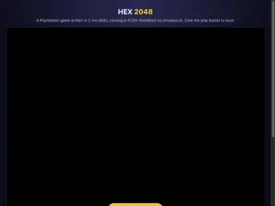

Page loads; clicking play to boot emulator.

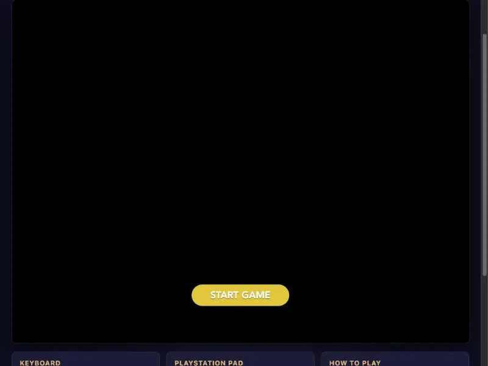

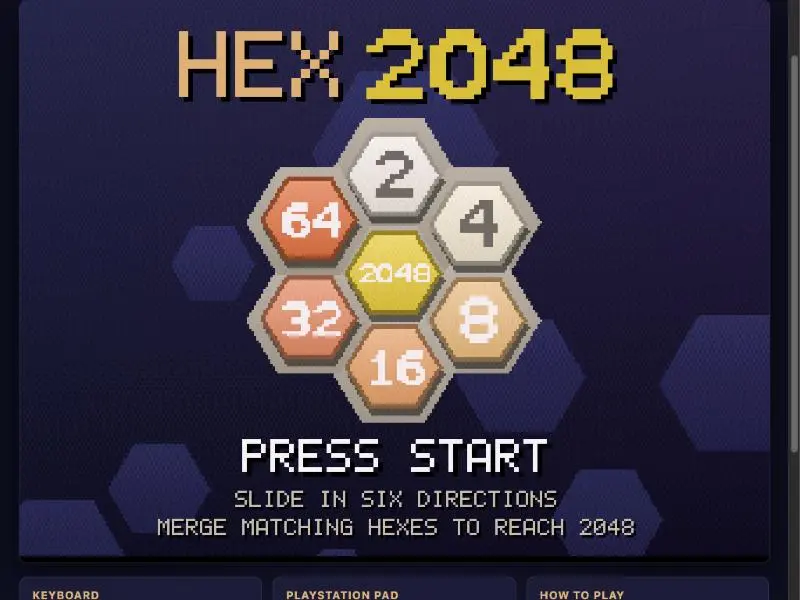

Boots and renders in PCSX-ReARMed. Testing pad input.

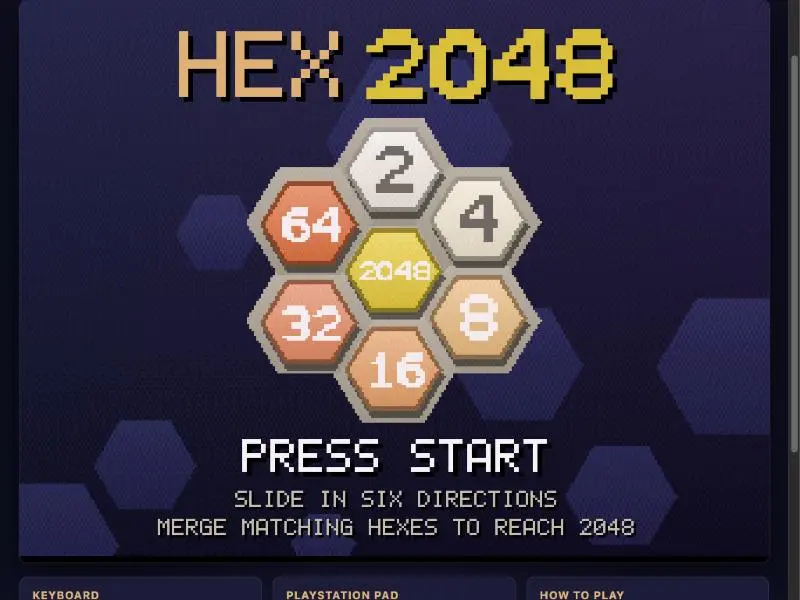

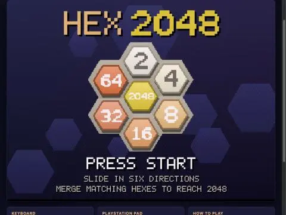

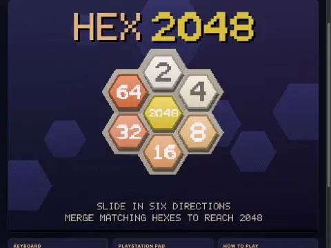

Input not reaching game. Adding on-screen pad debug to diagnose SIO.

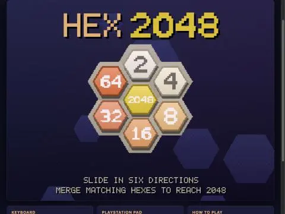

Debugging pad input; capturing debug readout.

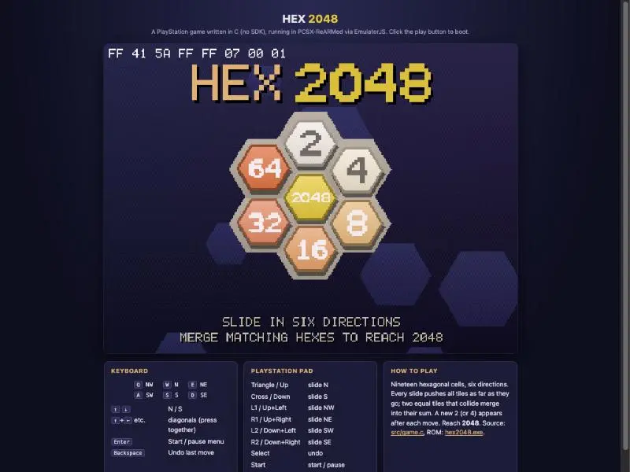

Pad responds (41 5A). Testing Start now with fresh ROM.

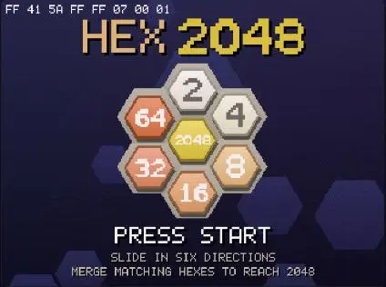

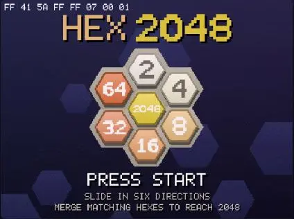

Still chasing pad input — reading emulator source to see how it latches buttons.

Keyboard input works — game started. Simulated-input API was the culprit, not the ROM. Testing moves.

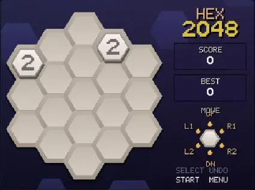

Pane hidden, so emulator is throttled. Using longer key holds.

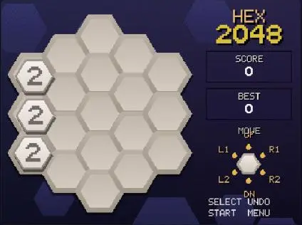

Moves work. Running a longer sequence to check merges/score.

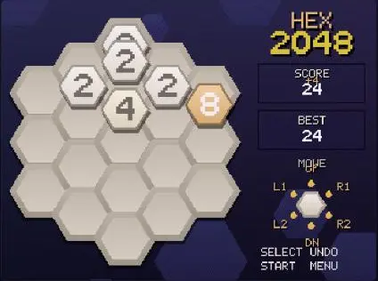

Merges + score work. Fixing panel overlaps, removing debug.

Adding a temporary test hook (Square fills near-win board) to verify win/game-over screens.

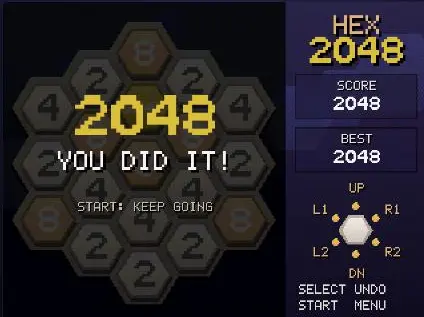

Win screen works. Continuing to test game-over.

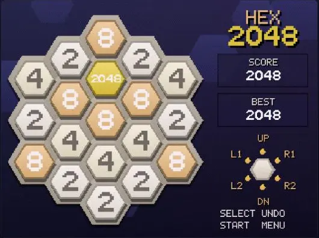

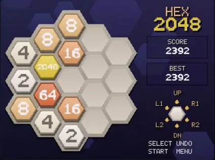

Gameplay solid. Testing undo + pause menu.

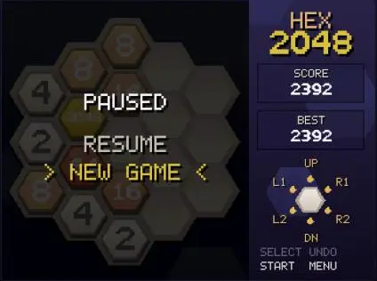

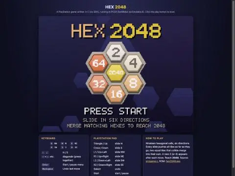

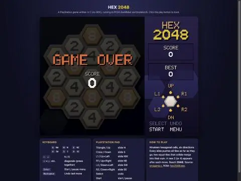

Game-over overlay OK. Removing test hook; then testing arrow-key chords.

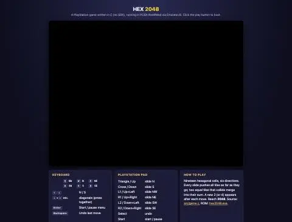

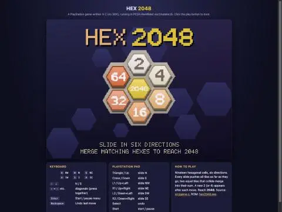

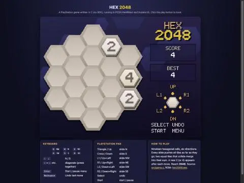

Chords work (tiles pushed to NE edge, merged to 4). Now README, landing card, prompt.md.

Hex 2048 runs as a real PlayStation 1 game, in [games/2048-ps1-opus-5.5-high](games/2048-ps1-opus-5.5-high). It boots in your browser through EmulatorJS, which runs a PS1 emulator (PCSX-ReARMed) with a built-in BIOS replacement, so no Sony BIOS file is needed. I played it there and checked: title screen, sliding and merging, score and best score, undo, the pause menu, the win screen and the game-over screen. I couldn't check the sound by ear.

**How it's built**
- It's bare-metal C plus a short assembly startup file. There's no PS1 SDK and no BIOS calls; the game drives the console's hardware directly for graphics, controller and sound.
- The board has 19 hex cells and six slide directions. The hexes are shaded polygons, and the numbers come from a font I drew in code, so the text can scale smoothly when tiles pop.
- Tiles animate when they slide, merge and appear, and merges play musical notes.
- The output is a standard PS1 program file, [hex2048.exe](games/2048-ps1-opus-5.5-high/hex2048.exe) (18 KB), so it should also run in other PS1 emulators. I only tested it in this one.

**Build:** `./build.sh` compiles everything inside a Docker container with Debian's cross-compiler, so nothing gets installed on your machine. I did have to start Docker Desktop, which was installed but not running.

**Controls:** On the keyboard, Q W E / A S D are the six directions (NW, N, NE / SW, S, SE). The arrow keys also work, with Up+Left and similar pairs for the diagonals. Enter is Start/pause and Backspace is undo. On a PS1 pad, Triangle and Cross slide N and S, the four shoulder buttons do the diagonals, and Select is undo.

**One fix along the way:** EmulatorJS caches a game by its file size. PS1 program files are padded to fixed block sizes, so the size never changed and it kept serving old builds. I turned its cache off in `index.html`; the game is tiny, so it costs nothing.

**Also done:**
- Added a [README.md](games/2048-ps1-opus-5.5-high/README.md).
- Generated `prompt.md` (estimated cost $5.92) with its screenshots.
- Added a card to the root `index.html`.
- Added a `2048-ps1-opus-5.5-high` local server entry to `.claude/launch.json`.

There are uncommitted changes in other demos (`2048-gba`, `hexahedron`) that aren't from this work, and I left them alone.

## You

Lets build the prompt.md using the shell script.
