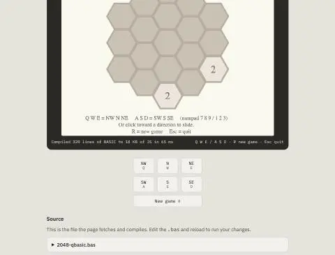
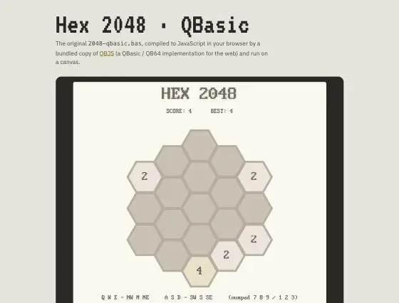
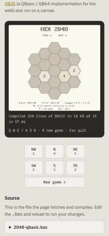
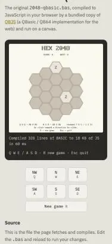
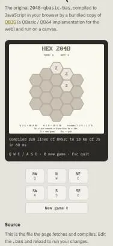

# Prompts

- **Model:** claude-opus-5-5
- **Effort:** high
- **Session(s):** 0d42fcf4-6103-430d-b03e-b74a633b72be
- **Tokens:** input 80, output 20391, cache read 4085083, cache write 70234
- **Cost (tokscale estimate):** $1.79

## You

Can we games/2048-qbas-opus-5.5-high to add an emulator so we can run it in the browser? I'd like a HTML page that contains.... something ... that will let the bas file be run

## Claude

Vendoring QBJS (MIT, QB64→JS compiler) so the page compiles the `.bas` in-browser at load. Checking compiler API.

Files vendored (~700 KB). Writing runner page now — fetches `.bas`, compiles with QBJS in browser, runs on canvas.

Runs. Text renders serif — DOS font not preloaded. Fixing, then testing input.

Font fixed, pad moves merge tiles (score 4). Checking canvas click, Esc, and phone width.

Unused GX bitmap font, but path is hardcoded `gx/` relative to page. Moving `gx/` to demo root rather than patching vendored code.

Mobile layout good, font 404s gone. One gap: on phones canvas is CSS-scaled, so tap-on-canvas coords would be off. Checking whether GX's own scaling corrects mouse coords.

Confirmed off by scale (158 vs 320). Trying `transform: scale` — offsetX reports untransformed coords.

Transform fixes mouse. GX touch handlers use `pageX - rect` (scaled, and scroll-broken), so I'll route touches to mouse events in capture phase.

Tap north slid tiles north on phone width. Resetting viewport and updating landing card.

QBasic game now runs in browser at [games/2048-qbas-opus-5.5-high/index.html](games/2048-qbas-opus-5.5-high/index.html). I checked it in the browser pane at desktop and phone width.

**How it works:** the "something" is [QBJS](https://github.com/boxgaming/qbjs), an MIT-licensed QB64 implementation for the web. The `.bas` was written for QBJS, so it's a natural fit. Page fetches `2048-qbasic.bas`, compiles it to JS in your browser (about 60 ms), then runs it on a canvas. The `.bas` stays the only source: edit it, reload, and the change runs.

**Added:**
- `qbjs/`: QBJS compiler and runtime (~700 KB), copied unchanged from upstream commit `1589a46`. Includes its LICENSE, the third-party licenses and a VERSION.txt.
- `gx/`: QBJS graphics library. Sits at the demo root because it loads its font images from a fixed `gx/` path relative to the page. Moving it was cleaner than patching the vendored code.
- `index.html`: click-to-run screen in a bezel, the same look as the asm sibling demo. Has a hex pad of buttons (NW/N/NE/SW/S/SE, New game), and a collapsible view of the source. After Esc it shows "Program ended, click to run again".

**Two fixes beyond plain hosting:**
- DOS fonts load before the program starts. Without that, the game's text drew in a serif font.
- On narrow screens the canvas shrinks with a CSS transform, not a CSS width. QBJS reads mouse positions in a way that a CSS width breaks, so clicks would land in the wrong spot. Its own touch handling has the same problem, so taps are turned into mouse events first.

**Tested:** keyboard keys, pad buttons, clicks on the canvas, phone taps (a tap above center slid tiles north), and Esc. Phone width has no sideways scroll.

Also updated the landing page card to open the runner, with the `.bas` linked underneath. Added a `2048-qbas` entry to `.claude/launch.json` (port 8805).

## You

Prompt.md + commit
