# Prompts

- **Model:** claude-opus-5-5
- **Effort:** xhigh
- **Session(s):** dd1e5cbe-6126-40f6-a35f-4db1a8f6b8c9
- **Tokens:** input 162, output 286292, cache read 24102684, cache write 717479
- **Cost (tokscale estimate):** $14.13

## You

<pasted_content id="bda5">
I want a HTML/CSS/JS self-contained game. I want it to be a tower defense game, based on a hexagonal grid. Lets use three.js.

I want this to be 3d. Id like for the ground to have multiple hight layers, maybe up to 3. Some towers can shoot over high ground if there is visibility to the other side, others require a direct line of sight (same level or below)

Put this in a new subfolder - 3dtd-opus-5.5-uiltra.

Do not reference any other code in this codebase, this is a standalone project
</pasted_content id="bda5">

## Claude

Writing game. Single file, three.js via CDN importmap.

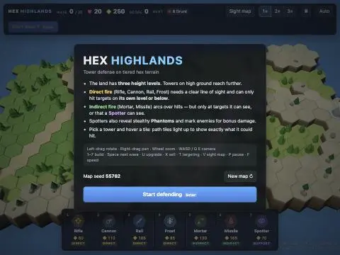

Renders. Start game, inspect map.

Works. Fixes needed: highland color too close to path sand; camera should reset to full-map view on start. Patch.

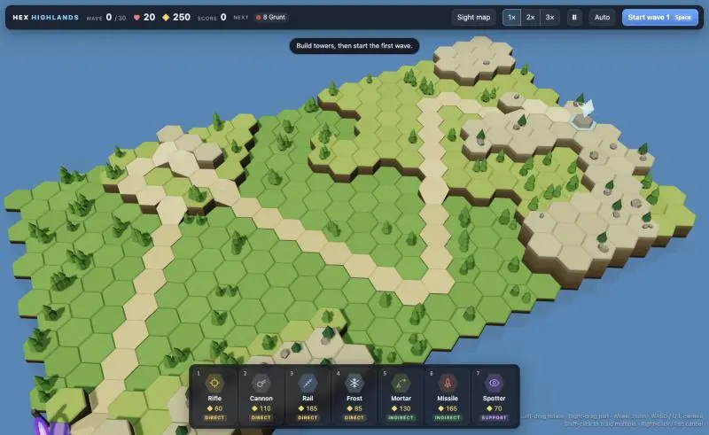

Pane shows stale data-URL snapshot. Navigate to real file URL.

Snapshot refreshes on navigate. Expose a few more debug hooks for scripted testing.

Map generation OK (42 tiles, 7 ramps, all 3 levels). Scripted build + waves to smoke-test combat.

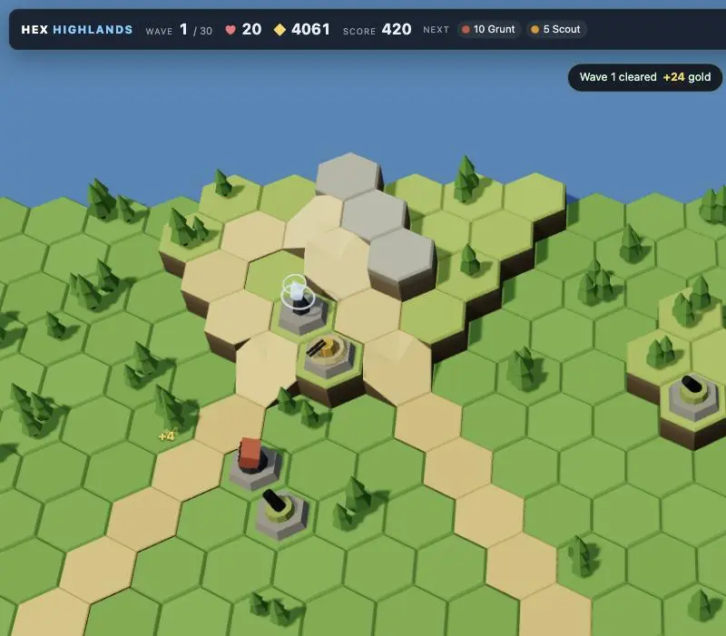

Wave 1 clean, ramps render. Push waves 2–6 (scouts, brutes, wasps, phantoms) at once.

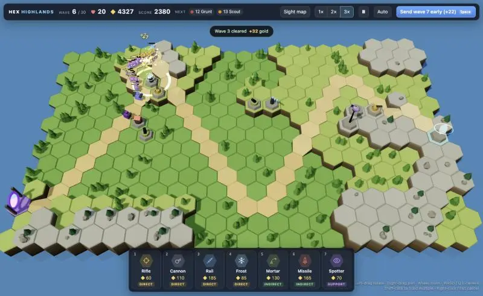

No errors, 81 kills, 0 leaks. Now check build-mode LOS overlay visually.

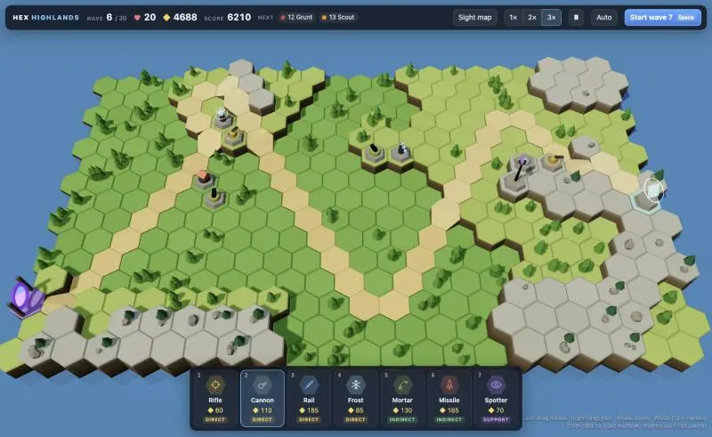

Pick works. Retest real hover with build mode.

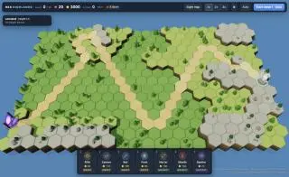

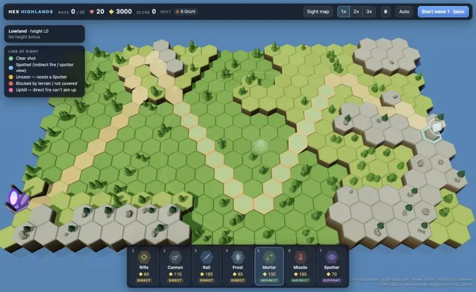

Overlay works but too faint (tone mapping washes it out; 1px lines). Switching to tone-map-free ribbons for rings/outlines and a dotted 3D LOS trace.

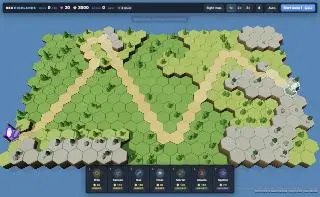

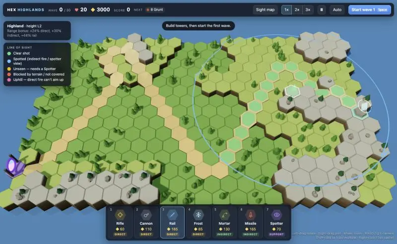

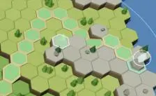

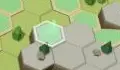

Game runs, waves clear without errors. Now polishing overlay visibility — ghost tower preview not showing, debugging.

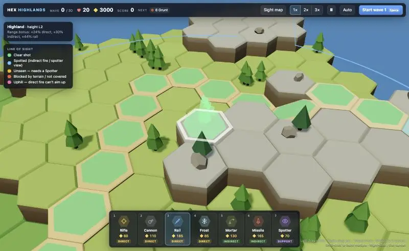

Ghost renders but flat/faint. Switch to shaded emissive material.

Now verify direct-fire blocking: place Rifle on lowland near cliffs, select it, hover a blocked path tile.

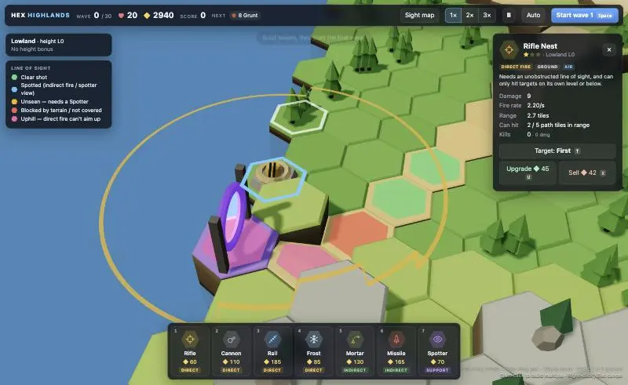

Statuses render correctly (pink uphill, red blocked, green clear). Re-aim hover onto the red tile to check the dotted LOS trace.

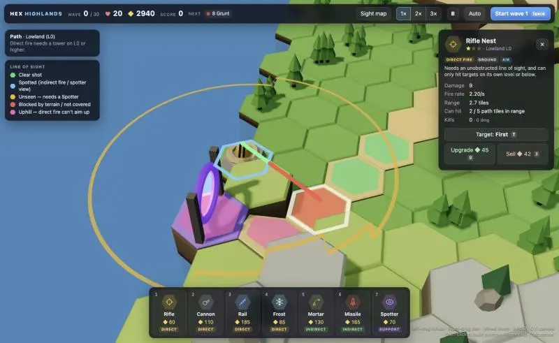

LOS trace works: green until the ridge, red after. Now stress-test boss wave 10 + game-over flow.

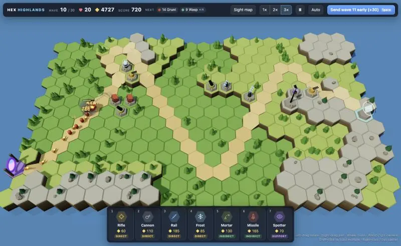

Boss wave clean. Test game-over flow and phone layout.

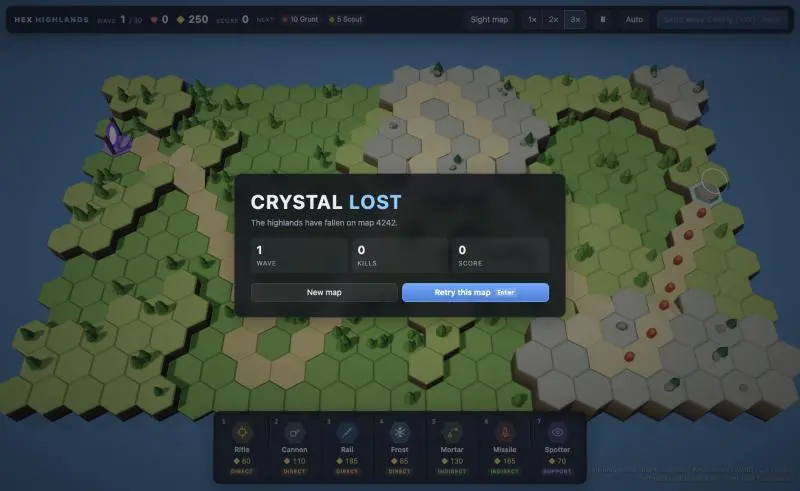

Game-over works. Phone layout check.

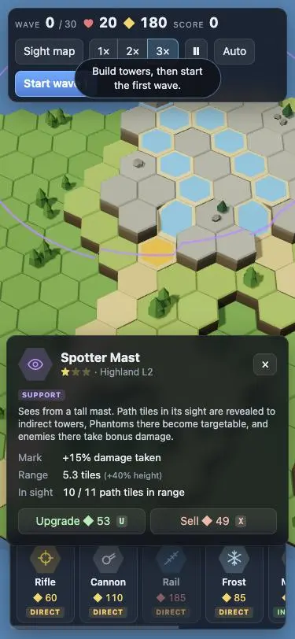

Mobile OK-ish; toast overlaps wrapped top bar and portrait camera too close. Fix both.

Two more fixes: panel re-renders mid-combat could eat clicks (rebuilds innerHTML on damage ticks), and new-enemy intros should warn a wave ahead.

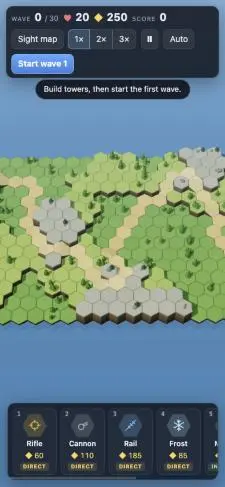

Mobile framing better. Final desktop action shot.

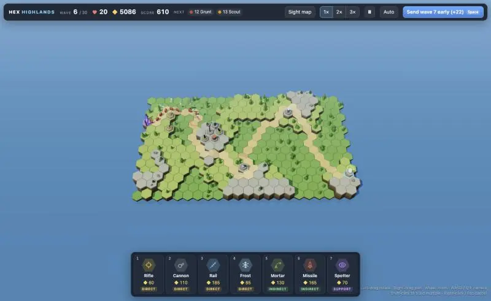

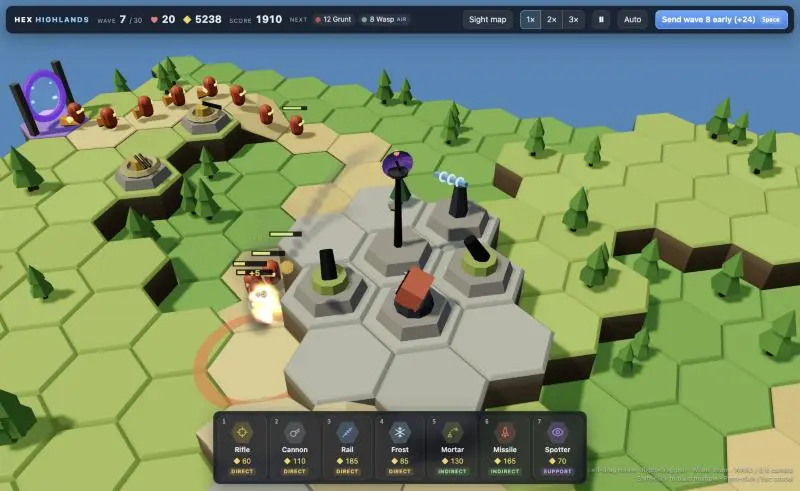

I've built the game, "Hex Highlands TD", as a single file: [3dtd-opus-5.5-uiltra/index.html](3dtd-opus-5.5-uiltra/index.html). Open it in a browser to play. It loads three.js r164 from the jsDelivr CDN, so it needs internet the first time. Nothing else in the repo is touched or referenced, and nothing is committed. I kept the folder name exactly as you typed it ("uiltra").

**Terrain**
- Every game generates a new hex island from a seed, with 3 height levels: lowland, ridge and highland, separated by cliffs.
- The enemy path winds across the levels and uses sloped ramp tiles where it changes height.
- Towers on higher ground get more range.

**Line of sight**
- **Direct-fire towers** (Rifle, Cannon, Rail, Frost) need a clear straight line to the target, and can only hit targets on their own level or lower. The Cannon's low barrel gets blocked by small hills more easily than the tall Rail.
- **Indirect-fire towers** (Mortar, Missile) arc over the terrain. They can hit any target they can see themselves, or one that a **Spotter** can see. So over a ridge they're blind until you build a Spotter.
- **Spotters** see from a tall mast. They give indirect towers sight past hills, reveal invisible Phantoms, and make enemies in their view take extra damage.
- **Preview before building:** when you pick a tower and hover a tile, the path tiles in range are coloured: green for a clear shot, cyan for spotted, amber for unseen (needs a Spotter), red for blocked, pink for uphill. Hovering a path tile while a tower is selected draws a dotted line showing exactly where the terrain blocks the shot. "Sight map" (V) shows your whole defence's coverage.

**The rest**
- 6 enemy types: grunts, fast scouts, armored brutes, flying wasps, invisible phantoms, and Titan bosses.
- 30 waves, then an optional endless mode.
- Each tower has 3 upgrade levels and a targeting mode (first, last, strongest, closest).
- 1×/2×/3× speed, pause, auto-send waves, and keyboard shortcuts.
- A basic phone layout.

**Testing**
- I played through waves 1–6, the wave-10 Titan, the game-over screen and the phone layout in the browser. There were no console errors.
- Not tested: a full 30-wave run or real balance. The difficulty curve and gold are educated guesses, so expect to tune them after playing.

`window.hexTD` is a small debug handle I left in for console testing.

## You

Lets add sound and music

## Claude

Plan: all audio synthesized via Web Audio API (no asset files, stays single-file). SFX per tower/event with stereo pan by screen position; generative music with layers (pad/bass/arp/drums/lead) whose intensity follows game state (menu → build → wave → boss); sound settings popover. Locating hook points.

Hook points located. Writing audio engine + wiring.

Wired. Expose master node for level metering, then test in browser.

Real click (user gesture unlocks audio), then meter levels per music state.

Audio running, build-phase music RMS ~0.034 (quiet, background-ish). Now measure wave + combat SFX and boss.

No clipping (boss peak 0.43). Bump overall levels slightly, then check popover UI + mute.

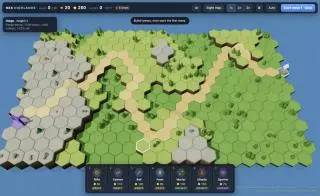

Sound engine in, no errors, levels clean. Checking settings popover UI now.

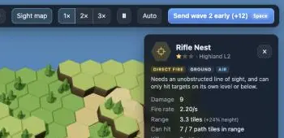

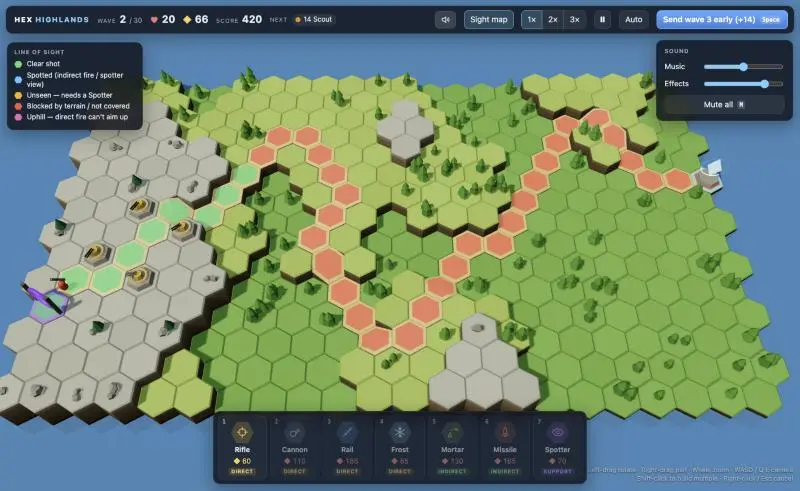

Popover renders. Looks like someone's playing in the pane (towers/waves appeared that I didn't place), so I'll stop poking it. Final error check.

I added sound effects and music to [index.html](3dtd-opus-5.5-uiltra/index.html). The game is still one self-contained file because every sound is generated in the browser, with no audio files. I couldn't listen to it myself. I checked it by measuring the output levels instead, so the mix still needs your ears.

**Sound effects**
- **Towers:** each type has its own firing sound. Rifle is a sharp crack, Cannon a deep thump, Rail an electric zap, Frost a chime, Mortar a launch thud, Missile a whoosh.
- **Shells and explosions:** mortar shells whistle as they fall, and explosions sound bigger for bigger blasts.
- **Enemies:** each type has a different death sound. Titans get a long rumbling explosion, and a horn sounds when a boss wave starts.
- **Game events:** build, upgrade, sell, not-enough-gold buzz, coin on kills, alarm when you lose a life, horn at wave start, chime when a wave is cleared, plus game-over and victory tunes.
- Sounds pan left or right with where they happen on screen and get quieter farther from the camera. Each sound is rate-limited and there's a cap on how many play at once, so 3× speed doesn't turn into noise.

**Music**
- It's composed live in A minor with pad, bass, arpeggio, drums and a randomly generated melody.
- It gets more intense with the game: calm on the menu, light percussion while building, full drums with driving bass during a wave, and heavier and faster while a Titan is alive. Changes happen on the bar line with a crossfade.
- Pausing muffles the music, and it fades to just the pad on game over.

**Controls**
- A speaker button in the top bar opens Music and Effects volume sliders and a Mute button. **M** toggles mute.
- Settings are saved in the browser between sessions.
- Browsers only allow sound after you interact with the page, so audio starts on your first click or key press.

**Testing**
- There were no console errors.
- Measured peaks were about 0.13 while building, 0.34 during a wave and 0.43 with a boss alive, so nothing clips.
- **Still to do:** tune the mix by ear. The overall levels are `SFX_SCALE` and `MUSIC_SCALE` near the top of the audio section.

Towers and waves I didn't create showed up in the preview pane partway through, so I stopped clicking around in case that was you playing. The pane also warned that the page wrote to the clipboard during a test click. The game has no clipboard code, so that's probably a false alarm, but check your clipboard before pasting.

## You

Lets add two more towers. Give me some ideas first

## Claude

Six ideas. Each adds a new rule about height or line of sight, since that's what makes this game different. The existing seven towers already cover cheap damage, splash, long range, slow, lobbing, homing and spotting, so each idea fills a gap or bends the terrain rules.

1. **Boiling Cauldron: hits only targets below it**
   - Built on a cliff edge. It pours burning oil onto path tiles next to it that are at least one level lower.
   - Damage goes up with the height of the drop, and the fire keeps burning on the tile for a few seconds.
   - This is the opposite of the Rifle-type rule ("same level or below"): it can never hit anything on its own level.
   - It makes cliffs over the path worth fighting for.

2. **Tesla Coil: hits only its own level**
   - Chain lightning that travels along the ground.
   - It hits only enemies on exactly the same height. Each arc can jump to another enemy on the same height, about 1.5 tiles away, ignoring line of sight.
   - Strong on long flat stretches, useless next to ramps. This is a new rule: neither up nor down.

3. **War Banner: buff tower that lifts others**
   - Towers within 2 tiles count as one level higher.
   - They get the range bonus, and direct-fire towers can shoot one level uphill.
   - That lets lowland defences cover ridges, which direct fire can't do today.
   - Raises the question of whether to stack towers on actual high ground or fake it with a banner.

4. **Gas Projector: lobs poison that flows downhill**
   - Lobs poison clouds that damage over time.
   - Clouds slowly drift downhill and pool in the lowlands, where they last twice as long.
   - Good for chokepoints at the bottom of ramps.
   - It's the first tower whose effect depends on the terrain after it lands.

5. **Earthworks: raise a tile instead of a tower**
   - Not really a tower: pay gold to raise any non-path tile by one level, up to level 2.
   - It creates new high ground, or a wall that blocks enemy line of sight… and your own.
   - Very strategic, but it changes the map, so it's the most work. The terrain mesh and all the sight coverage would need rebuilding.

6. **Gust Shrine: pushes enemies back**
   - A wind blast that pushes enemies back along the path.
   - On ramps it pushes three times as far, so walking uphill into wind is brutal.
   - It's the only crowd control besides Frost, and it buys time rather than dealing damage.

**My pick: Cauldron + War Banner.**
- They're opposites: one says "cliffs over the path are gold", the other says "you can manufacture height".
- Both use systems that already exist (the sight-coverage overlay, the range bonus from height), so the risk is low.
- If you'd rather have raw combat variety, Tesla's "own level only" rule plus Gas pooling downhill is the most visually fun pair.

Which two do you want? You can also mix and match or tweak any of these.

## You

Lets go with Tesla and Gust

## Claude

Tesla + Gust. Design before code:

- **Tesla Coil** (new "ground current" rule): hits only enemies on its exact height level, and only across connected ground of that level within range (current can't jump cliffs). Chain lightning hops between nearby same-level enemies, ignoring line of sight. Ground only.
- **Gust Shrine** (wind): pulse shoves ground + air enemies back along path. Needs open line of sight, any height. ×2.5 push on uphill ramps; brutes/Titans resist; brief immunity after a push so stacked shrines can't stall forever. No damage.
- Overlay gets two new colors (purple "off-level", teal "uphill ramp ×2.5"), legend shows only colors in play. Hotkeys 8 and 9 so existing keys stay put. Own sounds for both.

Reading exact code spots to patch.

Writing the patch.

All anchors applied. Browser test: place Tesla + Gust at best spots, check overlay, run waves.

Both build; 4 uphill ramps on this map. Now find a Tesla spot with mixed coverage for overlay check, and run combat.

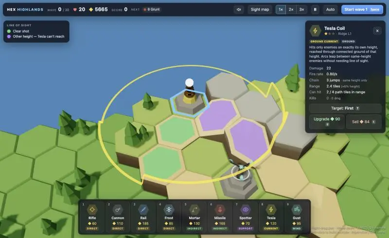

Overlay + legend correct (green same-height, purple other-height). Now combat run with all towers.

Teslas dealing damage, Gusts pushing (0 leaks). Grab an action shot.

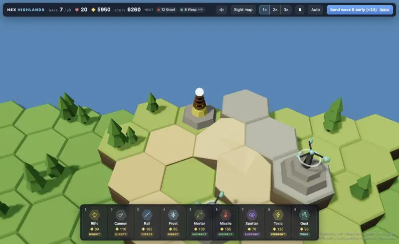

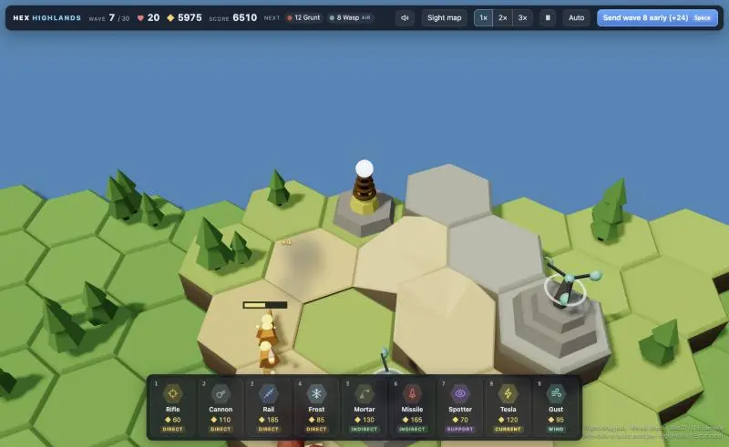

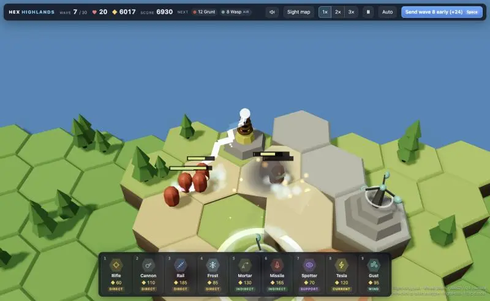

Lightning chain renders (orb → grunts), gust ring visible bottom. Cleanup + final error check.

The Tesla Coil (key 8) and Gust Shrine (key 9) are in, in [index.html](3dtd-opus-5.5-uiltra/index.html), and both work in play. The existing tower hotkeys didn't change.

**Tesla Coil** (◆120, "ground current")
- It hits only enemies on its exact height. The charge also has to reach them over connected ground of that height within range, so it can't jump a cliff or a ridge.
- Each zap chains to 3 more enemies on the same height within about 1.3 tiles, ignoring line of sight. Each jump does 20% less damage, and every upgrade level adds a jump.
- Ground only; Phantoms still need a Spotter.
- Looks like a copper-ringed coil with a glowing orb, idle sparks, jagged lightning and a crackling buzz.

**Gust Shrine** (◆95, "wind")
- Every 3.3 seconds it blasts back every enemy in range that it has a clear line of sight to, on any height. It does no damage.
- The push is 0.75 tiles. Enemies climbing an uphill ramp go 2.5× as far, flyers 1.4×, Brutes 0.6×, Titans 0.3×.
- After a push, an enemy takes only 30% push for 1.5 seconds, so stacking shrines can't freeze the path.
- Enemies slide back smoothly rather than teleporting. Upgrades raise the push to 1.3× and then 1.6×.
- Looks like a stone shrine with a spinning cup anemometer that speeds up after a blast, a wind ring and dust, with a whoosh sound.

**Overlay**
- Two new colours: purple for path at another height (out of the Tesla's reach) and teal for uphill ramps where the Gust pushes 2.5×.
- The legend now shows only the colours currently on screen.
- The Sight map ignores Gust, since it does no damage. Tooltips, the tower panel (with a "Pushed" counter for Gust) and the start screen explain both towers.

**Testing**
- I ran waves 1–6 at 3× speed with both new towers and the others: 81 kills, no lives lost, no console errors.
- I confirmed both new overlay colours, the dynamic legend and the lightning chain visually.
- Not tested: balance against later waves, so their cost and strength are educated guesses.

## You

Lets run the scripts/prompt-md on this conversation

## Claude

Session id from scratchpad: `dd1e5cbe-6126-40f6-a35f-4db1a8f6b8c9`. Passing it explicitly.
