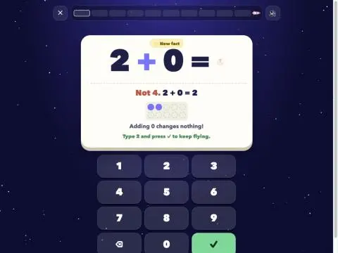
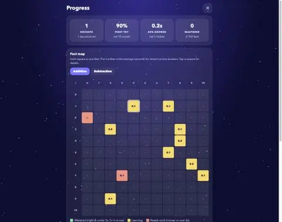
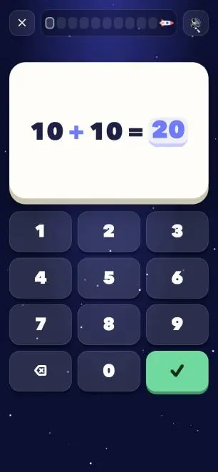
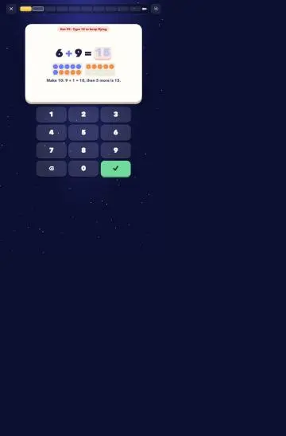

# Prompts

- **Model:** claude-fable-5-2, claude-opus-5-5
- **Effort:** high, medium
- **Session(s):** 7fed538a-66d8-4213-8d85-43dd474e6b3a eac6e170-3645-4413-892c-d3d7b7f71ea2
- **Tokens:** input 158, output 94872, cache read 10804702, cache write 571298
- **Cost (tokscale estimate):** $9.61

## You

I want to create a self-contained HTML/JS/CSS math facts quizzer for my 3rd grader. They are struggling with remembering basic addition and subtraction facts. I'd like to try something that is similar to flash cards, but gamified in some way. At least for now, I want to just start with addition and subtraction. Maybe work in batches of 10, and behind the scenes (using local storage) lets keep track of how long it takes for him to do them.

## Claude

Quizzer built at `fact-rocket/index.html`. Now testing it in browser.






Everything works. Last checks: phone layout, then clearing my test data.


Class name collision: stats `.empty` rule shrinks answer slot. Renaming.


Fixed. Clearing my test runs from storage so your kid starts fresh.

I built it as one file: [fact-rocket/index.html](fact-rocket/index.html). There's nothing to install, so you can open it straight from the folder or serve it on port 8793 with the new `fact-rocket` entry in `.claude/launch.json`. I played full rounds in the browser, including wrong answers, and checked it on a phone-sized screen. That's where I found and fixed a bug that shrank the answer box. I also cleared my test data, so your son starts fresh.

**How it plays**
- **Choosing a round:** he picks adding, taking away or a mix, and "up to 10" or "up to 20". Then he taps Launch.
- **Each round:** 10 flash cards answered on a big number pad (or the keyboard). Each one fills a cell of the rocket's fuel bar: gold if right the first time, blue if he needed help.
- **Stars:** 3 for an answer under 3 seconds, 2 under 6 seconds, 1 for slower. There's a 🔥 counter for 3 or more right in a row.
- **No visible timer.** Speed only shows up as stars, so there's no countdown pressure.
- **Wrong answers:** the card shows the right answer, dots in a ten-frame, and a tip suited to the fact (doubles, near doubles, make 10, counting up, or "think addition" for subtraction). He types the right answer to go on, and the same fact comes back 2–3 cards later.
- **End of a round:** the rocket flies to a new planet (Moon, Mars, Jupiter…) with confetti. The screen shows first-try score, flight time, his record for that mission and the facts to remember.

**Behind the scenes**
- It saves every answer: how long it took, whether it was right, and when. It also saves each round's total time, which skips feedback animations and any time the tab was hidden.
- Picking facts adapts to him. Facts he misses, answers slowly or hasn't seen yet come up more often. Mastered facts (right and under 3 seconds three times in a row) come up less, and easy facts with 0s and 1s are rarer. A round never has both 3+5 and 5+3.
- **The "Grown-ups: see progress" link** has:
  - totals, plus his average answer time now compared with his first rounds
  - a colour-coded map of every addition and subtraction fact; tap a square for its history
  - his trickiest facts
  - the last 20 rounds
  - JSON export and a reset button

**Things to know**
- Progress is saved per browser, and opening the file directly and using the local server count as separate places. Use one consistently on his device.
- There's sound, with a mute button in the top corner.
- The 3-second and 6-second cut-offs are set in `FAST` and `SLOW` at the top of the script if they turn out too strict for him.

## You

Lets push our repo

## Claude

Pushed `master` to `danwatt/ai-experiments`, and local now matches the remote.

- **New commit:** `9a00b75 feat(fact-rocket): gamified addition/subtraction flash cards`, with `fact-rocket/index.html` and `.claude/launch.json`.
- **Also went up:** your 2 local commits that hadn't been pushed yet (`912294c` and `18e1f8d`, the selah refactor and fix).
- **`launch.json` included two of your entries:** the file also had your uncommitted `tx-lege-report` and `emotion-tts` dev-server entries, so those were pushed too. Their folders are still untracked, so those two entries point to folders not in the repo yet.
- **Left out:** `.DS_Store`, `3dtd-opus-5.5-uiltra/`, `math-garden/`, `tx-lege/` and `voicebox-samples/`. They're still untracked and weren't pushed.

## You

lets add tx-lege and math-garden, and push those as well. Lets also add a recursive ignore for .DS_Store

## Claude

Clean. No secrets; tx-lege already ignores cache/venv/output. Adding root `.gitignore`, committing, pushing.

Pushed `d59cc34` to `master` on `danwatt/ai-experiments`. Local and remote match.

- **math-garden:** `README.md` and `index.html`.
- **tx-lege:** source code, tests, `pyproject.toml`, `uv.lock`, README and its own `.gitignore`. That `.gitignore` keeps out the 78 MB of `.cache/`, `.venv/` and `output/`, so only source went up. I checked the source for anything like API keys or passwords before committing and found none.
- **Root `.gitignore`:** `**/.DS_Store` ignores it in every folder, including the one in `tx-lege/`.

Still untracked: `3dtd-opus-5.5-uiltra/` and `voicebox-samples/`.

## You

Looking good so far. I would like for it to randomly switch between horizontal "x + y = " and the vertical version.

## Claude


Columns line up. "New fact" tag crowds the top number; nudging it down.


Page was still loading. Retrying.


Tag clears number now. Clearing test data.

Each card now randomly shows either `x + y =` on one line or the stacked layout, about half and half. I checked both on desktop and phone width with no console errors, then cleared my test data again.

The stacked card looks like a worksheet problem:
```
    8
+  10
 ────
   18
```
- **Columns line up:** the numbers are right-aligned so ones sit under ones. The answer box is under the bar and fills from the right, so a two-digit answer lines up once both digits are typed.
- **Fits the screen:** stacked numbers use a slightly smaller font so the card still fits on a phone next to the number pad.
- **Tag spacing:** I moved the stacked number down a little because the "✨ New fact" tag was crowding the top number.
- **Recorded per answer:** each answer is now saved with `vertical: true/false`. That means you could later compare his speed in the two layouts, though the grown-ups page doesn't show it yet.

The change is in [fact-rocket/index.html](fact-rocket/index.html) and isn't committed yet.

## You

Lets make the horizontal and vertical white boxes take up the same amount of space, so that the keyboard always stays in the same spot

## Claude

Overflow cause: horizontal font scales with screen width, not card width; "10 + 10 = 20" needs ~6.4em. Fix: size font off card width via container units.



Both fixed: same card height and keypad position in both layouts, and 10 + 10 = 20 fits on phone and desktop.

I fixed both: the white box is the same height in either layout, so the keypad stays put, and 10 + 10 = 20 now fits. I tested 10 + 10 = 20 in both layouts at desktop and phone width. The keypad sat in exactly the same spot and nothing ran past the box edges.

- **Same height:** the problem area always uses the height of the stacked version. The one-line version sits centred in that space.
- **Overflow:** the one-line font size followed the screen width, not the box width, so "10 + 10 = 20" ran wider than the box. It now scales to the box and tops out at the old size, so short facts look about the same while 10s fit.

When he gets an answer wrong, the help panel with the dots and tip still makes the box taller and pushes the keypad down until the next card. That's unchanged.

Both changes are in [fact-rocket/index.html](fact-rocket/index.html) and aren't committed yet.

## You

Ok, when we have an error, it makes the keyboard slide down. I'd really like to make sure the keyboard stays in place.

For what its worth, the target devices for this are a phone and an ipad mini

## Claude


Small phone passes: keypad at same spot in all three states, hint fits. Checking larger phone and iPad mini both orientations.

All four sizes pass. Last: real wrong-answer flow on iPad mini portrait.



The keypad now stays in place when he gets one wrong. The hint fits inside the same white box instead of making it taller.

I checked the keypad position at four screen sizes. Each time I compared a one-line card, a stacked card, and a wrong answer with the biggest hint (two ten-frames and the longest tip):

| Screen | Keypad position (one-line / stacked / hint) | Page scrolls? |
|---|---|---|
| Small phone (375×667) | same in all three | no |
| Large phone (390×844) | same in all three | no |
| iPad mini portrait | same in all three | no |
| iPad mini landscape | same in all three | no |

I also played a real wrong answer on the iPad mini size, typed the right answer, and the next card came up with the keypad still in place.

**What changed for a wrong answer**
- **Problem:** it shrinks to one line in the same box, so a stacked problem switches to one line while the hint is up.
- **Hint:** the ten-frame dots and tip go right under the problem, sized to fit the box.
- **Message:** "Not 14 · Type 15 to keep flying" now goes in the red tag at the top of the card. Before, it was a separate line that made the box taller.
- **Answer box:** it shows the right answer in faint grey, and he types over it.

The number pad buttons are also a little shorter on short screens, so everything fits on an iPad mini held sideways without scrolling.

On iPad mini portrait the card and keypad leave a lot of empty space at the bottom; making both bigger there is an option.

The changes are in [fact-rocket/index.html](fact-rocket/index.html) and aren't committed yet.

## You

Commit the card layout fixes and push to master.

## Claude

Pushed `ef1d403` to `master`, and local matches the remote. It has the random side-by-side or stacked layout, the fixed-height card so the keypad stays put, the hint fitting inside the card, and the 10 + 10 overflow fix.

Some files weren't in this commit:
- **`.claude/launch.json`:** it has new edits I didn't make, so I left it uncommitted.
- **Untracked folders:** `3dtd-opus-5.5-uiltra/`, `overhead/` (new since last push) and `voicebox-samples/`.

## You

Lets run the scripts/prompt-md on this conversation

## Claude

Output good, two fixes needed: drop unrelated tx-lege/math-garden push section, and restore your mid-turn "10+10 overflows" message (script missed it).

I generated [fact-rocket/prompt.md](fact-rocket/prompt.md) from this session, and its 14 screenshots are saved in `fact-rocket/prompt-assets/`.

- **Header:** claude-opus-5-5 at high effort, $5.60 estimated cost. That cost and the token counts cover the whole session, including the tx-lege/math-garden push.
- **Removed:** the tx-lege/math-garden push and this "run prompt-md" request, since neither is part of the demo.
- **Added back:** your "10+10 overflows the white box" message. You sent it while I was working, and the script didn't capture it, which left the overflow fix with no prompt above it. It now appears under the matching prompt with a note that it was sent mid-turn.
- **Screenshot 13:** it shows test content I put on the card for sizing ("10 + 10 = 18" with a subtraction tip), not a real card.

Not committed yet.

## You

Lets take a look at fact-rocket. How can we make this better, covering the features we have today (just addition and subtraction).

## Claude

Read [index.html](index.html) end to end. Not played in browser this pass. Visuals and feel solid. Weak spot is learning engine: what gets asked, and what counts as "known".

## Learning engine (biggest wins)

1. **Missed facts barely come back.** `weight()` gives trouble 6, unseen 3. Fresh addition pool: 81 non-trivial unseen × 3 + 40 trivial × 0.9 ≈ 279 total weight. One trouble fact = ~2% per draw, ~20% chance per round. Kid misses 8 + 7, sees it once more same round, then maybe not for 5 rounds. Fix: guarantee slots. Every round takes up to 3–4 trouble facts first, then fills rest.

2. **Too many new facts at once.** Same math: first dozen rounds are ~9 of 10 brand-new facts. Bad for struggling kid. Fix: cap new facts at 2–3 per round, rest from known/learning (incremental rehearsal). Builds confidence, still moves forward.

3. **Mastery earned too cheap.**
   - Comeback card answer counts in `recent`. Kid copies ghost answer, sees card again 3 cards later, answers in 2s. That counts as one of three "mastered" answers.
   - All three fast answers can land same day. Short-term memory, not recall.
   - Fix: comeback answers don't count toward mastery; require fast-correct on 2+ different days.

4. **3-second clock measures fingers, not memory.** Time runs until ✓ pressed. Answer 17 needs three taps. Fix: record time to first digit as recall time (keep total time too). Also cap at ~20s so one walk-away doesn't wreck averages.

5. **No strategy order.** "Up to 10 / Up to 20" is coarse. Better ladder: +0/+1, doubles, make-10 pairs, near doubles, +9/+8 bridging, then matching subtraction families. Tips already speak this language; selection doesn't. Unlock next group when current mostly mastered.

## Motivation

6. **Stars buy nothing.** `S.stars` just counts up. Add unlocks: rocket colors, planet badges.
7. **Speed record fights adaptivity.** Rounds get harder as engine targets weak facts, so "fastest flight" gets harder to beat. Swap for "facts mastered: 34 of 121" as kid-facing progress, plus day streak.
8. **Kid can't see own progress.** Fact map hidden in grown-ups page. Kid-friendly version (stars lighting up) would motivate.

## Device (phone + iPad mini)

9. **No sync, no import.** Export exists, import doesn't. Phone and iPad hold separate progress. Add Import JSON at minimum.
10. **Home-screen app.** Add manifest + apple-touch-icon so it runs fullscreen, no Safari bars. Swap `100vh` for `100dvh`.
11. **Keypad uses `click`.** `pointerdown` responds faster, timing more accurate.
12. **iPad mini portrait** leaves empty space under keypad (noted last session, never fixed). Scale card and keys up there.

## Grown-ups page

13. Trend chart over days (average recall time, mastered count). Now only "first 5 vs last 5".
14. Horizontal vs vertical comparison. Data already saved per answer, never shown.

Recommend 1–4 first: small code change, biggest effect on actual learning. Item 5 next, bigger design. Rest polish.

## You

Lets address the learning engine 1-4

## Claude

Edits in. Testing rounds in browser now.

All four in [index.html](games/fact-rocket/index.html). Played three rounds in browser, no console errors, test data cleared. Not committed.

**1. Missed facts come back.** Each round now takes up to 4 "needs work" facts first. Test with 8 trouble facts seeded: round had 4 of them.

**2. New facts capped.** Max 3 brand-new facts per round, dropping to 1 when 6+ facts need work. Rest of round comes from facts already seen. Fresh start with nothing seen: round 1 was 3 new + 7 easy ones (0s, 1s, x − x); round 2 was 7 seen + 3 new.

**3. Mastery harder to fake.**
- Comeback cards no longer recorded in fact history (still listed in round log).
- Three quick right answers must span 2+ days. Test: three on same day stays "Learning"; spread over two days shows "Mastered".
- Fact answered quick today gets lower weight for rest of day.

**4. Thinking time, not typing time.** Clock stops at first digit of answer, with 2s allowance for typing rest. Slower typing than that counts as thinking. Test: first digit at 1.3s, ✓ at 4.2s, recorded 2.2s. Recorded time capped at 20s.

Things to know:
- **Existing progress:** old answers have no date, so all count as one "old" day. Facts now "Mastered" drop to "Learning" until one more quick right answer on new day.
- **Averages shift:** new times are shorter than old ones (typing excluded), so grown-ups "Avg answer" will look like sudden jump in speed.
- **Flight time unchanged:** still full time on cards, uncapped.
- **Knobs:** `TROUBLE_MAX`, `NEW_MAX`, `TYPING`, `MAX_MS` at top of script.

## You

Commit the working tree changes with a sensible message.
