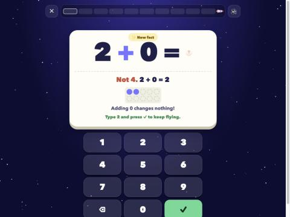
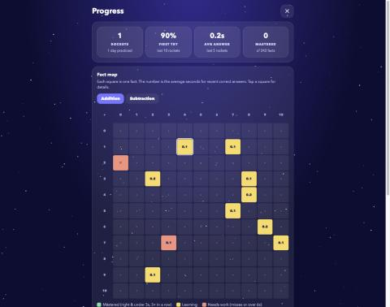
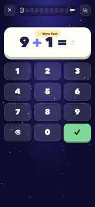
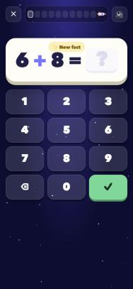
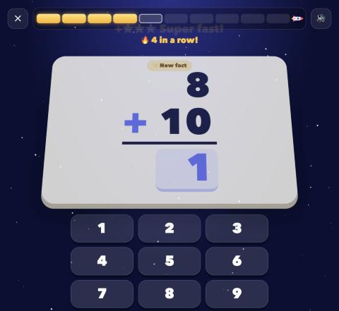
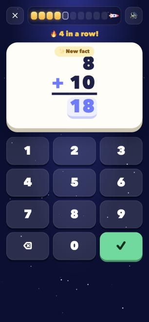
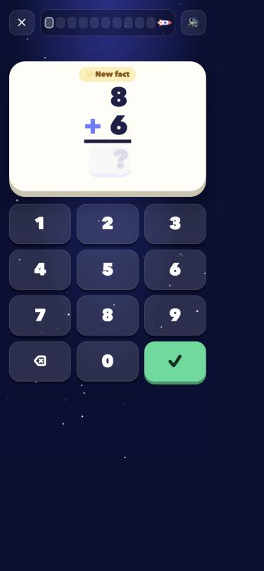
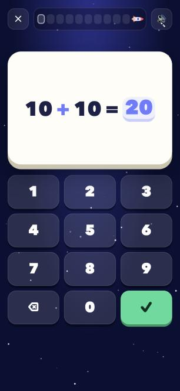
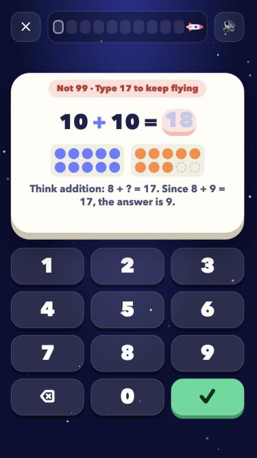

# Prompts

- **Model:** claude-opus-5-5
- **Effort:** high
- **Session(s):** 7fed538a-66d8-4213-8d85-43dd474e6b3a
- **Tokens:** input 120, output 75766, cache read 8317305, cache write 484540
- **Cost (tokscale estimate):** $5.6

## You

I want to create a self-contained HTML/JS/CSS math facts quizzer for my 3rd grader. They are struggling with remembering basic addition and subtraction facts. I'd like to try something that is similar to flash cards, but gamified in some way. At least for now, I want to just start with addition and subtraction. Maybe work in batches of 10, and behind the scenes (using local storage) lets keep track of how long it takes for him to do them.

## Claude

Quizzer built at `fact-rocket/index.html`. Now testing it in browser.






Everything works. Last checks: phone layout, then clearing my test data.




Class name collision: stats `.empty` rule shrinks answer slot. Renaming.



Fixed. Clearing my test runs from storage so your kid starts fresh.

I built it as one file: [fact-rocket/index.html](fact-rocket/index.html). There's nothing to install, so you can open it straight from the folder or serve it on port 8793 with the new `fact-rocket` entry in `.claude/launch.json`. I played full rounds in the browser, including wrong answers, and checked it on a phone-sized screen. That's where I found and fixed a bug that shrank the answer box. I also cleared my test data, so your son starts fresh.

**How it plays**
- **Choosing a round:** he picks adding, taking away or a mix, and "up to 10" or "up to 20". Then he taps Launch.
- **Each round:** 10 flash cards answered on a big number pad (or the keyboard). Each one fills a cell of the rocket's fuel bar: gold if right the first time, blue if he needed help.
- **Stars:** 3 for an answer under 3 seconds, 2 under 6 seconds, 1 for slower. There's a 🔥 counter for 3 or more right in a row.
- **No visible timer.** Speed only shows up as stars, so there's no countdown pressure.
- **Wrong answers:** the card shows the right answer, dots in a ten-frame, and a tip suited to the fact (doubles, near doubles, make 10, counting up, or "think addition" for subtraction). He types the right answer to go on, and the same fact comes back 2–3 cards later.
- **End of a round:** the rocket flies to a new planet (Moon, Mars, Jupiter…) with confetti. The screen shows first-try score, flight time, his record for that mission and the facts to remember.

**Behind the scenes**
- It saves every answer: how long it took, whether it was right, and when. It also saves each round's total time, which skips feedback animations and any time the tab was hidden.
- Picking facts adapts to him. Facts he misses, answers slowly or hasn't seen yet come up more often. Mastered facts (right and under 3 seconds three times in a row) come up less, and easy facts with 0s and 1s are rarer. A round never has both 3+5 and 5+3.
- **The "Grown-ups: see progress" link** has:
  - totals, plus his average answer time now compared with his first rounds
  - a colour-coded map of every addition and subtraction fact; tap a square for its history
  - his trickiest facts
  - the last 20 rounds
  - JSON export and a reset button

**Things to know**
- Progress is saved per browser, and opening the file directly and using the local server count as separate places. Use one consistently on his device.
- There's sound, with a mute button in the top corner.
- The 3-second and 6-second cut-offs are set in `FAST` and `SLOW` at the top of the script if they turn out too strict for him.

## You

Lets push our repo

## Claude

Pushed `master` to `danwatt/ai-experiments`, and local now matches the remote.

- **New commit:** `9a00b75 feat(fact-rocket): gamified addition/subtraction flash cards`, with `fact-rocket/index.html` and `.claude/launch.json`.
- **Also went up:** your 2 local commits that hadn't been pushed yet (`912294c` and `18e1f8d`, the selah refactor and fix).
- **`launch.json` included two of your entries:** the file also had your uncommitted `tx-lege-report` and `emotion-tts` dev-server entries, so those were pushed too. Their folders are still untracked, so those two entries point to folders not in the repo yet.
- **Left out:** `.DS_Store`, `3dtd-opus-5.5-uiltra/`, `math-garden/`, `tx-lege/` and `voicebox-samples/`. They're still untracked and weren't pushed.

## You

Looking good so far. I would like for it to randomly switch between horizontal "x + y = " and the vertical version.

## Claude





Columns line up. "New fact" tag crowds the top number; nudging it down.


Page was still loading. Retrying.



Tag clears number now. Clearing test data.

Each card now randomly shows either `x + y =` on one line or the stacked layout, about half and half. I checked both on desktop and phone width with no console errors, then cleared my test data again.

The stacked card looks like a worksheet problem:
```
    8
+  10
 ────
   18
```
- **Columns line up:** the numbers are right-aligned so ones sit under ones. The answer box is under the bar and fills from the right, so a two-digit answer lines up once both digits are typed.
- **Fits the screen:** stacked numbers use a slightly smaller font so the card still fits on a phone next to the number pad.
- **Tag spacing:** I moved the stacked number down a little because the "✨ New fact" tag was crowding the top number.
- **Recorded per answer:** each answer is now saved with `vertical: true/false`. That means you could later compare his speed in the two layouts, though the grown-ups page doesn't show it yet.

The change is in [fact-rocket/index.html](fact-rocket/index.html) and isn't committed yet.

## You

Lets make the horizontal and vertical white boxes take up the same amount of space, so that the keyboard always stays in the same spot

*(sent while Claude was working on the above)*

Also, when doing 10+10, or even 10+9, the numbers overflow the white box.

## Claude

Overflow cause: horizontal font scales with screen width, not card width; "10 + 10 = 20" needs ~6.4em. Fix: size font off card width via container units.



Both fixed: same card height and keypad position in both layouts, and 10 + 10 = 20 fits on phone and desktop.

I fixed both: the white box is the same height in either layout, so the keypad stays put, and 10 + 10 = 20 now fits. I tested 10 + 10 = 20 in both layouts at desktop and phone width. The keypad sat in exactly the same spot and nothing ran past the box edges.

- **Same height:** the problem area always uses the height of the stacked version. The one-line version sits centred in that space.
- **Overflow:** the one-line font size followed the screen width, not the box width, so "10 + 10 = 20" ran wider than the box. It now scales to the box and tops out at the old size, so short facts look about the same while 10s fit.

When he gets an answer wrong, the help panel with the dots and tip still makes the box taller and pushes the keypad down until the next card. That's unchanged.

Both changes are in [fact-rocket/index.html](fact-rocket/index.html) and aren't committed yet.

## You

Ok, when we have an error, it makes the keyboard slide down. I'd really like to make sure the keyboard stays in place.

For what its worth, the target devices for this are a phone and an ipad mini

## Claude



Small phone passes: keypad at same spot in all three states, hint fits. Checking larger phone and iPad mini both orientations.

All four sizes pass. Last: real wrong-answer flow on iPad mini portrait.


The keypad now stays in place when he gets one wrong. The hint fits inside the same white box instead of making it taller.

I checked the keypad position at four screen sizes. Each time I compared a one-line card, a stacked card, and a wrong answer with the biggest hint (two ten-frames and the longest tip):

| Screen | Keypad position (one-line / stacked / hint) | Page scrolls? |
|---|---|---|
| Small phone (375×667) | same in all three | no |
| Large phone (390×844) | same in all three | no |
| iPad mini portrait | same in all three | no |
| iPad mini landscape | same in all three | no |

I also played a real wrong answer on the iPad mini size, typed the right answer, and the next card came up with the keypad still in place.

**What changed for a wrong answer**
- **Problem:** it shrinks to one line in the same box, so a stacked problem switches to one line while the hint is up.
- **Hint:** the ten-frame dots and tip go right under the problem, sized to fit the box.
- **Message:** "Not 14 · Type 15 to keep flying" now goes in the red tag at the top of the card. Before, it was a separate line that made the box taller.
- **Answer box:** it shows the right answer in faint grey, and he types over it.

The number pad buttons are also a little shorter on short screens, so everything fits on an iPad mini held sideways without scrolling.

On iPad mini portrait the card and keypad leave a lot of empty space at the bottom; making both bigger there is an option.

The changes are in [fact-rocket/index.html](fact-rocket/index.html) and aren't committed yet.

## You

Commit the card layout fixes and push to master.

## Claude

Pushed `ef1d403` to `master`, and local matches the remote. It has the random side-by-side or stacked layout, the fixed-height card so the keypad stays put, the hint fitting inside the card, and the 10 + 10 overflow fix.

Some files weren't in this commit:
- **`.claude/launch.json`:** it has new edits I didn't make, so I left it uncommitted.
- **Untracked folders:** `3dtd-opus-5.5-uiltra/`, `overhead/` (new since last push) and `voicebox-samples/`.
