# Prompts

- **Model:** claude-opus-5-5
- **Effort:** high
- **Session(s):** 9a1fa48e-c673-4928-9e29-f2ea9ec83728
- **Tokens:** input 162, output 128336, cache read 16427643, cache write 244721
- **Cost (tokscale estimate):** $7.81

## You

Help me build a simulator. Specifically, what I want is to simulate the Factorio circuit network as a learning aid.

Must haves:

Constant combinator
Arithmetic combinator
Selector combinator
Decider combinator
Red and green wires
Logic conditions and outputs like Factorio's
Some dummy "buildings" that are capable of producing or accepting signals from the circuit network

Environment:

I'd like this written in Javascript, using the retejs.org library
Target platform: Web
Build: do not install anything. Use docker as neecssary

Place in `games/factorio-circuit-simulator-opus-5.5-high`

Do not look at other projects for inspiration, this should be self-contained.

## Claude

Inspected Rete React plugin API. Checking connection-plugin flow rules next, then bundling.

Bundle built (269 KB, Rete 2 + React 18 + htm). Writing simulation engine next.

12/12 sim tests pass (int32 math, wildcards, AND/OR precedence, tick delay, clock, memory cell, selector, latch). Now Rete editor + UI.

Engine + tests done, editor/nodes/examples written. Now main app shell, HTML and CSS.

Now launch config + browser preview.

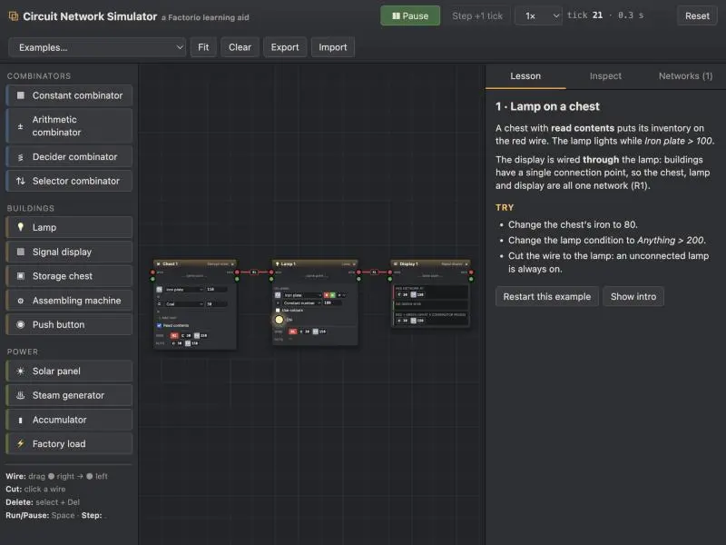

Boots clean, no errors. Zooming to check node rendering.

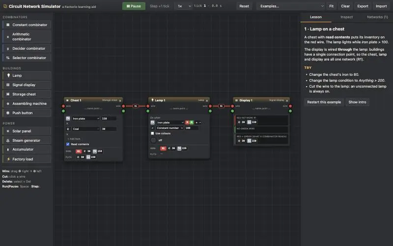

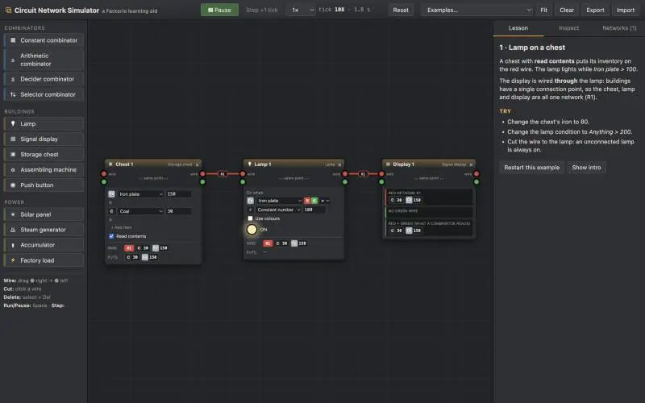

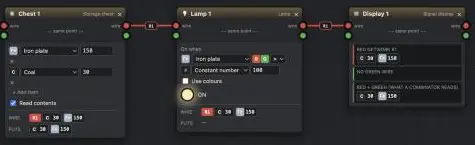

Example 1 renders and lamp logic works. Now cycling through other examples to check layouts.

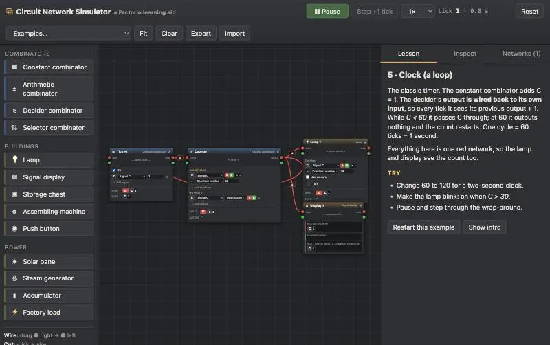

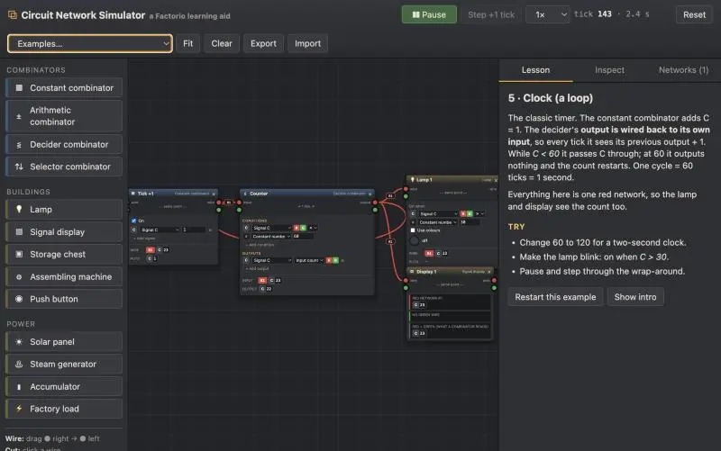

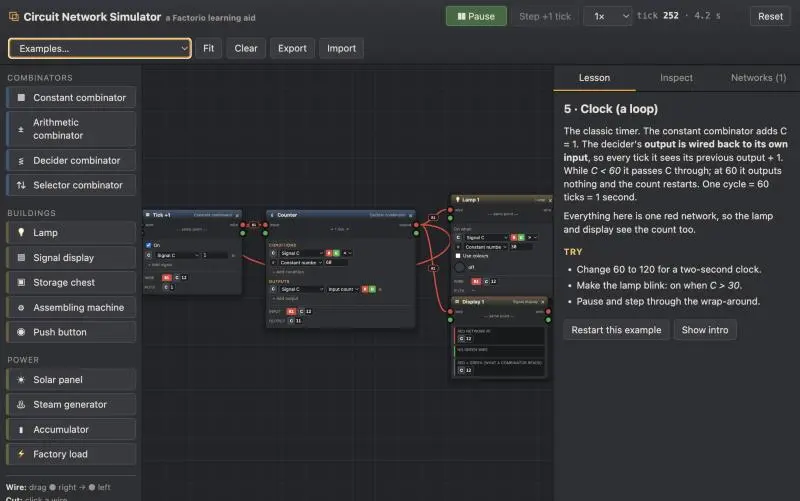

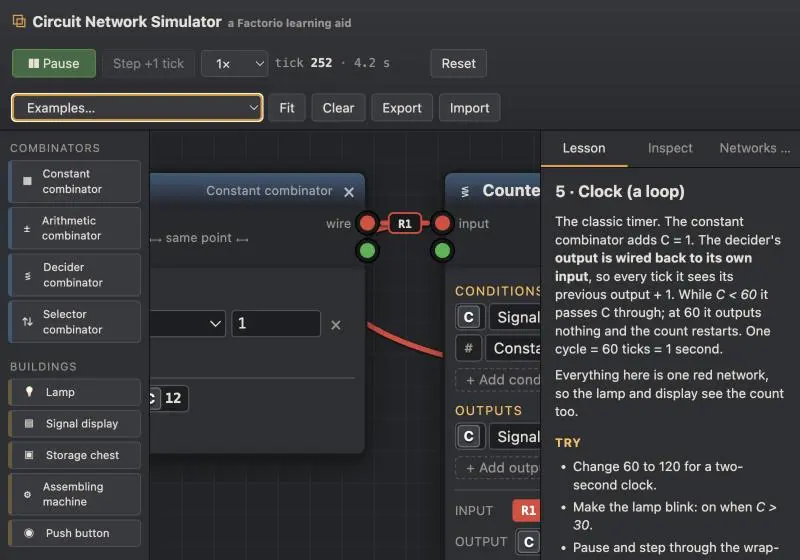

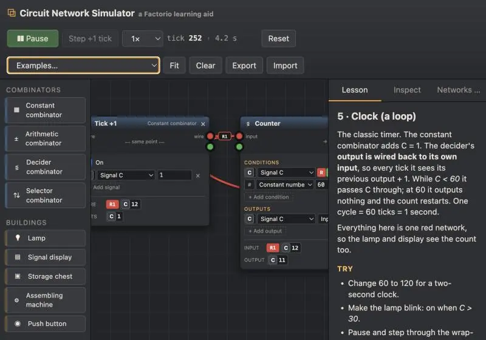

Clock counts correctly (input C12 → output C11, 1-tick lag). Checking all examples for node overlap programmatically.

Now power example behavior check via JS fast-forward.

All example circuits compute correctly (power latch switches 9× in 4 min, accumulator 19–100%). Testing mouse wiring next.

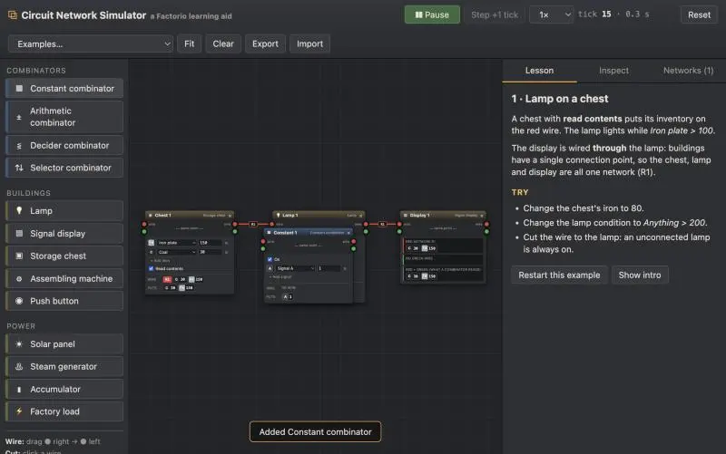

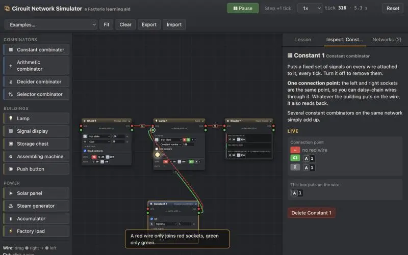

Wiring works; wrong-colour drop is rejected with a message. Rejected pseudo-wire lingers though — checking flow code to drop it.

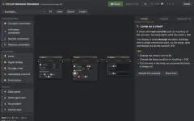

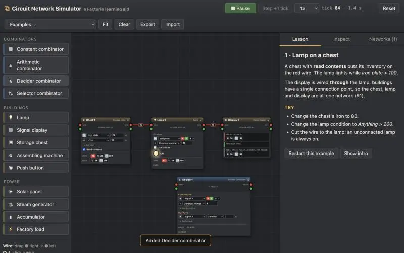

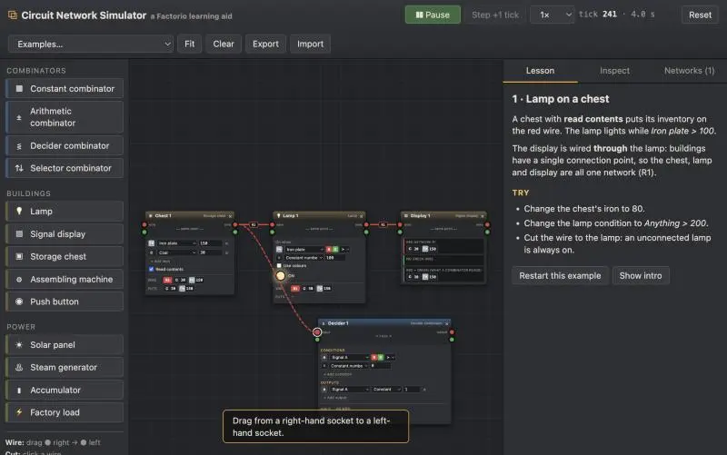

Node delete works. Wire-cut click missed the curve — computing exact wire midpoint to retest.

Wire cut works. Checking power example visually and the Networks tab.

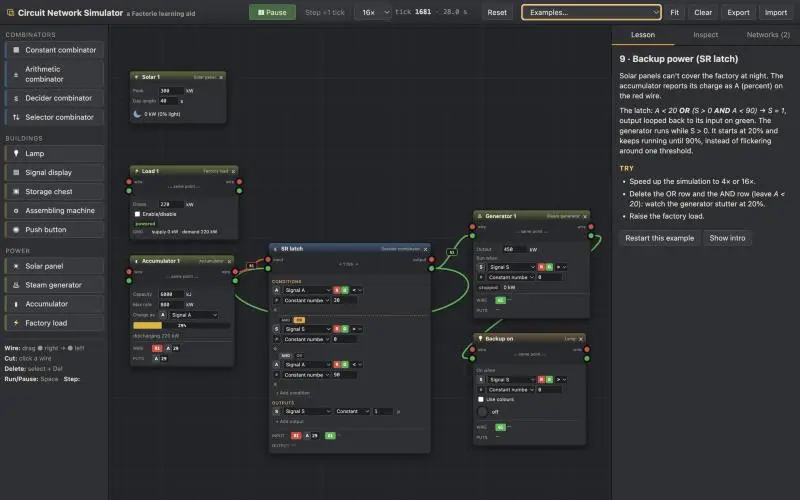

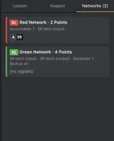

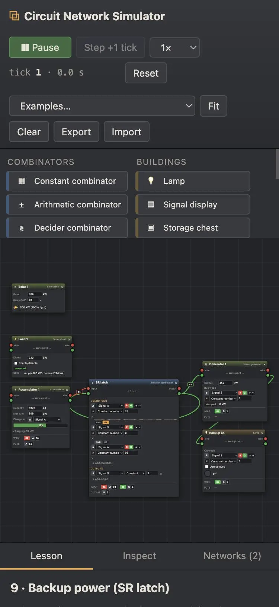

Mobile layout works, no console errors. Now README, landing-page entry, and screenshot.

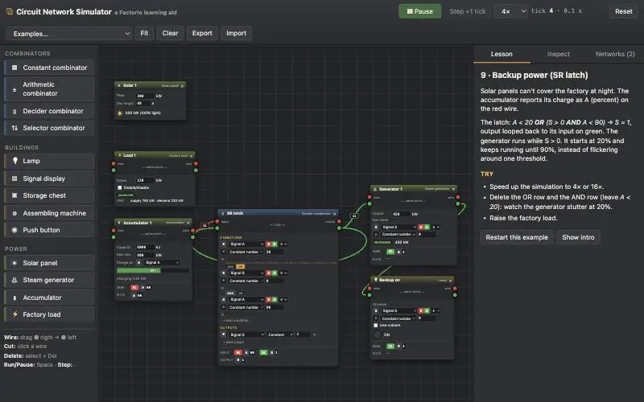

Found startup glitch: accumulator's A is missing on tick 0, so latch reads A=0 and turns the generator on at 68%. Fix: prime source buildings' outputs when added.

13/13 pass. Re-verifying power example startup in browser.

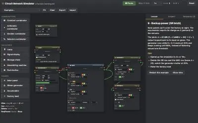

Pane is hidden (rAF paused), so stepping manually.

Browser served cached old module. Forcing cache refresh.

Fixed. Capturing landing screenshot.

Simulator built and running at `games/factorio-circuit-simulator-opus-5.5-high/`. All 13 simulation tests pass, and I tested it in the browser: loaded every example, dragged wires, rejected a wrong-colour wire, cut a wire, deleted a node, and checked the phone layout. Nothing is committed yet.

**Everything you listed is in:**
- **Constant combinator:** a list of signals with an on/off switch.
- **Arithmetic combinator:** all 11 operations and the Each wildcard. You can pick red only, green only, or both for each input. Numbers wrap around like the game's 32-bit integers, and dividing by zero gives 0.
- **Decider combinator:** several conditions joined with AND/OR (AND is grouped first), plus Everything, Anything and Each. It can have several outputs, each either a fixed value or a copy of the input value.
- **Selector combinator:** select input, count inputs, random input and stack size. Quality and rocket modes are left out.
- **Red and green wires:** each connected group of one colour is a network, labelled R1, G2 and so on. Everything on a network adds up. A combinator reads red and green added together, and its result appears one tick later.
- **Dummy buildings:** lamp (with colour mode), signal display, storage chest, assembling machine (on/off condition, reads its own stock), push button (one-tick pulse or toggle), solar panel with day and night, steam generator, accumulator (puts its charge % on the wire) and a factory power load.
- **Learning aids:**
  - Help text for every box, plus an Inspect tab showing what each connection point reads and writes.
  - A Networks tab listing every network.
  - Pause, step one tick at a time, and speeds from 0.1× to 16×.
  - Nine guided examples, including a clock, a memory/counter cell, stock control with hysteresis, and backup power using an SR latch.

**Build:** nothing is installed on your machine.
- `vendor-src/build.sh` bundles Rete.js 2 and React 18 into `vendor/rete-bundle.js` inside Docker.
- `./run-tests.sh` runs the tests with Node in Docker.
- The app itself is plain ES modules with no build step.

**Two differences from the game you should know about:**
- **Wire direction:** Rete wires have a direction, so you always drag from a right-hand socket to a left-hand one. The simulator ignores direction when it groups wires into networks. One side effect: you can't wire one combinator's output straight to another's output; you join them through a shared input instead.
- **Building sockets:** each building has a single connection point. Its left and right sockets are the same point, which lets you chain wires through it.

**One fix during testing:** on the first tick the accumulator hadn't reported its charge yet, so the latch read 0% and turned the backup generator on. Chests, constant combinators and accumulators now put their signals on the wire as soon as they're placed.

**Repo housekeeping:**
- Added a landing card to `demos.js` and its 640×400 screenshot.
- Added a README and a preview entry in `.claude/launch.json`.
- Generated `prompt.md`. Its 22 screenshots include a couple of blank zoom crops from testing that you may want to delete.

## You

lets do the prompt-md, screenshot, and index.html, then we can commit just this experiments. There are others I don't want committed yet

## Claude

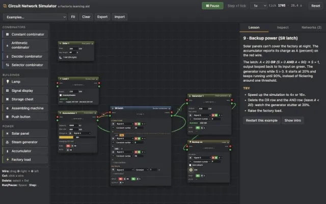
