# Prompts

- **Model:** claude-opus-5-5
- **Effort:** high
- **Session(s):** 9a1fa48e-c673-4928-9e29-f2ea9ec83728
- **Tokens:** input 314, output 222488, cache read 30529004, cache write 409615
- **Cost (tokscale estimate):** $13.83

## You

Help me build a simulator. Specifically, what I want is to simulate the Factorio circuit network as a learning aid.

Must haves:

Constant combinator
Arithmetic combinator
Selector combinator
Decider combinator
Red and green wires
Logic conditions and outputs like Factorio's
Some dummy "buildings" that are capable of producing or accepting signals from the circuit network

Environment:

I'd like this written in Javascript, using the retejs.org library
Target platform: Web
Build: do not install anything. Use docker as neecssary

Place in `games/factorio-circuit-simulator-opus-5.5-high`

Do not look at other projects for inspiration, this should be self-contained.

## Claude

Inspected Rete React plugin API. Checking connection-plugin flow rules next, then bundling.

Bundle built (269 KB, Rete 2 + React 18 + htm). Writing simulation engine next.

12/12 sim tests pass (int32 math, wildcards, AND/OR precedence, tick delay, clock, memory cell, selector, latch). Now Rete editor + UI.

Engine + tests done, editor/nodes/examples written. Now main app shell, HTML and CSS.

Now launch config + browser preview.


Boots clean, no errors. Zooming to check node rendering.


Example 1 renders and lamp logic works. Now cycling through other examples to check layouts.


Clock counts correctly (input C12 → output C11, 1-tick lag). Checking all examples for node overlap programmatically.

Now power example behavior check via JS fast-forward.

All example circuits compute correctly (power latch switches 9× in 4 min, accumulator 19–100%). Testing mouse wiring next.


Wiring works; wrong-colour drop is rejected with a message. Rejected pseudo-wire lingers though — checking flow code to drop it.


Node delete works. Wire-cut click missed the curve — computing exact wire midpoint to retest.

Wire cut works. Checking power example visually and the Networks tab.


Mobile layout works, no console errors. Now README, landing-page entry, and screenshot.


Found startup glitch: accumulator's A is missing on tick 0, so latch reads A=0 and turns the generator on at 68%. Fix: prime source buildings' outputs when added.

13/13 pass. Re-verifying power example startup in browser.


Pane is hidden (rAF paused), so stepping manually.

Browser served cached old module. Forcing cache refresh.

Fixed. Capturing landing screenshot.


Simulator built and running at `games/factorio-circuit-simulator-opus-5.5-high/`. All 13 simulation tests pass, and I tested it in the browser: loaded every example, dragged wires, rejected a wrong-colour wire, cut a wire, deleted a node, and checked the phone layout. Nothing is committed yet.

**Everything you listed is in:**
- **Constant combinator:** a list of signals with an on/off switch.
- **Arithmetic combinator:** all 11 operations and the Each wildcard. You can pick red only, green only, or both for each input. Numbers wrap around like the game's 32-bit integers, and dividing by zero gives 0.
- **Decider combinator:** several conditions joined with AND/OR (AND is grouped first), plus Everything, Anything and Each. It can have several outputs, each either a fixed value or a copy of the input value.
- **Selector combinator:** select input, count inputs, random input and stack size. Quality and rocket modes are left out.
- **Red and green wires:** each connected group of one colour is a network, labelled R1, G2 and so on. Everything on a network adds up. A combinator reads red and green added together, and its result appears one tick later.
- **Dummy buildings:** lamp (with colour mode), signal display, storage chest, assembling machine (on/off condition, reads its own stock), push button (one-tick pulse or toggle), solar panel with day and night, steam generator, accumulator (puts its charge % on the wire) and a factory power load.
- **Learning aids:**
  - Help text for every box, plus an Inspect tab showing what each connection point reads and writes.
  - A Networks tab listing every network.
  - Pause, step one tick at a time, and speeds from 0.1× to 16×.
  - Nine guided examples, including a clock, a memory/counter cell, stock control with hysteresis, and backup power using an SR latch.

**Build:** nothing is installed on your machine.
- `vendor-src/build.sh` bundles Rete.js 2 and React 18 into `vendor/rete-bundle.js` inside Docker.
- `./run-tests.sh` runs the tests with Node in Docker.
- The app itself is plain ES modules with no build step.

**Two differences from the game you should know about:**
- **Wire direction:** Rete wires have a direction, so you always drag from a right-hand socket to a left-hand one. The simulator ignores direction when it groups wires into networks. One side effect: you can't wire one combinator's output straight to another's output; you join them through a shared input instead.
- **Building sockets:** each building has a single connection point. Its left and right sockets are the same point, which lets you chain wires through it.

**One fix during testing:** on the first tick the accumulator hadn't reported its charge yet, so the latch read 0% and turned the backup generator on. Chests, constant combinators and accumulators now put their signals on the wire as soon as they're placed.

**Repo housekeeping:**
- Added a landing card to `demos.js` and its 640×400 screenshot.
- Added a README and a preview entry in `.claude/launch.json`.
- Generated `prompt.md`. Its 22 screenshots include a couple of blank zoom crops from testing that you may want to delete.

## You

lets do the prompt-md, screenshot, and index.html, then we can commit just this experiments. There are others I don't want committed yet

## Claude


Two blank crops (003, 005, ~300 bytes). Dropping them.

Staged index correct: only Rete demo, its screenshot, its `demos.js` line and launch entry. Godot demo stays unstaged.

I committed only this simulator, as `ef00f58` on a new branch `factorio-circuit-sim-rete` (not on master, since that's the default branch).

**What's in the commit:**
- **`prompt.md`:** rebuilt so it includes your last message (estimated cost $7.81). I removed two blank zoom screenshots (`003`, `005`) and their links.
- **Screenshot:** the existing 640×400 `screenshots/games/factorio-circuit-simulator-opus-5.5-high.webp`. I checked it and it shows the backup-power example.
- **Landing page:** only the "Circuit Network Simulator · Rete.js" line in `demos.js`.
- **`.claude/launch.json`:** only the `factorio-circuit-sim` entry.
- **The demo folder:** 41 files. `node_modules` is not included.

**Still uncommitted, as you wanted:** the `circuit-network-opus-5.5-high` folder and its screenshot. The `demos.js` card and `launch.json` entry for that demo also stay uncommitted.

Nothing is pushed. Getting the commit onto master is a fast-forward:

```bash
git switch master && git merge --ff-only factorio-circuit-sim-rete
```

## You

Yes, fast-forward

## Claude

`git branch -f` pointed master's upstream at the deleted branch. I'm pointing it back to `origin/master`.

The simulator commit (`ef00f58`) is now on master, which is 1 commit ahead of `origin/master`. Nothing is pushed.

- **How I did it:** a normal `git switch` was blocked because `demos.js` and `.claude/launch.json` have uncommitted Godot edits. So I moved the master pointer to the commit directly, which doesn't touch those files, then switched to master and deleted the temporary branch.
- **One side effect, fixed:** moving master that way set its upstream to the temporary branch. I set it back to `origin/master`.
- **Untouched:** the Godot `circuit-network-opus-5.5-high` demo, its screenshot, and its `demos.js` card and launch entry are still uncommitted, as you wanted.

## You

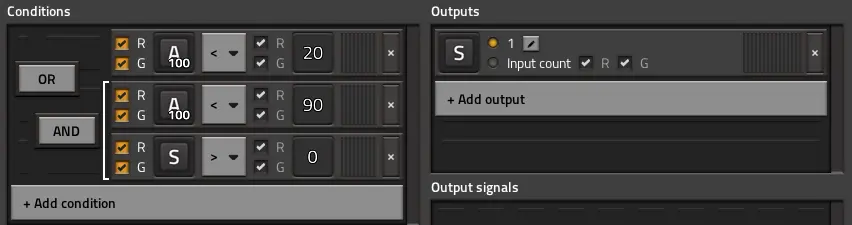

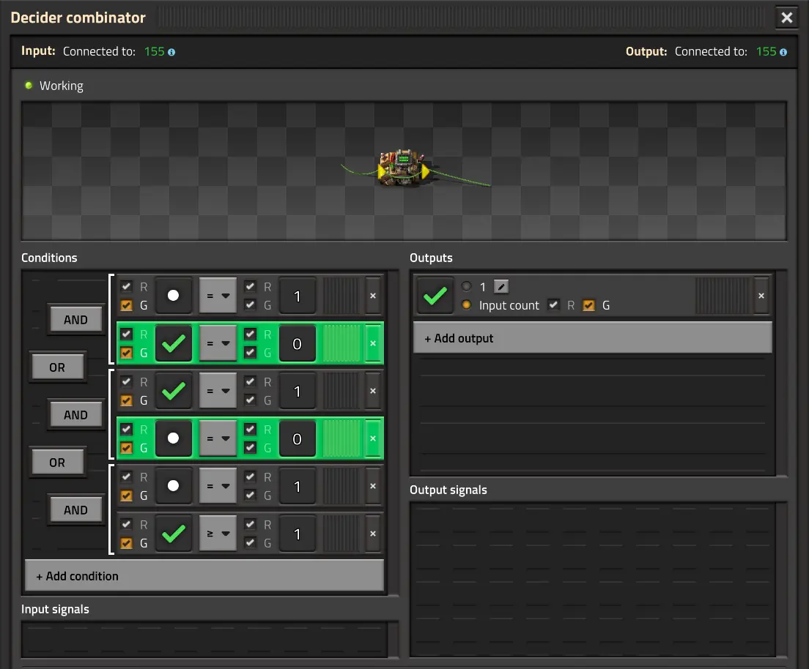

Can we try to make the UI look more like Factorios?

## Claude

Now writing. Item icons first: give each item an icon shape.

Components done. Now the node bodies, laid out like Factorio's entity windows.

Signal icons won't stand in for building icons. Adding small entity icons.

Now the node window in `editor.js`: title bar, connection bar with sockets, and status line.

Markup done. Now rewriting the stylesheet in Factorio's palette.

Now checking it in the browser.

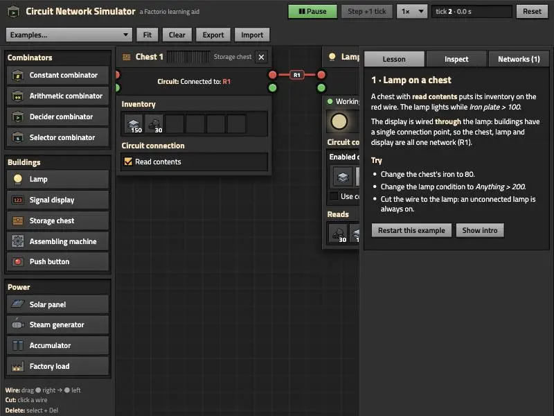

Factorio look is coming through. Checking a decider-heavy example at a desktop size.

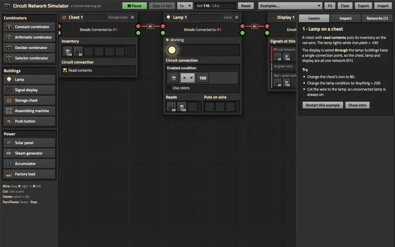

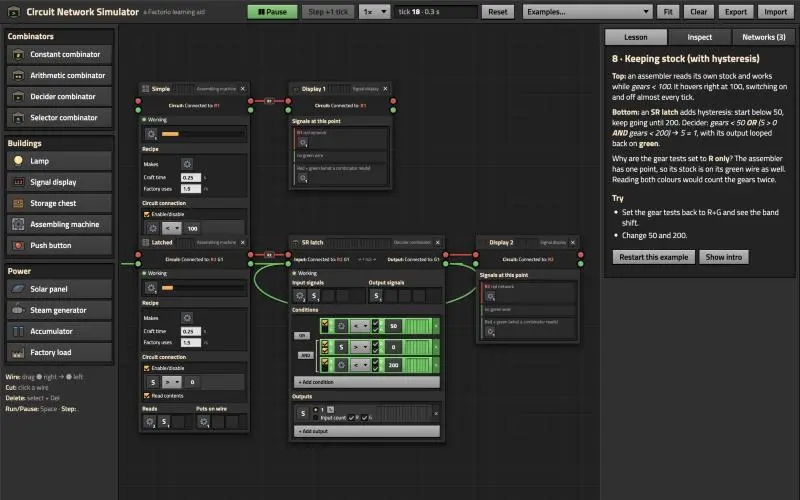

Nodes are taller now, so they overlap; I'll respace later. Zooming in on the decider.

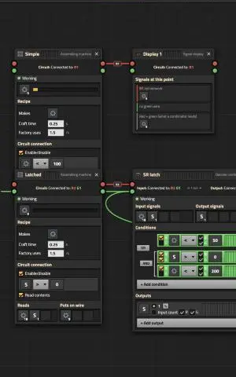

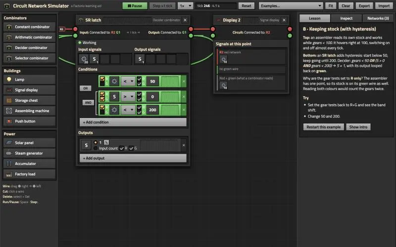

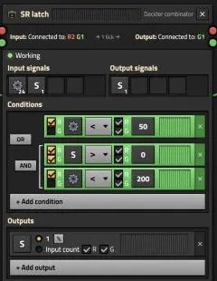

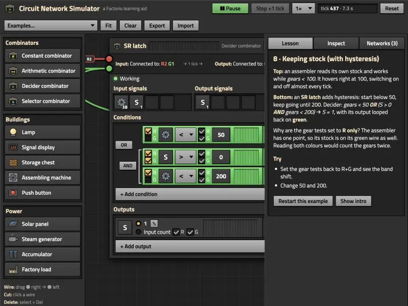

Close to the game's look. Row 1 (`gears < 50`) isn't green even though input shows 38 gears. Checking.

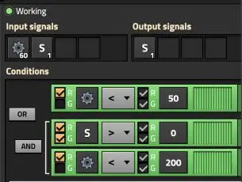

Live truth highlighting works (row 1 flips as the stock moves). Main problem: taller windows overlap in the examples. Measuring every example to respace them.

Positions applied. Reloading, re-checking overlaps, then testing the signal picker.

No overlaps in any example. Now the picker.

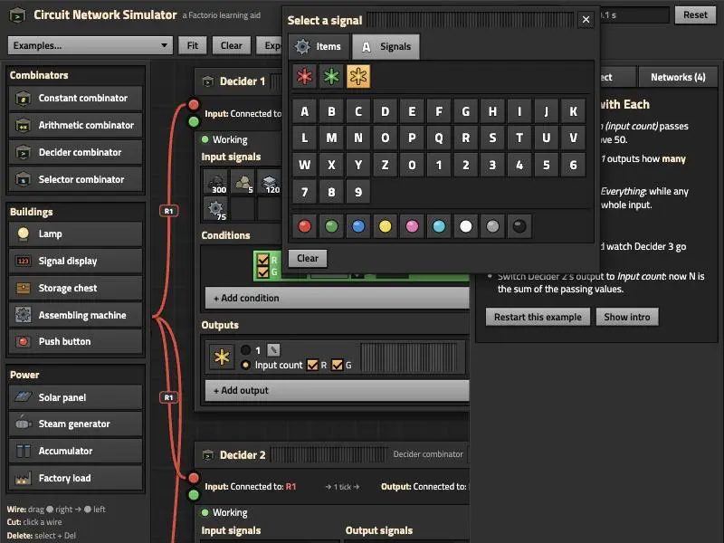

Picker looks right. Checking the Items tab icons, then picking a signal.

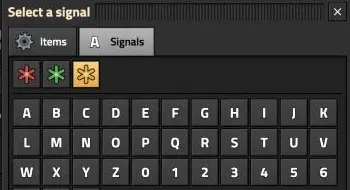

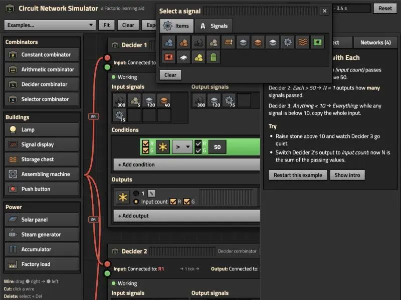

Items tab works. Picking iron plate to confirm the condition updates and the picker closes.

Picking works (sets iron plate, closes). The pane resized under me; pinning the viewport for the remaining checks.

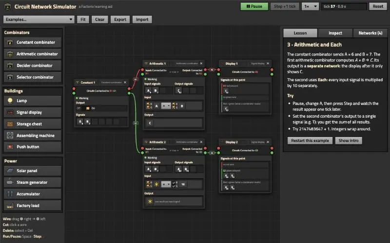

Arithmetic layout reads well. The narrow connection bar wraps "Connected to:", so I'll drop that phrase on combinators. Testing the constant combinator's slot editing first.

Constant combinator editing works (add C = 42, stays open for the value, Esc closes). Now operand constants, right-click clear, and AND/OR toggling.

All three work. One miss: the constant field doesn't get keyboard focus when the picker opens. Fixing that and the connection-bar wording.

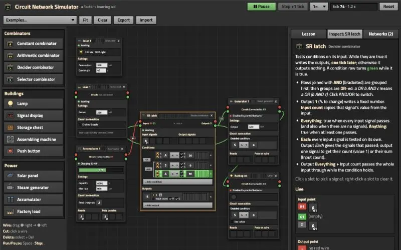

`select()` ran but focus didn't stick: the window is still `visibility: hidden` during that first layout pass. Moving the focus to after it's positioned.

Focus works. Quick phone-width check.

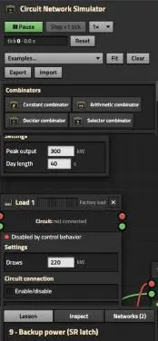

Mobile stacks fine. One nit: a factory load shows "Disabled" before the first tick, because its state isn't set yet. Fixing that, then updating the README.

Refreshing the landing-page screenshot so it shows the new look.

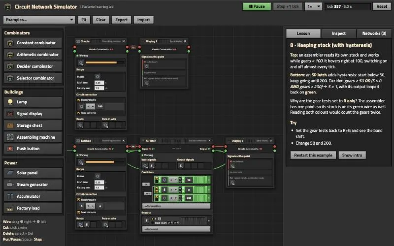

Fit-to-board is too small for a card. Zooming in on the SR latch.

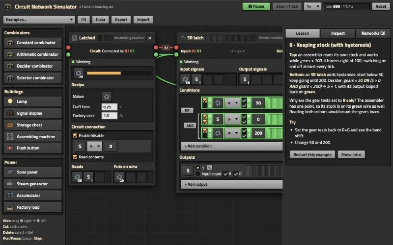


Good card shot. Converting it to the 640×400 WebP.

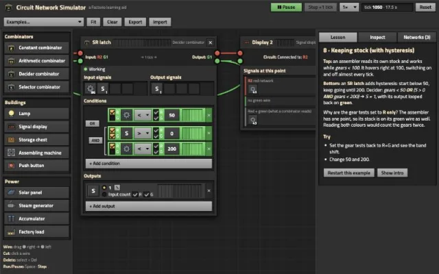

Updating the landing-card blurb, then regenerating `prompt.md`.

The simulator now looks like Factorio's own windows. All 13 tests still pass, and I checked it in the browser with no console errors. Nothing is committed.

**What changed:**
- **Boxes:** each one is styled like a Factorio entity window:
  - Beige bold title with a draggable stripe and a ✕ button.
  - Connection bar reading "Input: R2 G1 → Output: G1" (single-point buildings keep "Connected to:"), then a "● Working" or "Disabled by control behavior" status line.
  - Dark inset panels under headings like Conditions, Outputs, Input signals and Output signals. The font is Titillium Web, the font the game's UI uses.
- **Decider:**
  - Each row has R/G checkboxes, a signal slot, a comparator dropdown, R/G again, and a constant box.
  - A row turns green while it's true; this updates as the simulation runs.
  - AND groups get a white bracket, with AND/OR toggle buttons in the left margin.
  - Outputs have a radio choice between "1 ✎" (fixed value) and "Input count" with its R/G checkboxes.
- **Signal picker:** clicking any slot opens a "Select a signal" window with Items and Signals tabs.
  - Signals covers wildcards, letters and digits, and colours.
  - Operands also get a Constant field there, which takes keyboard focus when it opens.
  - Right-click a slot to clear it.
- **Constant combinator and chest:** now grids of slots with counts, plus an Off/On switch.
- **Icons:** simple drawn icons for items (ore, plates, gear, cable, circuit board, battery and so on) and for each building and combinator. They are not the game's artwork.
- **Rest of the page:** the toolbar, palette and side tabs use the same light-grey buttons that turn orange on hover.

**Other fixes along the way:**
- The windows are taller now, so every example's layout is respaced. I checked all nine and nothing overlaps.
- A factory load showed "Disabled" before the first tick; it now shows Working.
- The lesson text now says "checkboxes" instead of "R/G buttons".

I also updated the README, the landing-card text and its screenshot, and `prompt.md`. Running `prompt-md.sh` again brought back the blank screenshots (`003` and `005`) plus a new one (`029`); I removed all three.

When you commit, `demos.js` still has the uncommitted Godot entry as well, so I'll stage only this demo's line again, like last time.

## You

Commit it
