# Prompts

- **Model:** claude-opus-5-5
- **Effort:** high
- **Session(s):** d56185cc-61ad-4518-84b5-9336f0a84455
- **Tokens:** input 706, output 379062, cache read 151258038, cache write 683875
- **Cost (tokscale estimate):** $43.31

## You

Lets take what we have learned from some other experiments to make a new one.

Lets take `hexahedron`, the descent 1 inspired game, and make a version that can run on the N64 using an emulator in the browser.

Do not install any tools locally, use Docker.

We can skip some of the more advanced features, like importing PIG/HOG files from D1, and just stick with the basic enemies, weapons, and 3 demo maps.

## Claude

Studying hexahedron's 3 missions and the PS1/Lynx emulator demos. Next: pick N64 toolchain + check which browser N64 core can run homebrew microcode.

Found: browser N64 cores (parallel_n64, mupen64plus_next) include Angrylion RDP + cxd4 LLE RSP, so libdragon microcode should run. Now fetching libdragon toolchain image.

Docker image building in background. Meanwhile reading game.js for enemy/weapon behaviour to port.

Exporter works (825 / 2308 / 2550 cells). Now checking libdragon GL/rdpq API in image.

Image includes a prebuilt `gldemo.z64` — testing that in browser emulator first to de-risk.


Emulator boots ROM but screen black with parallel_n64+Angrylion. Trying mupen64plus_next core.


Emulator frozen at frame 1 because Browser pane hidden (no rAF). Opening pane.


parallel_n64 crashes (stack overflow) and mupen64plus_next crashes (table OOB) on libdragon gldemo. Trying other option combos.


Crash is deterministic. Building my own minimal test ROMs (CPU-only, rdpq, GL) to isolate which layer each core handles.


Even CPU-only test ROM shows black and core halts — testing core/plugin matrix with error overlay.


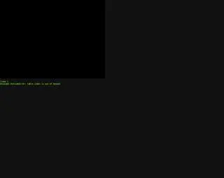

Both cores crash even on CPU-only ROM — suspect libdragon IPL3 boot vs emulator CIC handling. Checking libdragon IPL3 variants.

libdragon needs accurate emulation (MI repeat, PI DMA); old cores may choke. Cheap test first: pad ROMs to 2 MB (old cores assume ≥1 MB).


Same crashes. Checking whether in-app browser is the culprit — testing same page in Chrome.

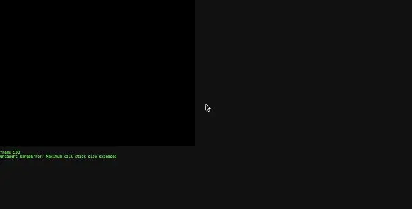

Same crash in Chrome, so it's ROM/core, not browser. Next test: bare-metal ELF (no libdragon runtime) booted by libdragon IPL3 — isolates boot vs runtime.

Bare-metal test ROM built. Running it in both cores.


Crash identical for every ROM → likely my EmulatorJS options, not ROMs. Testing pure defaults.


EmulatorJS caches core settings in browser storage — clearing it and retesting defaults.

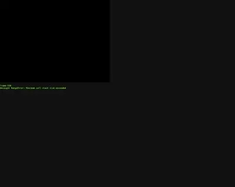

Even bare-metal ROM crashes both cores → suspect libdragon's IPL3 itself on these old cores. Next test: my own trivial IPL3 (PI DMA flat binary → 0x80000400, jump).

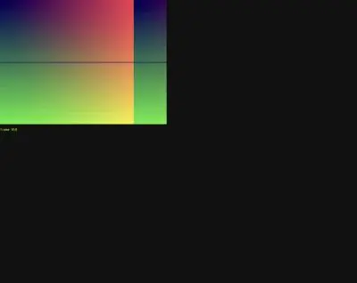

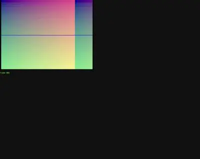

Both cores run with my custom IPL3 — root cause is libdragon's IPL3 on these old cores. Next: try libdragon runtime as flat binary under my IPL3.


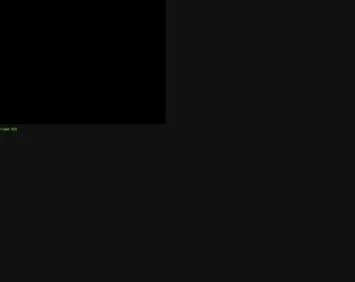


No crash now but black — libdragon init likely stuck somewhere. Building probe ROM that paints a raw-VI color per init stage.

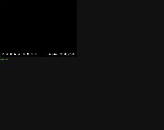

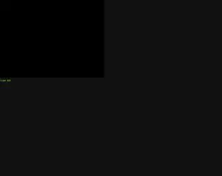


Likely cause: parallel_n64 defaults to 4 MB (expansion pak off) while probe/stack use 8 MB. Enabling expansion memory.


Option applied but still black. Making IPL3 probe real RDRAM size (4 vs 8 MB) instead of assuming 8 MB, and keep probe framebuffer under 4 MB.

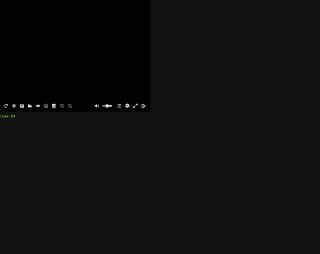


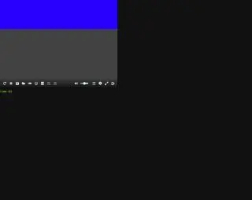


Reached constructor(135), hangs in a default-priority libdragon constructor. Listing the ctor table to bisect.

Order after c135: `__joybus_init`, `__rompak_init`, `__n64sys_hwmemset_emucheck`, … Patching ctor table to skip each suspect, one variant per ROM.

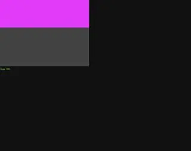


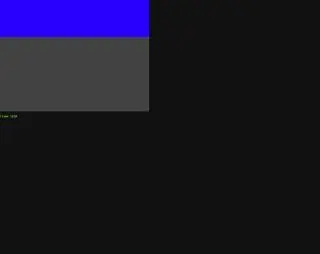

Both `__rompak_init` and `__n64sys_hwmemset_emucheck` hang on these cores. Checking what depends on them.

Hypothesis: my IPL3's PI DMA leaves PI interrupt pending → interrupt storm once libdragon enables interrupts. Clearing PI interrupt in IPL3.


Bare-metal path chosen. Pulling RDP bitfield constants (other modes, combiner) from libdragon headers to get commands right.

Have constants. Checking PS1 demo's font/source to reuse for bare-metal HUD.

Toolchain has o32 libgcc; bare-metal plan set. Grabbing ship-physics and door constants from browser version before writing the C engine.

Got constants (THRUST 72, DRAG 2.4, doors open once and stay). Writing bare-metal engine now: hardware layer first.

Writing RDP command module (raw DP commands from CPU, triangle setup ported from libdragon's public-domain `rdpq_tri.c`).

Writing level loader (parses exporter's binary from ROM).

Writing procedural textures (32x32 RGBA16, in TMEM-sized chunks).

Writing renderer: portal-culled cell traversal, CPU transform + clipping, fog/headlight vertex lighting, sliding doors, meshes and glows.

Writing build files and a first fly-through main to validate rendering in emulator.

Compiled. Testing in emulator.

Page froze (likely emulator stuck inside RDP work). Building staged debug ROMs: CPU-only, RDP clear, full world.

In-app browser wedged; switching to Chrome for testing.


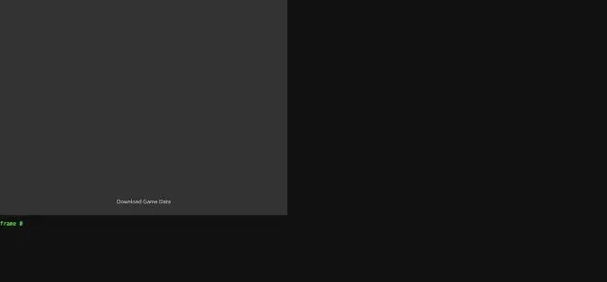

Old hung tab holds the origin's IndexedDB lock. Using `127.0.0.1` (separate origin).

Found it: IPL3 DMAs the image to RDRAM 0x0 but my program is linked at 0x80000400 (libdragon's flat images happened to start at 0x80000000). Fixing IPL3 destination.


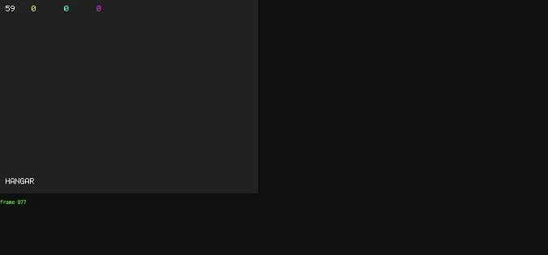

Stage 0 runs: 59 fps, level loaded, player in HANGAR. Trying RDP clear (s1) then world (s2).

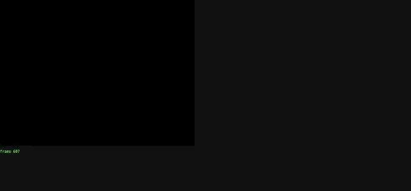

RDP wait never completes (black, CPU stuck in idle-wait). Probably emulator leaves busy bits set; waiting only on `DPC_CURRENT == DPC_END`, and adding DPC status to debug overlay.


Possibly EmulatorJS's ROM cache serving old builds with same name/size. Disabling its databases in test page.


Hypothesis: RDP runs deferred (after my CPU text), so its clear wipes the text. Testing with a red RDP rectangle.


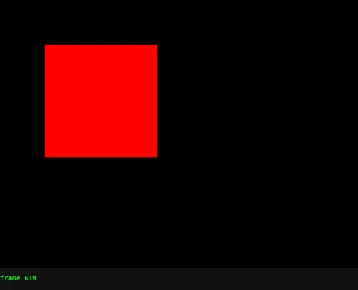


Now adding RDP text functions to the renderer.

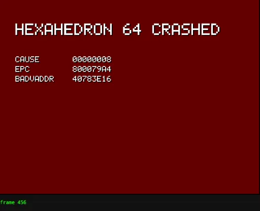

Crash handler works: TLB-load miss at EPC 0x800079A4, bad addr 0x40783E16. Locating.

Stack smash: `clip_poly` writes up to 9 clipped vertices back into the caller's 3–4 element array. Fixing with local buffers.

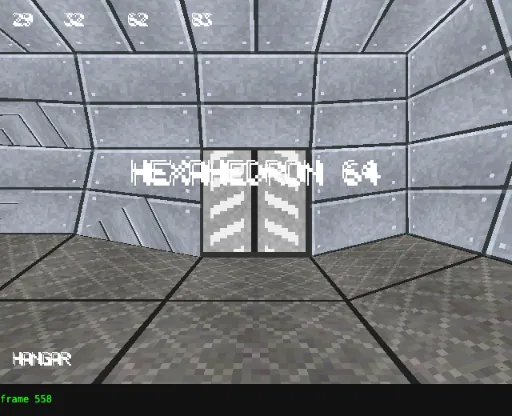

**Rendering works**: textured, lit Hangar with sliding door, 29 fps, ~83 triangles. Now finding EmulatorJS's N64 input ids to drive the ship.

Got EmulatorJS N64 ids (0 A, 1 B, 3 Start, 10 L, 11 R, 12 Z, 16–19 stick, 20–23 C). Flying forward to check performance deeper in level.

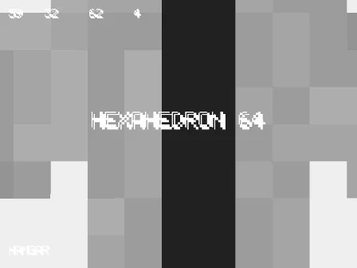

Writing small audio synth (AI DMA, polled; square/saw/noise voices with sweeps).

Now the main game logic.

Full game compiles cleanly. Testing title screen.


Title renders, but HUD text ignores its colour (all white, no shadow) and glyphs show stray marks. Zooming in to inspect.

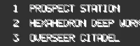

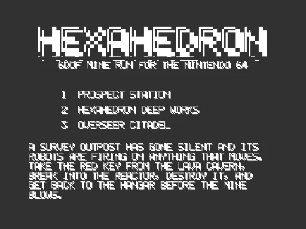


Emulator stalls at frame 20 deterministically. Suspect new audio path; testing build without audio.

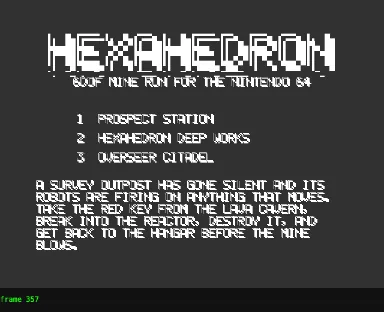

Audio was stalling the emulator (frames advance without it). Screen still static though; adding a debug heartbeat to the title.

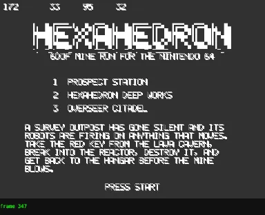


Game loop is alive (30 fps, ~95 tris). Remaining bug: prim colour seemingly ignored (text all white, tint gray). Isolating with a pure-red tint test.


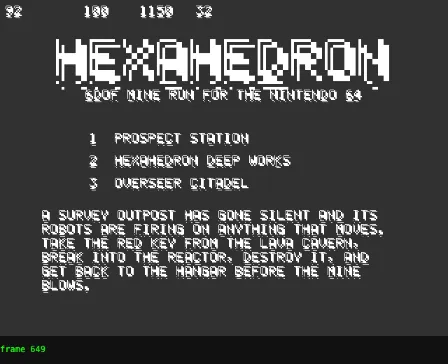

Text/tints now render but vertex (shade) colour seems ignored everywhere — likely walls too. Building a direct RGB-shaded triangle test.

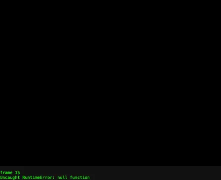

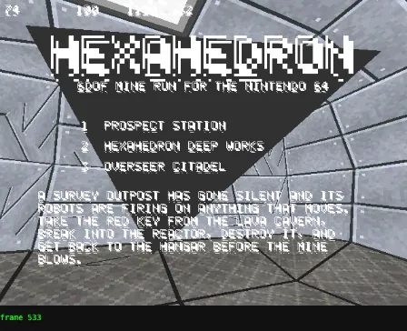

No more crash. World renders behind title. But my RGB test triangle shows flat dark gray → shade interpolation is broken. Zooming in.

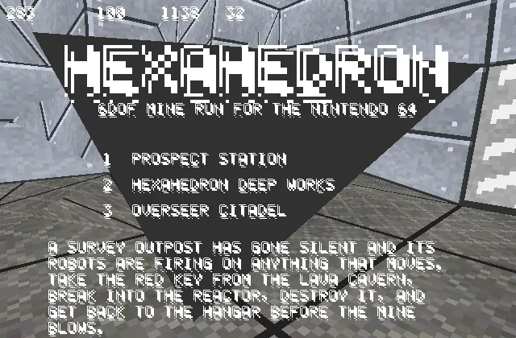

Walls (shade+tex+z) shade correctly; only my z-less triangles lose shade. Trying HUD triangles with a (ignored) Z block too.

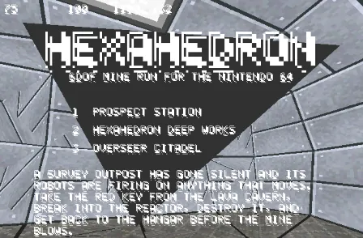

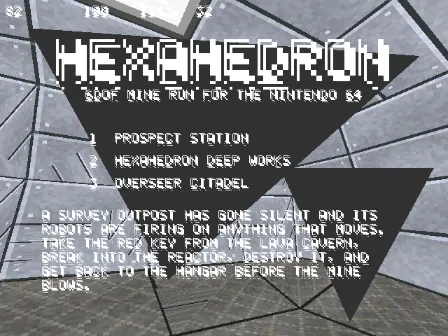


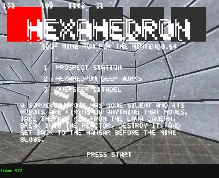

Fill mode is correct; every 1-cycle combiner output is the same dark gray, even prim colour. Inspecting the actual RDP command words in emulator RDRAM to verify my encoding.

Command encoding checks out in RDRAM. Dumping one HUD triangle's full packet to check shade values.

Packet data is correct (shade ints e.g. 122/176/204 present). Only difference from working walls: perspective bit. Testing with `SOM_PERSP` enabled for 2D/untextured modes.

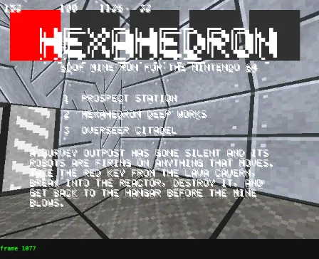

Commands encode correctly, yet colour inputs appear ignored. Testing whether wall shading actually applies (forcing wall vertex colour red).

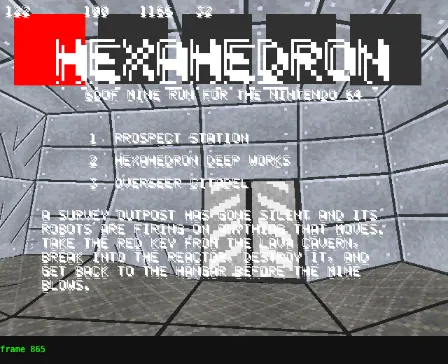

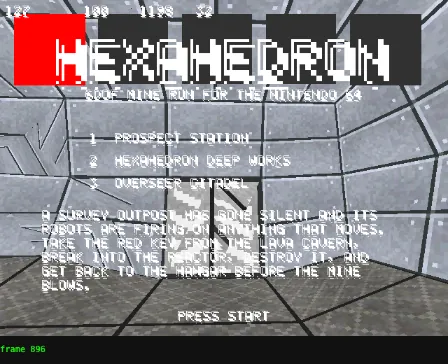

Plugin option has no visible effect → probably the core picked its renderer before EmulatorJS applied my options. Trying a core restart after options are set.

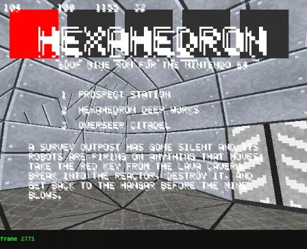

Restart didn't change it. Decisive test: draw walls with the SHADE-only combiner. Textured result ⇒ Set Combine ignored; solid red ⇒ my TEX×SHADE constant is wrong.

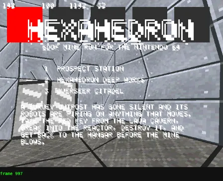

Set Combine is ignored entirely → not Angrylion; the core is still on its default HLE plugin. Looking at how EmulatorJS writes core options before boot.

No core-options file is written before boot. Checking how EmulatorJS fills `defaultCoreOpts` (the pre-boot option file).


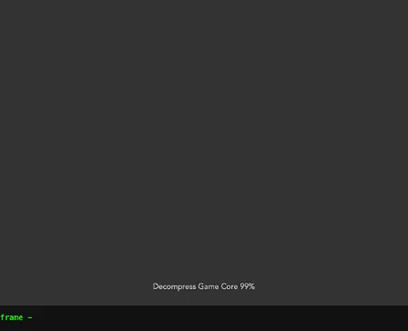

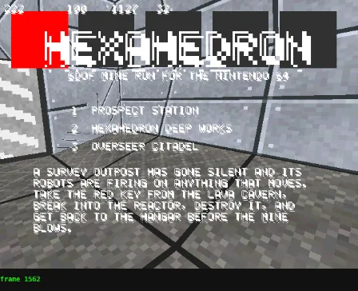

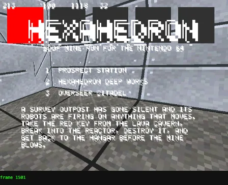

mupen64plus_next hangs on my game ROM. Back to parallel_n64: checking which renderer is truly active via its output size and core log.

Strong clue: my CPU-drawn text earlier vanished even after the RDP finished — that's how an HLE (Glide64) renderer behaves, not Angrylion. Verifying with Angrylion's unique "Depth" VI overlay.

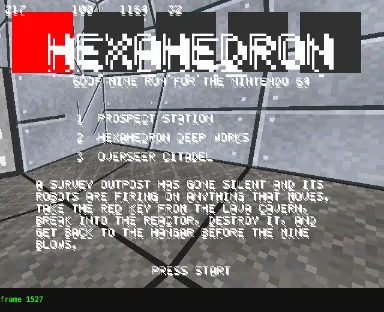

Confirmed: no Angrylion depth overlay → parallel_n64 silently uses Glide64 HLE. Trying mupen64plus_next with Angrylion + cxd4 written pre-boot (its earlier hangs were under default GLideN64).

mupen64plus_next still freezes the page. Measuring it on the trivial bare-metal ROM (bm2) with Angrylion to see if it's speed or a crash.

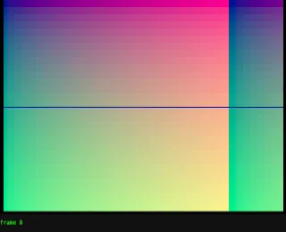

bm2 runs fine on mupen64plus_next + Angrylion. Bisecting what in my game hangs it with staged ROMs.


Page alive now (frame 2, slow start). Waiting.

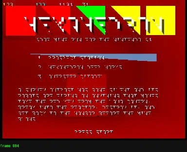

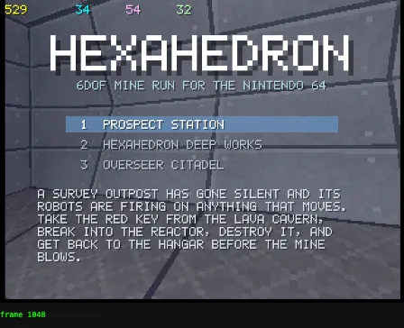

Title now looks right and runs ~30 fps. Starting a mission to test gameplay.

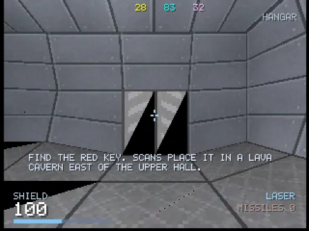

In-game HUD works. Two problems: door halves show black wedges, and gameplay runs ~12 fps (83 ms) with only 83 triangles → CPU-bound. Adding a per-phase profiler to the debug HUD.

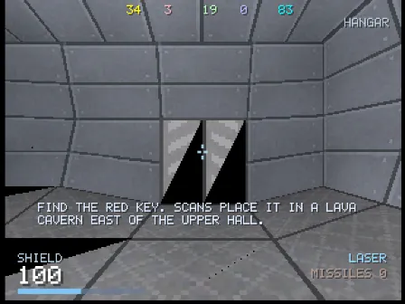

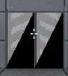

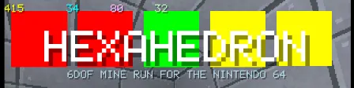

Flat-bottom fix works (all test quads full). Now: CPU trims (fixed-point conversion, fewer fan walls, idle robots skip physics, cached pickup cells), then re-enable audio on mupen.

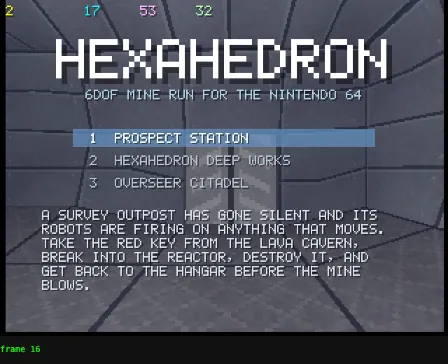

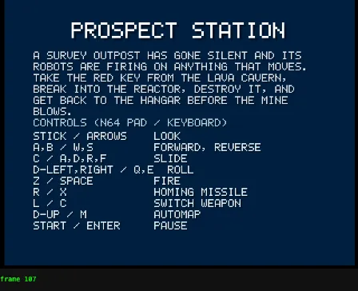

Not a hard stall: with audio active the emulator is paced by the suspended AudioContext (~7 fps). A real click is a user gesture that should resume it — clicking the game canvas.

Click resumed audio and emulation runs full speed. Final page will use EmulatorJS's click-to-start button for that gesture. Now playing: launch, fly into the Hangar door.

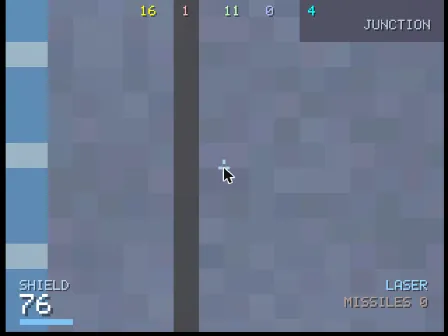

Gameplay works: flew through the door and tunnel into the Junction, took fire (shield 76). Testing turning, firing and robot rendering.

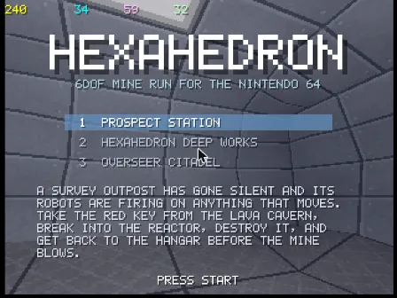

Back at title (my scripted Start/Z presses hit Pause→Abandon). Before more play-testing, listing mupen's Angrylion options to finalize the player page.

Now writing the real player page (`index.html`): mupen64plus_next/GLideN64, pre-boot options, keyboard + gamepad mapping, click-to-start for audio.


Player page loads with Start Game button. Clicking it and checking boot.


Title runs at 60 fps on the real page. Testing real keyboard input: Enter → briefing → launch, then fly.


Keyboard works and gameplay runs ~60 fps here (draw 14 ms). Flying through to the Junction to see robots and combat.


In the Junction, getting shot. Backing up and turning to find the drones.


Dropped back to the title unexpectedly. Checking whether the game is frozen (crash) or genuinely on the title.


Title is live, so the game really left the mission. I'll show raw pad bits in the debug HUD to verify how EmulatorJS ids map to N64 buttons.

Built. Re-testing on the page with pad bits visible.


id 1 maps to N64 B correctly (we reversed into the exit door: "EXIT SEALED" works, shield pickup visible). Reproducing the earlier sequence step by step: stick-left next.


No issue from stick input. Re-running the exact earlier route (into the Junction under fire) and watching frame by frame.

Old tab group is gone (hung tabs closed). Continuing in a fresh tab.


Chrome tab group keeps vanishing (you may be using Chrome). Switching testing to the in-app browser.


Running in the in-app browser. Replaying the Junction route with snapshots.


Still playing (backed through the Hangar tunnel; orange bolt glows visible). Watching a few more seconds to catch the title regression.


Lasers fire (blue glows), but shield drains ~18/s with no robot in view — suspicious. Adding debug counters (awake robots with line of sight, live enemy shots, last damage source).


Pacing is now real-time (~60 VI/s), but title dropped to 30 fps since audio mixing costs CPU. Optimizing: silent buffers skip mixing entirely.


Now real-time and 30 fps in play; turned 180° back toward the Hangar (green exit door visible). Turning back and pushing into the Junction while firing.


Let me look around the Junction for the drones at full resolution.


Clock is now real-time (8.1 s game vs 8.0 s real) and the Hangar runs 60 fps. Using the debug warp (L + D-down) to test key → reactor → escape.


Red key acquired in the lava cavern (HUD shows R). Warping to the reactor and firing.


Died in the lava cavern (leeches and drones visible in the death view — robots render). For flow testing I'll make the debug warp also enable invulnerability.


In the Reactor Core (objective updated after red key). Turning to face the reactor and firing.


Easier: make the reactor warp face the reactor. Patching the debug warp.


Reactor visible (its cage hides the core; I'll make the cage translucent). Continuing to fire.


Reactor destroyed, escape countdown running. Warping to the exit.


Full mission loop verified: red key → red door/reactor → countdown → exit → "MINE CLEARED". Now checking the automap and the other two missions.


Mission 2 loads after the win. Found a bug: Automap and Pause open and close on the same button press (the entry frame re-reads the press). Fixing both with an entry guard.


Rebuilding with the slim image and a clean release build.

Release ROM built (4 MB, 85 KB program). Verifying mission 3 (Citadel) in the release build.


Mission 3 (Overseer Citadel) loads and plays in the release ROM. Checking how landing-page screenshots are produced in this repo.

I'll grab a landing-page screenshot from the emulator's own screenshot API. First framing a robot in view.


Too punishing for keyboard play (dead in 14 s idle at the Citadel start). Easing robot damage and fire rates a bit; also adding a `-DGOD` build flag for capturing screenshots.


Lava cavern looks over-saturated. Comparing against the browser version's look.


Hangar matches the original's look; I'll tone the lava cavern down in the exporter (it was clipping to full orange).


Darker, textured cavern now; drones visible below. Framing the shot.


Capturing this frame via the emulator's screenshot API and converting to 640×480 WebP.

Emulator screenshot comes back blank (WebGL buffer cleared). Trying a direct `readPixels` from the WebGL canvas inside an animation frame.

WebGL readback isn't possible here; I'll use the browser capture instead and convert it to WebP in Docker. Moving the mouse off the emulator so its menu bar hides.


I'll use the previous Upper Hall frame (ceiling light panel, brute at right). Converting it to WebP in Docker.

Screenshot saved. Building the final release ROM (no god/warp/debug).

Writing the README.

Final check of the release ROM on the player page.


Release ROM boots and plays. Stopping the extra test server (the regular `hexahedron-n64` server on 8819 stays up).

I've built **Hexahedron 64** in [games/hexahedron-n64-opus-5.5/](games/hexahedron-n64-opus-5.5/index.html). It's a 4 MB ROM that runs in the browser through EmulatorJS's mupen64plus-next core, and everything was built in Docker (images for Node, Debian and libdragon's toolchain).

**What's in it**
- **Maps:** all three missions (Prospect Station, Hexahedron Deep Works, Overseer Citadel). A script runs the browser game's `level.js` in Docker and exports them, so the cube layout, doors and lighting are the same as the original.
- **Enemies:** drones, leeches and brutes. The browser version's other robot types are mapped onto these three.
- **Weapons:** twin laser, spreadfire and homing missiles.
- **Gameplay:** blue, yellow and red key doors, the reactor (or the Overseer's core) with a 50-second escape countdown, lava damage, shield pickups and an automap.
- **Menus and sound:** a title screen with mission select, a briefing, pause, game-over and win screens, and simple sound effects.
- **Controls:** keyboard (arrows to look, WASD/R/F to move, Space to fire, X for missiles, M for the map) or a gamepad.

**How it runs**
- libdragon didn't work in these emulators. Its boot code crashes both N64 cores in EmulatorJS, and even with my own boot code its startup hangs. So the game is plain C with no SDK: it drives the hardware directly, as the PS1 demo did. I adapted the triangle setup code from libdragon, which is public domain.
- The two N64 cores render very differently. parallel_n64 ignores the setting for its accurate renderer and draws everything without colour or lighting. mupen64plus-next draws it correctly, so the page uses that core and writes its settings before it boots.
- I worked around several emulator problems:
  - triangles with a flat bottom edge weren't drawn;
  - the game clock ran about twice as fast;
  - the emulator ran too fast until sound was playing;
  - a setting I had wrong froze the whole browser tab.
- The README explains each of these.

**What I tested in the browser**
- On one mission, using a debug-only teleport: red key, through the reactor door, reactor destroyed, countdown, reaching the exit and the "Mine Cleared" screen.
- Game over and retry, the automap, pause, and that missions 2 and 3 load and play.
- Speed: about 60 fps in small rooms and about 20 fps in the lava cavern.

**Not done or not checked**
- I didn't play missions 2 or 3 to the end.
- Difficulty: I lowered robot damage and fire rate because an idle ship died within seconds. Nobody has played it with a real keyboard yet.
- Nothing is committed, and there's no `prompt.md` yet. The landing-page card in `demos.js` and the screenshot are added; the card's "prompt" link won't work until `prompt.md` exists.

It's running at http://localhost:8819. Click **Start Game** first, because the browser blocks sound until you click.

```bash
open http://localhost:8819
```

## You

Write prompt.md
