# Prompts

- **Model:** claude-opus-5-5
- **Effort:** high
- **Session(s):** 9fec79ed-3b6c-4c21-9514-7976fd12e78d
- **Tokens:** input 98, output 135630, cache read 9696394, cache write 229273
- **Cost (tokscale estimate):** $6.49

## You

I really enjoyed the game series "Descent" as a kid. Its a 6-degree of freedom, 3d flying/shooter. The maps are constructed out of cubes, of which each side can be deformed, textured, or made to open to another cube.

Can we build something, simpler, a demo, like that in three.js?

Here are some requirements

1. The demo level should be a decent size, taking a few minutes to complete. There should be at least 10 distinct rooms, some of which have doors leading to them
2. There should be a "red key room", that has a floor of lava, that will damage the players ship if touched
3. The reactor should be behind a red key door
4. There should be 3 distinct types of enemies
5. There should be an automap, that will render just the cubes the palyer has traveled into or seen but not yet visited - ie: any cube behind a door will not show up on the map until the door has been opened
6. There should be at least one weapon pickup


Ignore any other prior art in this repository.

## Claude

Level builder done and validated (825 cubes, 12 rooms, 10 doors, all reachable). Now writing the main game engine.

Now the HTML shell with HUD and screens.

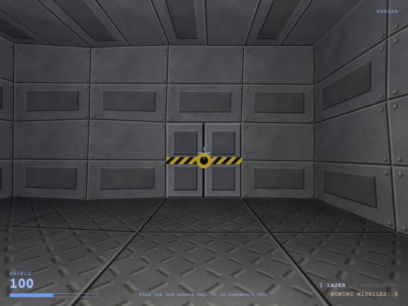

Game boots and renders. Tuning lighting and checking each room now.

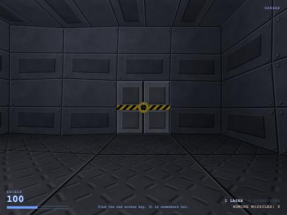

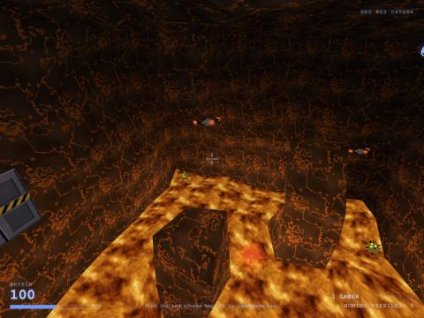

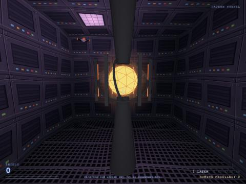

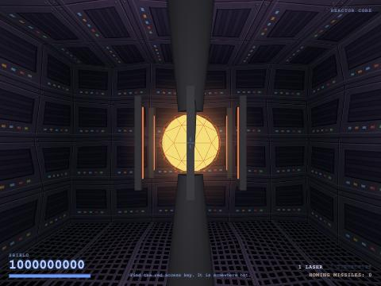


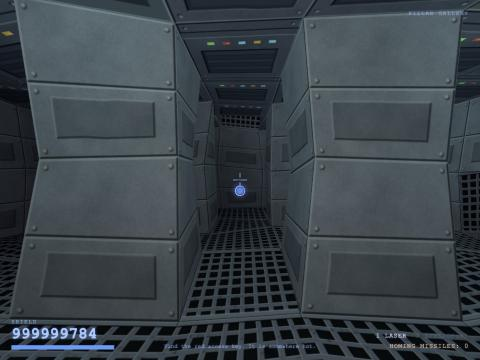

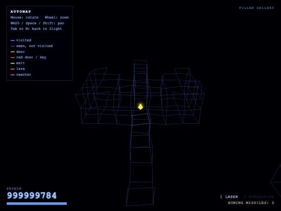

Visuals and automap working. Now running scripted gameplay checks (doors, locked doors, key, reactor, exit).

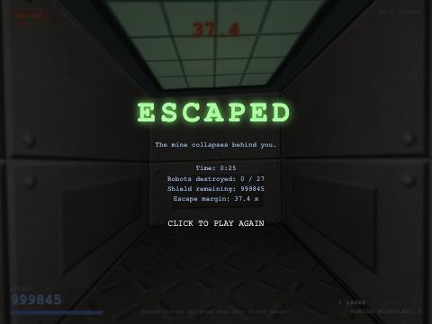

Full loop verified: locked red door → key → reactor → countdown → exit → win screen. Checking lava damage, combat, and automap door-hiding next.

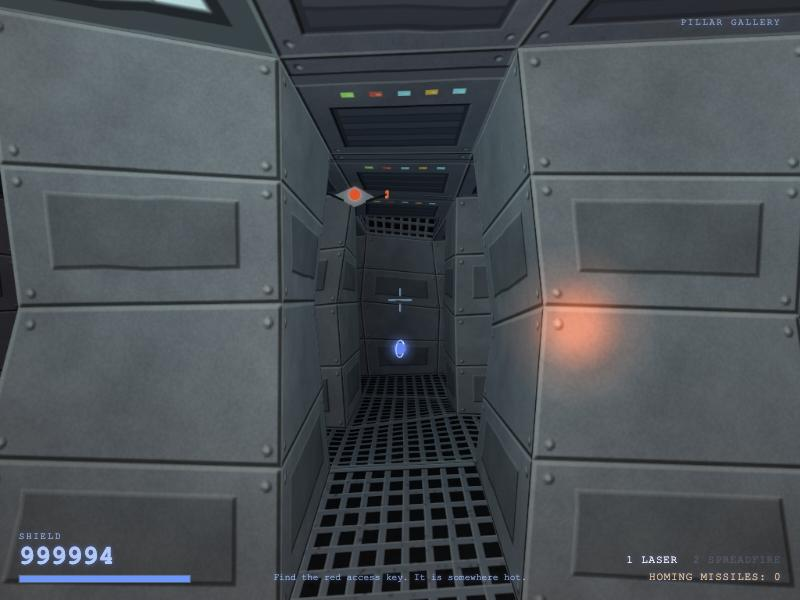

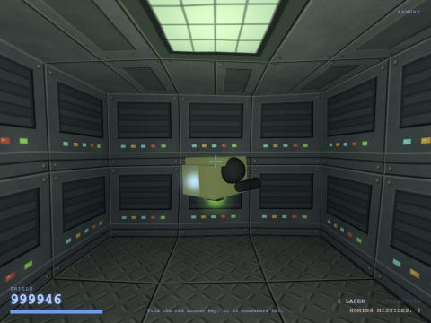

Pointer-lock fallback added. Doing a final real-click check, then adding the landing-page card.

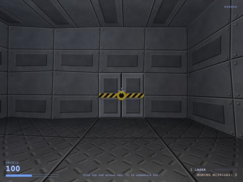

I've built the demo. It's called **Hexahedron** and lives in [games/hexahedron-opus-5.5/](games/hexahedron-opus-5.5/index.html). It uses three.js 0.160 from a CDN and has no build step. To run it locally, start the `hexahedron` server (port 8801) from `.claude/launch.json`.

**How the level works (Descent-style cubes)**
- The mine is 825 cubes on a shared grid of corners. Moving a corner reshapes every cube that touches it, so the cubes stay joined with no gaps.
- Each side of a cube is a wall, an opening into the next cube, or a door. Metal rooms are only slightly bent; the lava cavern and the pump cave are bent a lot so they look like rock.
- Lighting is pre-computed from ceiling light panels and added to each wall point. Your ship's headlight and the weapon and explosion flashes light the walls on top of that.
- You collide with the same surface that's drawn, so you can't clip through walls.

**Your requirements**
1. **Rooms and doors:** there are 12 rooms (Hangar, Junction, Pillar Gallery, Armory, Upper Hall, Storage Bay, Red Key Cavern, Crossroads, Pump Station, Antechamber, Reactor Core, Exit Tunnel), plus a lift shaft and connecting tunnels. There are 10 doors, including a hatch in the floor. Their halves slide apart when you fly into them or shoot them.
2. **Red key room:** the red key floats just above a lava floor. Touching the lava costs about 30 shield per second and pushes you up. Rock pillars give you places to stop.
3. **Reactor:** it sits behind the red door, fires back at you, and when destroyed starts a 50-second self-destruct. The exit door in the Hangar only opens after that.
4. **Enemies:**
   - Drones are fast and fire red bolts that lead their target.
   - Brutes are slow and heavily armoured, and fire purple homing shots.
   - Leeches are spiky and charge you to hit at close range.
   - Enemies wake when they see you and follow you through open passages. They can't get through closed doors.
5. **Automap (Tab or M):** shows a wireframe of the cubes you've been in (bright) and cubes you've only seen (dim). A cube counts as seen only when you have a clear line of sight to it and no closed door in the way. I checked that nothing behind the Hangar door shows up until it opens.
6. **Weapon pickups:** the Spreadfire cannon is in the Armory and 8 homing missiles are in the Storage Bay. There are also shield pickups around the level.

**Testing**
- I ran a script through the whole sequence: the door opens on contact, the red door refuses you without the key, the key unlocks it, the exit stays sealed until the reactor is destroyed, the countdown starts, and reaching the end of the exit tunnel shows the win screen.
- Lava damage, combat and the automap also worked, and screenshots looked right.
- I haven't played it with a real mouse and keyboard, so difficulty and speed haven't been tuned by hand.

I've added a card to the root `index.html`. Nothing is committed yet, and `prompt.md` comes last, once the work is final.

## You

I'll play first

## Claude

Go for it. Server's still running at http://localhost:8801, already open in the Browser pane. For a real browser window:

```bash
open http://localhost:8801
```

**Controls:** click the title screen to lock the mouse, then use the mouse to aim, WASD to move, Space and Shift to go up and down, Q and E to roll, and left click to fire. Tab opens the automap. Esc pauses.

**Route:** Hangar → Junction → Pillar Gallery. Side trip west to the Armory for the Spreadfire. Then up the lift shaft to the Upper Hall, with an optional detour to the Storage Bay for missiles. East into the lava cavern for the key, down the drop tunnel to the Crossroads, then the red door and the reactor. After that, race back to the Hangar exit.

Things worth noting while you play:
- Ship speed and turn sensitivity
- Enemy damage and how many enemies there are, especially the brutes in the Antechamber
- Whether the 50-second escape timer feels tight or too easy
- Whether rooms are too dark or too bright
- Anything that gets stuck, like enemies wedged on corners or the ship catching on doorways

Tell me what feels off and I'll tune it, then write `prompt.md` and commit.

## You

<bash-input>open http://localhost:8801</bash-input><bash-stdout>[No output was captured. The command ran in the terminal pane (tab 0); if it should have printed something, use read_terminal with tab_id "0" to check.]</bash-stdout><bash-stderr></bash-stderr>

## Claude

That should have opened the game in your default browser. Once you've played, tell me what to tune: speed, mouse sensitivity, difficulty, lighting, the escape timer, or anything that gets stuck.

## You

server is down, restart it place

## Claude

I restarted the server and it responds again at http://localhost:8801. It's also open in the Browser pane. Reload your browser tab, or run:

```bash
open http://localhost:8801
```

The server is tied to this session, so it may stop again if the session goes idle. If it does, tell me and I'll start it again.

## You

Ok, done, lets write the prompt.md
