# Prompts

- **Model:** claude-opus-5-5
- **Effort:** medium
- **Session(s):** 622d8aea-c35a-491c-8610-f5ca4fe2584b
- **Tokens:** input 116, output 106707, cache read 9831906, cache write 171439
- **Cost (tokscale estimate):** $4.96

## You

I really enjoyed the game series "Descent" as a kid. Its a 6-degree of freedom, 3d flying/shooter. The maps are constructed out of textured, deformed cubes.

Can we build something, simpler, a demo, like that in three.js?

## Claude

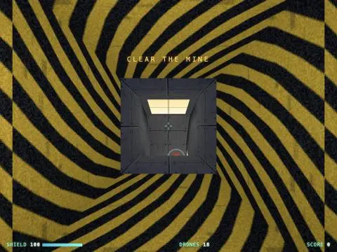

Running fine, 57 segments, no errors. Tuning look — hazard funnels too loud.

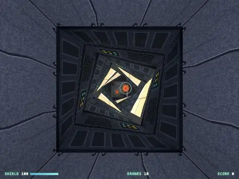

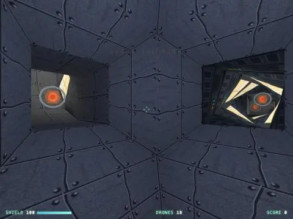

Twisting tunnel and hub look right. Checking loop joins and live combat sim.

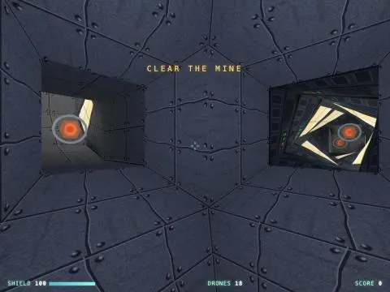

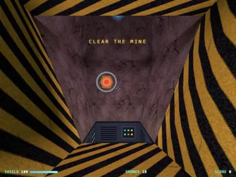

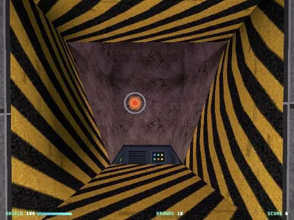

Loops join cleanly. Now live sim test: drones shooting, lasers, kills.

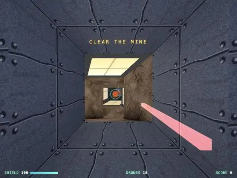

Laser bolt spawns too close to camera — looks like giant bar. Fixing spawn offset.

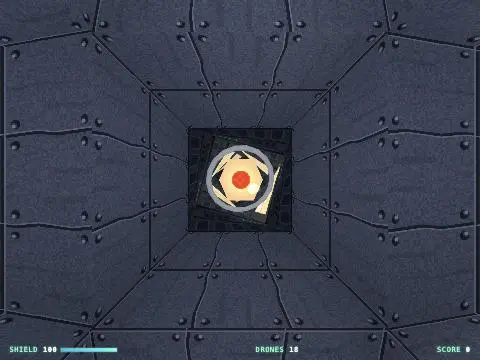

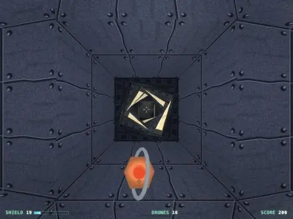

Combat works (2 kills). Shield drained too fast — ram damage applies every frame. Adding hit cooldown, softening fire rate.

Now root index entry.

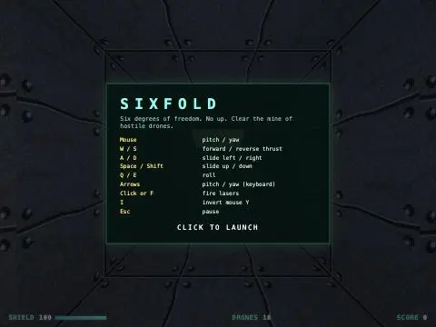

I built a demo called **Sixfold**: a 6DOF tunnel shooter in Three.js, in one file at [sixfold/index.html](sixfold/index.html). It's linked from the root index page. To run it, start the `sixfold` dev server (port 8797), click the page and fly. I tested it in the preview, where the mouse can't be captured, so I moved the ship from code. Mouse-look and how the controls feel are untested.

**How the level is built** (the Descent-style part):
- Every segment is a hexahedron: two 4-corner faces, each corner joined to the matching corner opposite. Neighbouring segments share corners, so their shared face becomes an opening and every other face is a wall.
- The mine is built mostly by extruding new segments off existing faces. Each one can narrow or widen, bend, twist or shift sideways, which gives funnels, curves, twisting tunnels and zig-zags.
- A `join()` helper connects two existing faces with a new segment. That closes two loops: the east tunnel curves up into the cave, and the south shaft drops into the sunken vault.
- The layout is a central hub with five branches leading to a cave, a red chamber, a green lab and the vault. There are 57 segments.

**Look and feel:**
- Textures are drawn in code at low resolution with blocky filtering: metal plates, tech panels, rock, floor grating, hazard stripes and light panels.
- Lighting is worked out once at load. Some corridor faces are set as light panels and each room gets a coloured light, and walls block light, so you get shadows. Your ship has a headlight, and shots and explosions flash.
- The ship drifts with momentum and slows gradually. It slides along walls and takes damage on hard hits.

**Gameplay:**
- 18 drones chase you when they can see you, circle you and fire plasma shots that aim ahead of you.
- Lasers fire alternately from two guns. There are 4 shield pickups.
- Sound effects are generated in the browser. Destroy every drone to clear the mine.

**What I checked:** no console errors. I looked at the twisting tunnel, the hub, both loop connections and the vault, and fired at drones (2 kills in the test). Shields drained very fast at first because ramming a drone did damage every frame, so I added a short cooldown on ram damage and made drones fire a little less often.

Possible next steps: an automap, a reactor or exit goal, homing missiles, and touch controls.

## You

Not yet

## Claude

OK, nothing committed. Your changes stay uncommitted in `sixfold/`, the root `index.html` and `.claude/launch.json`.

After you play it, tell me what feels off and I'll tune it. Mouse sensitivity, thrust, drone aggression and lighting brightness are each a quick number change.

## You

Lets do all of the next steps

## Claude

Big restructure (input layer, targets, game state), so rewriting whole file.

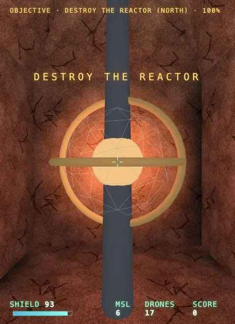

Reactor renders. Pointer-lock errors come from clicks inside the preview pane, which blocks lock. Adding fallback: if lock fails, play with free mouse. Then test missiles.

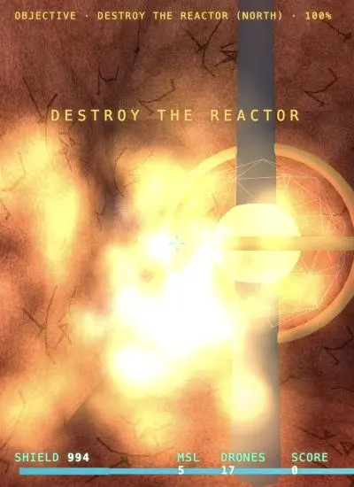

Missiles detonating early, no lock. Debugging.

Missiles + lock fine (earlier shot was aimed into wall). Testing reactor kill, door, countdown, escape.

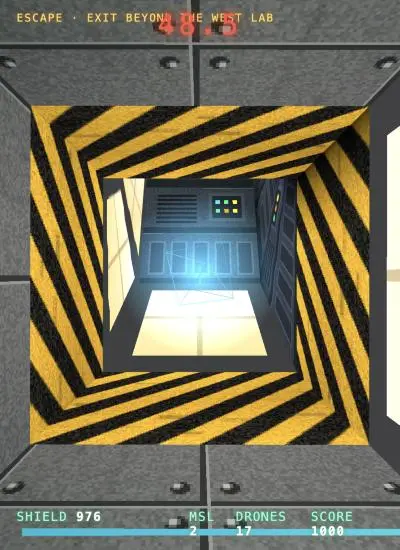

Door open, exit visible. Timer overlaps objective on narrow screens — will fix. Now automap + escape.

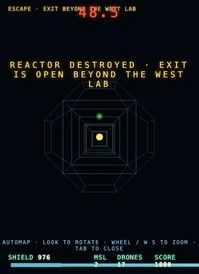

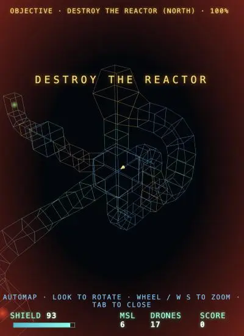

Automap works (wireframe of whole mine, exit glow green). Testing escape win.

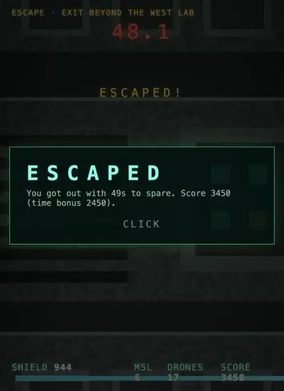

Escape works. Now locked door view + touch layout on mobile viewport.

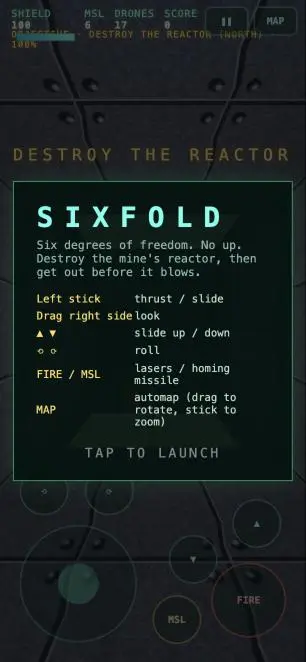

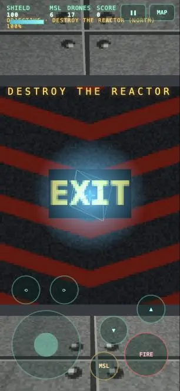

Door + touch layout render. HUD objective collides with shield bar on phone; roll icons tiny. Fixing, then test touch input events.

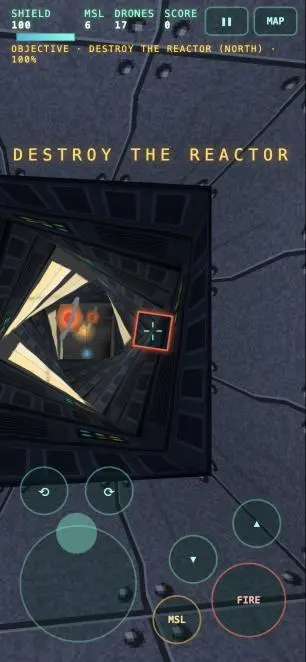

Stick + look + lock ring work. FIRE didn't register: `setPointerCapture` throws on synthetic pointer ids and aborts the handler. Wrapping it so real devices with odd ids are safe too.

All touch controls work (console errors are from the earlier page load). Last check: countdown look on desktop.

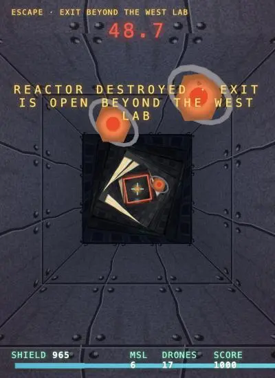

I added all four next steps to [sixfold/index.html](sixfold/index.html). Nothing is committed yet. I tested each piece in the preview by moving the ship and firing from code and by faking touch events; I haven't played it with a real mouse or on a phone.

**Reactor, countdown and escape**
- The red chamber at the end of the north tunnel now holds a reactor. It fires three shots at a time when it can see you, and its health shows next to the objective at the top left.
- Destroying it starts a 50-second countdown: an alarm, a red pulsing light, screen shake that gets stronger, and random explosions nearby.
- A locked exit door marked "EXIT" sits past the west lab. It slides open when the reactor dies, and you win by reaching the end of the tunnel behind it. Time left counts as a score bonus.
- Destroying every drone is now a +500 bonus, no longer the win condition.

**Homing missiles**
- Fire with right-click or G. You start with 6, and four orange pickups give +4 each.
- A spinning red diamond appears on the crosshair when a target is straight ahead and visible. Missiles fly toward it, pick a new target if theirs dies, and leave an exhaust trail.
- The explosion damages things nearby, including you if you fire at something very close.

**Automap (Tab or M)**
- Shows a wireframe of every segment you've been in plus the ones next to it, coloured by wall type.
- Your ship is a yellow arrow, the reactor a red marker and the exit a green one once you've found them.
- Move the mouse to rotate it and use the wheel or W/S to zoom. The game pauses while it's open.

**Touch controls**
- Turn on automatically on phones and tablets; add `?touch` to the address to force them.
- A stick on the left for thrust and sliding, drag anywhere on the right to look, and buttons for up/down, roll, fire, missile, map and pause.

Two fixes along the way:
- **Preview pane:** it blocks the mouse capture the game normally uses (those were the "pointer lock" errors in the console), so the game now falls back to plain mouse movement and Esc pauses. To play properly, open http://localhost:8797 in a normal browser tab.
- **Touch buttons:** they could fail silently, so I made them safer.

## You

Lets add what we have and commit and push it

## Claude

Sixfold is committed and pushed to `master` on GitHub (commit `091125b`). It went straight to `master` with no separate branch, because that's how the earlier commits in this repo were made.

The commit includes:
- `sixfold/index.html` (the game)
- `sixfold/prompt.md` (the file you added)
- the Sixfold card on the root `index.html`
- the new `sixfold` entry in `.claude/launch.json`

## You

Lets run the scripts/prompt-md on this conversation

## Claude

Renamed to `sixfold-opus-5.5-medium`. Rerunning there.

I ran the script, and it rewrote `sixfold-opus-5.5-medium/prompt.md` with the details of this session. The folder was renamed from `sixfold` in your "Refactoring" commit, so the first run (pointed at `sixfold`) failed and I ran it again on the new name.

- **Model:** `claude-opus-5-5`, medium effort
- **Tokens:** 94 input, 103,590 output, 7.5M read from cache, 167K written to cache
- **Cost:** about $4.41 (tokscale's estimate)
- **Prompts:** all 5 are copied word for word, including this last one. They're all about Sixfold, so I didn't remove any.

The updated file isn't committed yet.

## You

Commit and push

## Claude

The updated `prompt.md` is committed and pushed to `master` on GitHub (commit `fcdbd11`).

Before committing I ran the script again, so the file now also lists this "Commit and push" prompt. The estimated cost went up to $4.56.

The push also sent one commit of yours that hadn't been pushed yet: `a5c8fcc` "Add prompt.md rule and generator script".

## You

Lets re-run that

## Claude

Script changed since last run (you updated it): now writes full You/Claude log with screenshots. Checking output.

I re-ran the script. You've changed it since my last run, so the output looks different: `prompt.md` is now a full back-and-forth instead of just your prompts.

- **Header:** Opus 5.5 at medium effort, about $4.70 by tokscale's estimate (it was $4.56 before).
- **Body:** all 7 of your prompts, including "Lets re-run that", each followed by my reply.
- **Screenshots:** 20 browser screenshots from this session are now in `sixfold-opus-5.5-medium/prompt-assets/` (628K) and shown inline.

Nothing is committed. Your edits to `scripts/prompt-md.sh` and `CLAUDE.md` are uncommitted too.

## You

Commit all
