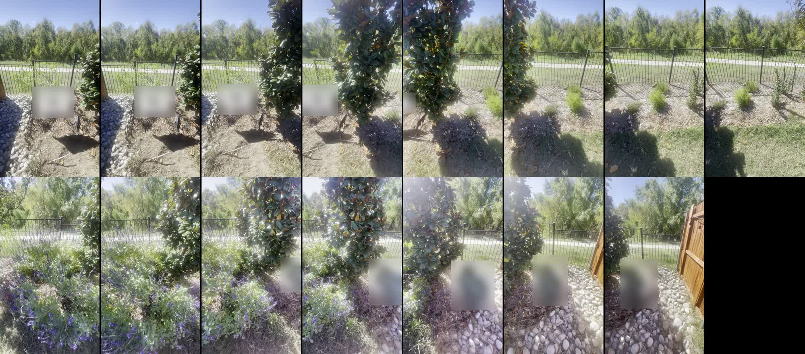
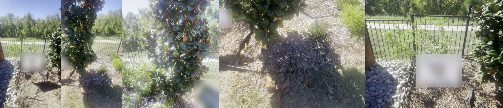
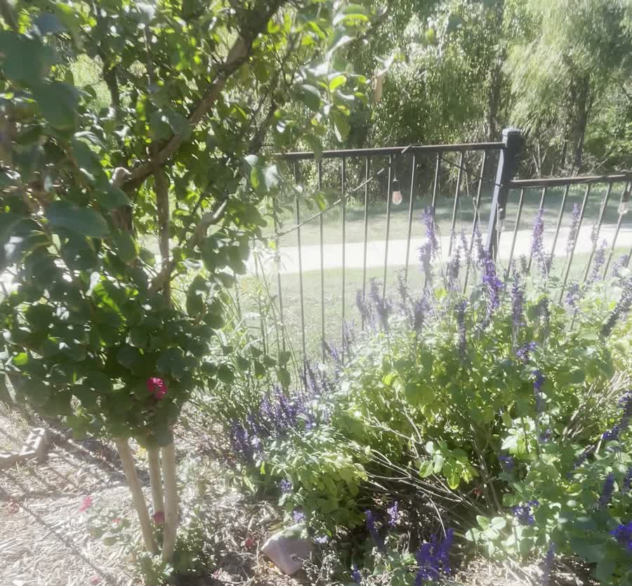
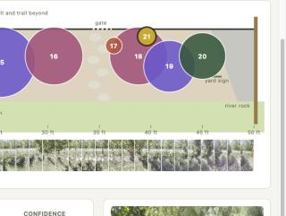
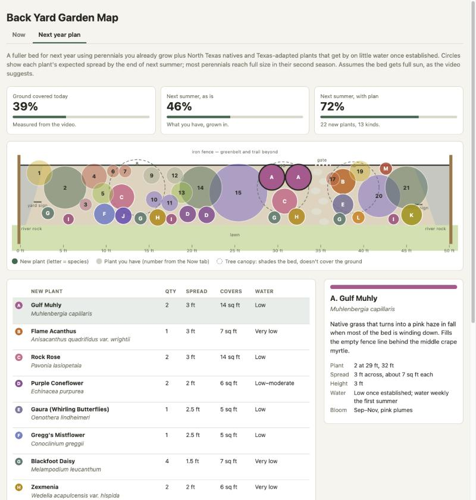
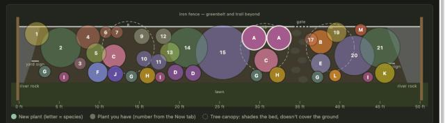
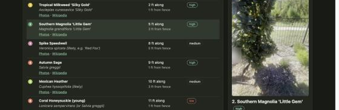

# Prompts

- **Model:** claude-opus-5-5
- **Effort:** high
- **Session(s):** 540952f4-8304-48e4-9ec2-8c013e57d96c
- **Tokens:** input 186, output 82758, cache read 14015333, cache write 193096
- **Cost (tokscale estimate):** $6

## You

I recorded a video, panning my back yard garden. Its about 50 feet wide, and I walked more or less at a constant pace.

Can we extract from the video:

I'd like to identify the plants that are in the garden, produce a map of where each plant is.

The video is in `~/Downloads/IMG_0650.MOV`

## Claude

No drawtext; tile without labels (order known).

Pulling frames from 39-sec video, IDing plants now. Have magnolias, crape myrtles, salvia so far; checking rest.

Map page written. Checking it in browser.

Fixing focus-ring glitch on selected plant, then done.

I built the map at [garden-map/index.html](garden-map/index.html) and checked it in the browser preview at `localhost:8803`, in light and dark mode. It's a top-down view of the bed with 20 plants. Click a circle, a table row or a video frame to see the frame where that plant shows up and what it is. Under the map, 39 frames (one per second) line up with the ruler so you can compare spots against the video.

**What's there, left to right:**
- **0–3 ft:** river rock bed, a school yard sign, and Esperanza (yellow bells) against the fence. Esperanza is a medium-confidence ID.
- **Three Southern Magnolias 'Little Gem'** at about 5, 21 and 45 ft. High confidence: they're narrow and upright, and the leaves are rusty brown underneath.
- **Three Crape Myrtles** at about 14, 31 and 39 ft. High confidence. The first has pink pool noodles on the trunks; the other two have magenta flowers and sit on either side of the stepping stones to the gate.
- **Red Mandevilla** in a hanging pot by the gate, about 36 ft. High confidence.
- **Blue salvia:** a big patch at about 23–29 ft, another around the last magnolia at about 40–43 ft, and two young plants near 16–17 ft. Medium confidence; probably 'Mystic Spires' or 'Indigo Spires'.
- **Low-confidence plants:**
  - Lime-green fine-leaved mounds at about 9 and 19 ft, possibly Mexican heather.
  - Young upright staked stems by the fence at 11–12 ft with a red tubular flower. Possibly coral honeysuckle, or possibly autumn sage.
  - Gray-green mounds, possibly lavender or rosemary.
  - A small herb clump.

  A close-up of a leaf and a flower on each would settle these.
- **45–50 ft:** a second yard sign and another river rock bed, up to the wooden fence.

**Limits:**
- Positions assume you walked about 1.3 ft per second (50 ft in 39 seconds). Expect them to be off by about ±2 ft.
- Distance out from the fence is a rough guess from the camera angle.

**Before you publish:** the frames in `garden-map/frames/` show a school yard sign. If this goes on the public GitHub Pages site, you may want to drop or blur those frames (`00`–`03`).

I also added a `garden-map` entry to `.claude/launch.json`. That file already had uncommitted changes from other work.

## You

Lets blur the signs

## Claude

Signs blurred in all 10 frames, text unreadable. Removing sign names from page text too.

Both signs are blurred now, in every frame that shows them, and you can't read the text on either:
- **School sign:** frames `00`–`04`. In frame `04` only the edge shows.
- **Second yard sign:** frames `34`–`38`.

I also took the sign names out of the page text, so the notes just say "yard sign". On the page in the browser, the Esperanza photo shows the blurred sign.

The original frames, without blur, are saved in `/private/tmp/claude-501/-Users-danwatt-git-ai-experiments/540952f4-8304-48e4-9ec2-8c013e57d96c/scratchpad/orig/`, outside the repo. The blur only changed the thumbnails in `garden-map/frames/`, not your original video.

## You

Add and commit

## Claude

Checking transcript screenshots for unblurred signs before commit.

Staged clean: only garden-map hunks, hexahedron work left unstaged. Committing.

Committed on `master` as `3b748d7`. Not pushed.

What's in it:
- **Map page:** `garden-map/` with the page and 39 frame thumbnails. Both yard signs are blurred in the thumbnails.
- **Landing page:** a new "Video & vision" section in `index.html` with a Garden Map card and a link to its prompt page.
- **`prompt.md`:** written along with 31 screenshots from this session. Ten of those showed a sign clearly, so I blurred or rebuilt them from the blurred frames. In the transcript I changed the school and company names to "school yard sign" and "second yard sign".
- **`.claude/launch.json`:** the `garden-map` server entry.

I left two things out of the commit because they belong to other work: the Hexahedron card and launch entry, and the Sixfold edits. They're still uncommitted in your working tree.

If you re-run `scripts/prompt-md.sh garden-map`, it brings back the unblurred screenshots and the sign names. You'd need to blur and redact them again before committing.

## You

I've added several HEIC images that are close-ups of several plants. Use them for better identification. We don't need to copy those into this directory. `1.HEIC` would be the plant identified as plant number 1

## Claude

*(Close-up photos of plants 1, 3, 4, 5 and 11 omitted.)*

Page updated, renders fine. Aligning plant 13 with plant 4, since they look like the same plant.

I found five close-ups in `~/Downloads`: `1`, `3`, `4`, `5` and `11`. I converted them to JPEG in the scratchpad to view them, so nothing was copied into the repo. Here's what they changed:

| # | Was | Now | Confidence |
|---|---|---|---|
| 1 | Esperanza | **Tropical Milkweed 'Silky Gold'** (*Asclepias curassavica*). The starry gold flowers with a crown in the middle and the smooth, narrow paired leaves make it a milkweed, not Esperanza. | high |
| 3 | Fine-leaf mound | **Autumn Sage** (*Salvia greggii*). Small rounded leaves and magenta two-lipped tube flowers. | high |
| 4 | Fine-leaf mound | **Mexican Heather** (*Cuphea hyssopifolia*). Sprays of tiny narrow leaves; no flowers in the photo, so this rests on the leaves alone. | medium |
| 5 | Small herb clump | **Spike Speedwell** (*Veronica spicata*, maybe 'Red Fox'). Short, fuzzy hot-pink spikes; many are spent and brown. | medium |
| 11 | Young blue salvia | **Violet Sage** (*Salvia nemorosa*, maybe 'May Night'). Deep indigo, dense spikes. It's a different plant from the big pale-blue salvia patches. | medium |

I also changed plant 13 to Mexican Heather, because in the video it looks like plant 4. Plant 10 may be the same violet sage as 11, but there's no close-up of it, so I left it alone.

Without close-ups, the shakiest IDs left are:
- **6 and 7:** coral honeysuckle or autumn sage.
- **9 and 12:** the gray-green mounds.
- **10:** the young blue salvia.

## You

There was a plant that was missed. Its along the fence, behind number 18. It too is a Tropical Milkweed. Its barely visible in the frame at 31 seconds.

## Claude

I added the second Tropical Milkweed 'Silky Gold' to the map as **plant 21**. It's about 40 ft along, against the fence and behind crape myrtle 18. In the 31-second frame, only some thin, narrow leaves show between the crape myrtle and the salvia, which is why I missed it the first time.

I put it at the end of the list instead of in left-to-right order, so plants 1–20 keep their numbers and your close-up file names still match. It shows on the map and in the table. Clicking it opens the 31-second frame.

## You

Lets re-number the plants based on their distance from the left side of the fence.

## Claude

Numbering correct. Six thumbnails failed on load (connection resets from local server); reloading to check.

The plants are now numbered 1–21 by distance from the left side of the fence. The map circles, the table and the notes all use the new numbers.

These plants got new numbers; all the others kept theirs:

| Plant | Was | Now |
|---|---|---|
| Spike Speedwell | 5 | 3 |
| Autumn Sage | 3 | 4 |
| Mexican Heather | 4 | 5 |
| Second milkweed | 21 | 19 |
| Salvia patch | 19 | 20 |
| Last magnolia | 20 | 21 |

I fixed the one note that pointed to a changed number: plant 13 now says it matches plant 5.

Your close-up files (`1`, `3`, `4`, `5`, `11.HEIC`) still use the old numbers. 3, 4 and 5 now mean speedwell, autumn sage and heather, in that order.

On one page load, six video thumbnails didn't show. Each one loads fine when requested on its own, so the local Python test server most likely dropped some of the many images requested at once. The page itself is fine.

## You

Help me start planning for next year. Lets add a tab that shows a new map, filling out the garden with more perennial plants. Propose plants that I either already have, or would be good for North Texas and are not too water hungry. Show me where they should go, and how much coverage they will have.

## Claude

Plan tab renders: coverage goes from 39% today to 72% with the plan. Checking the Now tab and dark mode.

I added a **Next year plan** tab. Open it with the tab button or by adding `#plan` to the page's address. It shows the bed at next summer's size, with your current plants faded under their Now-tab numbers and the proposed plants in solid colors marked with letters A–M.

**Coverage.** This counts how much of the planting bed has plants over it, not counting the river rock or the stepping-stone path:

| | Ground covered |
|---|---|
| Today | 39% |
| Next summer, current plants grown in | 46% |
| Next summer, with the plan | 72% |

The tree canopies (crape myrtles) and the hanging mandevilla aren't counted, because they shade the bed but don't cover the ground.

**Proposed plants (22 plants, 13 kinds, about 115 sq ft of new coverage):**
- **Along the back fence:**
  - Gulf Muhly ×2 behind the middle crape myrtle, for pink plumes in fall.
  - Flame Acanthus by the gate, for hummingbirds.
  - One more Coral Honeysuckle on the fence, a repeat of what you already have.
- **Middle of the bed:**
  - Rock Rose ×2. It handles the light shade under the crape myrtles.
  - Gaura.
  - Purple Coneflower ×2 in front of the middle magnolia.
- **Front edge by the lawn:**
  - Blackfoot Daisy ×4.
  - Zexmenia ×2.
  - Pink Skullcap ×3.
  - Gregg's Mistflower.
  - Aromatic Aster, for late-fall purple flowers.
  - Lantana 'New Gold' by the river rock.
- **For monarchs:** Butterfly Weed, a native milkweed that comes back every year, placed next to your tropical milkweed (19).

Water use is low or very low for all of them except coneflower, which is low to moderate. They all need weekly water the first summer.

Click any letter or table row to see why that plant fits, its height, bloom season and how much ground it covers. Click a numbered plant to see its expected size next year and any care note.

**Care notes for what you already have** are at the bottom of the tab:
- Cut the tropical milkweed back in fall.
- Mexican heather can die back in a hard freeze, so mulch it.
- The speedwell likes more water than the rest of the bed.
- The mandevilla needs to come inside for winter.

One assumption: the plan treats the bed as full sun, based on the shadows in the video. If parts of it get afternoon shade, the plant choices there would change.

## You

Lets add links to all of the plants to some place that I can see what they look like

## Claude

Rate-limited. Retrying slower for the rest.

Every plant on both tabs now has links that open in a new tab:

- **Photos:** a Google Images search on the plant's scientific name, plus the variety name when there is one (for example *Asclepias curassavica 'Silky Gold'*).
- **Wikipedia:** the article for the species. I checked that each article exists.

The links are under each plant's name in the tables and in the detail panel when you click a plant.

Exceptions:
- **Pink Skullcap** has no Wikipedia article, so it only gets Photos.
- **Gray-green mounds (9, 12):** these are still unidentified, so their links go to lavender, the best guess.
- **Blue salvia 'Mystic Spires'** links to *Salvia farinacea*, one of its parent species.
- **Lantana 'New Gold'** links to the common lantana article, since the variety has no article of its own.

## You

Lets commit and push
