# Prompts

- **Model:** claude-opus-5-5
- **Effort:** high
- **Session(s):** 540952f4-8304-48e4-9ec2-8c013e57d96c
- **Tokens:** input 644, output 330658, cache read 60256273, cache write 876787
- **Cost (tokscale estimate):** $25.68

## You

I recorded a video, panning my back yard garden. Its about 50 feet wide, and I walked more or less at a constant pace.

Can we extract from the video:

I'd like to identify the plants that are in the garden, produce a map of where each plant is.

The video is in `~/Downloads/IMG_0650.MOV`

## Claude

No drawtext; tile without labels (order known).

Pulling frames from 39-sec video, IDing plants now. Have magnolias, crape myrtles, salvia so far; checking rest.

Map page written. Checking it in browser.

Fixing focus-ring glitch on selected plant, then done.

I built the map at [garden-map/index.html](garden-map/index.html) and checked it in the browser preview at `localhost:8803`, in light and dark mode. It's a top-down view of the bed with 20 plants. Click a circle, a table row or a video frame to see the frame where that plant shows up and what it is. Under the map, 39 frames (one per second) line up with the ruler so you can compare spots against the video.

**What's there, left to right:**
- **0–3 ft:** river rock bed, a school yard sign, and Esperanza (yellow bells) against the fence. Esperanza is a medium-confidence ID.
- **Three Southern Magnolias 'Little Gem'** at about 5, 21 and 45 ft. High confidence: they're narrow and upright, and the leaves are rusty brown underneath.
- **Three Crape Myrtles** at about 14, 31 and 39 ft. High confidence. The first has pink pool noodles on the trunks; the other two have magenta flowers and sit on either side of the stepping stones to the gate.
- **Red Mandevilla** in a hanging pot by the gate, about 36 ft. High confidence.
- **Blue salvia:** a big patch at about 23–29 ft, another around the last magnolia at about 40–43 ft, and two young plants near 16–17 ft. Medium confidence; probably 'Mystic Spires' or 'Indigo Spires'.
- **Low-confidence plants:**
  - Lime-green fine-leaved mounds at about 9 and 19 ft, possibly Mexican heather.
  - Young upright staked stems by the fence at 11–12 ft with a red tubular flower. Possibly coral honeysuckle, or possibly autumn sage.
  - Gray-green mounds, possibly lavender or rosemary.
  - A small herb clump.

  A close-up of a leaf and a flower on each would settle these.
- **45–50 ft:** a second yard sign and another river rock bed, up to the wooden fence.

**Limits:**
- Positions assume you walked about 1.3 ft per second (50 ft in 39 seconds). Expect them to be off by about ±2 ft.
- Distance out from the fence is a rough guess from the camera angle.

**Before you publish:** the frames in `garden-map/frames/` show a school yard sign. If this goes on the public GitHub Pages site, you may want to drop or blur those frames (`00`–`03`).

I also added a `garden-map` entry to `.claude/launch.json`. That file already had uncommitted changes from other work.

## You

Lets blur the signs

## Claude

Signs blurred in all 10 frames, text unreadable. Removing sign names from page text too.

Both signs are blurred now, in every frame that shows them, and you can't read the text on either:
- **School sign:** frames `00`–`04`. In frame `04` only the edge shows.
- **Second yard sign:** frames `34`–`38`.

I also took the sign names out of the page text, so the notes just say "yard sign". On the page in the browser, the Esperanza photo shows the blurred sign.

The original frames, without blur, are saved in `/private/tmp/claude-501/-Users-danwatt-git-ai-experiments/540952f4-8304-48e4-9ec2-8c013e57d96c/scratchpad/orig/`, outside the repo. The blur only changed the thumbnails in `garden-map/frames/`, not your original video.

## You

Add and commit

## Claude

Checking transcript screenshots for unblurred signs before commit.

Staged clean: only garden-map hunks, hexahedron work left unstaged. Committing.

Committed on `master` as `3b748d7`. Not pushed.

What's in it:
- **Map page:** `garden-map/` with the page and 39 frame thumbnails. Both yard signs are blurred in the thumbnails.
- **Landing page:** a new "Video & vision" section in `index.html` with a Garden Map card and a link to its prompt page.
- **`prompt.md`:** written along with 31 screenshots from this session. Ten of those showed a sign clearly, so I blurred or rebuilt them from the blurred frames. In the transcript I changed the school and company names to "school yard sign" and "second yard sign".
- **`.claude/launch.json`:** the `garden-map` server entry.

I left two things out of the commit because they belong to other work: the Hexahedron card and launch entry, and the Sixfold edits. They're still uncommitted in your working tree.

If you re-run `scripts/prompt-md.sh garden-map`, it brings back the unblurred screenshots and the sign names. You'd need to blur and redact them again before committing.

## You

I've added several HEIC images that are close-ups of several plants. Use them for better identification. We don't need to copy those into this directory. `1.HEIC` would be the plant identified as plant number 1

## Claude

*(Close-up photos of plants 1, 3, 4, 5 and 11 omitted.)*

Page updated, renders fine. Aligning plant 13 with plant 4, since they look like the same plant.

I found five close-ups in `~/Downloads`: `1`, `3`, `4`, `5` and `11`. I converted them to JPEG in the scratchpad to view them, so nothing was copied into the repo. Here's what they changed:

| # | Was | Now | Confidence |
|---|---|---|---|
| 1 | Esperanza | **Tropical Milkweed 'Silky Gold'** (*Asclepias curassavica*). The starry gold flowers with a crown in the middle and the smooth, narrow paired leaves make it a milkweed, not Esperanza. | high |
| 3 | Fine-leaf mound | **Autumn Sage** (*Salvia greggii*). Small rounded leaves and magenta two-lipped tube flowers. | high |
| 4 | Fine-leaf mound | **Mexican Heather** (*Cuphea hyssopifolia*). Sprays of tiny narrow leaves; no flowers in the photo, so this rests on the leaves alone. | medium |
| 5 | Small herb clump | **Spike Speedwell** (*Veronica spicata*, maybe 'Red Fox'). Short, fuzzy hot-pink spikes; many are spent and brown. | medium |
| 11 | Young blue salvia | **Violet Sage** (*Salvia nemorosa*, maybe 'May Night'). Deep indigo, dense spikes. It's a different plant from the big pale-blue salvia patches. | medium |

I also changed plant 13 to Mexican Heather, because in the video it looks like plant 4. Plant 10 may be the same violet sage as 11, but there's no close-up of it, so I left it alone.

Without close-ups, the shakiest IDs left are:
- **6 and 7:** coral honeysuckle or autumn sage.
- **9 and 12:** the gray-green mounds.
- **10:** the young blue salvia.

## You

There was a plant that was missed. Its along the fence, behind number 18. It too is a Tropical Milkweed. Its barely visible in the frame at 31 seconds.

## Claude

I added the second Tropical Milkweed 'Silky Gold' to the map as **plant 21**. It's about 40 ft along, against the fence and behind crape myrtle 18. In the 31-second frame, only some thin, narrow leaves show between the crape myrtle and the salvia, which is why I missed it the first time.

I put it at the end of the list instead of in left-to-right order, so plants 1–20 keep their numbers and your close-up file names still match. It shows on the map and in the table. Clicking it opens the 31-second frame.

## You

Lets re-number the plants based on their distance from the left side of the fence.

## Claude

Numbering correct. Six thumbnails failed on load (connection resets from local server); reloading to check.

The plants are now numbered 1–21 by distance from the left side of the fence. The map circles, the table and the notes all use the new numbers.

These plants got new numbers; all the others kept theirs:

| Plant | Was | Now |
|---|---|---|
| Spike Speedwell | 5 | 3 |
| Autumn Sage | 3 | 4 |
| Mexican Heather | 4 | 5 |
| Second milkweed | 21 | 19 |
| Salvia patch | 19 | 20 |
| Last magnolia | 20 | 21 |

I fixed the one note that pointed to a changed number: plant 13 now says it matches plant 5.

Your close-up files (`1`, `3`, `4`, `5`, `11.HEIC`) still use the old numbers. 3, 4 and 5 now mean speedwell, autumn sage and heather, in that order.

On one page load, six video thumbnails didn't show. Each one loads fine when requested on its own, so the local Python test server most likely dropped some of the many images requested at once. The page itself is fine.

## You

Help me start planning for next year. Lets add a tab that shows a new map, filling out the garden with more perennial plants. Propose plants that I either already have, or would be good for North Texas and are not too water hungry. Show me where they should go, and how much coverage they will have.

## Claude

Plan tab renders: coverage goes from 39% today to 72% with the plan. Checking the Now tab and dark mode.

I added a **Next year plan** tab. Open it with the tab button or by adding `#plan` to the page's address. It shows the bed at next summer's size, with your current plants faded under their Now-tab numbers and the proposed plants in solid colors marked with letters A–M.

**Coverage.** This counts how much of the planting bed has plants over it, not counting the river rock or the stepping-stone path:

| | Ground covered |
|---|---|
| Today | 39% |
| Next summer, current plants grown in | 46% |
| Next summer, with the plan | 72% |

The tree canopies (crape myrtles) and the hanging mandevilla aren't counted, because they shade the bed but don't cover the ground.

**Proposed plants (22 plants, 13 kinds, about 115 sq ft of new coverage):**
- **Along the back fence:**
  - Gulf Muhly ×2 behind the middle crape myrtle, for pink plumes in fall.
  - Flame Acanthus by the gate, for hummingbirds.
  - One more Coral Honeysuckle on the fence, a repeat of what you already have.
- **Middle of the bed:**
  - Rock Rose ×2. It handles the light shade under the crape myrtles.
  - Gaura.
  - Purple Coneflower ×2 in front of the middle magnolia.
- **Front edge by the lawn:**
  - Blackfoot Daisy ×4.
  - Zexmenia ×2.
  - Pink Skullcap ×3.
  - Gregg's Mistflower.
  - Aromatic Aster, for late-fall purple flowers.
  - Lantana 'New Gold' by the river rock.
- **For monarchs:** Butterfly Weed, a native milkweed that comes back every year, placed next to your tropical milkweed (19).

Water use is low or very low for all of them except coneflower, which is low to moderate. They all need weekly water the first summer.

Click any letter or table row to see why that plant fits, its height, bloom season and how much ground it covers. Click a numbered plant to see its expected size next year and any care note.

**Care notes for what you already have** are at the bottom of the tab:
- Cut the tropical milkweed back in fall.
- Mexican heather can die back in a hard freeze, so mulch it.
- The speedwell likes more water than the rest of the bed.
- The mandevilla needs to come inside for winter.

One assumption: the plan treats the bed as full sun, based on the shadows in the video. If parts of it get afternoon shade, the plant choices there would change.

## You

Lets add links to all of the plants to some place that I can see what they look like

## Claude

Rate-limited. Retrying slower for the rest.

Every plant on both tabs now has links that open in a new tab:

- **Photos:** a Google Images search on the plant's scientific name, plus the variety name when there is one (for example *Asclepias curassavica 'Silky Gold'*).
- **Wikipedia:** the article for the species. I checked that each article exists.

The links are under each plant's name in the tables and in the detail panel when you click a plant.

Exceptions:
- **Pink Skullcap** has no Wikipedia article, so it only gets Photos.
- **Gray-green mounds (9, 12):** these are still unidentified, so their links go to lavender, the best guess.
- **Blue salvia 'Mystic Spires'** links to *Salvia farinacea*, one of its parent species.
- **Lantana 'New Gold'** links to the common lantana article, since the variety has no article of its own.

## You

Lets commit and push

## Claude

Committed. Before pushing, checking your recent "Fixes to the garden map" commit so I don't overwrite it.

Committed and pushed to `origin/master` as `f64a8c3`.

The commit has:
- the IDs from your close-ups
- the second milkweed
- plants numbered left to right
- the Next year plan tab
- the Photos and Wikipedia links
- a refreshed `prompt.md`

You had already committed some of my earlier changes yourself (`81084c6` and `66a0dbf`). My commit builds on those, and nothing of yours was overwritten.

For `prompt.md`:
- **Signs:** regenerating it put back the unblurred screenshots, so I swapped in the blurred versions again. I also replaced the school and company names again.
- **Close-ups:** I left out the five plant photos, since you didn't want them copied into the project. A one-line note marks where they were.
- **Cost:** the estimated session cost so far is about $6.

## You

Lets make some more fixes. Plants 6, 7, 9 and 10 do not exist. Lets remove the, and re-number

## Claude

Now edit data with a script.

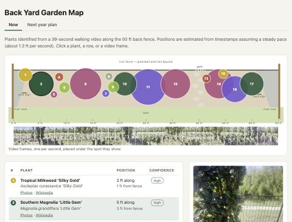

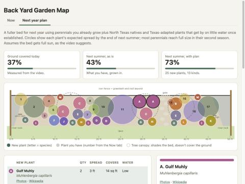

Care notes listed out of order: number-only keys sort first in `Object.entries`. That happened before this change too. Sorting them by first plant number.

I removed plants 6, 7, 9 and 10 and renumbered the rest 1–17, still in order from the left fence. I checked both tabs in the preview and there are no console errors. Nothing is committed yet.

**Renumbering:** 8 is now 6, and 11–21 are now 7–17. I updated everything that refers to a plant number:
- The plan tab's expected spreads next year, the tree canopy set and the care-note keys.
- The milkweed note now says it sits "behind crape myrtle 14", and Butterfly Weed sits "near milkweed 15".

**Notes that pointed at removed plants:**
- Violet Sage no longer says plant 10 might be the same plant.
- The remaining gray-green mound no longer says it matches the one at 15 ft.
- Coral Honeysuckle (M) no longer calls itself a repeat of plants 6 and 7. It's now described as a native vine for the fence.

**Plan tab:** removing those plants left a bare patch from about 10 to 17 ft, so I added three plants there:
- a second Coral Honeysuckle on the fence at 11 ft
- a third Rock Rose at 16 ft by the fence
- a second Gaura at 15 ft in the middle of the bed

Ground coverage now reads 37% today, 43% next summer as is, and 73% with the plan (was 39 / 46 / 72). There are now 25 new plants.

**Care notes:** they were listing out of order (3, 4 and 17 came before "1, 19"), and that was already happening before today. They now sort by plant number.

When we commit, I'll regenerate `prompt.md` and re-blur the sign screenshots and remove the sign names again.

## You

There is another plant, like number 3, but with pink-ish flowers, about 4 feet to the right of number 3. Same overall species. This new one probably is a Red Fox, the existing number 3 is a purple one.

## Claude

*(Close-up photos of plants omitted.)*

Close-up 11 shows the hot-pink spikes, so that photo is the new Red Fox, not #3. Moving that description over and adding the plant.

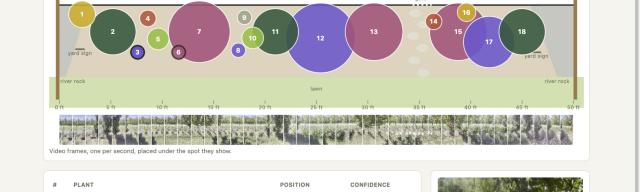

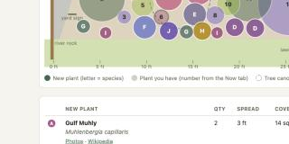

I added the pink speedwell as plant 6, which brings the map to 18 plants. Both tabs load in the preview with no errors. Nothing is committed yet.

- **New plant 6:** Spike Speedwell 'Red Fox', at 11.6 ft, the same distance from the fence as plant 3. It's pink on the map and uses the video frame at 9 s.
- **Plant 3:** now Spike Speedwell (purple), drawn in purple. Its description used to be hot-pink spikes. That came from close-up 11, which shows the pink flowers, so the close-up actually matches the new Red Fox. I moved that description to plant 6.
- **Renumbering:** the old 6–17 are now 7–18. On the plan tab I updated the expected spreads, the tree canopy set and the care-note numbers. The milkweed note now says it sits "behind crape myrtle 15", and Butterfly Weed sits "near milkweed 16". The speedwell care note covers both 3 and 6 and now also says to deadhead.
- **Plan tab:** I shifted three new plants so they don't sit on top of the Red Fox: a Rock Rose to 12.4 ft, the Aromatic Aster to 12.4 ft and a Blackfoot Daisy to 14.3 ft. Coverage now reads 37% today, 44% next summer as is, and 74% with the plan.

## You

Plant number 8 is the same as number 3
Plan number 9 is the same as plant number 4

## Claude

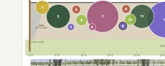

Plants 8 and 9 now match 3 and 4. They keep their positions, so no numbers changed. The page loads in the preview with no errors. Nothing is committed yet.

- **Plant 8:** was Violet Sage, now Spike Speedwell (purple), same name and color as plant 3. Its note says it's the same as plant 3, and plant 3's note points back to it.
- **Plant 9:** was the gray-green mound I'd guessed was lavender or rosemary, now Autumn Sage like plant 4. I removed the leftover lavender photo and Wikipedia link settings.
- **Plan tab:** next summer's spreads now follow the speedwell (1.5 ft) and the sage (3 ft). The care notes now read "3, 6, 8" for speedwell and "4, 9" for autumn sage. Coverage today rounds to 38% instead of 37%; next summer stays at 44% as is and 74% with the plan.

## You

There is another plant like numbers 4 and 9 located between 12 and 13, near the top most intersection of the two canopies, about the same distance from the back fence as 4 and 9

## Claude

Topmost canopy intersection lands at about 28.2 ft, 1.2 ft from the fence, which matches 4 and 9. Adding it as the new plant 13.

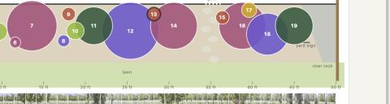

I added the new Autumn Sage as plant 13, which brings the map to 19 plants. The page loads in the preview with no errors. Nothing is committed yet.

- **Position:** the topmost point where the salvia mass (12) and the crape myrtle (now 14) overlap works out to 28.2 ft along and 1.2 ft from the fence. That matches 4 and 9 (about 1.3 ft), so I placed it there. It uses the video frame at 22 s. Its note says it's the same as 4 and 9, and plant 9's note points to it.
- **Renumbering:** the old 13–18 are now 14–19. On the plan tab I updated the spreads (the new sage grows to about 3 ft next summer) and the tree canopy set. The care notes now read "4, 9, 13" for autumn sage, "1, 17" for milkweed, "12, 18" for blue salvia and "15" for the mandevilla. The milkweed note now says it sits "behind crape myrtle 16", and Butterfly Weed sits "near milkweed 17".
- **Plan tab:** the first of the two Gulf Muhly sat almost on top of the new sage, and with only one fitting before the stepping-stone path, I cut Gulf Muhly to one plant at 31.4 ft. That takes the plan from 25 to 24 new plants. Coverage now reads 38% today, 45% next summer as is, and 73% with the plan.

## You

There is another hanging plant number 15, about 4 feet to the left of number 15 - basically directly opposite it on the stone path

## Claude

I added the second hanging Red Mandevilla as plant 15, which brings the map to 20 plants. The page loads in the preview with no errors. Nothing is committed yet.

- **Position:** 33 ft along and 1.6 ft from the fence, the same distance out as the first pot. That puts it on the left side of the stepping-stone path, about 3.4 ft from the first pot instead of the 4 ft you mentioned. I went with "directly across the path" over the exact distance. It uses the video frame at 25 s.
- **Renumbering:** the old 15–19 are now 16–20, and the first pot is now plant 16. The two pots' notes point to each other.
- **Plan tab:**
  - The new pot doesn't count as ground cover, same as the first, so coverage is unchanged: 38% today, 45% next summer as is, 73% with the plan.
  - The care notes now read "15, 16" for the mandevillas (bring the pots in below 50°F), "1, 18" for milkweed and "12, 19" for blue salvia.
  - The milkweed note now says it sits "behind crape myrtle 17", and Butterfly Weed sits "near milkweed 18".

## You

Lets add to the "Now" tab some additional care instructions for each species, including what care should be done to prepare them for winter / next spring

## Claude

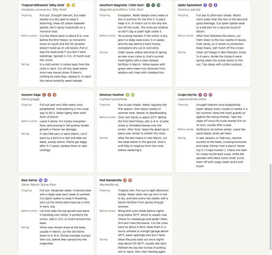

Cards render. Checking that clicking a number jumps to the plant, and checking phone width.

The Now tab now has a "Care by species" section below the map notes: one card per species, eight in all. The timing assumes North Texas, with the first freeze in mid to late November and the last in mid-March. It works in the preview at desktop and phone width, and nothing is committed yet.

- **Each card** shows the plant numbers it covers, and clicking a number jumps to that plant on the map. It then gives three parts: ongoing care, what to do before winter, and what to do in late winter or spring.
- **Each plant's detail panel** on the map now includes its "Before winter" step.

Things that need doing now, since it's early November:
- **Red Mandevillas (15, 16):** bring both pots in before nights drop below 50°F. Check them for pests first, cut them back by about a third, and keep them somewhere bright.
- **Tropical Milkweed (1, 18):** cut the stems back to about 6 in. before the first freeze, then mulch the crown.
- **Mexican Heather (5, 10):** mulch the crowns 3–4 in. deep before a hard freeze, and leave the dead tops on over winter.

For the rest:
- **Autumn sage (4, 9, 13) and crape myrtles (7, 14, 17):** leave them alone until late winter. Then cut the sage back and prune the crapes lightly, without topping them.
- **Blue salvia (12, 19) and speedwell (3, 6, 8):** cut back after frost or once new growth shows.
- **Magnolias (2, 11, 20):** only need a deep watering during dry spells.

The care notes on the plan tab are still there and are shorter versions of the same advice.

## You

On the "Next year plan", lets add more Red Mandevilla hanging pots along the back fence. You may have to examine the image, but the idea is to have one hanging pot per fence post\

## Claude

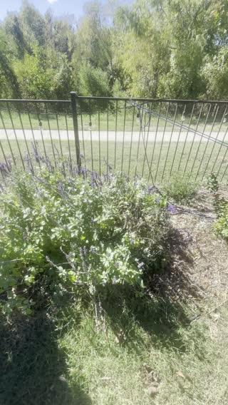

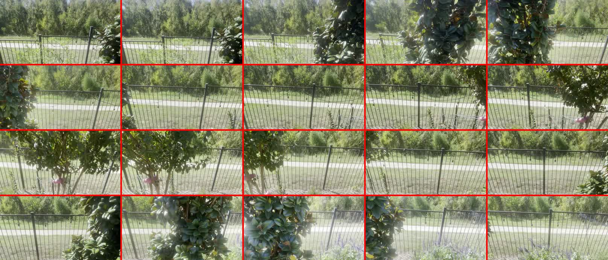

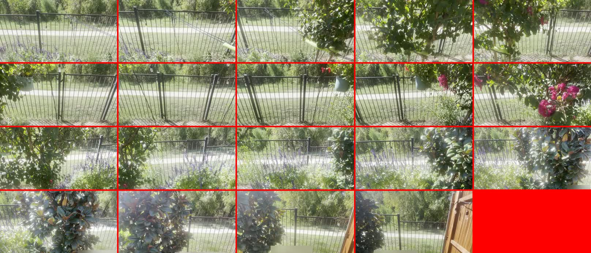

Tracking fence posts across frames to measure the spacing. First pass gives about 5–6 s between posts, roughly 7 ft. Checking the rest of the fence.

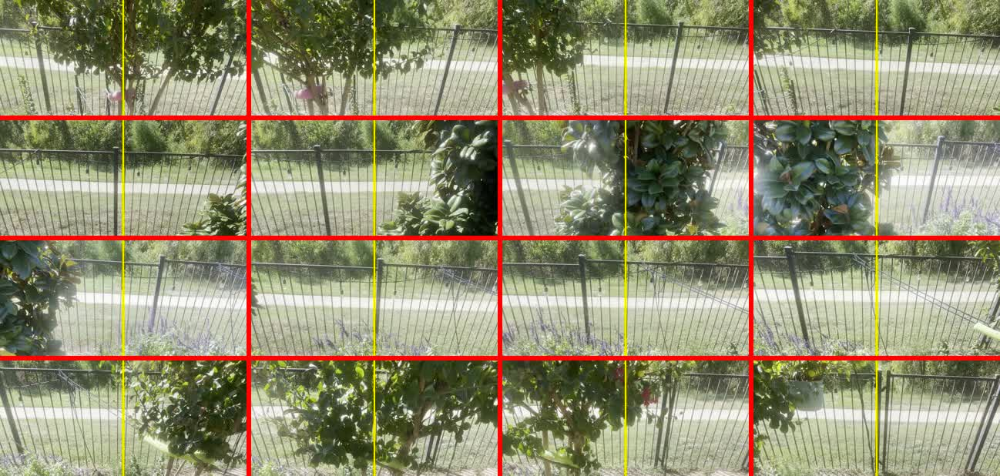

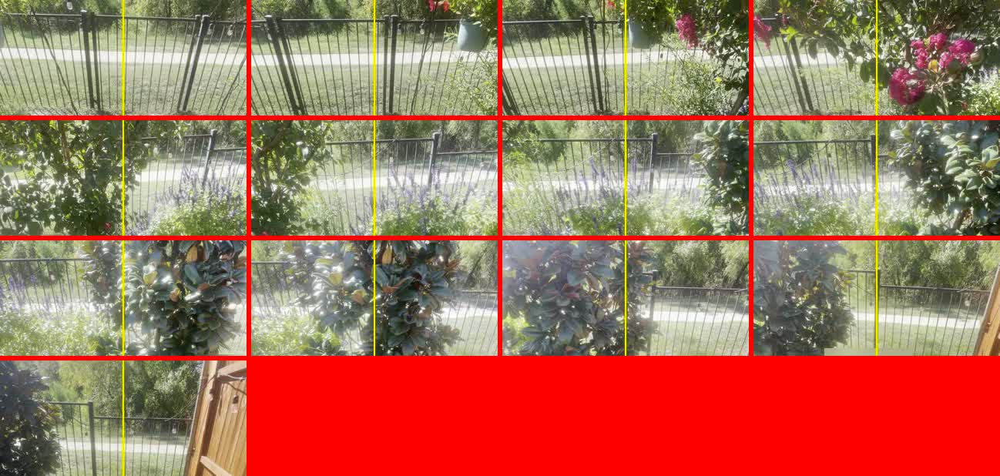

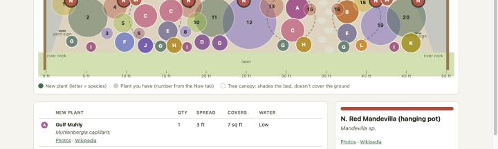

Pots show along the fence. One fix: the detail panel adds "once established; water weekly the first summer", which is wrong for pots.

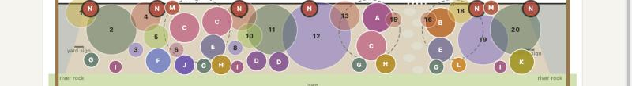

I added six hanging Red Mandevilla pots to the Next year plan, one on each fence post, marked N. With the two existing pots at the gate (15 and 16), that makes eight in all. The page loads in the preview with no errors. Nothing is committed yet.

**Fence posts:** I followed each post through the video frames and timed when it passed the middle of the picture, the same way the plants were placed. The posts come out about 7 ft apart:
- left of the gate at about 3, 10, 18 and 25 ft
- the gate posts at about 33 and 36 ft, which already hold the two existing pots
- right of the gate at about 41 and 46.5 ft

**Uncertainty:** I didn't walk at an exact steady pace, so each post could be off by a foot or two. The right-hand spacing also came out tighter, about 5.5 ft instead of 7. There also seem to be corner posts where the iron fence meets the wooden fences at 0 and 50 ft. I left those without pots since they sit over the river rock. If you count the posts in person, tell me the number and I'll even out the spacing.

**Plan details:**
- The pots hang, so they don't count toward ground coverage. Coverage stays at 73%, and the summary now reads "24 new plants, 13 kinds, plus 6 hanging pots".
- In the table the pots show "hangs" instead of an area, and they're left out of the square-foot total.
- Their detail panel describes pot watering instead of in-ground watering, and says to bring every pot in for the winter.

## You

Ok, so you suggested I add some purple coneflowers. Turns out I do have some, but they are past flowering at this point. One is located to the right of number 12, fully within the coverage of number 12 and outside of the coverage of 14. The other one is a similar distance to the left of 19

## Claude

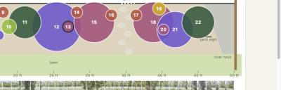

I added your two Purple Coneflowers as plants 13 and 20, which brings the map to 22 plants. The page loads in the preview with no errors. Nothing is committed yet.

- **Plant 13:** at 27 ft, 1.6 ft right of the center of the salvia mass (12). I checked the geometry: it sits fully inside 12's circle and fully outside the crape myrtle's (now 15).
- **Plant 20:** the same distance left of the second salvia mass, at 40.2 ft.
- **Both:** marked high confidence, and their notes say they're past bloom.

**Renumbering:**
- The old 13–18 are now 14–19, and the old 19–20 are now 21–22.
- Every cross-reference is updated:
  - the milkweed sits behind crape myrtle 18
  - Butterfly Weed sits near milkweed 19
  - the pot notes point to 16 and 17
  - the third autumn sage is now 14
  - the canopy set, the spreads and the care-note numbers all use the new numbers

**Care:**
- The Now tab has a new Purple Coneflower card. It says to leave the seed heads standing over winter for the goldfinches, keep mulch off the crowns, and cut the stems down in late February.
- The cards now sort by their first plant number, so the coneflower card lands between Blue Salvia and Red Mandevilla.
- The plan tab has a matching "13, 20" care note.

**Plan:** the two coneflowers I proposed (D) stay where they were, below the middle magnolia, and the entry now says you already grow two. The new plants sit inside the salvia masses, so coverage doesn't change: 38% today, 45% next summer as is, 73% with the plan.

## You

Commit and push

## Claude

Rebuilt `prompt.md`: restored the blurred screenshots and the sign redactions, and dropped the old close-ups. Checking the new screenshots 046–048, which look like this session's close-ups.

*(Close-up photos of plants omitted.)*

Committed and pushed to `origin/master` as `bd556eb`. Only the `garden-map/` folder went in. The other uncommitted changes in the repo (the Hexahedron files and the root `index.html`) stay out of the commit, untouched.

The commit has:
- all the plant fixes from this round, which bring the map to 22 plants
- the care-by-species cards on the Now tab
- the hanging mandevilla pots on the plan tab
- a refreshed `prompt.md`

For `prompt.md`:
- **Signs:** regenerating it brought back the unblurred screenshots, so I swapped in the blurred versions again. The school and company names are replaced again too; neither name appears in `prompt.md` or the page.
- **Close-ups:** I left out the old close-ups and the three you showed this round. A one-line note marks where each set was.
- **Screenshots:** the 16 new ones are map views or crops of the already-blurred video frames.
- **Cost:** the estimated session cost so far is about $10.60.

## You

Can we get a 3d render of the next year plan?

## Claude

Building it as a third tab: a Three.js scene loaded only when the tab opens, drawn from the same plan data.

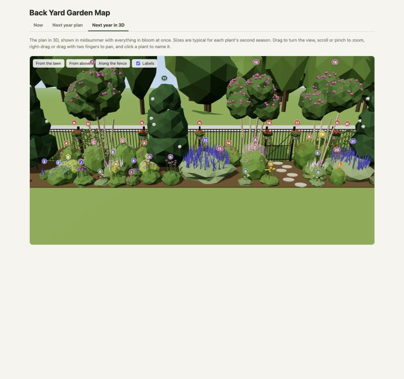

Scene renders without errors. The lawn view shows too much lawn, so I'm lowering the framing; I'm also pushing the background trees back.

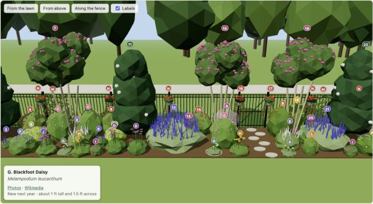

Click-to-name works (you'd selected G). Checking the other two views.

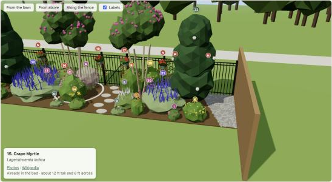

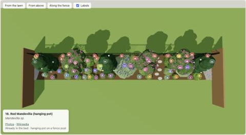

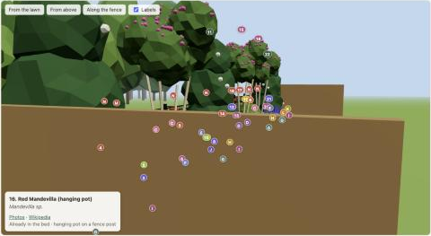

"Along the fence" puts the camera behind the left wooden fence, so the wall fills the view. Moving that camera inside the yard.

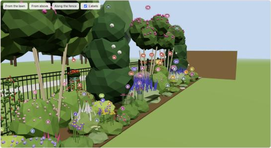

Along-the-fence view works. Checking phone width and tab switching.

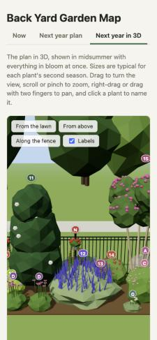

I added a third tab, "Next year in 3D", with a 3D model of the plan that you can turn and zoom. It's in the preview now, and it looks like you've already been using it. It works at desktop and phone width with no console errors. Nothing is committed yet.

- **What's in the scene:** everything comes from the same plan data as the 2D map, so later plan changes show up here too.
  - **Existing plants:** your 22, at next summer's size.
  - **New plants:** A–N from the plan.
  - **Hardscape:** the mulch bed, both river-rock areas, the stepping stones, the iron fence with its posts and gate, the wooden fences on each side, and the trail and tree line beyond.
- **Plant shapes:**
  - Magnolias are evergreen columns, and the crape myrtles have bare trunks (pool noodles included on yours) under pink-flowered canopies.
  - The salvias and speedwells have flower spikes, the coneflowers and daisies have flower heads on stems, and the Gulf Muhly is grass with a pink haze.
  - The mandevillas hang in pots from brackets on the posts, and the Coral Honeysuckle covers a stretch of the fence.
- **How it looks:** midsummer with everything blooming at once, so it's a best case, not any single week.
- **Controls:**
  - Drag to turn, scroll or pinch to zoom, and right-drag or two-finger drag to pan.
  - Three preset buttons: "From the lawn", "From above" and "Along the fence".
  - Number and letter labels match the map and can be turned off.
  - Clicking a plant or its label shows its name, its Photos and Wikipedia links, its size, and whether it's new.
- **Loading:** the 3D library loads only when the tab is first opened, so the other two tabs stay as fast as before. You can link straight to it with `#3d`.
- **On a phone:** the narrow screen shows only part of the 50 ft bed at once, so you have to pinch out or turn to see the rest.
- **Files:** the new code is in `garden-map/plan3d.js`; `index.html` has the tab and styles.

## You

Commit and push

## Claude

Committed and pushed to `origin/master` as `2c08902`. The Pages site will have the 3D tab after its next build, and you can link straight to it with `#3d`. Only the `garden-map/` folder went in; the Hexahedron files and the root `index.html` stay out, untouched.

For `prompt.md`:
- **Signs:** regenerating it brought back the unblurred screenshots again, so I swapped the blurred ones back in. The sign names still appear nowhere in the published files.
- **Close-ups:** last round's side-by-side check image of the three close-ups also got pulled in, so I removed it and left the usual one-line note.
- **Screenshots:** the seven new ones are views of the 3D scene.
- **Cost:** the estimated session cost so far is about $12.85.

## You

Lets add another tab - next year timeline
On the timeline, lets show each species that will be planted, and using their color - what times of the year they will be blooming

## Claude

Whole file is 618 lines. Read it fully.

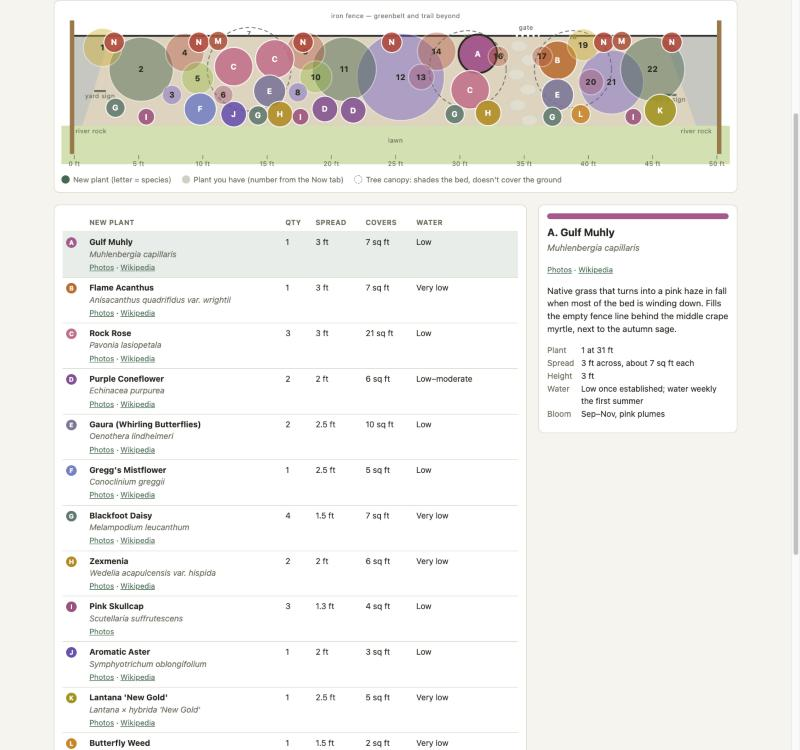

Timeline tab built; checking render now.

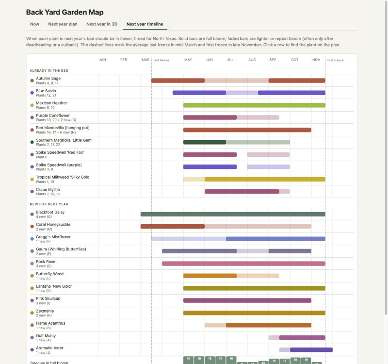

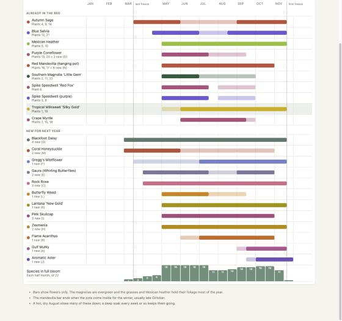

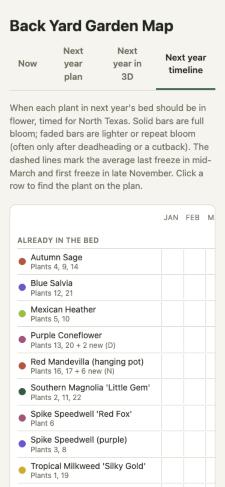

Mobile: name column hogs width, bars off-screen. Fix: narrower sticky name column on phones.

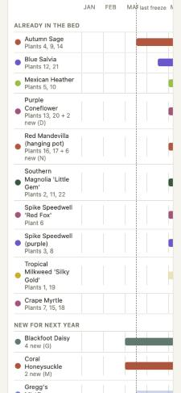

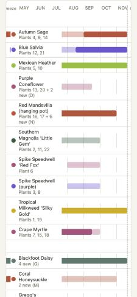

Bars leak into scroller padding left of the pinned names. Cover it with a panel-colored shadow.

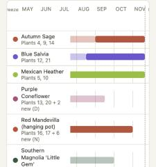

Mobile clean. Check row click plus dark mode.

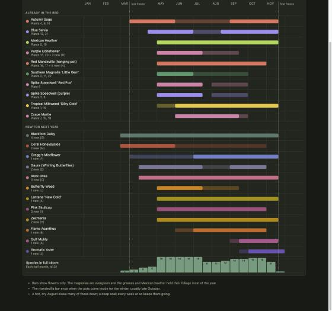

The "Next year timeline" tab is in [index.html](index.html), and you can link straight to it with `#timeline`. It works on desktop, on a phone and in dark mode. Not committed yet.

- **Rows:** one per species, split into "Already in the bed" (10) and "New for next year" (12). Each row lists the plant numbers or plan letters it covers. The coneflower and mandevilla rows also include the new D and N plantings, since they're the same species.
- **Bars:** in the same colors as the maps. Solid means full bloom. Faded means lighter or repeat bloom, like speedwell after deadheading or the autumn sage summer lull.
- **Bloom times:** these are my estimates of typical North Texas timing. Dashed lines mark the average last freeze (mid-March) and first freeze (late November).
- **Count chart:** a strip at the bottom shows how many species are in full bloom each half month. It peaks at 16 in May and June and dips to 11 in July and August. Early spring is thin: only blackfoot daisy and coral honeysuckle are in full bloom in March.
- **Clicking a row** opens the plan tab with that plant selected.
- **On phones** the names stay pinned on the left while the months scroll sideways.

Autumn sage and the red mandevilla share a red on the existing map, so their two bars are the same color.

## You

Lets add to the timeline a marker to indicate the best time to plant or do other maintenance tasks per species

## Claude

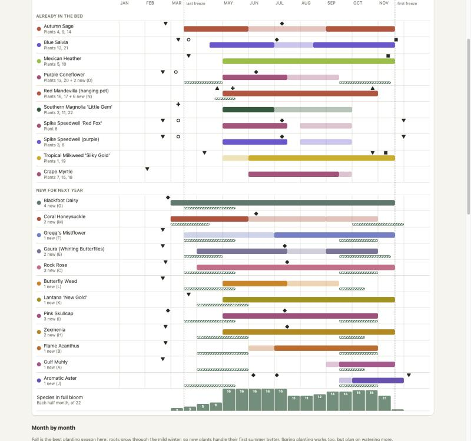

Markers render. Check legend and month list.

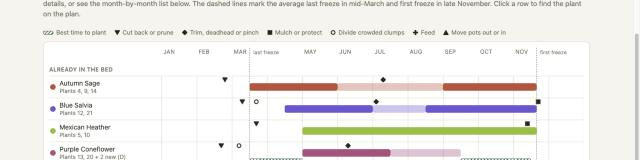

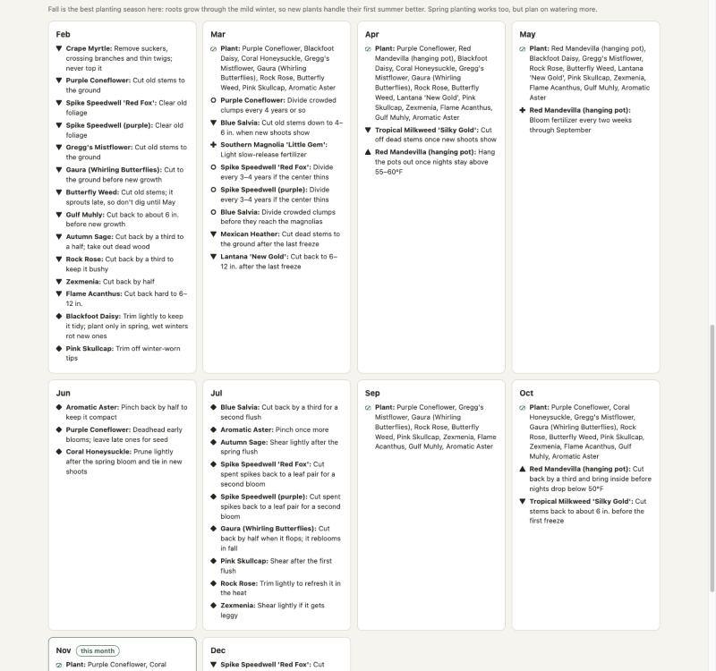

Month list works. Start it at current month so due-now tasks come first.

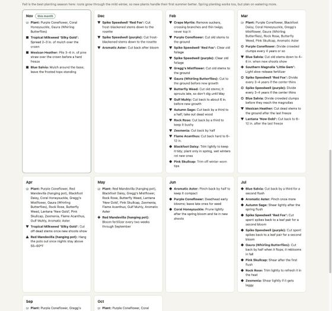

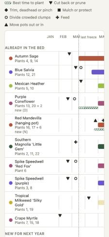

Timeline now marks when to plant and when to do upkeep, per species. Checked on desktop and phone with no errors. Not committed yet.

- **Planting windows:** green hatched strip under a bloom bar. Shown only where new plants go in: the 12 new species, plus the new coneflowers (D) and new mandevilla pots (N).
  - Most new species get a spring and a fall window.
  - Blackfoot daisy and lantana get spring only. Wet winters rot new blackfoot daisies, and new lantana is tender at first.
- **Upkeep marks:** small shapes along the top of each row, with a legend above the chart. Hover over one for what to do.
  - ▼ cut back or prune
  - ◆ trim, deadhead or pinch
  - ■ mulch or protect
  - ○ divide
  - ✚ feed
  - ▲ move pots out or in
- **Timing:** the existing plants' tasks come from their Now-tab care notes; the new plants' tasks are my North Texas estimates.
- **"Month by month" list:** under the chart, the same tasks as text, so they're usable on a phone without hovering. It starts with this month, so November is marked "this month" and comes first: milkweed, Mexican heather and blue salvia mulching, plus fall planting. Late February is the busiest stretch for cutting back.
- **Fall planting:** the list notes that fall is the better season here. That means most of the new plants could go in now rather than waiting for spring.

One mismatch: the timeline puts bringing in the mandevilla pots in late October. The Now tab's care note says to do it now, before nights drop below 50°F.

## You

Commit and push

## Claude

Regenerated prompt.md; now restoring blurred screenshots and removing close-ups.

Check new screenshot 071 (Now tab with video frames) for unblurred signs.

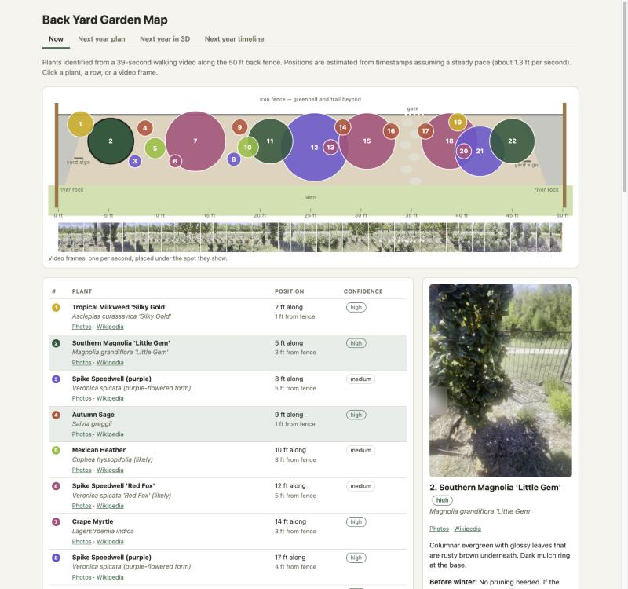

Sign in frame already blurred. Committing.

Committed and pushed to `origin/master` as `763a4b7`, with the timeline tab and a refreshed `prompt.md`. The Pages site will have the tab after its next build, and you can link straight to it with `#timeline`.

- **Signs:** regenerating `prompt.md` brought back the unblurred screenshots again, so I swapped the blurred ones back in. The sign names still appear nowhere in it. The video frame in one new screenshot was already blurred.
- **Close-ups:** they got pulled in again, so I removed them; the one-line note stays in their place.
- **Screenshots:** 14 new ones, all of the timeline and plan tabs.
- **Cost:** about $15.30 for the session so far.
- **Left alone:** the Hexahedron files and the root `index.html` are still uncommitted, as before.

## You

*(Close-up photos of plants omitted.)*

Add these plants to the mix for next year, if. It already there

## Claude

Zinnias new; blue mealy sage = existing blue salvia (12, 21); aromatic aster = already plan J. Find open spots for zinnias.

Picking front-edge gaps for 5 zinnias. Adding data.

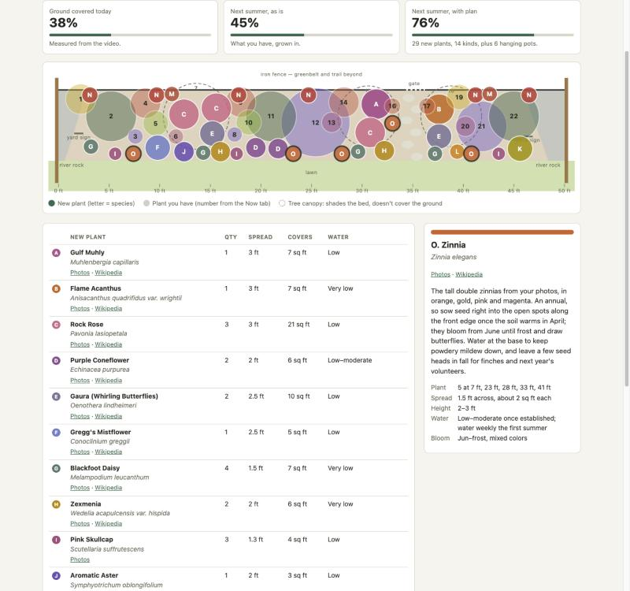

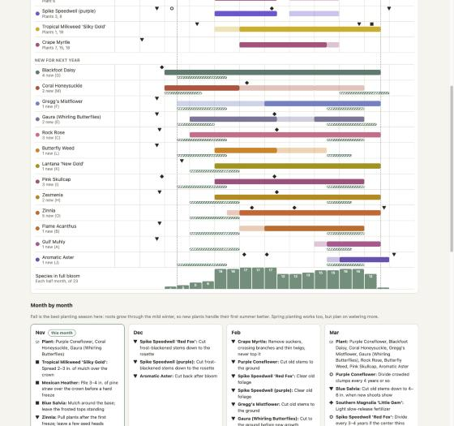

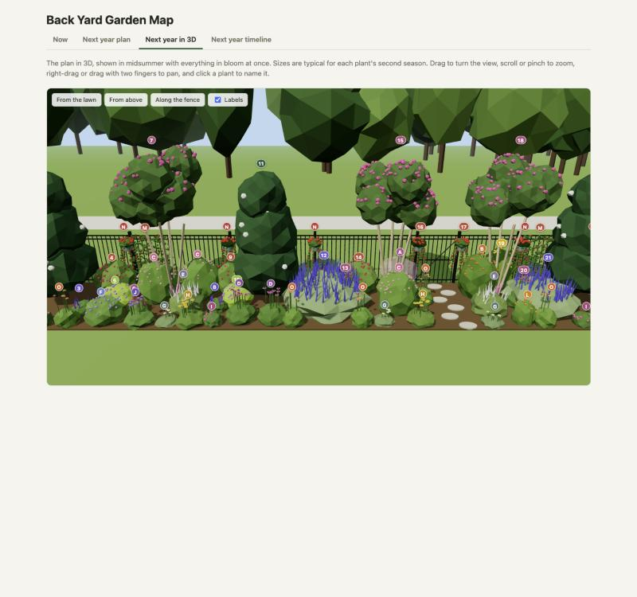

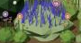

Of the three photos, only the zinnias were new; the other two were already covered. The zinnias are now in the plan as **O**, and the change works on the plan, timeline and 3D tabs with no errors.

- **Zinnias (photo 1):** new species O, the tall double kind (*Zinnia elegans*) in mixed orange, gold, pink and magenta. They're annuals.
  - **Where:** 5 plants in the biggest open gaps, mostly along the front edge: 7, 23, 28 and 41 ft, plus one at 33 ft beside the stepping-stone path.
  - **Plan tab:** O has its own row and details. Its watering note fits seed sown in place: keep the seedbed moist at first, then about weekly.
  - **Coverage:** with the plan it goes from 73% to 76%.
  - **Timeline:**
    - Sow April–May.
    - Full bloom June to frost.
    - Upkeep: deadhead in summer, cut back by a third in August for a fall flush, and pull the plants after the first freeze.
  - **3D:** O shows as a daisy-type plant with flower heads in four colors.
- **Blue sage (photo 2):** already in the bed as the blue salvia masses, 12 and 21. The white woolly stems in your photo point to mealy blue sage itself, rather than the 'Mystic Spires' hybrid that plants 12 and 21 are listed as. I left that name alone for now.
- **Purple asters (photo 3):** aromatic aster is already in the plan as J, one plant at 12 ft. I didn't add more.

I couldn't make out the four flower colors in the 3D screenshot at that size.

Not committed yet. These photos are plant close-ups too, so when I next regenerate `prompt.md` I'll leave them out like the earlier close-ups. Should I commit and push this now, or hold off?

## You

Not yet

## Claude

Okay, I won't commit. The zinnia changes stay uncommitted in [index.html](garden-map/index.html) and [plan3d.js](garden-map/plan3d.js) until you say to commit.

## You

I want to expand this to include my front garden.

I have video and some still photos in `~/Downloads/front`. Lets give it a pass as well. This was not shot in a straight line, but I trust you can work out the spatial orientation of everything.

Lets blur any part of pictures that are not plants or parts of the garden to keep identifying information out of this repository.

## Claude

*(Unblurred working images of the front yard omitted.)*

Reviewing front video frames and the 3 photos to map the layout.

*(Unblurred working images of the front yard omitted.)*

Front yard: bed along walk + porch, bed along house to side gate, island bed with birdbath. Zooming key frames for IDs.

*(Unblurred working images of the front yard omitted.)*

IDs done. Now pick key frames for publishing and work out blur regions. Making gridded views.

*(Unblurred working images of the front yard omitted.)*

Writing blur script; strips metadata too (HEIC may carry GPS).

*(Unblurred working images of the front yard omitted.)*

Blurs look right: house, porch, windows, door, cars, street, fence, bins and hose reel all hidden; metadata stripped. Now copy to repo and build the Front yard tab.

Edits: CSS colors, tab + section, data and drawing code.

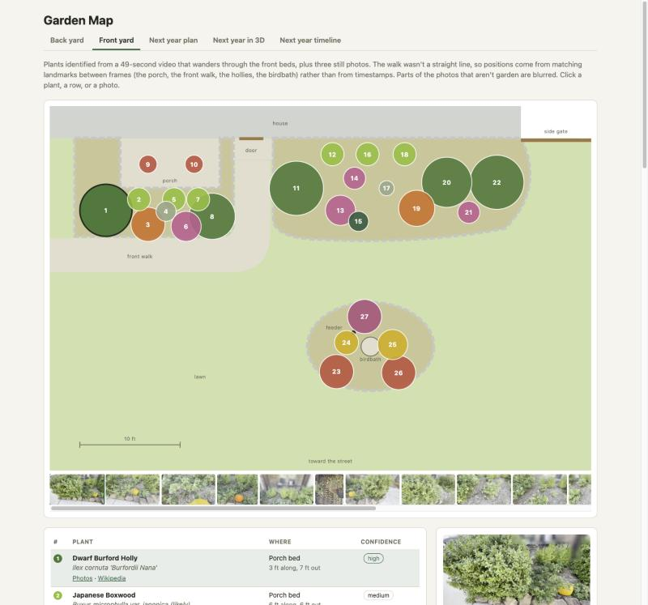

Map renders. Fix blank corner by the side gate, then check the rest.

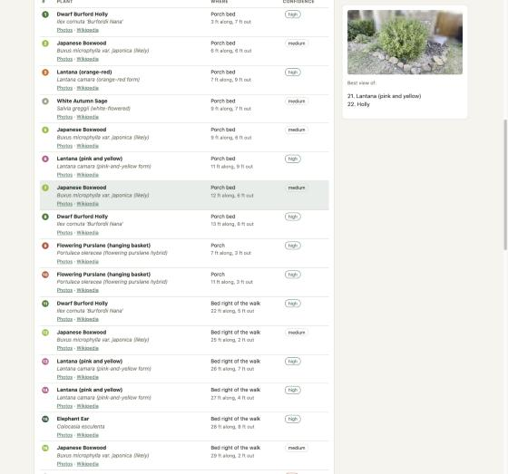

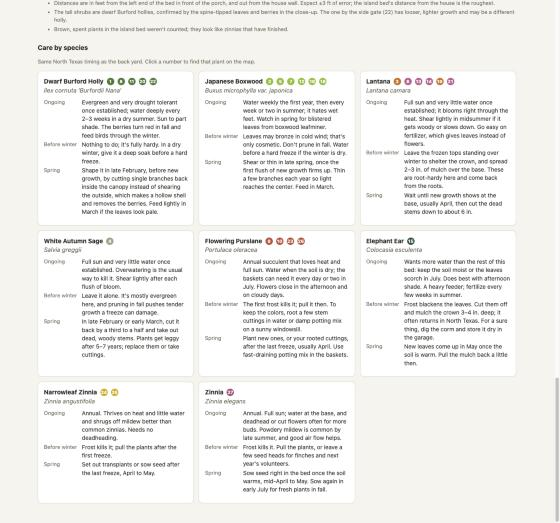

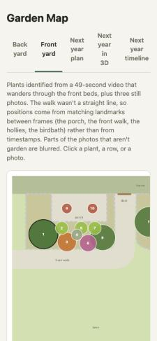

Tabs wrap to 3 lines on phones. Make them scroll instead.

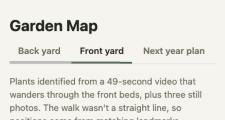

I added a **Front yard** tab with 27 plants on a top-down map, built from the video and your three photos. It works on desktop and phone with no errors; nothing is committed yet. I also renamed the page "Garden Map" and the "Now" tab "Back yard".

**Layout:** I placed everything by matching landmarks across frames (the porch, the bend in the front walk, the hollies, the birdbath), not by the video timestamps.
- **Bed in front of the porch:** hollies at the walk corner and by the steps to the door, three boxwoods along the porch edge, two lantanas either side of the pumpkin, and a white autumn sage.
- **Porch:** two hanging baskets of flowering purslane, one pink and one yellow.
- **Bed right of the walk, to the side gate:** four hollies, three boxwoods along the house, five lantanas, an elephant ear, and one plant I couldn't identify.
- **Island bed with the birdbath:** two purslane mats, two clumps of yellow narrowleaf zinnia, and mixed tall zinnias by the feeder pole. Those tall zinnias are probably the ones in your earlier close-ups.

How far the island sits from the house is the roughest estimate.

**IDs worth a second look:**
- **Boxwoods (medium):** they could be dwarf yaupon. A close-up of a leaf edge would tell them apart.
- **Shrub at the side gate (22):** looser and lighter than the Burford hollies, so it may be a different holly.
- **Plant 17 (low):** a small gray-green shrub I couldn't identify.
- **Yellow island zinnias:** I called them narrowleaf zinnia, but they could be a yellow Zahara or Profusion type.

**Photos:** 14 video frames and all three stills are in `garden-map/front/`, resized to 960 px wide.
- **Blurred:** the house walls, windows and door, the porch furniture and pillow, the stoop pumpkins, cars, the street, the mailbox, the utility box, neighbors' houses, the fence and gate, the trash bins and the hose reel.
- **Left sharp:** the walk and edging stones, since they're part of the garden layout, plus the brick behind the porch baskets.
- **Metadata:** removed from every image, including any location data in the photos.
- **Not copied into the repo:** the full video and original photos.

**Care cards:** seven new species have care cards with North Texas timing. The white autumn sage uses the same card as the back yard's autumn sage.

The front yard is not in the plan, 3D or timeline tabs; those still cover only the back yard. I didn't update the Garden Map card on the landing page, since that file has uncommitted changes from another session.

## You

Lets add a next year plan, a 3D, and a timeline for the front. We can group the back-yard and front-yard tabs separately.

## Claude

Big change. Plan: refactor plan/timeline code to take a yard config, make 3D take a yard, add front data, and split nav into yard + view rows.

Writing the HTML sections: yard switch, view tabs, front plan/3D/timeline.

Now the JS: replace the plan/timeline/tab code with yard-generic versions.

Now timeline + front bloom/upkeep data + yard configs + tabs.

Now 3D: make `plan3d.js` take a yard and build a front scene.

Gap check found better spots. Updating positions.

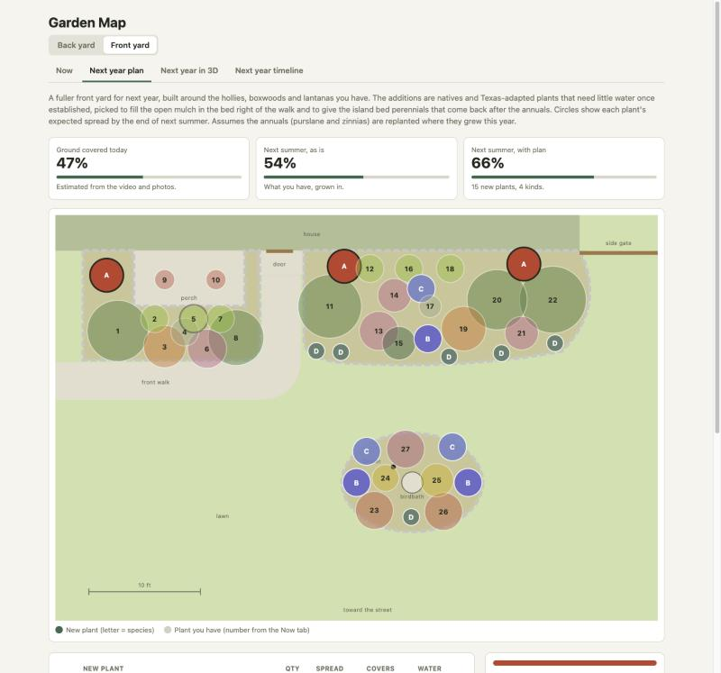

Front plan works (47% → 54% → 66%). Check front timeline and 3D.

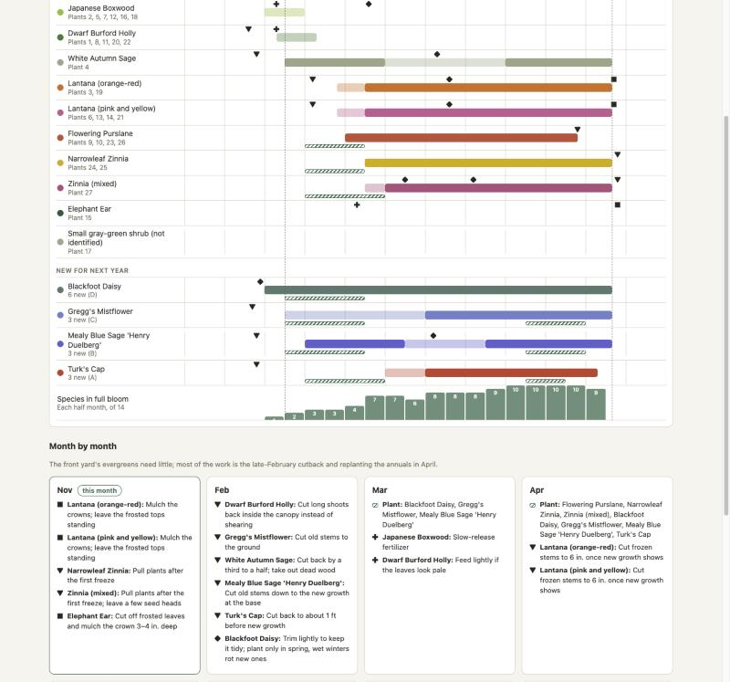

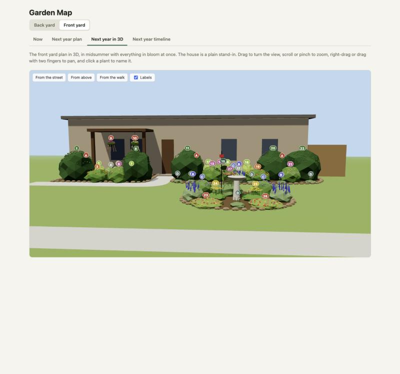

Front 3D renders. Tighten the street camera, then check back-yard tabs still work.

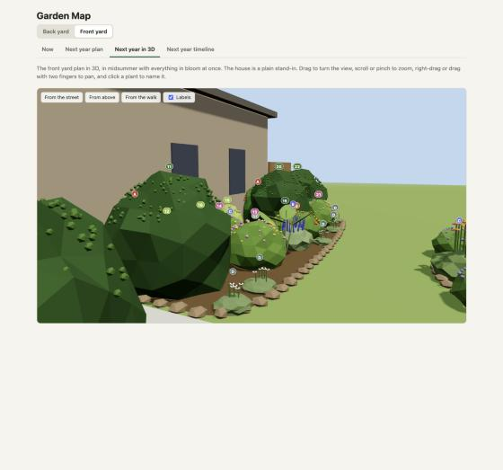

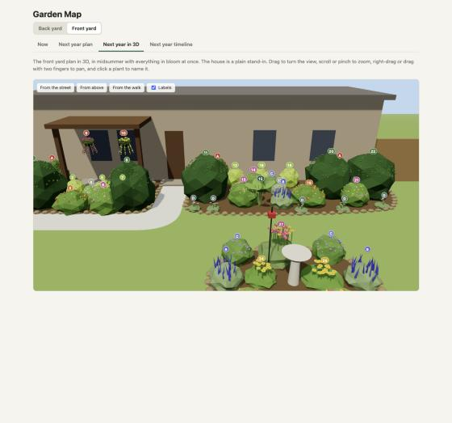

User is clicking in the pane, so testing via JS calls instead.

The front yard now has its own Next year plan, 3D view and timeline. I checked both yards in the browser; nothing is committed yet.

**Tabs:** a Back yard / Front yard switch sits above the four tabs, Now, Next year plan, Next year in 3D and Next year timeline. Each yard has its own link: `#plan`, `#3d` and `#timeline` for the back, `#front`, `#front-plan` and so on for the front. Old back-yard links still work.

**Front yard plan:** ground cover goes from 47% today to 54% next summer as is, and to 66% with the plan. Both summer figures assume you replant the purslane and zinnias where they grew this year. I placed the new plants in the largest open gaps I could find:

| | Plant | Qty | Where |
|---|---|---|---|
| A | Turk's cap | 3 | Shady spots against the house: left of the porch, beside the right-hand holly at the walk, and between the two hollies on the right. Native, with red flowers for the hummingbirds that come to the feeder. |
| B | 'Henry Duelberg' mealy blue sage | 3 | One near the front of the bed right of the walk, two either side of the birdbath. Blue from spring to frost, and gives the island something that comes back each year. |
| C | Gregg's mistflower | 3 | One in the open mulch in the middle of the bed right of the walk, two on the house side of the island. Draws butterflies. |
| D | Blackfoot daisy | 6 | Along the sunny edging stones, plus one in front of the birdbath. |

There are care notes for the plants you already have, grouped the same way as the back yard's.

**Front timeline:**
- **Bloom bars:** shown for every species. The hollies and boxwoods get faint bars, since their flowers are small and plain. The elephant ear and the unidentified shrub (17) have none, since they're grown for their leaves.
- **Planting windows:** shown for the new plants, and also for the annuals you replant each April.
- **Busiest stretch:** the month-by-month list shows the work is mostly late February.

**Front 3D:** the house is a plain stand-in box, with the porch, posts, hanging baskets, door and windows. Around it are the walk, the beds with edging stones, the island with its birdbath and feeder pole, the side fence and the street. The three views are from the street, from above, and from the walk.

The 3D code now builds either yard from one file, `plan3d.js`, and the plan and timeline code is shared between the two yards.

While I was testing, clicks in the browser pane switched yards a few times, so I checked the tab and link handling by calling it directly. The front-yard bloom times, new-plant spreads and placements are my North Texas estimates, like the back yard's.

## You

Front yard - I dont think I got it in the photo, but about 20 feet to the left of the birdbath is another garden bed. There is a small live oak tree in the middle. The overall diameter of this bed is maybe 5 feet. There are currently not plants in it, but we should add something shade tolerant.

Also, on the "Next year plan". Where the "A" is to the left of the front porch is another plan, the same as number 1. The video probably did not do a good job of capturing that.

And, for what it is worth, the front yard, especially the beds by the house, starts to be shaded around noon each day. The birdbath area gets sun until late afternoon during the summer.

## Claude

Changes: add the hidden holly left of the porch (renumbering the front), add the live-oak bed 20 ft left of the birdbath with shade plants, and re-pick plants for the afternoon shade by the house.

Now oak on Now map as canopy, the shade-aware plant picks, and new species data.

Plan good. Check Now map, 3D and timeline.

Oak cut off at left of the street view. Widen it.

I added the second holly and the live oak bed, and changed the plan to fit the afternoon shade by the house. I checked all four front tabs in the browser with no errors; nothing is committed yet.

**Second holly:** it's now plant 2, against the house left of the porch, where the Turk's cap was. The front plants are renumbered from there, so the old 2–27 are now 3–28. The care notes, grown sizes for next summer, timeline rows and notes all use the new numbers.

**Live oak bed (plant 29):** a 5 ft round bed about 20 ft left of the birdbath, with the oak in the middle. I placed it from your description since it isn't in the video; it shows on the Now map, the plan, the timeline and in 3D. The oak is drawn as a canopy that shades the bed rather than covering ground. It has its own care card with oak wilt rules: prune only in late January to early February or in midsummer, and paint every cut right away. Under it go two new shade plants:
- **E. Cedar sage** (3 here): a small native sage for dry shade, with red spikes the hummingbirds visit. It reseeds gently to fill in.
- **F. Inland sea oats** (2 here): a native shade grass with dangling seed heads that turn bronze. It seeds freely, so cut some of the heads before they drop.

**Afternoon shade changes:**
- **Blackfoot daisy:** it needs full sun, so it's now only in the sunny island bed, in front of the birdbath.
- **Cedar sage (5 more):** these take its old place along the shady front edge of the bed right of the walk.
- **Turk's cap:** kept at its two spots against the house; it flowers well in afternoon shade.
- **Gregg's mistflower and 'Henry Duelberg' sage:** kept. The plan notes they handle morning-only sun, and the island ones still get sun until late afternoon.
- **Text:** the plan text and the Now-tab notes now describe the light in each bed. The notes add that the lantanas by the house bloom a little less for it.

**Plan totals:** 19 new plants of 6 kinds. Ground cover goes from 48% today to 55% next summer as is, and to 68% with the plan.

The new plant choices, sizes and bloom times are my North Texas estimates, like the rest of the plan.

## You

21 and 23 - that is one plan, centered around the mid-point of the two. There is open space on the right side of where 23 currently sits

## Claude

Merging 21 and 23 into one holly at the midpoint, renumbering 24–29 down by one, then filling the open space on the right.

Open space: x 43–45 by the gate. Turk's cap there plus a Gregg's mistflower; the Turk's cap that sat under the merged holly moves to the gap at 35 ft.

Plants 21 and 23 are now one holly, centered between them, and I've filled the open space to its right. The front plan page loads without errors; nothing is committed yet.

**The merged holly (21):** it sits at about 39 ft along, midway between the window and the side gate. I put it at about 6 ft across now and 6.6 ft next summer, which is my estimate. Its note now explains that the video saw it from two angles and that you confirmed it's one plant. I kept the "may be a different holly" remark about its looser, lighter growth.

**Renumbering:** the front yard now has 28 plants. The old 24–29 moved down one, so the live oak is now 28. The care notes, timeline rows and Now-tab notes all use the new numbers.

**Plan changes:**
- **Turk's cap (A):** the one that would have sat under the bigger holly moved. One now fills the open corner by the side gate, and one fills a gap against the house at about 35 ft.
- **Gregg's mistflower (C):** one more goes in that corner, below the Turk's cap.

**Totals:** 21 new plants of 6 kinds. Ground cover now goes from 45% today to 52% next summer as is, and 66% with the plan. Coverage today dropped because the two overlapping circles became one.

## You

Commit and push
