# Prompts

- **Model:** claude-sonnet-5-5
- **Effort:** high
- **Session(s):** ee72f58b-6af4-4623-8ebe-8b49e3f035a5
- **Tokens:** input 48, output 34283, cache read 3616185, cache write 146091
- **Cost (tokscale estimate):** $1.29

## You

We have a couple design systems built in claude already, other than Bluebonnet. Can we add demo pages for them into this repo as well?

## Claude

Pulling the rest of both systems' files (component previews and READMEs), then I'll build the demo pages.

Both pages build. Checking them in the browser now.

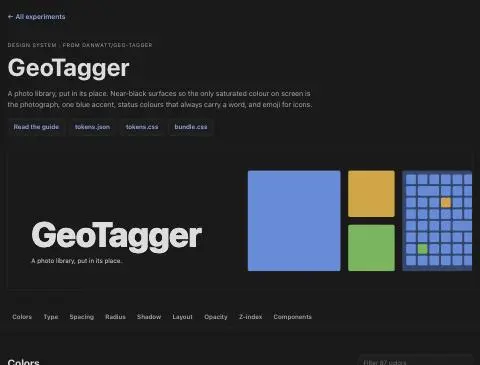

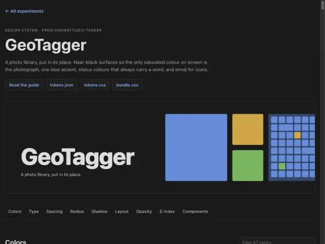

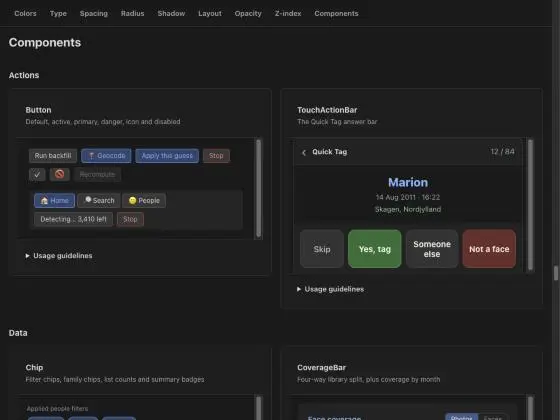

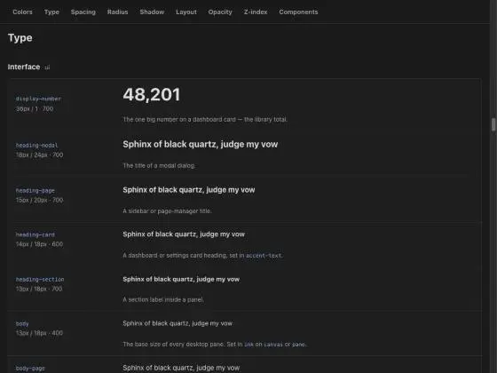

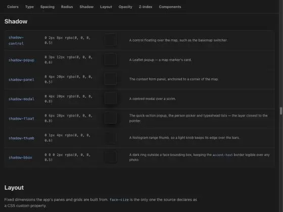

Fixed the iframe sizing. Re-checking GeoTagger components, then the RePair page.

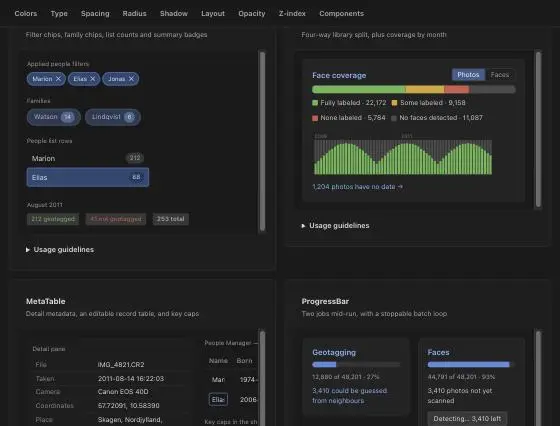

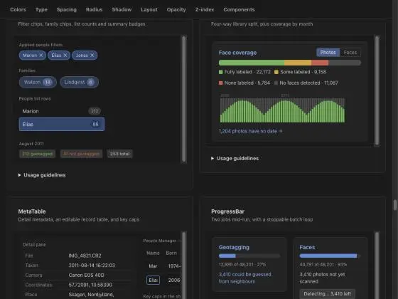

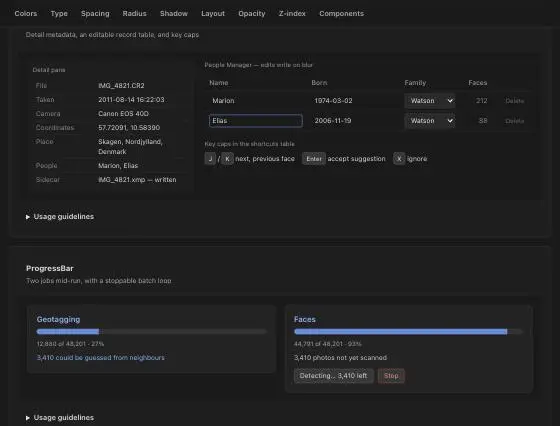

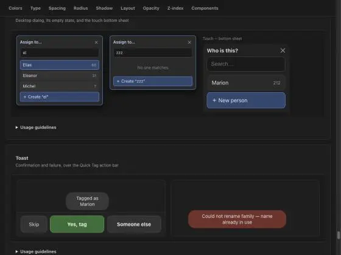

GeoTagger looks good. Now RePair, including the light theme.

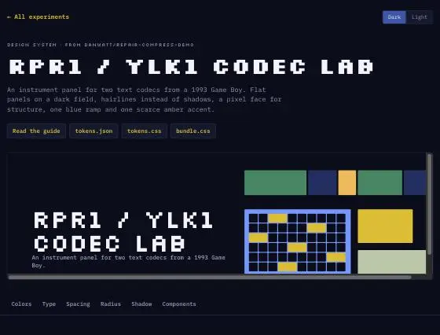

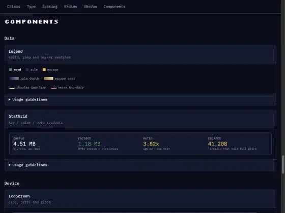

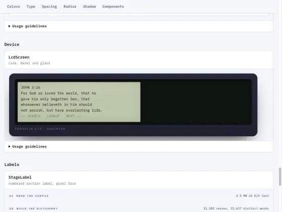

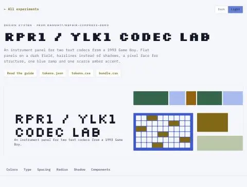

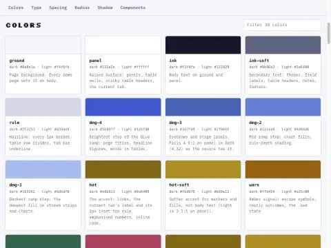

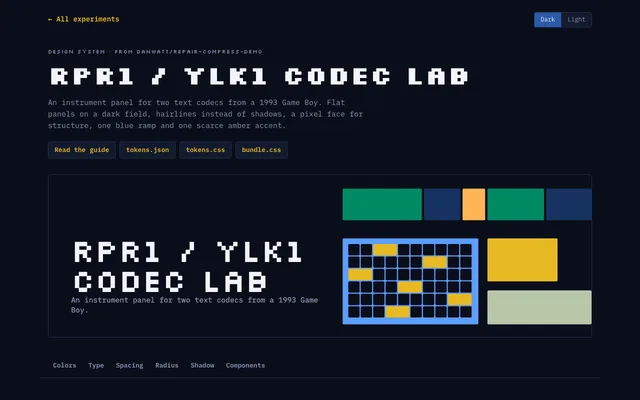

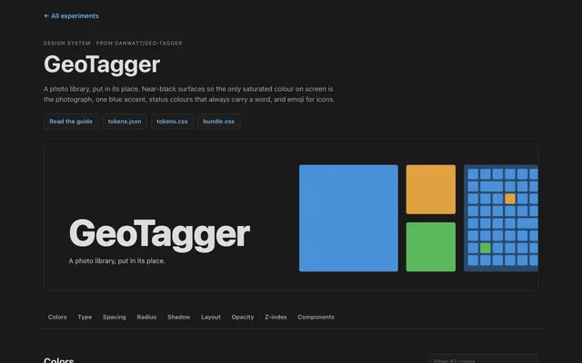
