# Prompts

- **Model:** claude-opus-5-5
- **Effort:** high
- **Session(s):** c33fe025-64ca-42ff-bbda-a99eea1404bd
- **Tokens:** input 864, output 456607, cache read 185977157, cache write 4771211
- **Cost (tokscale estimate):** $70.19

## You

I want to start a new experiment.

I want to be able to visualize what aircraft are in the air around where I am located. I'd like to have a 2D and 3D view, and for this to be in the browser (if a backend worker is needed, so be it).

I'd like for this data to come from an open data provider if possible.

I'd like a realtime view, and a view that has a slight delay to it so that it can show smooth movement of planes from point to point, as some of these data providers only update information in intervals longer than 10 seconds.

I should be able to rotate the view freely, so that I can visualize relative to the direction the screen faces, vs always being North.

I'd like to have filters based on various factors (depending on what is available) such as altitude ranges, airline, aircraft size, etc.

## Claude

Backend proxy written (adsb.lol / adsb.fi / OpenSky lack CORS). Testing it, then front end.

Data store + 3D meshes done; cleaning mesh code, then the map view.

UI shell next (HTML/CSS), then main wiring.

Now main wiring (state, filters, render loop, compass, details).

Modules parse. Launching in browser.

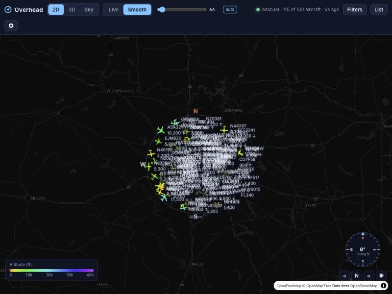

Browser render works. Investigating slow/stale backend responses (direct curl is fresh, proxy isn't).

adsb.lol rate-limits anonymous use (60/min, 500/day). Switching default to adsb.fi, adding 429 backoff in server.

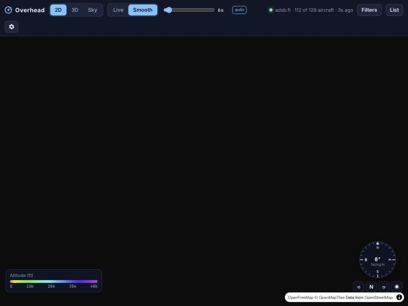

Map rendering blank after reload; adding debug handle to inspect.

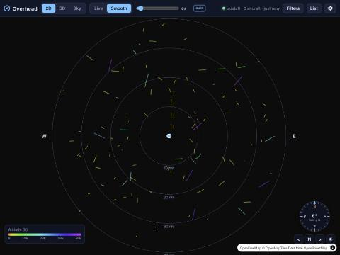

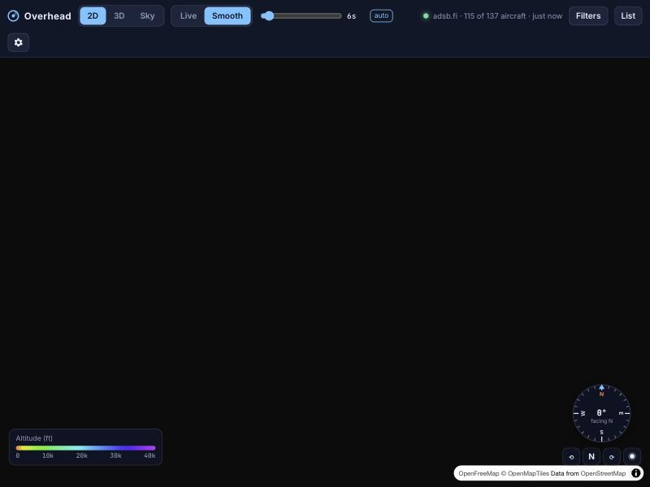

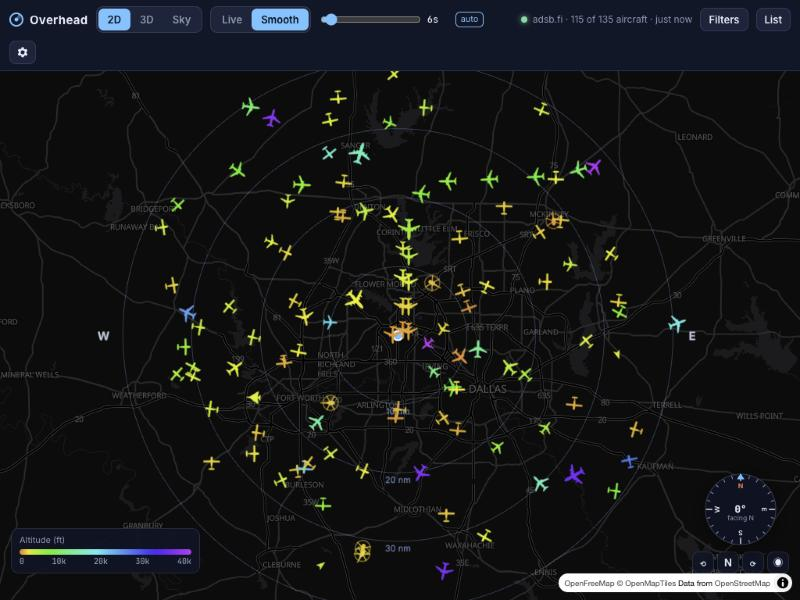


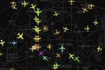

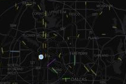

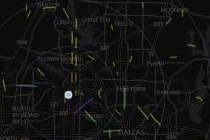

Labels vanish with deck's collision extension; replacing with a simple screen-space declutter.


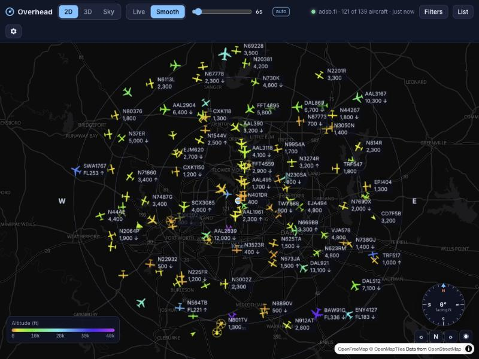

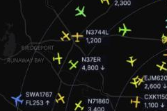

2D view working with decluttered labels. Verifying icon heading direction up close.

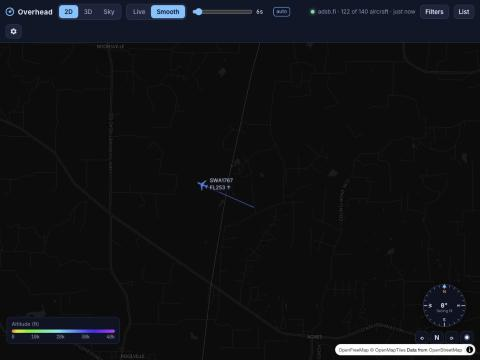


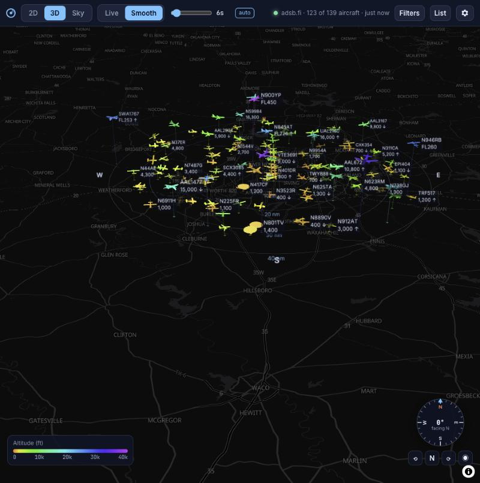

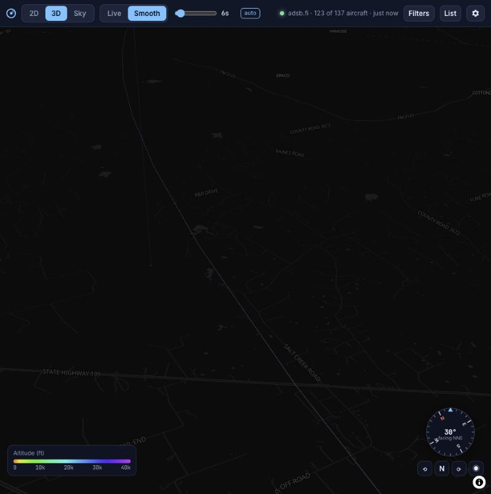

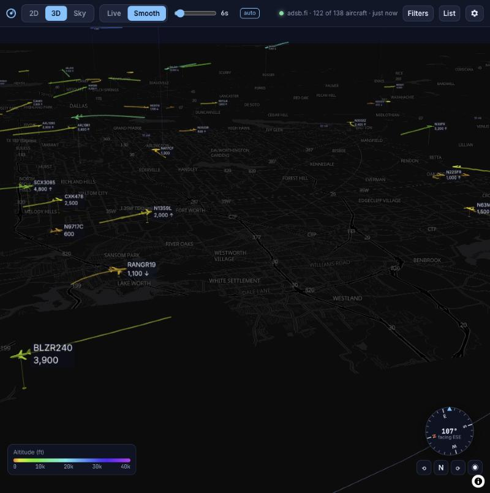

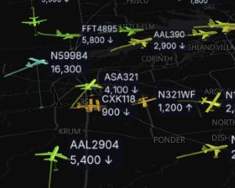

3D meshes render well. Fixing 3D fit centering + helicopter rotor, then testing Sky view, filters, details.

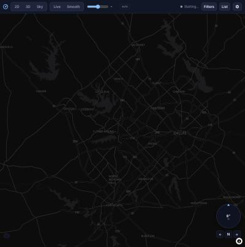

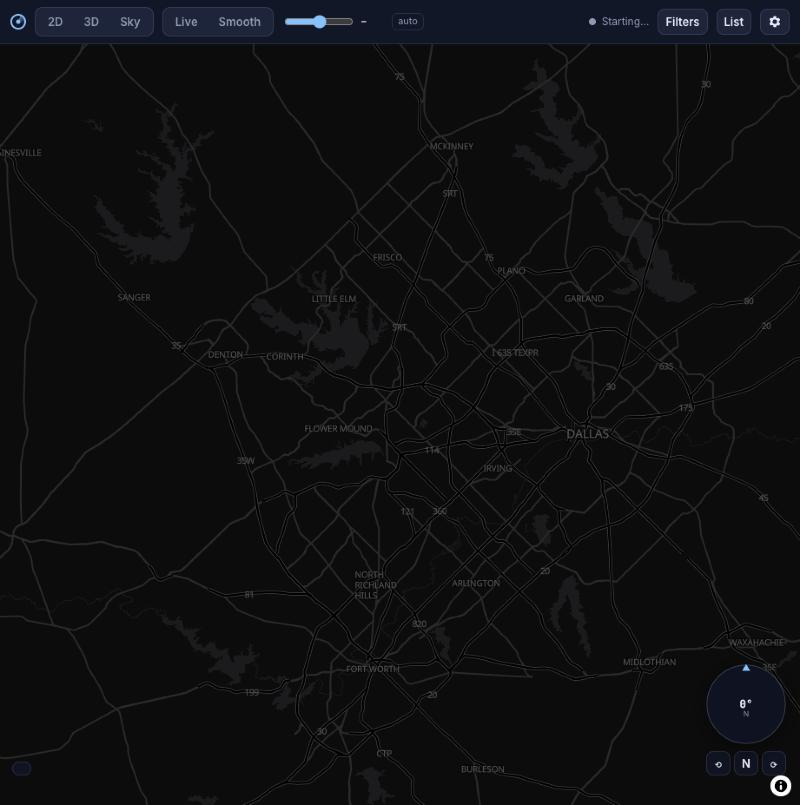

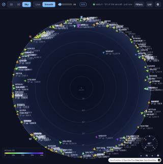

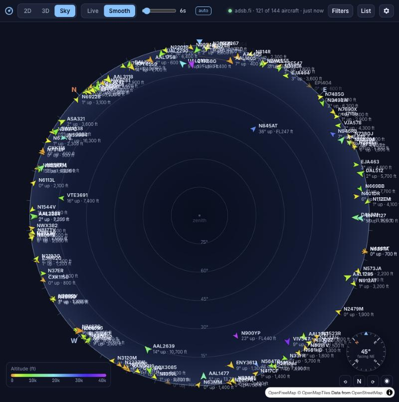

Sky dome renders; elevation scale crowds horizon. Switching to sqrt elevation scale + label declutter.


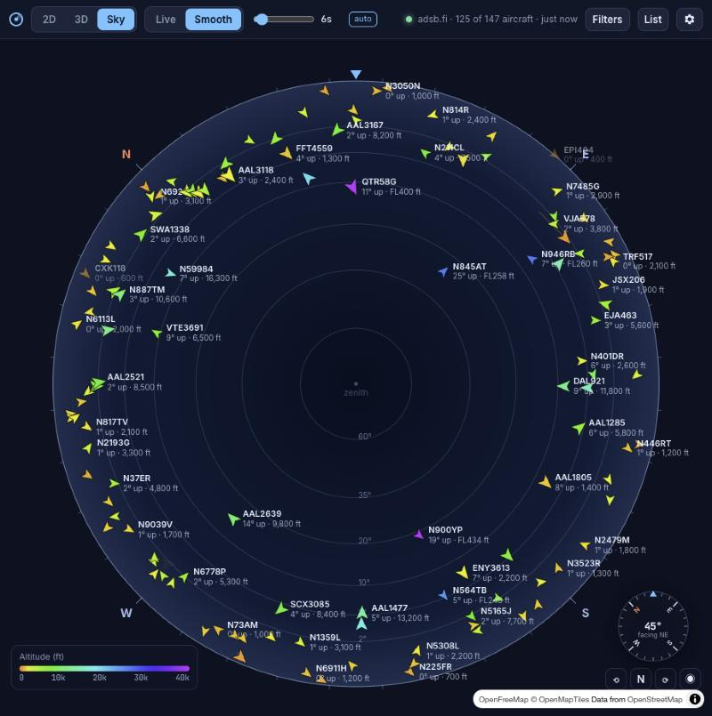

Sky view good. Testing filters, list, details card, and Live mode.

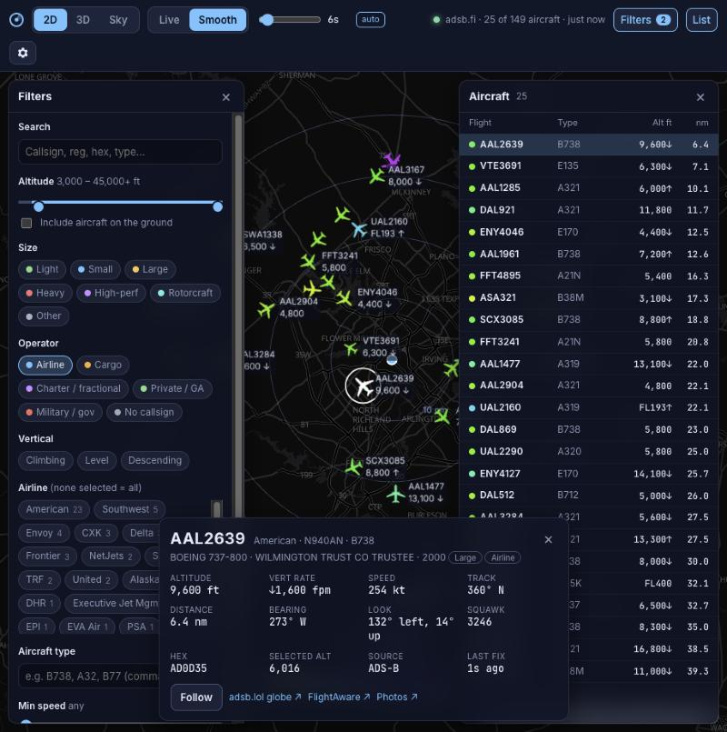

Live and Smooth motion both continuous (no jumps at poll boundaries). Checking 3D fit + rotation.

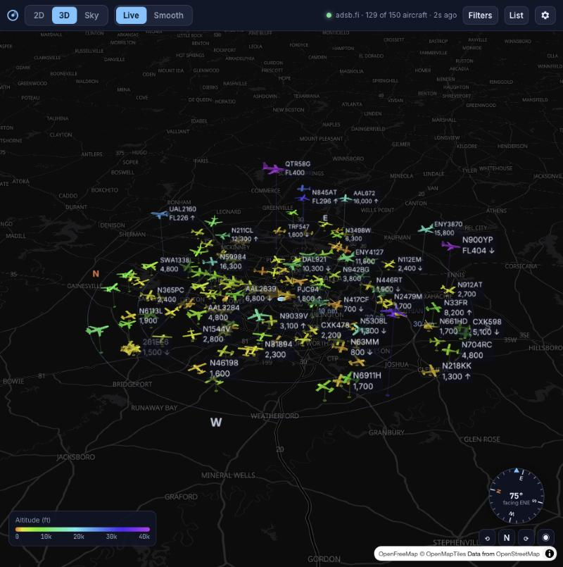


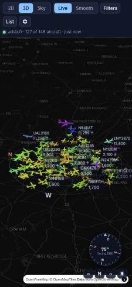

Mobile layout holds. Resetting viewport, writing README.

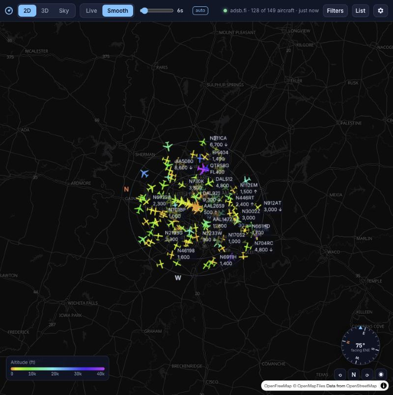

I've built **Overhead** in `overhead/`. It's no-build like the other experiments, and it's added to `.claude/launch.json` as `overhead` on port 8795. I tested it in the browser against live traffic around a test spot near DFW, and all three data sources returned real aircraft.

```bash
python3 overhead/server.py
```

The first time you open it, it asks for your location: use your device location, click a spot on the map, or type latitude and longitude.

**Data source and backend**
- A backend was needed. None of the open flight-data services allow a browser page to call them directly, so [server.py](overhead/server.py) does it, using only the Python standard library.
- It converts the three providers' formats into one, caches requests so several tabs share one call, slows down when a provider says it's sending too many requests, and keeps showing the last good data during outages.
- **adsb.fi** is the default. It's open data, updates about once a second, and includes the aircraft type, owner and build year.
- **adsb.lol** was my first choice, but anonymous use is capped at 60 requests a minute and 500 a day. It hit that limit during testing, so it now refreshes only every 5 seconds.
- **OpenSky** updates every 10–15 seconds and has a daily quota. You can raise the quota by setting `OPENSKY_CLIENT_ID` and `OPENSKY_CLIENT_SECRET`.
- Only your location rounded to about 1 km is sent to the provider.

**Live vs. Smooth**
- **Live** shows each plane's latest position and projects it forward between updates. When a new position arrives, the plane slides to it over about 0.3 s instead of jumping.
- **Smooth** runs a few seconds behind, so every frame falls between two real positions. Planes move along curves fitted to their reported speed and direction, so turns look curved rather than jagged.
- The delay is set automatically: 6 s on adsb.fi and 32 s on OpenSky. You can also set it with the slider.
- I measured frame-to-frame movement in both modes and found no jumps when new data arrives.

**Views**
- **2D:** a top-down map. Icons differ by size class (light plane, jet, heavy, fast military jet, helicopter), and labels are thinned out so they don't overlap.
- **3D:** a tilted map with simple 3D aircraft models at their altitude. They tilt nose-up or nose-down when climbing or descending and bank in turns. Lines drop to the ground, and you can exaggerate the altitude.
- **Sky:** a dome view of what's above you. The centre is straight overhead and the edge is the horizon. Most traffic sits within 10° of the horizon, so that band is stretched to give it more room.

**Rotation**
- All three views share one direction. You can turn it with the compass dial (drag or scroll), Q/E keys, N for north-up, or right-dragging the map.
- On a phone, ◉ follows the phone's compass so the top of the screen points the way you face.
- The details card for a selected plane tells you where to look, for example "132° left, 14° up".

**Filters:** search, altitude range, size class, operator type (airline, cargo, charter, private, military), climbing/level/descending, airline (chips list the airlines currently in range), type codes like `B738, A32`, minimum speed, maximum distance, and military only. You can colour aircraft by altitude, size, operator or airline.

A few limitations:
- OpenSky doesn't provide aircraft type or registration, so with that source the size filter only works for planes that report a size category.
- The airline name list covers about 150 carriers. Unknown codes show as the raw code, such as "TRF".
- The phone compass feature is untested because there was no real device to try it on.
- Switching views keeps the current zoom. Press H to recentre.

The [README](overhead/README.md) has the details.

## You

Lets add the ability to recenter the map somehow. Right click action on the map maybe?

## Claude

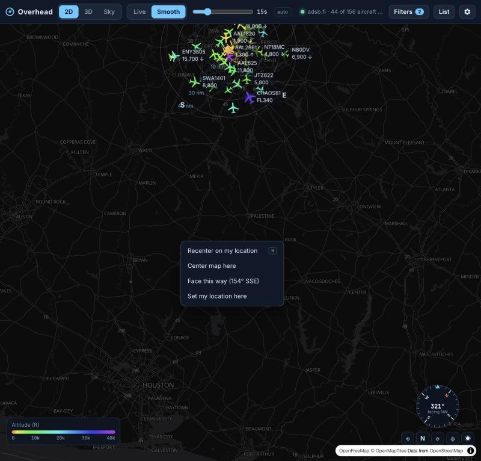

Recenter works from the menu. Checking that a right-drag (rotate) doesn't open the menu.

Map now has three ways to recenter:

- **Right-click the map** for a small menu:
  - **Recenter on my location**: fits the map back to your area, keeps your current rotation and stops following any aircraft.
  - **Center map here**: centers on the point you clicked.
  - **Face this way (154° SSE)**: rotates the view so the clicked point is at the top of the screen. Point it at a landmark you're facing and the map lines up with your real direction.
  - **Set my location here**: moves your home point to the clicked spot.
- **⌖ button** next to the rotate buttons under the compass. Hidden in Sky view, where recentering doesn't apply.
- **`H`** key, as before.

Right-drag still rotates and tilts the map. The menu only opens when you right-click without dragging (less than 5 px of movement). Esc, clicking elsewhere, or moving the map closes it.

I checked in the browser: right-click opens the menu, "Recenter" goes back home, a right-drag doesn't open the menu, Esc closes it, and ⌖ recenters. Long-press on a phone should also open the menu, but I couldn't test that here.

Changes are in [mapview.js](overhead/js/mapview.js), [main.js](overhead/js/main.js), `index.html`, `style.css` and the README.

## You

What other information is available from our data provider that we are not showing?

## Claude

Quite a bit is available that we don't show. I pulled a live sample from adsb.fi and adsb.lol around DFW (about 50 aircraft each). Both send the same set of fields; adsb.fi also adds the aircraft description, owner and year. Percentages below are how many aircraft in that sample had the field.

**Autopilot and intent (most interesting)**
- `nav_modes`: which autopilot modes are engaged, e.g. `autopilot, vnav, lnav, tcas` or `althold`. About 8% of aircraft.
- `nav_heading`: the heading selected on the autopilot (40%). We already show the selected altitude.
- `nav_altitude_fms`: the altitude programmed in the flight computer, separate from the panel-selected altitude (rare).
- `nav_qnh`: the altimeter setting the crew has dialed in (60%).

**Air data and weather aloft (only some aircraft, about 3–6%)**
- `ias`, `tas`, `mach`: indicated and true airspeed and Mach number. We only show ground speed.
- `oat`, `tat`: outside and total air temperature, e.g. −51 °C at cruise.
- `wd`, `ws`: wind direction and speed at the aircraft's altitude, e.g. 230° at 41 kt.
- `roll`, `track_rate`: the real bank angle and turn rate. The 3D view currently guesses bank from changes in direction.
- `mag_heading`, `true_heading`: the way the nose points, which differs from the direction of travel in a crosswind.

**Position, altitude and source**
- `alt_geom` / `geom_rate`: GPS altitude and climb rate. We fetch the GPS altitude but don't display it; it differs from the pressure altitude by a few hundred feet.
- `type`: how the aircraft was received: direct ADS-B (`adsb_icao`), relayed (`adsr_icao`), multilateration (`mlat`), or ground broadcast (`tisb_*`). We only tell ADS-B and MLAT apart.
- `mlat` / `tisb`: which individual fields came from multilateration or ground broadcast.
- `nic`, `rc`, `nac_p`, `nac_v`, `sil`, `sda`, `gva`, `version`: position accuracy and integrity figures. These could show something like "±10 m" or flag questionable positions.
- `rssi`, `messages`, `seen`: signal strength, how many messages have been received, and seconds since the last one. We fetch `rssi` but never show it.

**Database flags (`dbFlags`)**
- We only use bit 1 (military). Bit 2 marks "interesting" aircraft, bit 4 PIA (privacy-masked address) and bit 8 LADD (owner asked to limit display). Six of the 52 aircraft were LADD-flagged.
- `alert`, `spi`: the transponder's alert flag and its "ident" button, which a pilot presses when air traffic control asks.

**Other provider endpoints we don't call**
- adsb.fi and adsb.lol also offer military-only, search-by-squawk and search-by-type feeds. I confirmed adsb.fi's military endpoint responds; I haven't checked the others.
- adsb.lol has a route lookup (`/api/0/routeset`) that should give origin and destination airports. I tested it with a few aircraft that were airborne at the time and got empty responses, so it looks unreliable or retired. Getting origin and destination would need another source.

If we add these, the best payoff is:
- A details-card section with the autopilot state, selected heading and altimeter setting.
- Airspeed and Mach, plus wind and temperature when the aircraft reports them.
- The actual reception source with an accuracy figure.
- GPS altitude and signal strength.
- Using the real bank angle in 3D when it's available.

Wind reports could also become an optional layer of arrows on the map showing wind at different altitudes.

## You

do we know anything about where a plane is going or came from? Waypoints or source/destination airports?

## Claude

Not from the data we use now. The aircraft broadcasts its position, altitude, speed and callsign, plus sometimes the heading and altitude set on its autopilot. It never broadcasts a flight plan, waypoints, or where it departed from or is going.

We can still get a likely route by looking up the callsign in public route databases. I tested this with AAL556, which was near DFW and heading toward it:

- **adsbdb.com** (`api.adsbdb.com/v0/callsign/AAL556`) works. It returned SFO to DFW, with each airport's name, codes and coordinates, plus the airline.
- **adsb.lol's route files** (`vrs-standing-data.adsb.lol/routes/AA/AAL556.json`) also work. They returned PHX to DFW, with each airport's coordinates.
- **adsb.lol's live route API** (`/api/0/routeset`), which is supposed to check the route against where the plane actually is, returned empty responses.
- **OpenSky's route lookup** returned 404 (not found). Their departure/arrival estimates for a specific aircraft are only computed in batches after flights finish, so they aren't live.

The two working sources disagreed on the origin. They map a flight number to its usual route, and airlines reuse flight numbers, so the result can be stale or wrong for today's flight. We can partly check it: if the plane is near the destination and descending toward it, or near the origin and climbing away, the route is probably right. Otherwise we'd show it as uncertain.

**Waypoints:** no open source gives the filed route. The closest we can get:
- **Where it's heading now:** the autopilot heading and altitude (shown for about 40% of aircraft) and the current direction of travel.
- **Where it's been:** our trail, but it only covers time since the page opened. adsb.lol and adsb.fi keep longer track histories behind their map sites, but that isn't an official API and could change.
- **A projected line** from the plane to its destination airport once we know it, drawn as a dashed line. This is a straight guess, not the actual route.

If we add routes, it would go through `server.py`, cached per callsign since routes rarely change. It would use adsbdb first and the adsb.lol files as a fallback, with the check above deciding confidence. The result would show as "SFO → DFW" in the details card and the list, optionally in labels, with the dashed line to the destination. That would also allow filters such as "arriving at DFW" or "departing DAL".

## You

Add origin/destination lookup via the backend (adsbdb + adsb.lol route files, cached per callsign, with a plausibility check), show it in details/labels, and draw a dashed line to the destination.

## Claude

Backend works and the cache returns in about 10 ms. Next, the client route book and plausibility scoring.

Scoring module written. Now wiring it into the UI, the map, and the sky view.

Restarting the server (backend changed) and testing in browser.

Your own `server.py` is running on 8795 with the old code, so I'll leave it alone and test on a temporary port.

Results look right now. Checking the visuals.

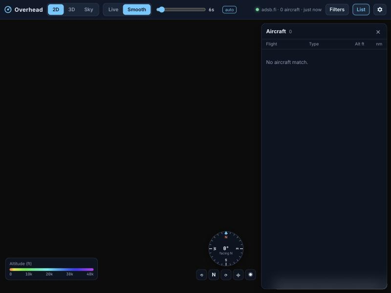

Browser pane is hidden, so animation frames are throttled. Driving the test step by step.

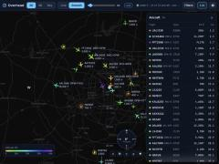

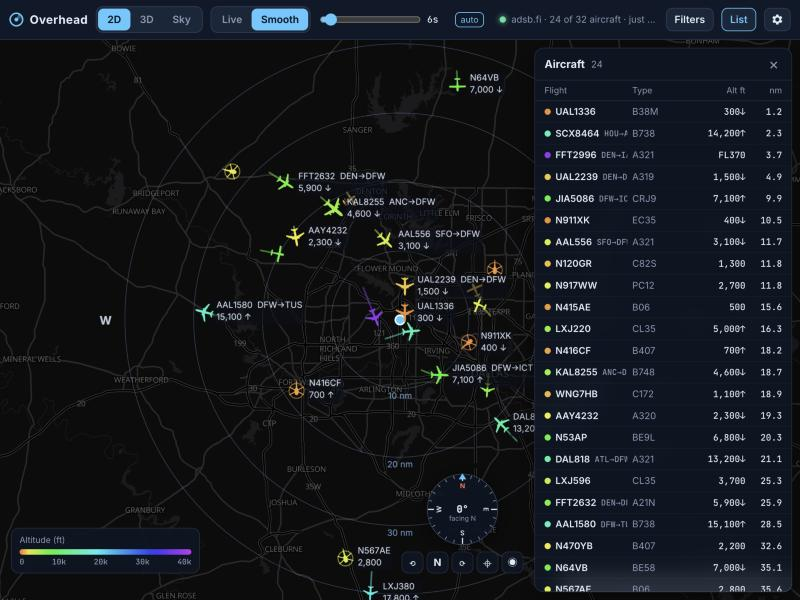

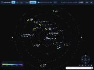

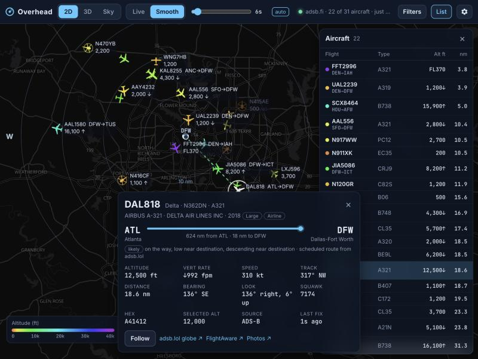

Details card, dashed line, and DFW marker all render. Checking 3D and Sky with the same selection.

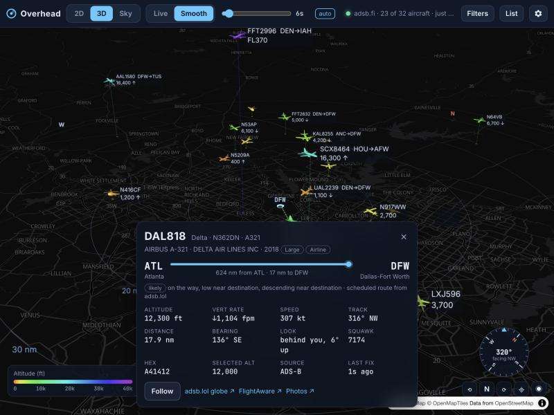

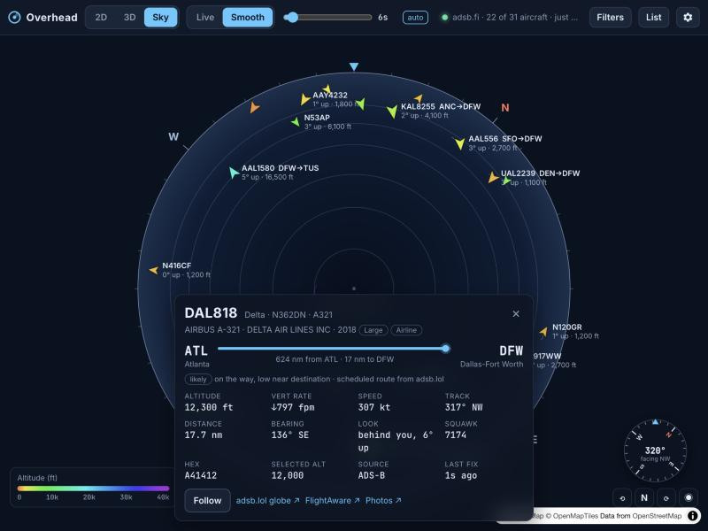

Sky labels show routes. The details card covers the selected plane at this small pane size. Quick check of "all aircraft" lines, then cleanup.

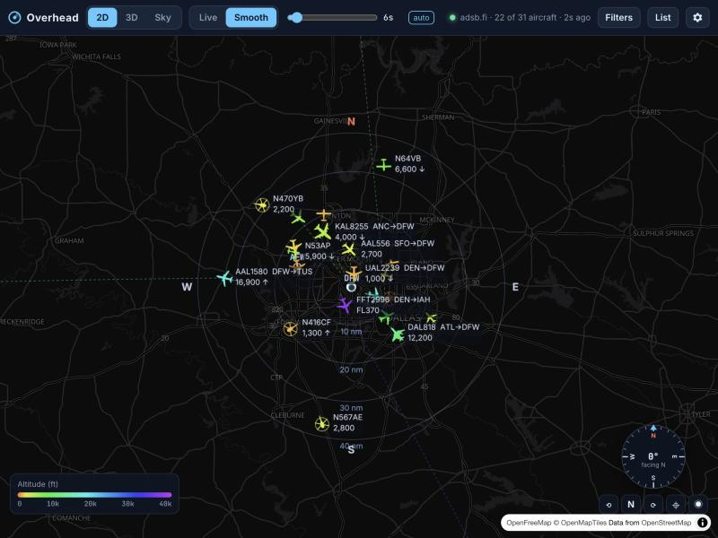

All modes verified. Cleaning up the temporary test server and updating the README.

Aircraft now show where they're likely coming from and going, plus a dashed line to the destination. Restart your `server.py` on port 8795 to get it: that process is still running the old code. I tested on a temporary server on another port, since removed.

**How it works**
- The server has a new `/api/routes` endpoint. For each callsign it asks both adsbdb and adsb.lol's route files, and caches the answer for 12 hours (3 hours if nothing was found, 5 minutes after an error).
- Only airline-style callsigns are looked up. Private tail numbers have no route on file.
- The first batch near DFW took about 8 seconds; after that answers come from the cache in milliseconds.

**The plausibility check** ([routes.js](overhead/js/routes.js))
Each leg the databases list is checked against what the plane is actually doing:
- how far it is from the direct line between the two airports, and whether it's between them;
- whether it's heading toward the destination;
- whether it's low and close to one of the two airports;
- whether it's climbing out of the origin or descending into the destination;
- if it's on the ground, whether it's at one of those airports.

Each route is then graded **likely**, **possible** or **unlikely**. In the first version the AAL flight climbing out over DFW was matched to CLT→SFO, because my "on the way" test was too forgiving on long flights. With the stricter version, on 22 flights near DFW:
- AAL1580 is now DFW→TUS, and the other likely picks matched what the planes were doing.
- Neither database was right for 5 flights. Examples: SWA1767 was listed as MDW→OAK or EUG→SMF while flying west out of DFW, and AAL2004 as PHL→LAX or TPA→MIA while landing at DFW. These were correctly marked unlikely.

**Where it shows**
- **Labels and Sky view:** `AAL556  SFO→DFW`, for likely and possible routes only.
- **Aircraft list:** the route on a second line under the callsign.
- **Details card:** origin and destination with city names, a progress bar ("624 nm from ATL · 17 nm to DFW"), the confidence and why, which database it came from, and other routes the databases list.
  - If no listed route fits, the card says so ("databases list X, but that doesn't fit this aircraft's position").
- **Dashed line:** follows the earth's curvature to the destination, with the airport marked and labelled.
  - In 3D it slopes down to the airport's elevation; in Sky view it traces across your sky to the horizon.
  - Settings let you show it for the selected aircraft (default), all aircraft, or none, and turn routes in labels on or off.
- **Airport filter:** `DFW` matches either end, `>DFW` arriving only, `<DAL` departing only.

**Limits**
- Planes on the ground at an airport usually come out as departing, even if they've just landed.
- Southwest-style flights that keep one flight number across several stops often end up unlikely or with no route.
- At the 800×600 test size, the details card covers the selected plane and its line. That's fine on a larger window.

The README has a new section on origin and destination.

## You

Commit the overhead experiment

## Claude

Committed as `3905b87` (`feat(overhead): live aircraft viewer with 2D, 3D and sky views`). It's on a new branch, `overhead`, not on master, because I branch before committing when on the default branch. Your earlier experiments went straight onto master, so this can be fast-forwarded onto master with no conflicts.

The commit has the `overhead/` folder and its `overhead` entry in `.claude/launch.json`. Your other uncommitted files are unchanged: `.serena/project.yml`, `.idea/`, `3dtd-opus-5.5-uiltra/` and `voicebox-samples/`. Nothing is pushed.

## You

Fast-forward master to the overhead branch

## Claude

master now includes the overhead commit (`3905b87`), applied as a straight fast-forward with no merge commit. The working copy is on master again, one commit ahead of `origin/master`, and nothing is pushed.

The local `overhead` branch still exists and points at the same commit, so it can be deleted whenever you like.

## You

lets configure how long the trails can show up

## Claude

Settings + fading done. Moving a shared helper out of mapview, then testing in browser.

Your server on 8795 is running; testing on a temporary port so your saved settings stay untouched.

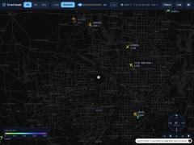


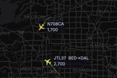

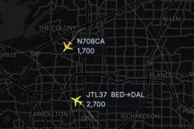

Trails are working; 60 s of a slow plane is just short at that zoom. Zooming in to check the fade visually.

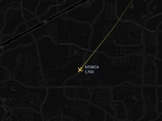

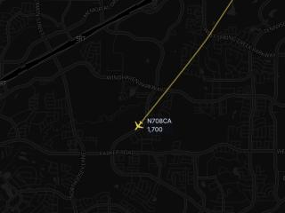

Fade works: the tail fades out, versus a uniform line with fade off. Quick Sky view check, then cleanup.

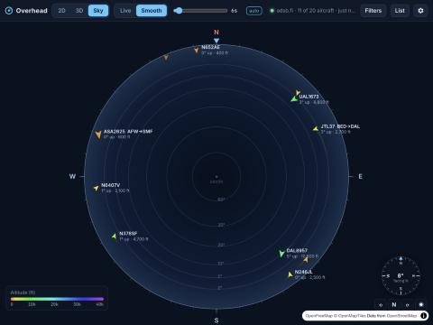

Trail length is now configurable under ⚙ Settings → Display:

- **Trail length:** Off, 15 s, 30 s, 1, 2, 5, 10 or 30 min, or All history (capped at 1 hour). Default is still 2 min.
- **Selected aircraft trail:** "Same as others", or 1, 5, 15 or 30 min, or All. Default is 5 min, which matches the old behaviour.
- **Fade trails toward their tail** (on by default): the newest part is solid and the oldest fades out. Turn it off for even-brightness lines.
- **`T` key** steps through the trail lengths and shows a toast. It's in the README key list.

The app also keeps enough position history for whatever length you pick, so "30 min" and "All" don't get cut off at the old 15-minute limit.

I checked it in the browser on a temporary server, so your server and saved settings on 8795 weren't touched. Since only front-end files changed, reloading the page picks it up with no server restart.

- Settings, the `T` shortcut and the history sizing all worked.
- With fading on, a trail faded toward its old end; with fading off, the same trail was even.
- Sky view rendered with no errors.

A trail only covers time since your page started receiving that aircraft; the data providers don't send earlier history. Long settings fill in as you watch.

The changes are on master and not committed. The `.serena/project.yml` modification isn't mine; I left it alone.

## You

Commit the trail settings change on master

## Claude

Committed on master as `809bf41` (`feat(overhead): configurable trail length with fading`). Only `overhead/` was staged, so `.serena/project.yml` and your other untracked files are still uncommitted. master is now 2 commits ahead of `origin/master`, and nothing is pushed.

## You

Ok, offer me some suggestions. How could we make this even ... cooler?

## Claude

Here are my suggestions, ranked by how much impact each gives for the effort. Most build on data and code we already have.

**Biggest impact**
1. **Camera view on a phone.** Show the live camera with aircraft labels laid over it. Point the phone at a plane and its callsign, altitude and route appear on it. We already work out where each plane is in your sky and can read the phone's compass, so this mostly needs tilt sensing and camera framing. One catch: phones only allow camera access over https, so testing on your phone needs a tunnel or a certificate.
2. **Chase camera in 3D.** The camera sits behind the selected plane and follows it down the approach into DFW. It's a camera that tracks the plane's heading and position each frame. Cheap to build and very cinematic.
3. **"Look up!" alerts.** Use each plane's course to predict which ones will pass close or high overhead in the next minute or two. Then send a browser notification like "AAL556 passing NE, 40° up, in 35 s." This turns the app from a map into something that tells you when to step outside.

**Medium effort**
4. **Aircraft photos in the details card** from planespotters.net's public photo lookup by aircraft address, with the photographer credit their terms require. Small job, makes every selection nicer.
5. **Replay and time travel.** Record history on the server in a small local database, then add a timeline slider to scrub back and replay at 10× speed. Smooth mode already plays from a buffer, so the playback side is half done. Good for "what was that loud plane 20 minutes ago?"
6. **Airports and runways.** Draw runway outlines from the public-domain OurAirports data. Then work out which runways are in use from the direction of landing traffic, which tells you whether the arrival line runs over your house today.
7. **Contrail prediction.** Some planes report outside air temperature, and Open-Meteo provides free humidity data at altitude. With the standard physics rule for contrail formation, we could label planes as "likely leaving a contrail." Real and rarely seen in apps.

**Fun extras**
8. **Spatial sound.** Each plane gets a soft engine hum placed around you by direction, louder when closer and lower. With headphones you hear traffic pass from left to right.
9. **Event spotting:** emergency squawk codes, go-arounds, holding patterns (planes circling) and rare aircraft types, kept in a "today's sightings" log.
10. **Departure-board mode:** a split-flap style board of flights passing overhead, for an always-on screen on a wall.
11. **Real sun lighting in 3D**, plus a heatmap that builds up the approach corridors over hours of history.

I'd start with the **chase cam and "look up" alerts**: both are quick and use what's already built. The **camera view** is the showpiece but needs the https setup and a real phone to test.

## You

I think actually right now numbers 6 and 11 would be most interesting for me

## Claude

Both datasets are available. OurAirports runways come in two files, 12 MB and 4 MB. The deck.gl bundle includes the sun-light and heatmap layers. Writing the backend modules.

Backend works: 53 airports and 68 runways within range of DFW, and the heatmap is recording. Now client modules: runway activity detection and sun position.

Runway detection written. Next: sun position.

Sun math checks out: sunrise and sunset at DFW match real times. Now the map layers.

Map layers done. Wiring into main: settings, runway watch, sun, heatmap, and the "runways in use" card.

Wired up. Starting a test server; it's night at DFW now, so I'll simulate daytime sun from the console.

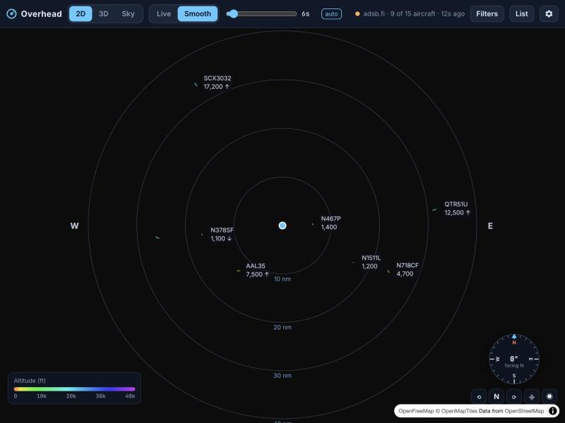

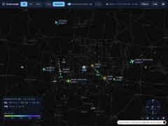


Now checking simulated afternoon sun in 3D: lighting, sky, shadows, and the auto light map.

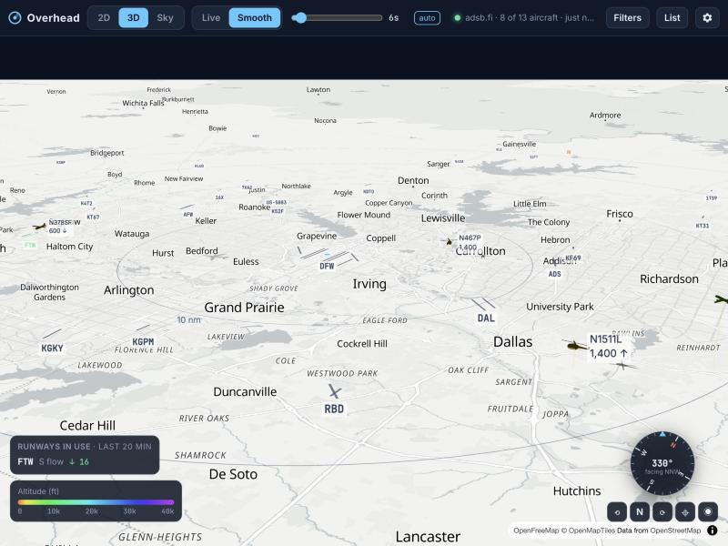

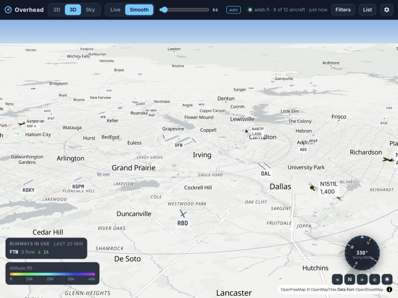

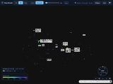

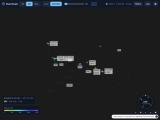

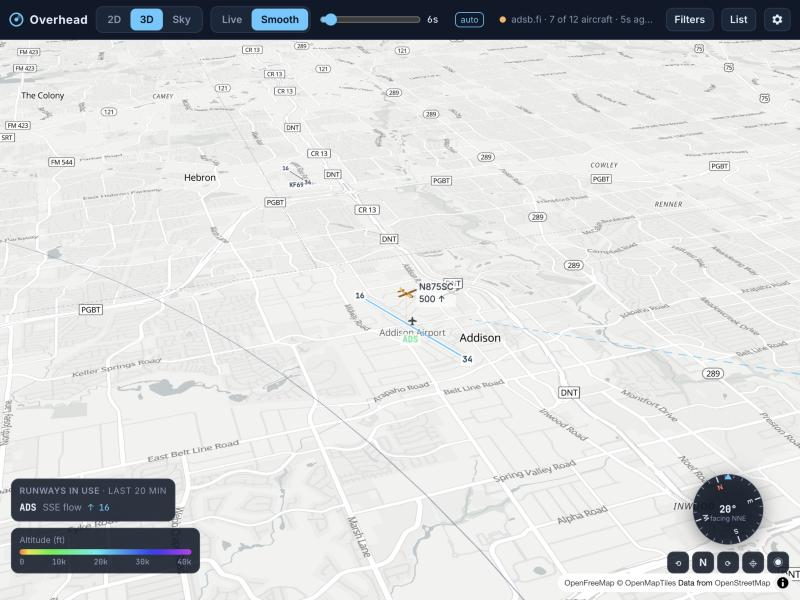

Departure from Addison runway 16 is picked up and highlighted, and the sun-cast shadow is visible. Checking the Sky dome with the sun, then the heatmap.

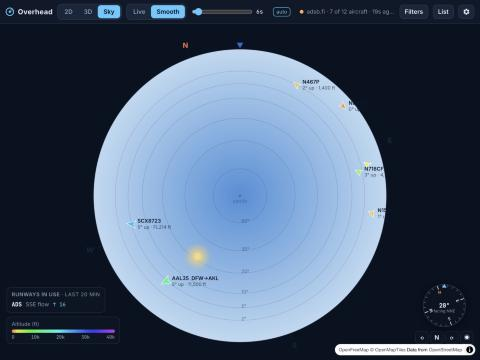

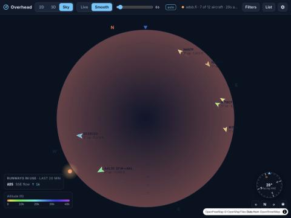

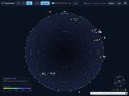

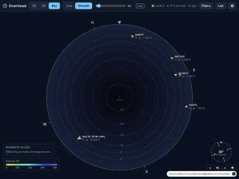


Text is readable on both. Testing the heatmap in 2D.


The heatmap draws flight corridors from 16 minutes of late-night recording, and it fills in as the server runs. Cleaning up and updating the README.

Runways in use, sun lighting with sky and shadows, and the traffic heatmap all work. Restart your `server.py` on 8795 to get them; that process is still running the old code, so I tested on a temporary port. It's night at DFW right now, so I could only check daytime lighting with a simulated sun position.

**6 — Airports, runways and runways in use** ([runways.js](overhead/js/runways.js), [airports.py](overhead/airports.py))
- **Data:** airports and runways come from OurAirports, which is public domain. The server downloads them into `overhead/data/` the first time and refreshes monthly. Near DFW that's 53 airports with 68 runways drawn to scale; runway numbers appear when you zoom in.
- **Detecting use:**
  - A plane counts as landing when it's lined up with a runway, within 10 nm, at or below a normal 3° descent, and not climbing.
  - It counts as taking off when it's past the far end, lined up, and climbing.
  - Each plane counts once, on its best-matching runway, so parallel runways aren't double-counted. Helicopters and slow movers are ignored.
- **Live check:**
  - Runways found in use: Dallas Love Field landing to the northwest on 31R/31L, Fort Worth Meacham landing south on 16, and a departure off Addison runway 16.
  - The first version wrongly counted helicopters at Love Field and one Meacham arrival on two parallel runways. Both are fixed.
- **On the map:** active runways turn green (landing) or blue (taking off), with dashed lines for the final approach and the climb-out. The approach line slopes at 3° in 3D.
- **Runways in use card**, bottom left:
  - Shows each busy airport's flow, e.g. `DAL  NW flow ↓ 31R 31L ↑ 31R 31L`. Click an airport to fly there.
  - When your location is under an active path it adds a line like "You're under the DFW 17L approach: 6.2 nm out, arrivals pass ~2,000 ft above." That line is built, but the test location wasn't under one, so I haven't seen it appear.

**11 — Sun lighting and heatmap** ([sun.js](overhead/js/sun.js), [heat.py](overhead/heat.py))
- **Sun lighting (3D):** the aircraft models are lit from the sun's real position. Light is warm and low at golden hour and the sun light turns off at night.
- **Shadows:** in 3D, aircraft cast shadows on the ground away from the sun, faint for high aircraft. The 3D horizon gets a sky that changes from day blue to sunset red to night.
- **Sun marker:** the compass dial shows where the sun is.
- **Map style "Auto"** is the new default: light map by day, dark at night. If you've saved a style before, yours is kept.
- **Sky view:** the dome takes the sky colour for the time of day and shows the sun. Text colour now follows the dome's brightness, with a halo so it stays readable.
- **Heatmap:**
  - The server counts every position it receives into a grid of roughly 500 m cells, stored in `data/heat.sqlite`.
  - You can show the last hour, 6 hours, 24 hours, 7 days, or everything recorded.
  - You can limit it to ground traffic (taxiways), below 10,000 ft (approach and departure corridors), or en route.
  - After 16 minutes of late-night traffic it already showed the corridors as streaks. It only records while the server is polling, so it fills in over hours and days of use.

**Where the settings are:** a new **Layers** section in Settings has toggles for airports and runways, approach and climb-out lines, and sun lighting, plus the heatmap time window and altitude filter. "Auto" is in the map style list.

**Also:**
- The server no longer serves anything under `/data/`, so the downloaded files and history database aren't reachable from the browser.
- `overhead/.gitignore` excludes `data/` from git.
- The README is updated.

## You

Commit the runways, sun lighting and heatmap work on master

## Claude

Committed on master as `bfc03c9` (`feat(overhead): runways in use, sun lighting and traffic heatmap`).

- The commit has 12 files from `overhead/`: the new `airports.py`, `heat.py`, `runways.js`, `sun.js` and `.gitignore`, plus the updated files.
- `overhead/data/` isn't in it; that holds the downloaded airport files and the heatmap history.
- `.serena/project.yml` and your other untracked files were left alone.
- master is now 3 commits ahead of `origin/master`, and nothing is pushed.

Restart `server.py` on 8795 to get runways in use and the heatmap. The heatmap only starts collecting once the new server is running.

## You

ok, lets now add an option to chase a plane. 2d and 3d. 2d places us above the plane, 3d behind and slightly above

## Claude

Camera done. Wiring chase controls into the app.

Wired. Testing in the browser.


2D chase works: the plane is centred and nose-up, bearing matches its track, and the HUD shows. Testing 3D.


Chase camera is moving, but the plane isn't visible. Checking where deck.gl projects it.


My test script deselected the plane before pressing C. Retrying.


Pixel sizes fixed. Closing the details card currently ends the chase, which would block the view, so during a chase × will just hide the card, with an Info toggle in the HUD.


The thick band is the drop line from the plane to the ground, which has the same depth issue. Scaling it as well.


API Error: Your computer went to sleep mid-response. The response above may be incomplete.

API Error: Your computer went to sleep mid-response. The response above may be incomplete.


Forgot to reload after the edit. Reloading.


Now it looks right: EVA049, a widebody, just departed DFW 17R, seen from behind, with the blue climb-out guide ahead. Testing orbit drag, scroll distance, and Esc.


Orbit works: dragging swung the camera round to a side-on view of the 777. Checking that Esc restores normal map controls.

Esc stops the chase, restores pan, rotate and zoom, keeps the plane selected and brings the card back. No console errors. Cleaning up.

Chase mode works in both views. Start it with **Chase** in the details card or the **C** key. Only front-end files changed, so a page reload picks it up with no server restart.

**2D:** the map stays centred on the plane and turns so its nose points up. Scroll still zooms; dragging turns the view around it.

**3D:** the camera sits behind the plane and a little above, looking where it's going.
- Its turns are smoothed so the view pans rather than jerks.
- Drag to orbit around the plane and tilt; scroll to move closer or further.
- The compass and the rotate buttons also orbit while chasing.
- The view uses true perspective: nearby planes look bigger, but distant traffic never shrinks below about 14 px so you can still see it.

**While chasing:**
- A bar at the top shows the callsign, altitude, speed and heading, with **Info** (shows or hides the details card) and **Stop**.
- The details card hides at the start to clear the view; × hides it again rather than ending the chase.
- Clicking another aircraft switches the chase to it. Esc, Stop, recentring or switching to Sky ends it and gives back the normal map controls.
- If the plane drops out of the data for 5 seconds, the chase ends with a message.

I tested on live DFW traffic on a temporary server:
- 2D chase on a NetJets jet held it centred and nose-up.
- 3D chase behind EJA650 on final into Love Field showed runway 13L lit and its approach line ahead.
- 3D chase behind EVA049, a widebody climbing out of DFW 17R, showed the departure line rising ahead.
- Dragging swung the camera round to a side-on view of the widebody.
- Esc restored panning, rotating and zooming and kept the plane selected.

The 3D camera needed several fixes along the way:
1. The plane was invisible because it sat closer to the camera than the 3D layer will draw. The chase distance now stays beyond that limit, and the plane model scales with it so it keeps a steady size on screen.
2. Labels and lines near the camera came out huge, because the 3D layer only sizes them correctly at the map's centre point, which sits far ahead of the plane in this view. They're now scaled by distance.
3. Lines passing behind the camera, like the approach guide, reappeared mirrored in the sky. They're now cut off at the camera.
4. The chased plane's own drop line to the ground rendered as a thick bar, so it's hidden during a chase.
5. Releasing an orbit drag counted as a click on empty map, which deselected the plane and ended the chase. Empty-map clicks are now ignored while chasing.

**Limits:**
- At cruise altitude with the default 3× altitude exaggeration, the 3D camera has to sit several kilometres back. The plane still looks the right size, but the ground is far below. Setting exaggeration to 1× gives a more natural chase.
- Dragging up lowers the camera. If you'd rather it work the other way, that's a one-line change.

The README has a section on chase mode.

## You

Commit chase mode on master

## Claude

Committed on master as `9e9408f` (`feat(overhead): chase mode in 2D and 3D`). Only `overhead/` was staged, so `.serena/project.yml` and the untracked folders are still uncommitted. master is now 4 commits ahead of `origin/master`, and nothing is pushed.

## You

Let’s add a demo mode, so we can deploy this with demo data not requiring the backend api. Id like that to be deployed with the rest of the experiments to GitHub pages

## Claude

Recorder works. It left out 6 limited-display aircraft and found routes for 55 of 59 airline callsigns. Starting a 15-minute recording in the background.

While that records: building an API layer the app can swap for the demo data.

Now pointing the store, routes, runways and heatmap at it.

Data calls now go through `api.js`. Next, the demo wiring in main: separate saved settings, a fixed location, a Demo badge, and the sun following the recording's time of day.

Wired up. While the recording finishes, updating the README.

About 13 minutes of recording left. Meanwhile I'll test static hosting with the short test recording, served from the repo root the way Pages serves it (under a subfolder).


It was just tiles still loading; the map fills the view now. Waiting for the full recording to finish.

Recording runs about 11 more minutes. I'll resume when it finishes.

Demo mode is built and works on static hosting. I'm waiting on the full 15-minute DFW recording, about 11 minutes left. When it finishes I'll check the file size, re-test the demo with it, and clean up the temporary test server.

1.5 MB, about 420 KB compressed: 189 aircraft, 98 routes. An "owner" string showed up in the aircraft data, though; checking that before anything gets published.

False alarm: it matched the aircraft model name "Beech 23 Sundowner". There's no owner field. Re-testing the static demo with the full recording.


Full recording works: 86 aircraft have trails from the start, along with routes and runways in use (DFW south flow), and the morning sun gives the light map. Cleaning up the test server.

Demo mode works: Overhead now runs on GitHub Pages with no backend by replaying a recorded sample of real traffic. Your existing Pages workflow already publishes every top-level folder with an `index.html`, so `overhead/` goes out with the other experiments on the next push to master. No workflow change was needed.

**How it works**
- The page checks for `server.py`. If it can't reach it (as on GitHub Pages), or the URL has `?demo`, it plays `demo/traffic.json` on a loop instead.
- All the live features run from the recording: smooth and live modes, trails, routes, runways in use and the heatmap.
- It starts two minutes into the recording, so trails are already drawn when the page opens.
- Sun lighting follows the recording's time of day (Sunday morning), not your clock.
- A **DEMO** badge in the top bar opens Settings, which explains the recording. Location and data source are greyed out.
- Demo settings are saved separately, so opening `?demo` locally never changes your real home location.
- Server calls now use relative paths so the page works from a subfolder; the live app works the same as before.

**The recording**
- I recorded 15 minutes around DFW starting about 9:12 am today: 189 aircraft, routes for 98 of them, 53 airports, and a heatmap built from the recording.
- The file is 1.5 MB, about 420 KB once Pages compresses it.
- Before publishing, it drops aircraft whose owners asked trackers to limit display (the LADD/PIA flags) and stores no owner names.
- `overhead/tools/record_demo.py` records a fresh sample, for DFW or anywhere else; the README covers it.

**Tested** on a plain static server with no API, under `/overhead/` the way Pages serves it: 128 tracks, 86 with trails at start, runways showing DFW in south flow, and no console errors. I haven't seen it on actual GitHub Pages yet; that happens when master is pushed.

Pushing master also publishes your four earlier Overhead commits, which aren't on GitHub yet. Do you want me to commit and push now to deploy, or just commit locally for now?

## You

Commit and push

## Claude

Deployed. Verifying the live page.


Overhead is live in demo mode at **https://danwatt.github.io/ai-experiments/overhead/**.

- Committed as `d2e2dd9` (`feat(overhead): demo mode for static hosting`) and pushed master. That also published the four earlier Overhead commits.
- The Pages workflow built and deployed successfully. Overhead is listed on the experiments index page, since that list is built automatically from the folders.
- I opened the live page and it works:
  - The DEMO badge shows and the replay loops: 128 tracks, 91 aircraft on screen, trails already drawn at start.
  - Routes are labelled, runways in use show DFW south flow, and the map is the light morning style.
  - No console errors.

The demo replays Sunday morning's traffic around DFW on a 15-minute loop. To show somewhere else or a busier time, run `overhead/tools/record_demo.py`, commit the new `demo/traffic.json`, and push.

`.serena/project.yml` and your other untracked folders are still uncommitted.

## You

What could it look like to have a “spotter mode”, where the user is parked near an airport, and looking at the field, and have their phone or tablet showing what’s in their field of vision (no need for camera access, at least not yet)

## Claude

Here's how I'd design it. The mockup above shows a tablet held up facing south over DFW 17C. If it didn't come through on your device: it's a first-person view out toward the runway, with labelled aircraft in the sky, arrows at the edges for traffic outside the view, and a strip of upcoming arrivals and departures along the bottom.

**What you'd see**
- **The view through the screen.** The tablet shows the slice of world it's pointing at, about a 70° field of view, with the horizon and compass headings marked.
  - Raise or turn the tablet and the view follows, using the compass for direction and tilt for up/down.
  - Pinch to zoom in to a "binocular" 10–15°.
- **The airfield drawn in perspective.** Runways come from the OurAirports data we already load, placed at their real ground positions relative to you. That makes it easy to match the screen to what's out the windscreen.
  - Active approach paths are drawn as the sloping dashed line planes will come down.
- **Aircraft where they actually are.** Each plane appears at its real bearing and height above your horizon, sized by its distance, with a card attached.
  - The card shows callsign, type, route, height above the field, and for arrivals "lands 17C in 0:48".
- **Edge arrows** for traffic just out of view: "SKW6335 enters view in 1:30", or a departure still taxiing.
- **The bottom strip** lists the next movements on the runways you're facing, with countdowns. That's the core spotting job: knowing when to look up and lift the camera.

**Mostly reused:** sky-angle maths from Sky view, runways and runways-in-use detection, routes, live-mode position prediction, and the compass code. The new work is the perspective drawing, the landing countdowns, and the timeline.

**The hard parts**
1. **Compass accuracy in a car.** Phone compasses are often 10–30° off near a vehicle's metal and electronics. The fix is an "align" step: point at a runway end, tap it, and the app stores the correction. Without that, labels drift off the planes.
2. **Data delay.** Positions arrive 1–3 s late, so this view would use live mode with prediction, not the smooth replay. A plane on final moves about 70 m/s, so even a small delay matters for lining labels up.
3. **Low on the horizon.** Planes on a 2 nm final are only about 3° above the horizon, so field elevation and your own height need to be right.
4. **Heights and countdowns.** The data reports altitude relative to sea level and the runway data includes field elevation, so heights above the field are straightforward. Landing countdowns would be distance to the threshold divided by ground speed, accurate to a few seconds on final.

**Later:** a camera overlay would sit on top of this view almost unchanged, since the view and label placement are the same.

I'd build it as a fourth view ("Spot") next to 2D, 3D and Sky, with the align step, the landing countdowns, the edge arrows and the bottom strip. It would also work in the GitHub Pages demo using the DFW recording, minus the real compass on desktop. Do you want me to build it now, or leave it as a design for later?

## You

Build it

## Claude

Runway movements and landing countdowns done. Now the perspective renderer.

Renderer done. Now device pose, alignment, and wiring into main.

Wired. Testing against the DFW demo recording, which needs no backend.


Looks right: arrivals labelled "Lands 17L in 1:27", "in view 1:00" arrows, and runway numbers on the horizon. One bug: a plane at touchdown shows "-1:-1" in the strip. Making it say "landing".

Testing the phone-pose maths with a synthetic orientation event: tablet upright, rotated to face west, tilted up 5°.


The browser pane refuses compass permission, so I'm checking the pose maths directly in Node instead.

The pose maths checks out: upright facing north gives 0°, turned left gives 270°, tilting changes pitch, and landscape holds work. Checking the phone layout.


Portrait phone layout works. On narrow screens the zoom/Align buttons overlap the heading readout and the compass covers the strip, so tightening that.


Phone layout is clean. Checking that switching back to 2D still works, then cleaning up.


2D is back, still facing the same direction as the spotter view. Cleaning up and documenting.

Spotter mode is built as a fourth view, **Spot** (key `4`). The one thing I couldn't test is a real phone compass: the browser pane I test in refuses compass permission. I checked the orientation maths separately and it gives the right direction and tilt for portrait, landscape and tilted holds.

**What you see**
- **Your view as a window.** It's drawn from where you are, pointed where you face, with the sky coloured for the time of day, the horizon, compass headings along it, and 5°, 10°, 20° marks above it.
- **The airfield.** Runways are drawn in perspective with centrelines and runway numbers; ones in use are tinted green (landing) or blue (taking off). The dashed approach and climb-out paths are shown, plus nearby airport codes.
- **Aircraft where they really are.** Each is drawn as a side-on silhouette, sized by distance and turned the way it's moving, with a card such as "AAL1454 · A321 / MIA → DFW · 1,400 ft up · 9.6 nm / Lands 17L in 1:27".
  - Cards for arriving or departing aircraft get a green or blue border and go first; cards never overlap.
- **Edge arrows** for nearby traffic just out of view, with when it will come into view ("in view 1:15") or what it's doing.
- **A bottom strip, "Next at DFW"**, for the nearest airport. In the demo it showed "ENY3920 18R rolling · AAL2239 17L 0:05 · AAL1454 17L 1:33 · AAL503 17R holding". Tap one to select it.
  - Countdowns use distance to the runway end divided by ground speed. Departures show holding, lined up or rolling. A plane over the runway end shows "landing" instead of a countdown.

**Controls**
- **Desktop:** drag to look around, scroll or − / + to zoom between 8° and 100°. It starts facing the nearest airport.
- **Phone or tablet:** tap ◉ and the view follows where the back of the device points and how far up it's tilted.
- **Align:** car interiors can throw a compass off by 10–30°. Point the crosshair at a runway end you can see and tap its number. ◀ / ▶ nudge by 1°, and the correction is saved.
- **Defaults:** switching to Spot turns on Live mode, since smoothing adds a delay. Your eye height is taken as the airport's elevation plus 6 ft unless you set your elevation in Settings.
- **Phone layout:** the strip uses the full width and the compass dial is hidden, since the heading is shown at the top.

**Tested on the DFW demo data** at desktop and phone sizes, with no console errors. I fixed four problems along the way:
- edge labels overlapping cards;
- aircraft too small to see at distance;
- a negative countdown at touchdown;
- the controls overlapping the heading readout on phones.

**Limits:**
- In the demo your position is the middle of DFW, so you're standing on the field and the runways look flat on the horizon. That's accurate from ground level, but a spot by the fence would look better.
- Origin and destination come from the same route databases as before, so they're sometimes wrong. AAL2239 showed DFW → SFO while landing at DFW.

Nothing is committed yet. Do you want me to commit and push to deploy it to GitHub Pages, or just commit locally for now?

## You

Commit and push

## Claude


The spotter view is live at **https://danwatt.github.io/ai-experiments/overhead/** — tap **Spot** or press `4`.

- Committed as `20b7cfd` (`feat(overhead): spotter view`) and pushed to master; the GitHub Pages deploy succeeded.
- I opened the live page and switched to Spot. It shows the demo traffic around DFW with aircraft cards, edge arrows and the "Next at DFW" strip (ENY3920 rolling on 18R, AAL2239 landing on 17L, AAL1454 lands 17L in 1:30), with no console errors.

Following how you hold a phone or tablet is still untested on a real device. On a phone, tap ◉ to turn on the compass and use **Align** if the view is off from what you see.

`.serena/project.yml` and your untracked folders are still uncommitted.

## You

Let’s default this mode to founders plaza near dfw, and have it oriented towards the center of the airport.

Also, any chance we can incorporate 3d buildings that are in/near the airport?

## Claude

Now the map side: 3D building extrusions, plus a helper that collects building footprints for the spotter view.

Now drawing the buildings in the spotter view, depth-sorted with the aircraft so a plane taxiing behind a terminal is hidden by it.

Buildings render now. Testing on the demo.


Zero buildings were collected. Debugging the footprint query directly.


No buildings yet. The browser pane is hidden, which throttles map rendering, so each grid step waits out its 6-second timeout. Giving it more time.

The direct query works, returning 137 buildings with heights. The real bug: on startup the collection ran before the map style had loaded, found no tile source, and never retried. Fixing that.


Down to 779 buildings (about 9,600 vertices) within 5 km. Taking a look.


Buildings show in the spotter view: the terminal skyline across the field, with the tall Terminal D hotel in the middle, shaded by the sun and drawn over the runway line. Checking the 3D map.


The 3D map now shows DFW's terminals extruded, with active runways tinted and aircraft on approach. Cleaning up and documenting.

The spotter view now starts at Founders' Plaza facing the middle of DFW, and 3D buildings show in both the 3D map and the spotter view. I tested both on the DFW demo data.

**Founders' Plaza default**
- The spotter view now stands at Founders' Plaza (32.9184, −97.0587, from OpenStreetMap). It starts facing the centre of DFW, 141° SE and 1.7 nm away, using the airport's official centre point.
- That default applies whenever the plaza is inside the area you're receiving: always in the demo, and in live mode when your location is near DFW. Elsewhere it falls back to your own location.
- A new **Watch from** dropdown in the spotter controls switches between your location and Founders' Plaza. More spotting places would each be one line.
- From the plaza, your eye height is DFW's field elevation plus 6 ft, and the align list and landing countdowns are based on DFW.

**3D buildings**
- The free map tiles already include OpenStreetMap building footprints and heights.
- **3D map:** buildings are drawn in 3D and stretched by the same height exaggeration as the aircraft, so a plane over a terminal stays above it. The DFW terminal arcs and Terminal D hotel come out well.
- **Spotter view:** the app loads buildings within 5 km of the spot, keeping big footprints and anything 15 m or taller. That's 779 buildings from the plaza; all of them would be about 25,000, mostly housing.
  - They're drawn in perspective and shaded by the sun, so you see DFW's terminal skyline along the horizon.
  - Buildings and aircraft are drawn back to front, so a plane taxiing behind a terminal is hidden by it.
- There's a **3D buildings** toggle under Settings → Layers.

**Bugs fixed while testing**
- The first building load ran before the map had finished loading and silently returned nothing. It now waits and retries up to three times.
- Reading building tiles moves the hidden map around, so switching from Spot back to 2D or 3D now re-centres it.

**Not verified**
- Building heights depend on OSM tags. Untagged buildings default to about 5–6 m, and Terminal D's hotel is listed at 83 m.
- On a slow connection, buildings take a few seconds to appear after you open Spot.
- I couldn't measure frame rate here because the browser pane is hidden while I test.

Nothing is committed yet. Do you want me to commit and push to deploy, or commit locally only?

## You

Commit and push

## Claude


Opening straight into Spot now faces 141° toward the airport after the buildings load. Deploying.


The deployed files have the fix, but the page is still running older JavaScript from the browser cache (GitHub Pages lets browsers cache for 10 minutes). Trying a hard reload.


The hard reload didn't take in this pane. Browsers pick up the new files within 10 minutes of a deploy, so I'll re-check the live page then.

Founders' Plaza default and 3D buildings are committed and deployed (`16f8d05`), with two follow-up fixes:

- **`2e7ba6a`**: opening the page already in Spot view now faces the airport.
- **`9288b4e`**: loading the buildings no longer turns the view north. The hidden-map sweep reset the map's bearing, which the app read as you turning.

Locally, with the same code, opening straight into Spot faces 141° toward DFW with 779 buildings loaded. The live page in my browser is still running the previous JavaScript from its 10-minute cache, so I'll re-check it in about 11 minutes. If you open it before then and it faces north, a hard refresh fixes it.


The live site at **https://danwatt.github.io/ai-experiments/overhead/** now has the fix. I re-checked after the browser cache expired:

- The page is running the new code (`9288b4e`).
- Spot view opens at Founders' Plaza, faces 141° toward the middle of DFW, and stays there after its 779 buildings load.

If a browser opened the site within 10 minutes of a deploy, it may still use the old files until its cache expires; a hard refresh picks up the new version straight away.

## You

Let’s remove shadows from 3d view

## Claude


No shadow layers are left in 3D; the aircraft, drop lines, labels and trails are unchanged, with no console errors. Cleaning up.

Shadows are gone from the 3D view: both the sun-cast aircraft shadows and the coloured dots that sat on the ground under each aircraft when the sun was down.

- Aircraft still get sun lighting, sky colour and the vertical lines down to the ground.
- I renamed the Settings option to "Sun lighting and sky (3D)" and updated the README to match.
- Checked in 3D on the demo: no shadow layers are drawn, and there are no console errors.

The change is in `js/mapview.js`, plus the label and README, and isn't committed yet. Do you want me to commit and push to deploy, or commit locally only?

## You

Commit and push

## Claude

Removing the 3D shadows is committed as `2b125dc` and pushed to master, and the GitHub Pages deploy succeeded. It's live at https://danwatt.github.io/ai-experiments/overhead/. Browsers that opened the site in the last 10 minutes may keep the old files until their cache expires; a hard refresh picks up the new version straight away.

## You

Lets make it so that I can server this on an open network, not just localhost

## Claude

Server options are in place. Next, telling users why location and compass don't work over plain http on another device.

Testing a network-facing server over HTTPS on a temporary port.

HTTPS works. The browser pane rejects the self-signed certificate, as expected, but each rejected handshake prints a long traceback. I'll quiet those and test with curl over the LAN address.

The banner lists the LAN URL and the warnings. Last check: plain http over the LAN, to confirm the "needs https" message appears.

Over plain http on the LAN address, the app runs live (not demo) and the compass button explains it needs https. Cleaning up and documenting.

`server.py` can now serve other devices on your network, not just localhost:

```bash
python3 overhead/server.py --host 0.0.0.0 --https
```

**What's new**
- **`--host 0.0.0.0`** makes the server reachable from other devices. The default is still localhost only, so the existing launch config is unchanged.
- **`--https`** encrypts the connection. Phone browsers only allow location and compass on https pages, so you'll want this for the spotter view on a phone or tablet.
  - The first time, it creates a self-signed certificate in `overhead/data/` (not in git), covering this Mac's name and network address. A new one is made automatically if your address changes.
  - Browsers warn once about it; accept the warning to continue.
  - You can pass your own certificate with `--cert` / `--key` (for example from mkcert) to avoid the warning.
- **At startup** it prints the addresses to open, such as `https://192.168.0.197:8797`. When it's open to the network, it also warns that anyone who can reach it can use the data-provider connection through your IP and its rate limits.
- **In the app**, "Use my location" and the compass button now explain that https is needed, instead of failing silently.
- Failed secure connections from untrusted certificates or plain http are no longer printed as tracebacks.

**Tested on this Mac using its network address `192.168.0.197`**
- **Over https:** the app, the provider list and live aircraft data all loaded.
  - Private data files under `/data/` were still blocked.
  - The certificate covers the address and the Mac's name, and its key is readable only by you.
- **Over plain http:** the app ran with live data (not the demo), and the compass button showed the https message.

Not yet tried from an actual phone or tablet. iPhones in particular need you to accept the certificate warning before location and compass will work.

The README has the commands and caveats. Changes are in `server.py`, `js/main.js` and the README, and aren't committed yet.

## You

Commit the network serving option and push master

## Claude

The network serving option is committed as `193ce32` (`feat(overhead): serve on the local network, optionally over HTTPS`) and pushed to master. It contains `server.py`, `js/main.js` and the README; the self-signed certificate stays out of git under `data/`.

The GitHub Pages deploy succeeded. The only visible change there is the new https message for location and compass; the live demo is otherwise unchanged, since it doesn't use the server.

To try it on your network, restart your server with:

```bash
python3 overhead/server.py --host 0.0.0.0 --https
```

## You

Couple bugs.

1. In the settings, there seems to be a precision issue with the lat/lon. If too many decimal points are present (6 or 7?) i get an error
2. Lets add back an option to filter planes by flight level
3. Lets add an option (on by default) to NOT dim 3d models at night. Its hard to see the planes at night right now in 3d view

## Claude

Flight-level filter in place. Now the night-brightness option.

Testing all three on the demo.


The basemap was still switching to night in the first shot. Taking a closer comparison on one aircraft.


The plane is high above this view. Using chase mode to put it in the middle of the screen.


Clear difference: with the option off, the aircraft at night is a dark, muddy shape; with it on, it's bright and readable. Cleaning up.

All three are fixed and tested on the DFW demo.

**1. Coordinate precision.** The latitude and longitude boxes only accepted 4 decimal places, so the browser rejected values like 32.9184264 when you saved Settings. The elevation box had the same problem: it only accepted multiples of 10, so 607 ft was rejected too.
- All of these boxes now accept any precision, in both Settings and the first-run location card.
- Checked: 7-decimal coordinates and 607 ft are now accepted.
- Phones still show the minus key for longitude.

**2. Flight level filter.** The altitude filter was a two-thumb slider, which is unreliable on touch screens (especially iPhone and iPad) and worked in feet rather than flight levels. I've replaced it.
- Under **Flight level** in Filters, pick **From** and **To**: Surface, 1,000 ft … 14,000 ft, FL180, FL240, FL290 … FL450, or "No limit".
- One-tap presets: **All**, **Below FL100**, **FL100–FL240**, **FL240 and up**.
- "Include aircraft on the ground" is still there.
- Checked: the FL100–FL240 preset showed 17 of 115 aircraft, all at 10,104 ft or above, and the filter badge counted it.
- Ranges you saved with the old slider snap to the nearest step.

**3. Bright aircraft at night (3D).** A new option, **Keep aircraft bright at night (3D)** under Settings → Layers, is on by default.
- At dusk and night it lights the aircraft evenly instead of using the dim realistic lighting. During the day nothing changes, and the dark map and night sky stay as they were.
- Checked by chasing an AAL 737 at simulated midnight: with the option off it was a dark, muddy shape; with it on it was bright and clear.

The README is updated. Changes are in `index.html`, `css/style.css`, `js/main.js`, `js/mapview.js` and the README, and aren't committed yet.

## You

Commit these three fixes and push master

## Claude

The three fixes are committed as `008e3d8` and pushed to master, and the GitHub Pages deploy succeeded. They're live at https://danwatt.github.io/ai-experiments/overhead/; a hard refresh shows them straight away if your browser still has the old files cached.

If you're running `server.py` locally, a page reload picks up all three; no restart is needed.

## You

Lets run the scripts/prompt-md on this conversation

## Claude

Directory was renamed to `overhead-opus-5.5-high`. Rerunning with that.

Generated: 65 KB, 157 screenshots (4.3 MB), and a cost of $69.36 (tokscale estimate). Checking the prompt list for anything that doesn't belong.

I've generated `prompt.md` for the overhead demo. The folder has been renamed since we last worked on it, so it's at [overhead-opus-5.5-high/prompt.md](overhead-opus-5.5-high/prompt.md).

- **Header:** model `claude-opus-5-5`, effort high, this session's id.
- **Usage:** 455k output tokens, 182M cache-read and 4.8M cache-write tokens, about $69.36 by tokscale's estimate.
- **Conversation:** all 28 of your prompts with my replies, from "I want to start a new experiment" to this request. Every one belongs to this demo, so I removed nothing.
- **Screenshots:** 157 browser captures saved to `overhead-opus-5.5-high/prompt-assets/` (4.3 MB), linked inline.

Neither file is committed yet. `3dtd-opus-5.5-uiltra/prompt.md` and its assets are also untracked, but they're from separate work and I've left them alone.

## You

Commit and push
