# Prompts

- **Model:** claude-opus-5-5
- **Effort:** high
- **Session(s):** c6d9482a-504a-4630-b20c-8ee1b9a34906
- **Tokens (whole session):** input 570, output 351603, cache read 73738371, cache write 1007591
- **Cost (tokscale estimate):** $29.84 for the whole session. The session first built the [Fort Worth ISD](../fwisd-budget-opus-5.5-high/prompt.html), [Tarrant County](../tarrant-isd-compare-opus-5.5-high/prompt.html) and [Texas](../texas-isd-statewide-opus-5.5-high/prompt.html) explorers, whose prompts are left out here; the session stood at $23.25 when the Texas page was committed, so this school map is roughly $6.59.

## You

Going back to just tarrant county. Is there anything in this data - or another source - that lets us drill down to the individual school level for any of the districts? In particular, Fort Worth, Castleberry, or Lake Worth?

## Claude

Yes. Two school-level sources are already in the data I downloaded, and both cover all three districts.

**1. TEA spending data, by campus.** The `FIN_UNIT` column in the TEA files we've been using is a campus number (district number plus the school's three-digit code). Codes 7xx–999 are district-wide costs. For FY2025 operating spending:

| District | Share coded to schools | Schools | District-wide (not assigned to a school) |
|---|---|---|---|
| Fort Worth | 77% of $1.01B | 138 codes | $209M |
| Castleberry | 87% of $55M | 7 codes | $5M |
| Lake Worth | 68% of $47M | 7 codes | $12M |

- **Coverage:** every year FY2011–FY2025, broken out by function, fund and program.
- **Federal money by school:** because the data is split by fund, I can show Title I, special ed, COVID relief and food-service spending at each school. For example, Castleberry High spent $13.7M in FY2025, $2.0M of it from federal funds.
- **Limits:** revenue isn't tracked by school, only spending. Central administration, much of transportation and some maintenance are recorded district-wide, so per-school figures understate the full cost.

**2. TDA meal claims, by school.** Each claim row is one school, from 2015-16 to 2025-26. It gives October enrollment, free and reduced counts, meals served (so participation rates) and monthly reimbursement. The meal-claim site IDs match TEA campus numbers: 125 of 126 in Fort Worth, and 5 of 5 in Castleberry and Lake Worth. That lets spending and meals join school by school.

**One limit on meals:** Fort Worth claims CEP as a single district-wide group, so every school shows the same 79.9% free rate in 2025-26. Castleberry and Lake Worth are 100% everywhere. The claims show differences in participation and dollars between schools, but not each school's underlying share of SNAP-matched students.

**Other sources worth adding**
- **TEA's school report card data (TAPR):** campus enrollment, economically disadvantaged share and staffing. It would give per-student figures and a poverty measure that doesn't depend on meal claims. TEA also lists separate economically disadvantaged reports. ([TAPR download help](https://rptsvr1.tea.texas.gov/perfreport/tapr/2024/Advance%20Download/taprhelp.html), [TEA reports portal](https://tea.texas.gov/texas-schools/accountability/academic-accountability/performance-reporting/texas-education-agency-reports-and-data-portal))
- **School-by-school SNAP-matched share (the CEP "ISP"):** states have to publish eligible and participating schools each year, and FRAC keeps a CEP database. That might fill in the per-school shares behind Fort Worth's grouped rate. I haven't confirmed a current Texas file exists. ([FRAC CEP overview](https://frac.org/?p=20261), [FRAC CEP report 2026](https://frac.org/wp-content/uploads/CEP-Report-2026.pdf))
- **Federal per-pupil spending by school:** the federal ESSA law requires states to report it. I didn't find a bulk Texas download, but source 1 can compute something close. ([TEA state funding reports](https://tea.texas.gov/node/103555))
- **School locations:** TEA's school directory or federal NCES geocodes would allow a map of schools.

A school-level page could show, for each school:
- spending per student by function;
- federal-funded spending per student;
- meal participation and reimbursement;
- trends since FY2011.

There could also be a map of schools, with a district switcher for the three districts.

## You

Lets cover Fort Worth, Lake Worth, Castleberry, and EMS, as they are the closest to where I live.
A map of school, district switcher would be helpful. I'd like to be able to see all schools across the districts as well if not single district is selected.
Make sure the map has a base layer - something simple - so that we can see local road and city layouts.

## Claude

Looking up school locations and enrollment in the federal NCES school map service.

While the downloads run (spending by school from TEA, meal claims by school from TDA, 15 years of NCES school directories, district boundaries), I'm writing the build script.

School data is built: 184 open campuses across the four districts, 182 placed on the map. Opening the page to check the map and base layer.

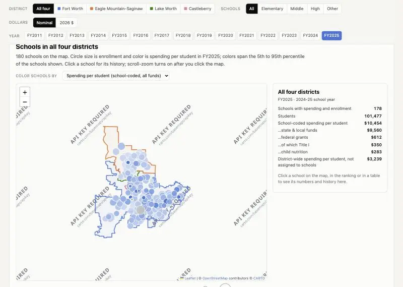

CARTO's base map now requires an API key ("API KEY REQUIRED" across the tiles). Switching to Esri's keyless light-gray and dark-gray canvas, which show roads and city names.

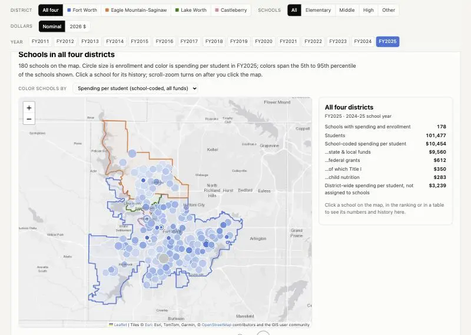

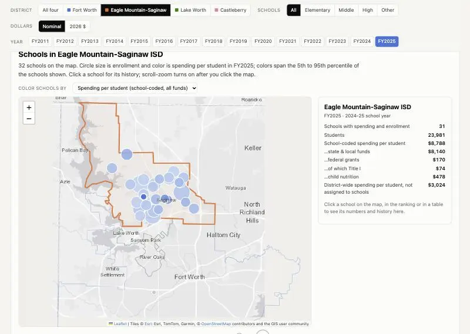

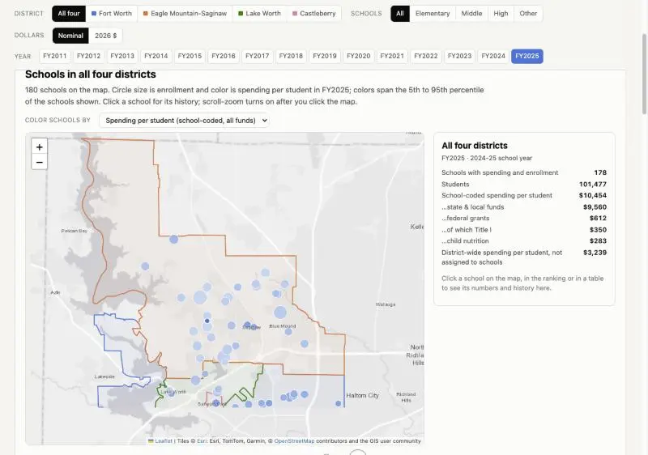

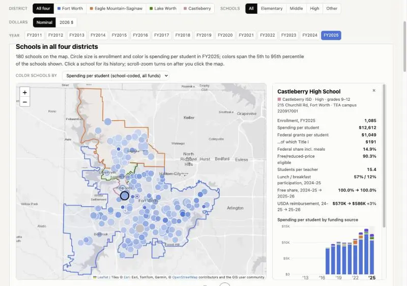

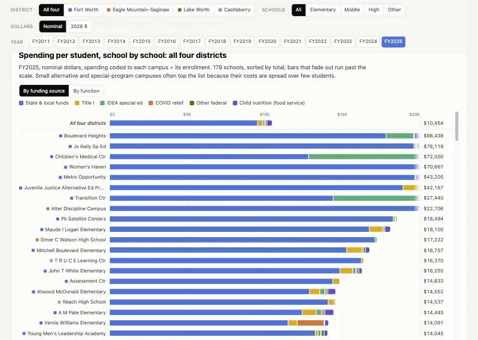

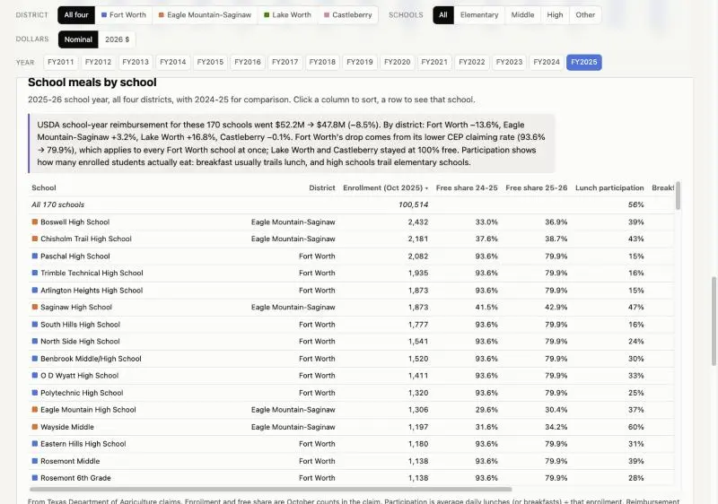

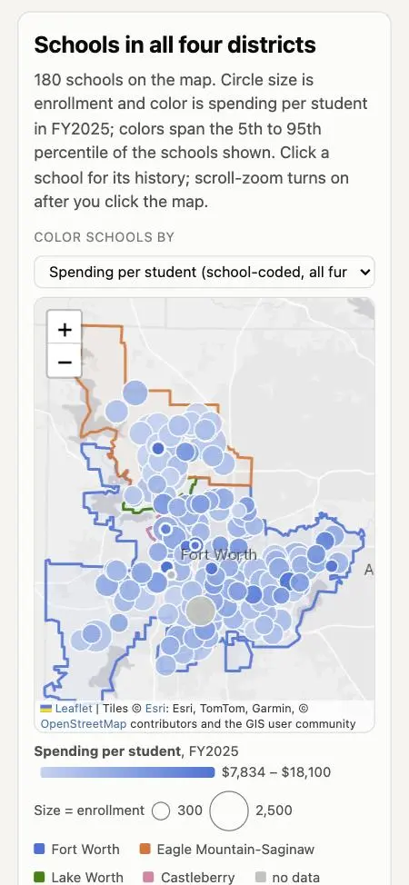

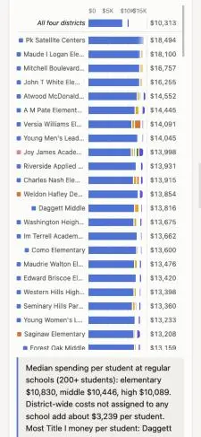

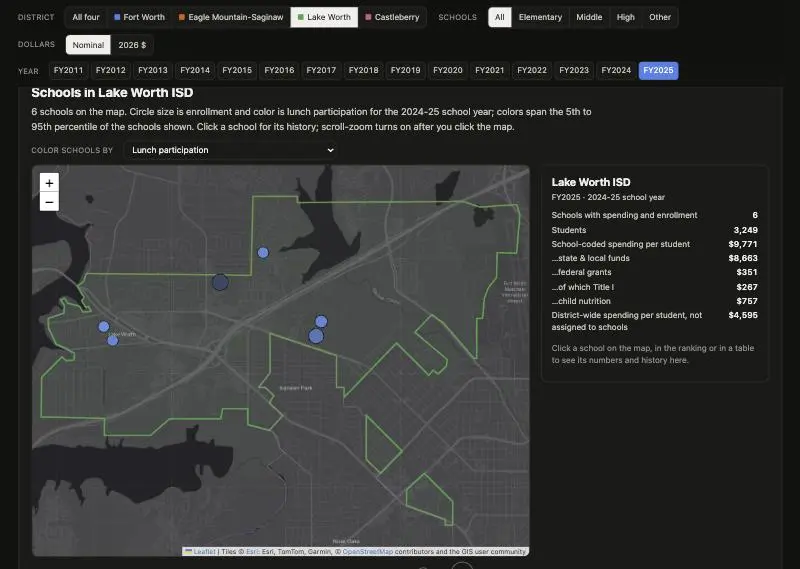

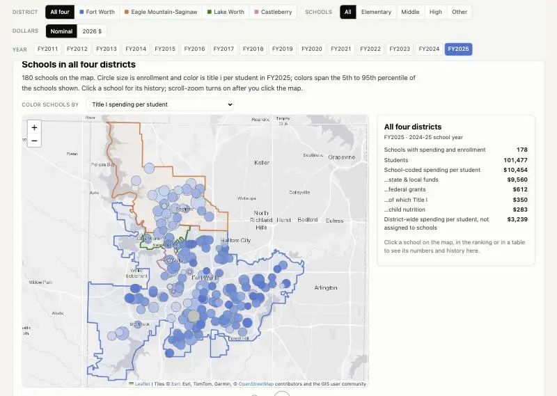

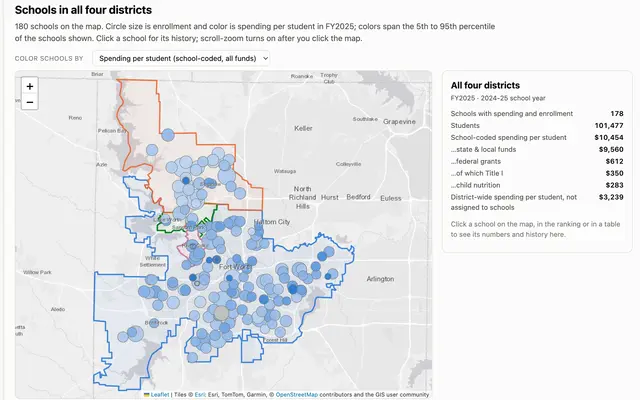

The school map is built: [politics/fort-worth-area-schools-opus-5.5-high/index.html](politics/fort-worth-area-schools-opus-5.5-high/index.html). It covers Fort Worth, Eagle Mountain-Saginaw, Lake Worth and Castleberry: 184 open schools, 182 of them on the map. I checked it at desktop and phone widths and in dark mode, with no console errors. Nothing is committed yet.

**Base layer:** I first used CARTO's light map, but its tiles now show "API KEY REQUIRED". I switched to Esri's light and dark gray maps, which need no key and show roads, highways, lakes, and city and road names. The labels sit above the school circles so they stay readable. The map follows the page's light/dark setting. Leaflet and the map tiles need an internet connection; the rest of the page works offline.

**Map and controls**
- **District switcher:** "All four" shows every school with all four district boundaries. Choosing one district zooms the map to it, hides the other districts' schools and fades their boundaries.
- **Filters:** a school-level filter (elementary, middle, high, other) and year buttons for FY2011–FY2025.
- **Circles:** size is enrollment. Color is one of ten measures: spending per student, federal grants, Title I, federal share, free/reduced-price share, lunch or breakfast participation, USDA reimbursement per student, students per teacher, and enrollment change.
- **Zooming:** scroll-zoom turns on only after you click the map, so scrolling the page doesn't zoom it by accident.
- **School panel:** click any school (on the map, in the ranking or in a table). The side panel shows its numbers plus history charts for spending per student by funding source, enrollment and lunch participation. The link updates so you can share a school.

**Other sections:** a school-by-school spending ranking (by funding source or by function), spending over time, a school-meals table and a sortable table of all schools.

**What it shows (FY2025)**
- **Spending at schools:** $10,454 per student is coded to the schools themselves. District-wide costs add about $3,239. The median at regular schools is about $10,000–$10,800 for every level.
- **Title I:** concentrated in high-poverty Fort Worth schools. Daggett Middle gets $1,147 per student, Mitchell Boulevard Elementary $1,009 and A M Pate Elementary $925.
- **Meal reimbursement, 2025-26:**
  - Fort Worth −13.6%, because its free-meal claiming rate dropped for every school at once.
  - Eagle Mountain-Saginaw +3.2%, Lake Worth +16.8%, Castleberry flat.
- **High school lunch participation:** only about 15–33% of enrolled students eat lunch at Fort Worth high schools, compared with 37–47% at Eagle Mountain-Saginaw high schools.

**Data decisions**
- **Linking the sources:** TEA campus numbers connect to federal NCES school records (locations, enrollment, teachers) through the state school ID. Older NCES years write that ID differently; I handled both formats, so enrollment goes back to FY2011. Meal-claim site IDs match TEA campus numbers.
- **Ranking default:** the ranking hides campuses under 150 students unless you tick the box. Special-ed, alternative and juvenile-justice campuses run $20,000–$98,000 per student and would otherwise fill the top of the list.
- **Missing data:** one new 2024-25 Eagle Mountain-Saginaw elementary listed only as "NEW EL" doesn't match a TEA campus yet. Two district-program campuses (code 699) have spending but no location.

I also added the `demos.js` card, a screenshot of the map at `screenshots/projects/fort-worth-area-schools-opus-5.5-high.webp`, a README, and a `.gitignore` for `raw/`. The raw downloads are in the scratchpad, outside the repo.

## You

Yes, prompt + commit
