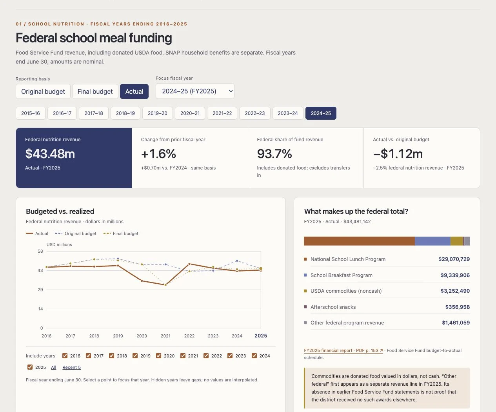

# Prompts

- **Model:** gpt-6.1-sol
- **Effort:** high
- **Session(s):** 01a1b196-579e-73b1-9080-508b694bb1f7
- **Cost:** unavailable (tokscale failed)

## You

I want to take a look at the budget changes in the Fort Worth ISD school district.

My end goal is to see changes in federal funding, around the SNAP/food assistance in the school district. But, that is just a piece of the overall budget.

Only 4-5 years of data is available, and its all in PDF. Please try to extract the data, and provide some good visualizations. If there is a way to get older data, maybe going back 10 years, that would be great, but is a lower priority.

Self-contained HTML/CSS/JS, with data embedded. A Sankey diagram would be helpful, but any other charts would be as well. I want to have toggles for each individual year, but seeing trends from year to year would be helpful

Budgets are linked to from here: [https://www.fwisd.org/departments/budget/budget-documents](https://www.fwisd.org/departments/budget/budget-documents). I think the Adopted Budgets are the ones we want. But, if there is a better source for this data, go for it.

## Claude

I’ll look for comparable annual budget figures, extract the federal and school nutrition funding, and build a self-contained interactive dashboard. I’ll also check for older records and distinguish school meal funding from SNAP, since they flow through different programs.

I’m using the PDF extraction and Sites skills to produce a portable HTML file with embedded data. The main comparison will use adopted budgets consistently; any audited actual spending I find will be clearly separated from those plans.

I found audited financial reports going back to 2007, so a ten-year history is available. They also contain original budget columns, which may let us extend the adopted-budget comparison beyond the four recent budget books. I’m checking those columns before combining the years.

There’s a significant comparability trap: the posted 2025–26 “Adopted Budget” shows only the General Fund, while adjacent years include food service and debt service. Also, some summaries put food service “other resources” under federal revenue. I’ll flag those differences and use the audited nutrition program lines to show the federal meal funding trend.

The ten-year nutrition series is extractable, including breakfast, lunch, donated USDA food, snacks, and original versus final budgets. I also found an error in a later historical summary, so I’m checking each year against its own financial statements. That keeps the charts tied to the reported annual figures.

The clearest initial finding is that federal revenue in the district’s governmental funds fell sharply in 2024–25, while federal revenue in the Food Service Fund rose slightly. The dashboard will show those paths separately, with a nutrition funding Sankey, year-by-year comparisons, and links to the exact PDF pages.

The interactive page is built, and the year, budget-basis, and comparison controls are working. It includes downloadable data and source-page links. I’m finishing the layout checks and checking that every funding flow balances to the published totals.

All 30 nutrition year/basis combinations and all five district budget views passed the interaction checks, and the data export works. The page also flags the misleading 2025–26 scope change, so the smaller General Fund posting won’t appear as a sudden districtwide budget cut.

[Open the self-contained dashboard](/Users/danwatt/git/ai-experiments/politics/fwisd-budget-gpt-6.1-sol-high/index.html)

Includes:

- **10 years** of nutrition funding: FY2016–2025.
- Five recent district budget plans.
- Interactive Sankey, trends, year filters, and budget-versus-actual comparisons.
- CSV/JSON downloads and exact PDF-page links.
- Explanations of SNAP versus school meal funding and inconsistencies in the budget documents.

A key finding: FY2025 Food Service Fund federal revenue rose **1.6%**, while governmental federal revenue fell **41.6%**. Those are separate funding streams. Sources: [2024 report](https://resources.finalsite.net/images/v1751476207/fwisdorg/xx7y4pfqgcgl7wq5crbg/ACFR_070225.pdf), [2025 report](https://resources.finalsite.net/images/v1778537241/hvuxe2uenkfunpmm0ple/Fort_Worth_ISD_Signed_ACFR.pdf).

The HTML works offline; source links require internet access.

## You

Can we please stop using the green GPT theme, and use something a bit more original? And cut the fluff and buzzwords at the top.

## Claude

I’ll replace the green palette with ink blue and burnt orange, and simplify the top to a plain title, date range, and controls.

Updated the [dashboard](/Users/danwatt/git/ai-experiments/politics/fwisd-budget-gpt-6.1-sol-high/index.html) with ink blue and burnt orange, a compact title, and direct section labels. Removed the slogans, badges, and long introduction.

I’ll avoid that green theme going forward.

## You

Lets go ahead and run the prompt.md script first, add a screenshot and add to the index at the root

## Claude

I’ll run the prompt script first, then capture a screenshot and add it to the root index card.

Ran the script first, refreshed [prompt.md](/Users/danwatt/git/ai-experiments/politics/fwisd-budget-gpt-6.1-sol-high/prompt.md), and added the screenshot to the root index card. Cost metadata was unavailable.

## You

Lest make sure all of these files are in `politics/fwisd-budget-`gpt-6.1-sol-high

## Claude

I’ll move the dashboard into `politics/fwisd-budget-gpt-6.1-sol-high` and update the index and screenshot links.

## Screenshot

