# Prompts

- **Model:** claude-opus-5-5
- **Effort:** high
- **Session(s):** c6d9482a-504a-4630-b20c-8ee1b9a34906
- **Tokens:** input 212, output 108948, cache read 21864825, cache write 313354
- **Cost (tokscale estimate):** $9.06

## You

<pasted_content id="985a">
I want to take a look at the budget changes in the Fort Worth ISD school district.

My end goal is to see changes in federal funding, around the SNAP/food assistance in the school district. But, that is just a piece of the overall budget.

Only 4-5 years of data is available, and its all in PDF. Please try to extract the data, and provide some good visualizations. If there is a way to get older data, maybe going back 10 years, that would be great, but is a lower priority.

Self-contained HTML/CSS/JS, with data embedded. A Sankey diagram would be helpful, but any other charts would be as well. I want to have toggles for each individual year, but seeing trends from year to year would be helpful

Budgets are linked to from here: https://www.fwisd.org/departments/budget/budget-documents. I think the Adopted Budgets are the ones we want. But, if there is a better source for this data, go for it.
</pasted_content id="985a">

Lets put this in `politics/fwisd-budget-opus-5.5-high`

## Claude

Downloaded 13 FWISD PDFs (adopted budgets 2023-24 to 2026-27, budget books 2022-23 to 2025-26). Reading them now.

Found TEA PEIMS data: district-level actuals with fund/function/object detail back to 2009. Much better than PDFs for federal detail (child nutrition fund 240, ESSER, Title I). Downloading.

Extracted FWISD rows (district 220905) from 15 years of TEA actuals. Federal totals show ESSER spike 2021–2024. Child nutrition money not showing in fund 240; checking enterprise fund 701.

Mapping TEA fund codes to program names (ARRA, ESSER, Title I etc.) so federal chart labels are right.

Found Texas Dept. of Agriculture meal-reimbursement datasets (2015-16 through 2025-26) — gives meals served and USDA reimbursement for FWISD directly. Pulling those.

Got the meal data: school-year claims, summer SSO (huge in 2020-22 pandemic waivers: ~$30M/yr), and CACFP after-school suppers starting 2024. Aggregating now.

TEA summary file also has fall enrollment per year (2009–2025) — enables per-student numbers. Now writing the build script that turns all sources into one embedded dataset.

Data mapped. Writing build script now (TEA actuals FY2011–25 + FWISD adopted budgets FY2023–27 + TDA meal claims SY2015-16 to 2025-26).

Building the page now: hand-written SVG Sankey + trend charts, no CDN deps. Grabbing CPI first for an optional inflation-adjust toggle.

Palette validated. Adding CPI (FRED, fiscal-year averages) to the build, then writing the page.

Now the page itself (single HTML, inline SVG charts, data inlined by the build script).

Page written, data inlined (~50KB). Checking it in the browser.

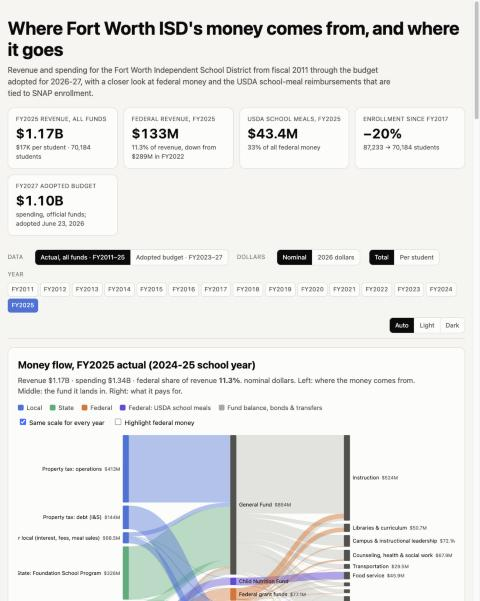

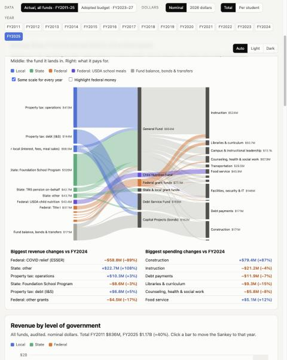

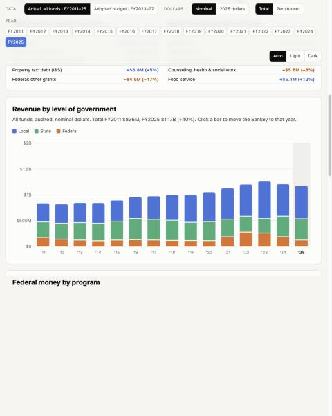

Page renders clean, no console errors. Fixing layout (Sankey labels clipped at narrow widths); checking again.

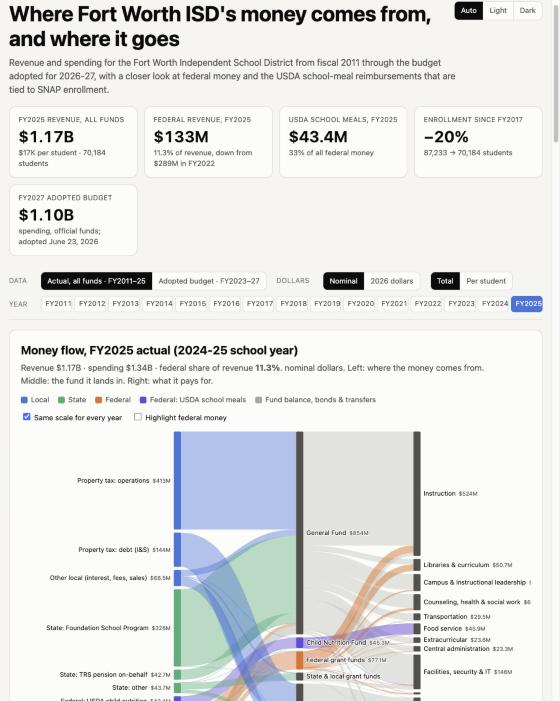

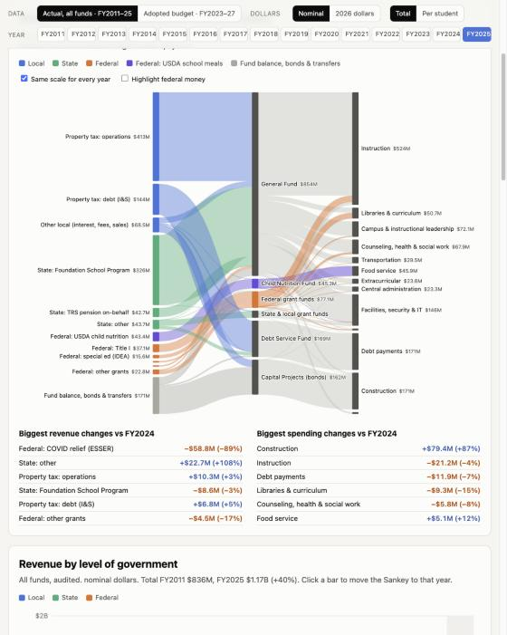

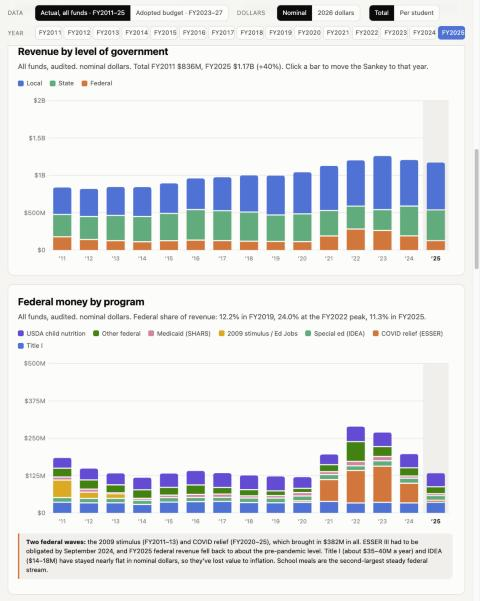

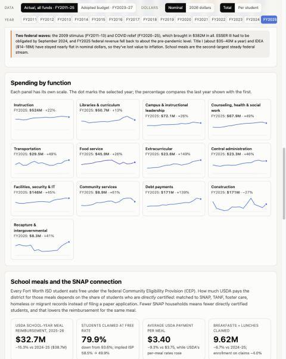

Main charts working. Now checking the school-meals section.

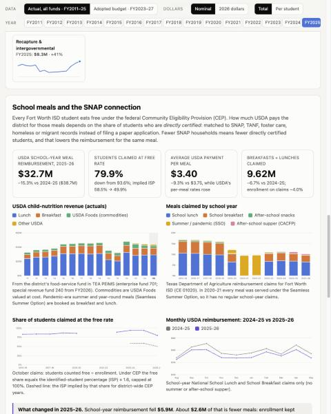

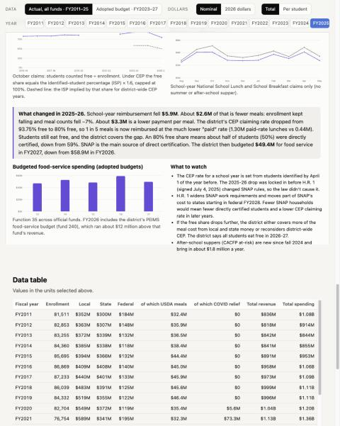

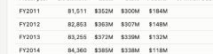

Table fine. Making half-width charts use a narrower canvas so text stays legible.

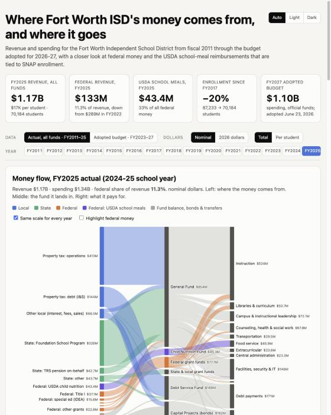

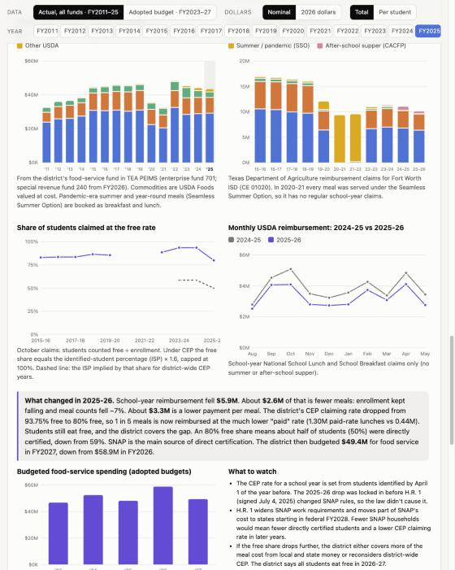

Meals section looks right. Testing budget mode, per-student/real-dollar toggles, dark mode and phone width.

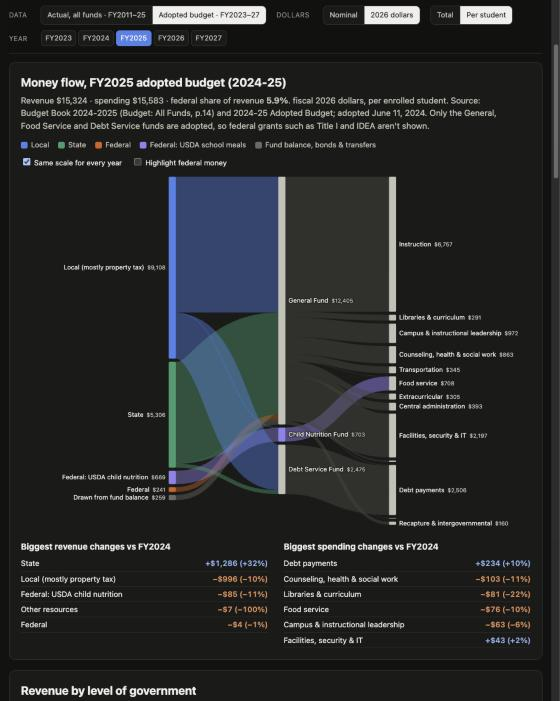

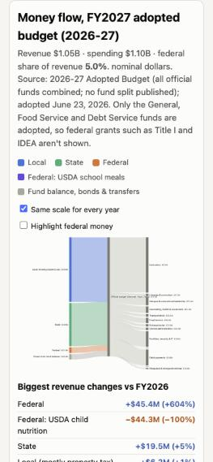

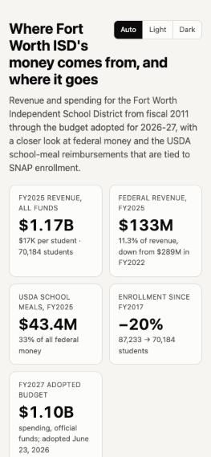

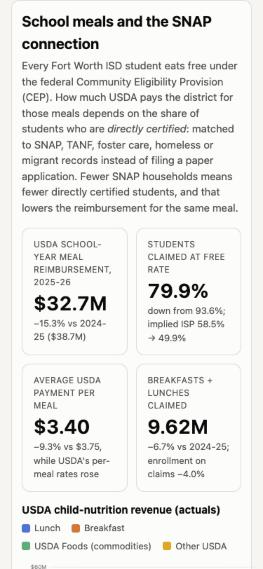

Mobile OK (no horizontal scroll). Final polish, then build/fetch script, landing-page entry and screenshot.

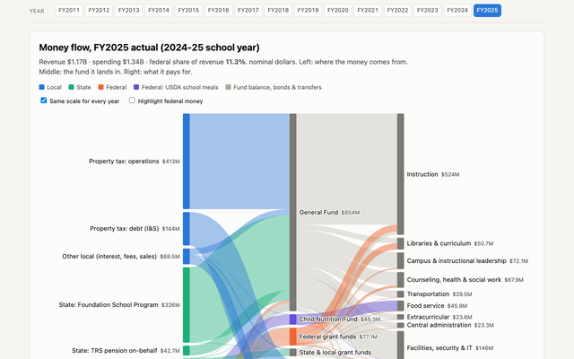

Landing card added. Writing `build/fetch.sh` and a short README so the data can be rebuilt.

I built the page at [politics/fwisd-budget-opus-5.5-high/index.html](politics/fwisd-budget-opus-5.5-high/index.html). It's one self-contained file (about 100 KB) with the data inlined and no CDN scripts. I checked it in the browser pane at desktop and phone widths and in dark mode, and the console showed no errors.

**Data sources.** The PDFs alone weren't enough, so I combined three sources:
- **TEA audited actuals, FY2011–FY2025.** These come from state PEIMS files filtered to FWISD and cover every fund. That matters because the adopted budgets only cover the General, Food Service and Debt Service funds, so Title I, IDEA and ESSER never appear in them. This also covers your 10-year goal: it goes back 15 years.
- **FWISD adopted budgets, FY2023–FY2027.** Transcribed from the budget books and adopted-budget PDFs, with the source noted for each year. The posted 2025-26 budget covers only the General Fund, so I filled Food Service and Debt Service from the district's budget filing with TEA. The 2026-27 budget has no breakdown by fund.
- **Texas Department of Agriculture meal claims, 2015-16 to 2025-26.** Meals served and USDA reimbursement for FWISD, including summer and after-school meals.

**On the page:**
- A Sankey diagram for any year: revenue source, then fund, then what the money pays for. You can highlight federal money and keep the same scale across years.
- A switch between actuals and adopted budgets, plus toggles for 2026 dollars and per-student amounts.
- Year-by-year charts of revenue, federal money by program, and spending by category.
- A school-meals section and a data table.

**What the data shows:**
- **Federal money is back to pre-pandemic levels.** It was 12.2% of revenue in FY2019, peaked at 24% in FY2022 with COVID relief (about $382M over FY2020–25), and was 11.3% ($133M) in FY2025.
- **USDA school meals** bring in $43–46M a year, a third of FWISD's federal money. Title I and special-ed grants have stayed flat in dollars, so they've lost about a third of their value to inflation.
- **The SNAP link turned up a real change in 2025-26:**
  - Every student still eats free under the Community Eligibility Provision (CEP), and the district says that continues in 2026-27.
  - USDA pays more per meal the more students are matched to SNAP and similar programs. FWISD's free-claiming rate fell from 93.75% to 80%. That implies the matched share fell from about 58.6% to 50%. This is my inference: the district doesn't publish that figure.
  - School-year meal reimbursement fell 15%, from $38.7M to $32.7M: about $2.6M from fewer meals and $3.3M from the lower rate per meal.
  - The FY2027 budget cuts food service to $49.4M, down from $58.9M.
- **H.R. 1 didn't cause the 2025-26 drop.** That year's rate was set from spring 2025 data, before the law's SNAP changes. Those changes are a risk for future years.

The `build/` folder has `fetch.sh` (re-downloads about 400 MB of state data and keeps FWISD's rows) and `build_data.py` (rebuilds the data in the page). I also added the landing-page card in `demos.js`, a screenshot, a README and `prompt.md`. Its screenshots in `prompt-assets/` are browser checks from this session. I didn't touch the existing untracked `fwisd-budget/` folder.

Sources:
- [FWISD budget documents](https://www.fwisd.org/departments/budget/budget-documents)
- [TEA PEIMS financial downloads](https://tea.texas.gov/about-tea/state-funding/state-funding-reports-and-data/peims-single-file-financial-data-downloads)
- [TEA fund code table](https://tealprod.tea.state.tx.us/TWEDS/66/0/0/0/CodeTable/List/8024) and [ESSER fund codes](https://tea.texas.gov/sites/default/files/update-to-fund-codes.pdf)
- [data.texas.gov (TDA meal data)](https://data.texas.gov/)
- [FWISD CEP page](https://www.fwisd.org/departments/operations/child-nutrition-services/community-eligibility-provisions-cep)
- [FRED CPI-U](https://fred.stlouisfed.org/series/CPIAUCNS)
- [Bellwether on H.R. 1 and K-12](https://bellwether.org/blog/what-the-one-big-beautiful-bill-act-means-for-the-social-safety-net-in-k-12-schools/)
- [School Nutrition Association bill summary](https://schoolnutrition.org/wp-content/uploads/2025/08/TAM-25-SNA-BBB-Bill-Summary.pdf)
- [Center for American Progress on school meals](https://www.americanprogress.org/article/congressional-republicans-big-beautiful-bill-threatens-access-to-free-school-meals/)

## You

Lets go ahead and run the prompt.md script first, add a screenshot and add to the index at the root
