# Prompts

- **Model:** claude-opus-5-5
- **Effort:** high
- **Session(s):** c6d9482a-504a-4630-b20c-8ee1b9a34906
- **Tokens (whole session):** input 368, output 190716, cache read 37188423, cache write 515506
- **Cost (tokscale estimate):** $15.38 for the whole session. The session started with the [Fort Worth ISD explorer](../fwisd-budget-opus-5.5-high/prompt.html), whose prompts are left out here; its prompt.md put that part at $9.06, so this comparison is roughly $6.30.

## You

Are there other nearby school districts we could add and do a comparison? Specifically, any of the other ISD's in Tarrant County.

## Claude

Checking district IDs and names for Tarrant County from the TEA files already downloaded.

Yes, there are 15 others. TEA counts 16 ISDs in Tarrant County, including FWISD. The statewide TEA spending files and TDA school meal datasets I already downloaded cover every Texas district in the same format. So the comparison mostly means dropping the Fort Worth-only filter, not finding new sources.

FY2025 operating revenue and federal share, from TEA's summarized financial data:

| District | Revenue | Federal |
|---|---|---|
| Fort Worth | $884M | 10.1% |
| Arlington | $667M | 13.4% |
| Mansfield | $398M | 8.0% |
| Keller | $349M | 6.4% |
| Birdville | $275M | 10.6% |
| Eagle Mountain-Saginaw | $265M | 6.6% |
| Hurst-Euless-Bedford | $250M | 10.0% |
| Crowley | $201M | 12.3% |
| Grapevine-Colleyville | $162M | 6.6% |
| Carroll | $96M | 3.6% |
| Azle | $85M | 8.4% |
| White Settlement | $77M | 9.4% |
| Everman | $65M | 12.6% |
| Castleberry | $56M | 17.6% |
| Lake Worth | $48M | 11.9% |
| Kennedale | $35M | 9.7% |

The federal share roughly follows poverty. Castleberry, Arlington, Everman and Crowley rely on federal money more than Fort Worth does. Carroll, Keller and Grapevine-Colleyville barely rely on it, so the school meal and SNAP angle should show real contrast.

What I can compare for all 16:
- **Spending, FY2011–FY2025:** TEA's audited actual spending for every fund, with revenue by level of government, federal money by program and spending per student. Enrollment comes from TEA's fall survey.
- **School meals, SY2015-16 to 2025-26:** USDA revenue, meals claimed and each district's free-claiming rate under the free-meals program (CEP), from the TDA claims data. This answers whether the 2025-26 drop in the free-claiming rate hit only Fort Worth or the whole county.

**What I'd skip:** the adopted budgets. Those were hand-copied from FWISD's PDFs, and doing that for 15 more districts is a lot of manual work. TEA publishes a statewide FY2026 budget file I could use instead.

**Two boundary questions:**
- Districts that are partly in Tarrant County but based elsewhere (Northwest, Aledo, Burleson, Godley) aren't on the list. I can add Northwest, which covers a large part of north Fort Worth.
- Charter schools are excluded.

I'd make it a new page, because adding 16 districts of detail to the existing 100 KB Fort Worth page would make it heavy.

## You

New page, all 16

## Claude

TEA data extracted for all 16 districts. Now pulling the school meal claims one year at a time (parallel requests timed out).

Writing the data build script: 16 districts × 15 years of TEA revenue and spending, plus TDA school meal claims.

Found summer-meal money in fund 242 (Arlington and HEB booked pandemic meals there); folding it into USDA child nutrition, then building the page.

Data checks out (Everman books meals in fund 101 and Carroll isn't in the school lunch program, both handled). Writing the page now.

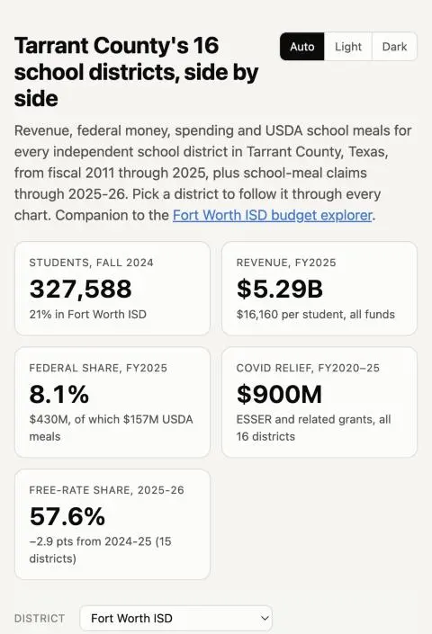

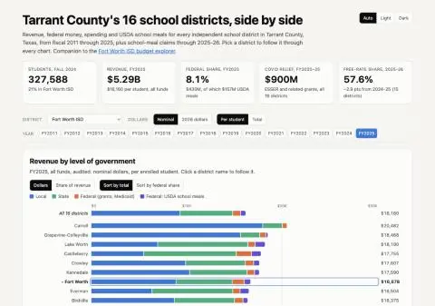

Page renders with no console errors. Checking each section visually now.

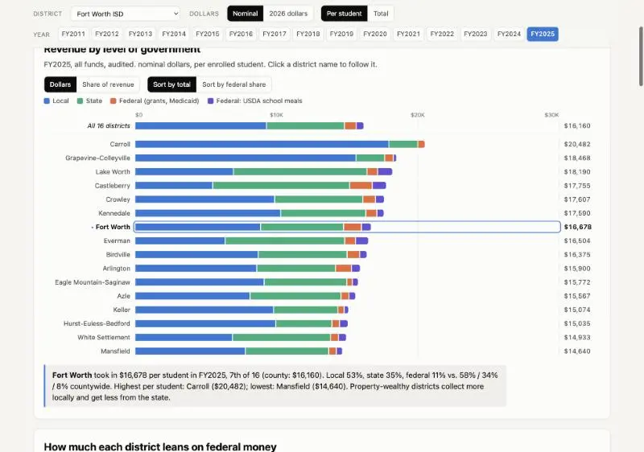

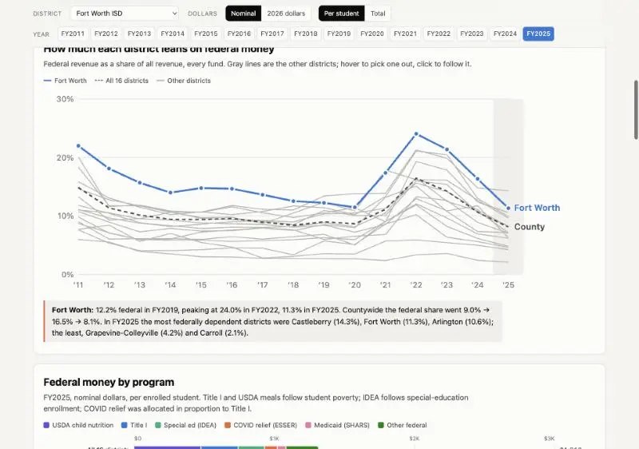

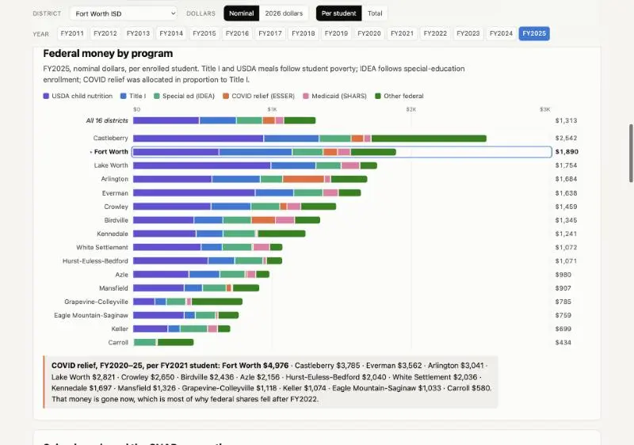

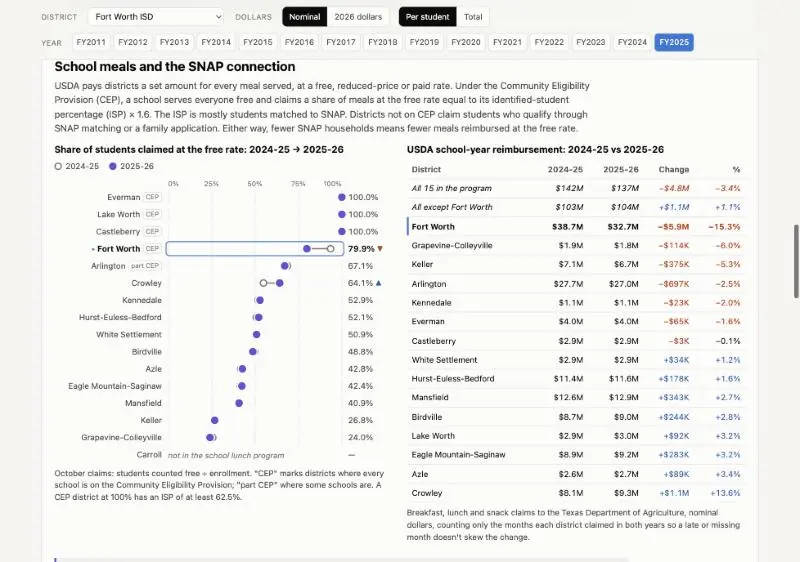

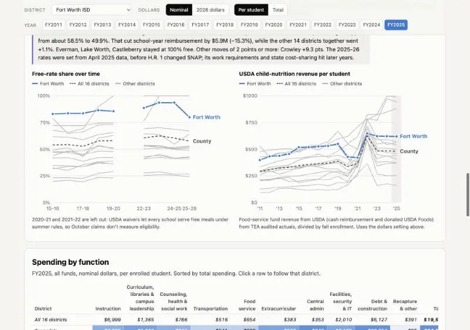

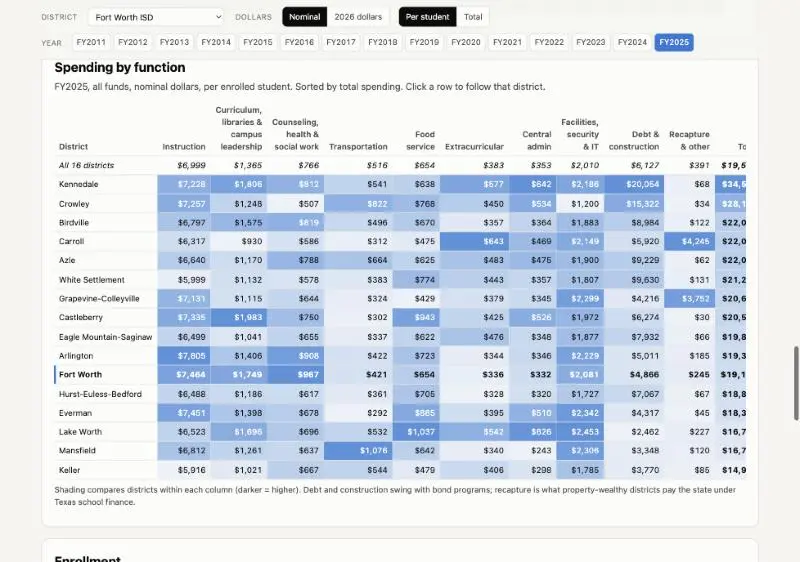

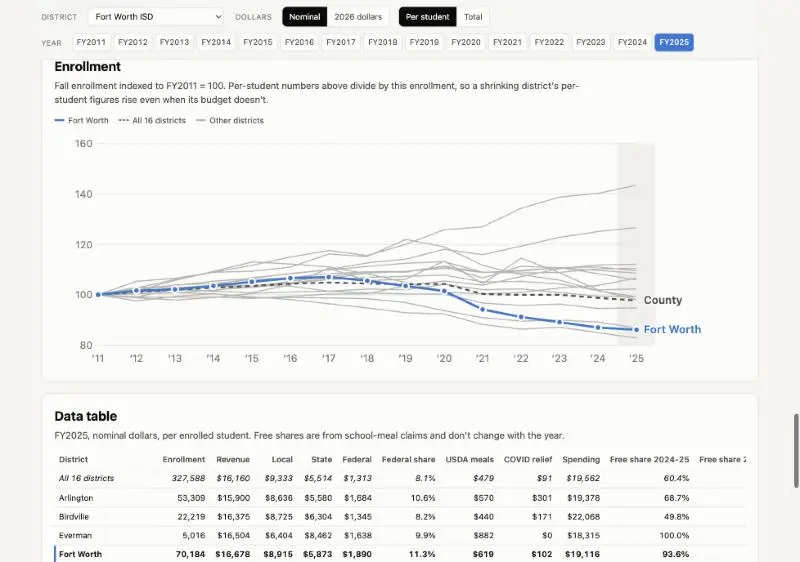

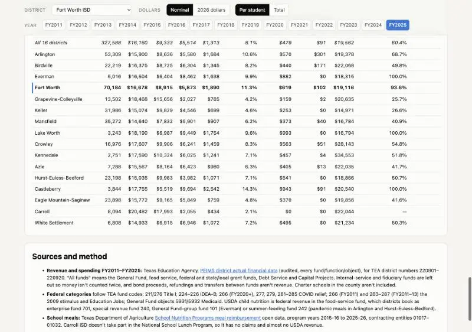

Fixed axis ranges, label collisions and the spending table (now sorted by operating spending, so bond-driven debt doesn't dominate). Rechecking, then mobile and dark mode.

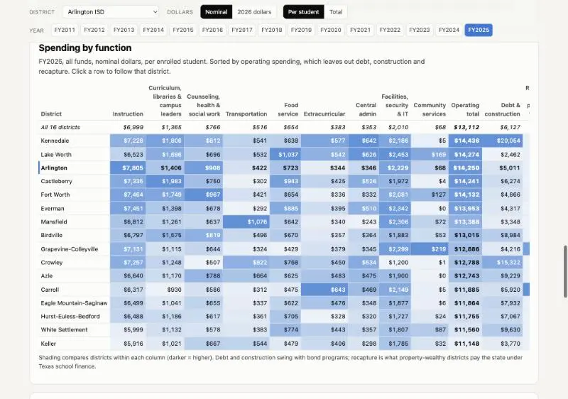

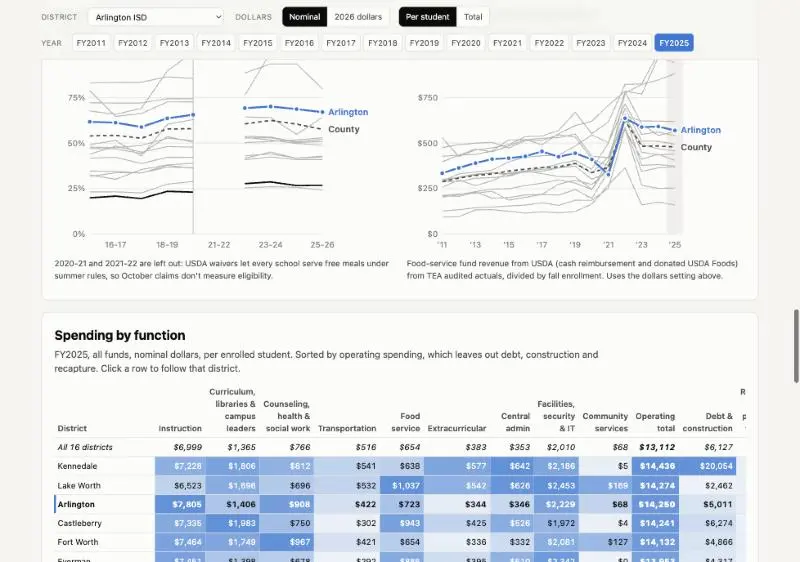

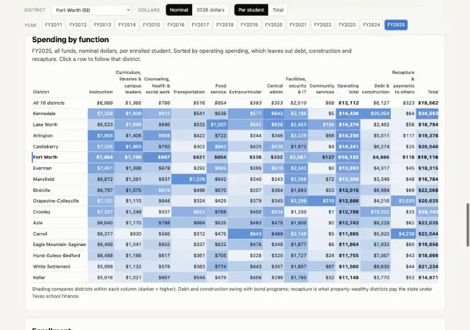

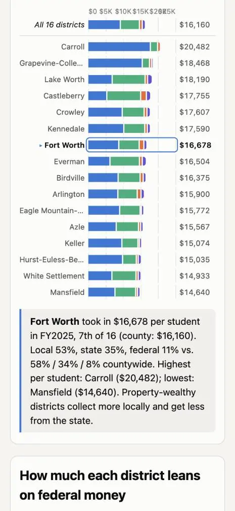

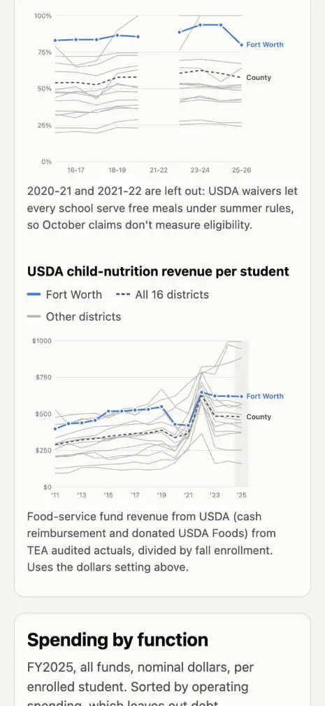

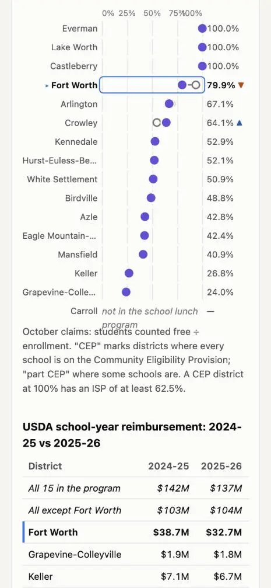

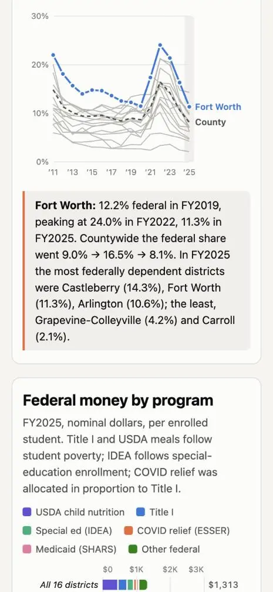

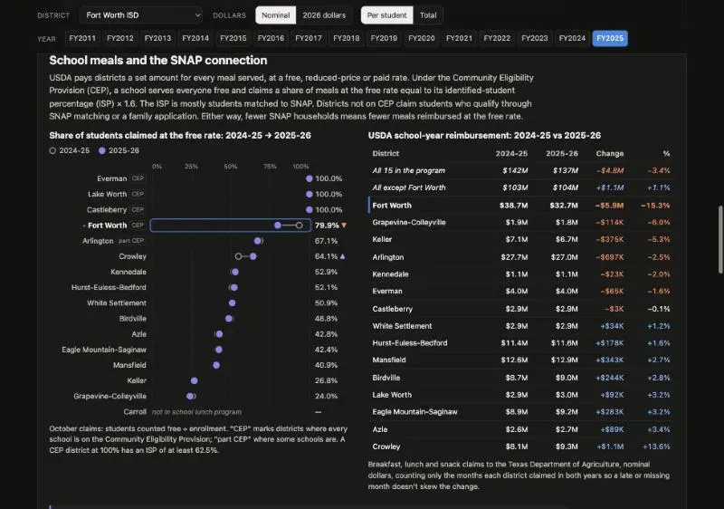

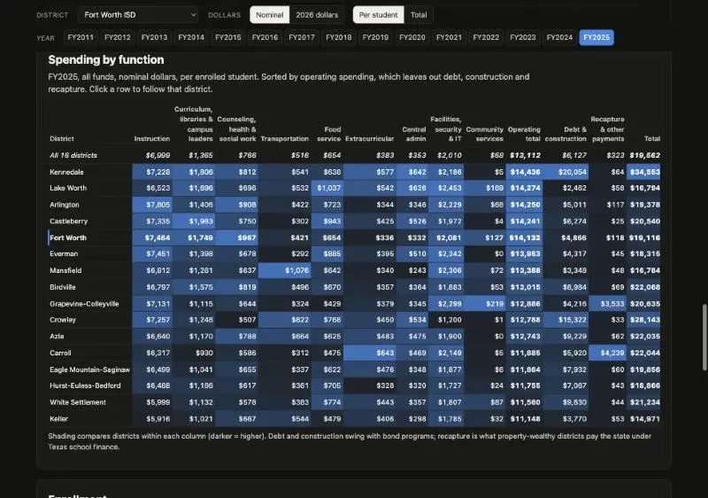

Dark mode works. Last visual check on a line chart with hover, then the README, demos.js card and screenshot.

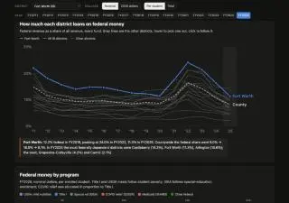

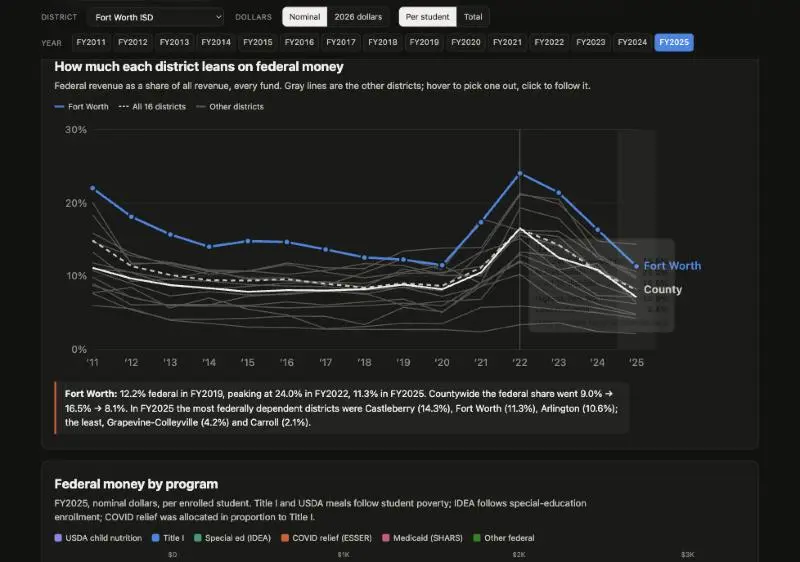

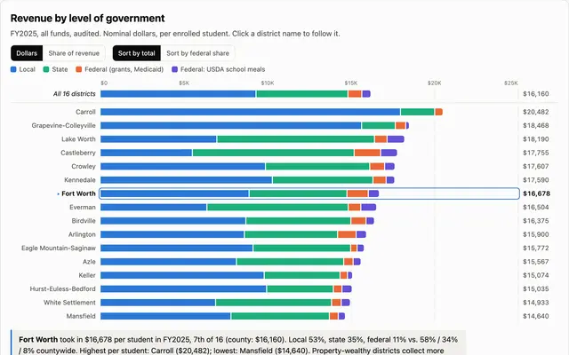

Screenshot looks good. Adding the demos.js card and README.

The comparison page is built: [politics/tarrant-isd-compare-opus-5.5-high/index.html](politics/tarrant-isd-compare-opus-5.5-high/index.html), one self-contained file of about 195 KB. I checked it at desktop and phone widths and in dark mode, with no console errors. Nothing is committed yet, and `prompt.md` isn't generated.

**What the data shows:**
- **Fort Worth is the only district whose school-meal reimbursement dropped sharply in 2025-26.** Its free-meal claiming rate fell from 93.6% to 79.9%, cutting USDA reimbursement 15%. The other 14 districts in the lunch program rose 1.1% combined.
- **Free-meal claiming rates elsewhere:** Everman, Lake Worth and Castleberry stayed at 100%. Crowley rose 9 points.
- **Federal reliance:** countywide, federal money was 8.1% of revenue in FY2025, down from 16.5% in FY2022. Castleberry (14.3%), Fort Worth (11.3%) and Arlington (10.6%) rely on it most; Grapevine-Colleyville (4.2%) and Carroll (2.1%) least.
- **Revenue per student, FY2025:** from $14,640 in Mansfield to $20,482 in Carroll. Fort Worth is 7th of 16 at $16,678.
- **Enrollment:** Fort Worth's fell about 14% since FY2011 while the county's stayed nearly flat, which inflates Fort Worth's per-student figures.

**What's on the page:** pick a district from the dropdown and it's highlighted in every chart. Clicking a district's name or a gray line does the same.
- Revenue by level of government (dollars or share of revenue, with a sort option).
- Federal share over time.
- Federal money by program, with COVID relief per student.
- School meals: free-rate shares for 2024-25 vs 2025-26, a reimbursement table, and trends over time.
- A shaded spending-by-function table, enrollment, and a data table.

**Accounting differences I handled:**
- **Where meal money is booked:**
  - Everman runs food service through fund 101, which the Fort Worth build would have dropped.
  - Arlington and Hurst-Euless-Bedford booked pandemic meals in a summer-feeding fund (242).
  - All of these count as school meals here. Fort Worth never used fund 242, so its own explorer doesn't need changing.
- **Carroll ISD** isn't in the National School Lunch Program, so it has no meal claims and is marked that way.
- **Spending table sort:** it's sorted by operating spending, because counting debt and construction (Kennedale's bond program, for example) would distort the ranking.

I also added the `demos.js` card, a screenshot at `screenshots/projects/tarrant-isd-compare-opus-5.5-high.webp`, a README, and `build/fetch.sh` plus `build/build_data.py` to rebuild the data.

## You

Before we commit, just verifying that large datafiles are ignored, and only the results will be committed?

## Claude

Yes. Only the results would be committed. A dry-run `git add` lists just these:

| File | Size |
|---|---|
| `index.html` (page with the data built in) | 195 KB |
| `build/build_data.py` | 9.6 KB |
| `build/fetch.sh` | 3 KB |
| `README.md` | 3.4 KB |
| `screenshots/projects/tarrant-isd-compare-opus-5.5-high.webp` | 22 KB |
| `demos.js` (changed) | — |

All the large files are outside the repo, in the session scratchpad: about 400 MB of TEA zips, 230 MB of filtered CSVs and 30 MB of meal-claim JSON.

One gap I closed: by default, `fetch.sh` downloads into a `raw/` folder inside the demo directory, and nothing ignored that folder. I added a small `.gitignore` covering `raw/` and `__pycache__/` to both this demo and the Fort Worth demo, whose script has the same default. I tested it with a dummy `raw/` file, and git didn't pick it up.

## You

Yes, prompt + commit
