# Prompts

- **Model:** claude-opus-5-5
- **Effort:** high
- **Session(s):** c6d9482a-504a-4630-b20c-8ee1b9a34906
- **Tokens (whole session):** input 470, output 275737, cache read 52790019, cache write 897386
- **Cost (tokscale estimate):** $23.25 for the whole session. The session first built the [Fort Worth ISD](../fwisd-budget-opus-5.5-high/prompt.html) and [Tarrant County](../tarrant-isd-compare-opus-5.5-high/prompt.html) explorers, whose prompts are left out here; the session stood at $15.38 when the Tarrant demo was committed, so this statewide page is roughly $7.87.

## You

Lets expand this analysis to the state of Texas as a whole.

First step, can we determine how much data we can bring in? How many ISDs or counties are available to pull for the same time period we have done for Tarrant?

## Claude

Yes, we can bring in all of Texas for the same years as the Tarrant page. I counted from the statewide TEA files I'd already downloaded and the state's open meal data.

**TEA spending data (FY2011–FY2025)**
- Every year has about 1,020 districts in 253 counties: 1,029 in FY2011 and 1,019 in FY2025. Texas has 254 counties, but Loving County has no school district of its own.
- 1,018 districts appear in all 15 years.
- 12 districts closed, merged or started during the period, including North Forest (absorbed by Houston ISD in 2013), La Marque (absorbed by Texas City in 2016), and a handful of tiny rural districts. The UT Austin high school is the one that started (2022).
- By name, 962 are ISDs, 49 are CISDs, 6 are CSDs and 1 is an MSD. They enroll about 5.09 million students in all.
- The median district has about 1,000 students. 314 have under 500, and 15 have over 50,000.

**Charter schools aren't in these files.** TEA reports 183 charters with about 435,000 students (fall 2024) in another summary file, but their spending data isn't in the downloads used here. Adding them would mean finding another source. Without them, the page covers about 92% of public school students.

**TDA school meal claims (2015-16 to 2025-26)**
- About 1,180–1,290 entities file each year. Roughly 985–1,000 of them are school districts, about 984 in recent years; the rest are private schools, nonprofits and agencies.
- A few dozen districts are missing, like Carroll in Tarrant: they're either not in the federal lunch program or file under another entity.
- As in Tarrant, 2020-21 and 2021-22 can't be used because of the pandemic free-meal waivers. In 2021-22 only 461 entities filed regular claims at all.
- Since 2018-19, each claim carries the TEA county-district code, so most matching to TEA is direct. Earlier years would be matched through the state's entity ID, which is stable over time.

**Size and what it means for building**
- **Raw downloads:** TEA is the same ~400 MB of zips I already have. TDA is about 88,000 school-month rows a year, roughly 100 MB of JSON per year if downloaded raw. I'd have the state's site total them by district and month instead, which is a few MB in all.
- **Page size:** at the Tarrant level of detail, the data would be about 9 MB. Trimmed to what the charts use, all 1,019 districts fit in about 3 MB, so it can still be one self-contained page.
- **Rollups:** county (253) and regional service center (20) totals are small. TDA records already carry the region, and the TEA district number starts with the county code.
- **Design changes:** sixteen gray lines work, but 1,000 don't. A statewide page would need:
  - a search box to pick a district;
  - comparisons against peers (same county, same region, similar size, similar poverty rate);
  - statewide distribution charts instead of one bar per district.

## You

Yes, build it

## Claude

Meal claims for all ~1,180 entities summarized on the state's server (about 20 MB in all). Writing the statewide build script, which reads the TEA zips directly.

Page built (1.9 MB). Opening it in the browser pane to check it.

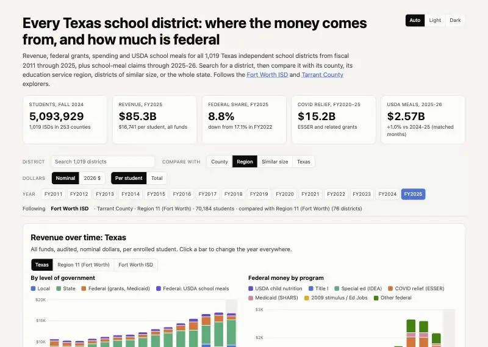

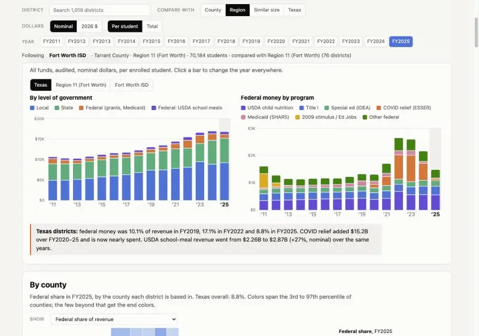

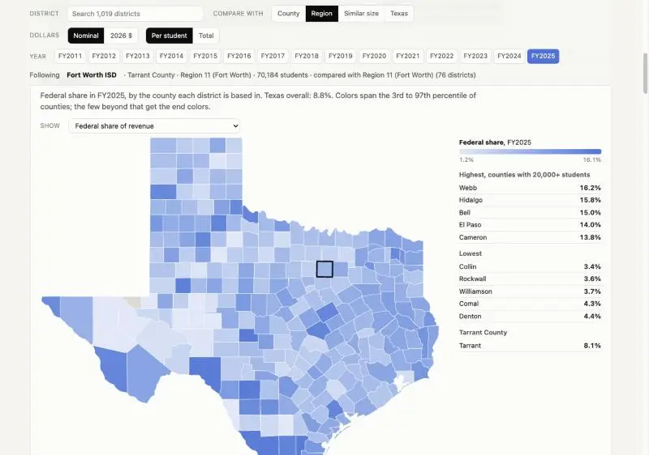

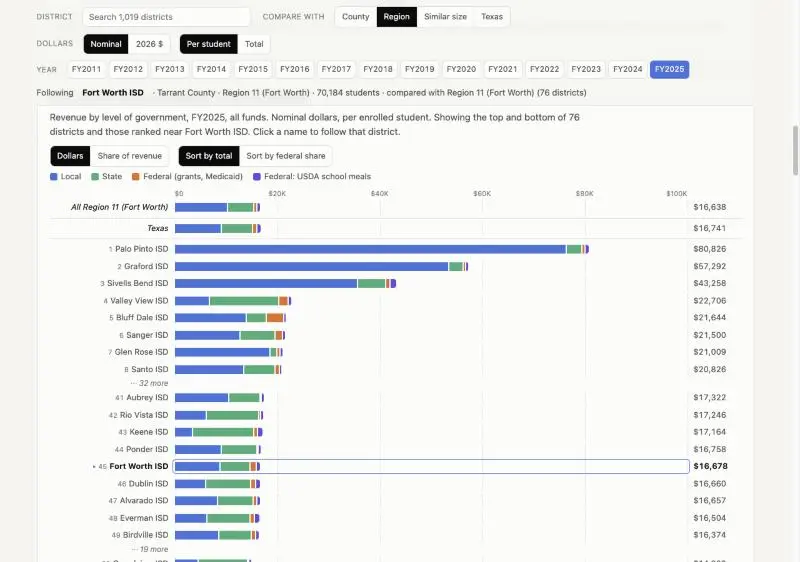

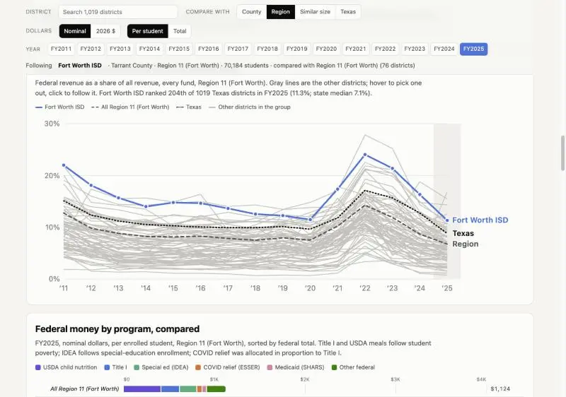

Main charts render with no errors. Fixing one scale problem: a few tiny, property-rich districts ($80K per student) flatten everyone else's bars. Capping the scale near the 95th percentile.

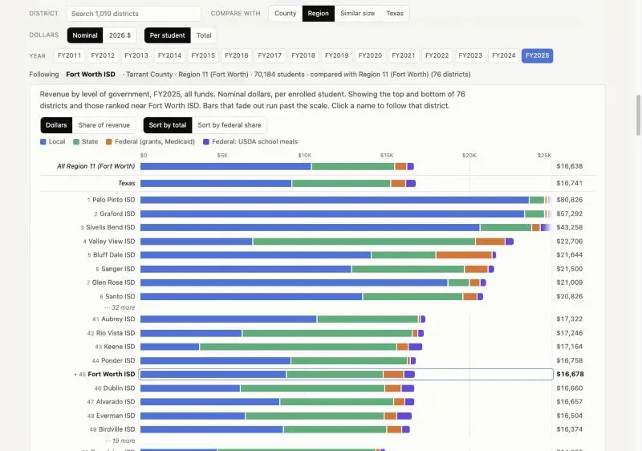

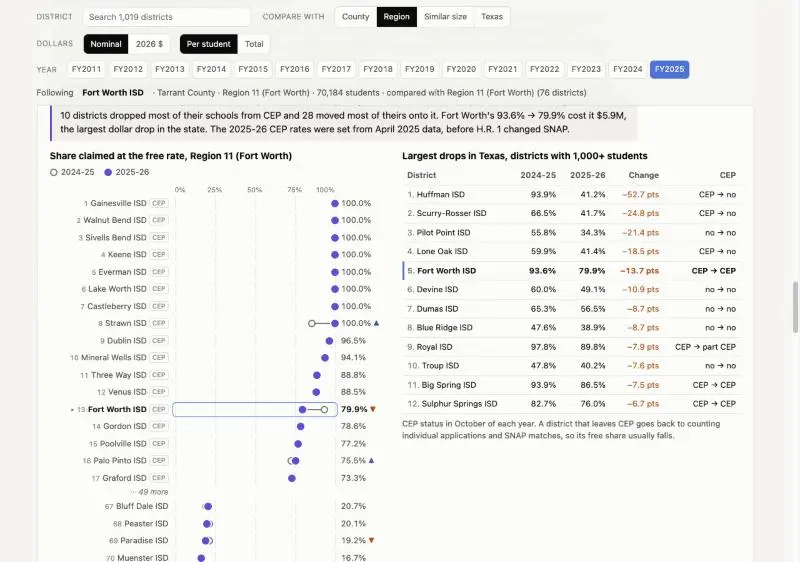

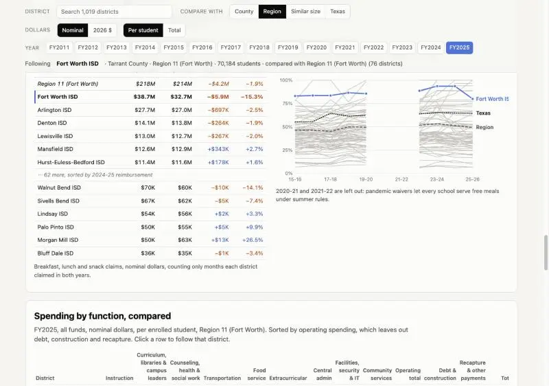

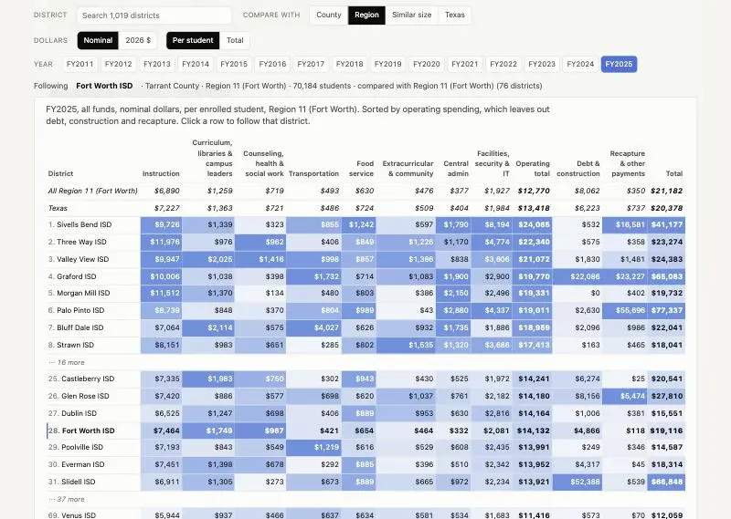

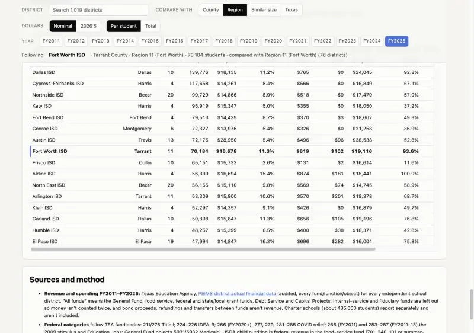

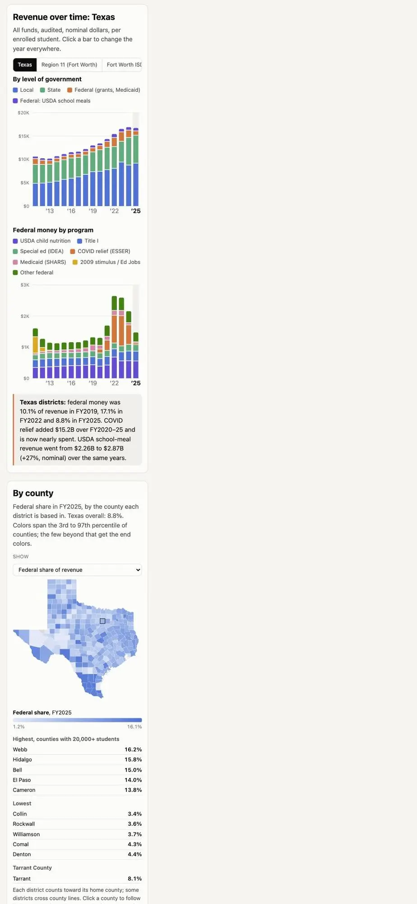

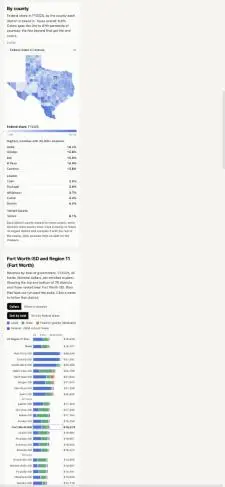

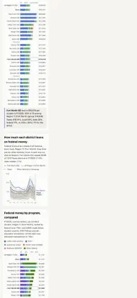

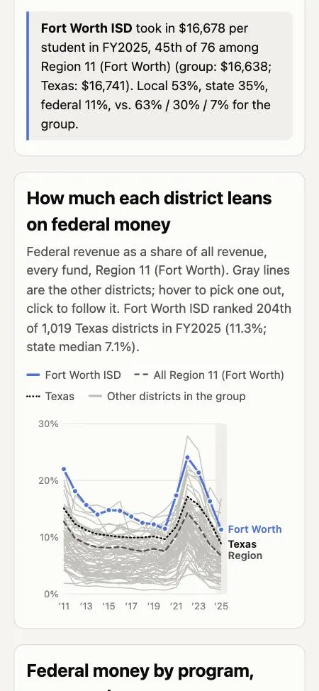

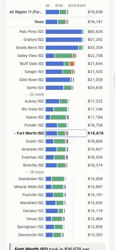

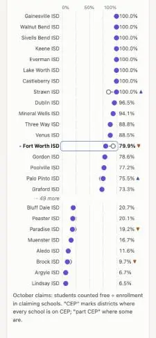

Mobile layout fixed (a summary line was forcing the page wider than the phone). Checking dark mode and the search and peer controls.

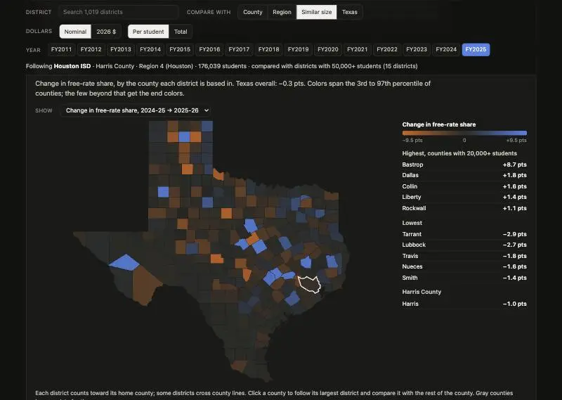

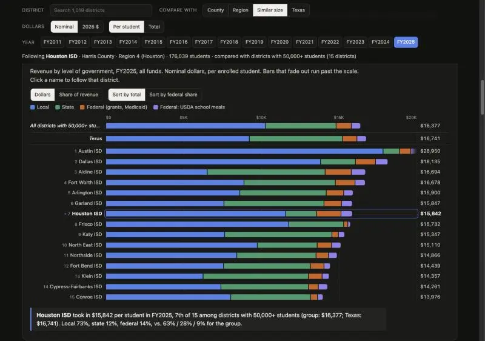

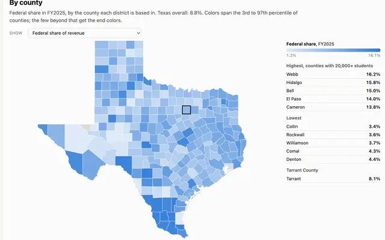

The statewide page is built: [politics/texas-isd-statewide-opus-5.5-high/index.html](politics/texas-isd-statewide-opus-5.5-high/index.html). It covers all 1,019 ISDs in one self-contained file of about 1.9 MB. I checked it at desktop and phone widths and in dark mode, with no console errors, and tested the search box and peer controls. Nothing is committed yet, and `prompt.md` isn't generated.

**What the statewide data shows**
- **Revenue and federal share:** districts took in $85.3B in FY2025. Federal money was 8.8% of that, down from 17.1% in FY2022. COVID relief totaled $15.2B over FY2020–25.
- **By county:** federal money matters most along the border (Webb 16.2%, Hidalgo 15.8%) and in Bell County (15.0%). It matters least in fast-growing suburbs like Collin (3.4%).
- **School meals, 2025-26:** almost nothing changed statewide.
  - The share of students claimed at the free rate went from 64.7% to 64.4%.
  - USDA reimbursement rose 1.0% ($2.54B to $2.57B).
  - Only 17 of 503 districts with 1,000+ students lost 5 points or more.
- **Fort Worth stands out statewide:** its $5.9M drop is the largest in Texas, nearly three times Houston's $2.0M.
- **Leaving CEP:** the steepest drops come from districts that took their schools off the free-meals program. Huffman ISD went from 94% to 41%. Overall, 10 districts moved most of their schools off CEP and 28 moved most onto it.

**How the page works**
- Search for any district, then compare it with its county, its region, districts of similar size, or all of Texas. Every chart follows the district you pick.
- The URL updates with the district's TEA number, so you can link to a district (`#101912` opens Houston).
- In long groups, the bar charts show the top, the bottom, and the districts ranked near yours.
- A county map shows seven measures. Click a county to follow its largest district.
- The revenue-over-time charts switch between Texas, the peer group and the district.
- A table of all districts can be sorted and filtered.

**Data decisions**
- **Scale:** bar scales stop at each group's 95th percentile. A few tiny, property-rich districts reach $50,000–$80,000 per student and would otherwise flatten every other bar; bars past the scale fade out.
- **Download size:** the state's meal-claims site summarizes the claims before download, so that pull is about 20 MB instead of roughly 1 GB.
- **Missing meal claims:** about 20 districts have none of their own. Some aren't in the lunch program (Carroll, Highland Park); others claim through a cooperative.
- **Regions:** two one-district counties had no region in the meal data, so I set them by hand: Kenedy (Region 2) and King (Guthrie, Region 17).
- **Charter schools:** about 435,000 students, left out as before.

I also added the `demos.js` card, a screenshot of the county map at `screenshots/projects/texas-isd-statewide-opus-5.5-high.webp`, a README, and a `.gitignore` for `raw/`. The commit would include only those files, the page and the two build scripts. The roughly 450 MB of raw downloads are in the scratchpad, outside the repo.

## You

Yes, prompt + commit
