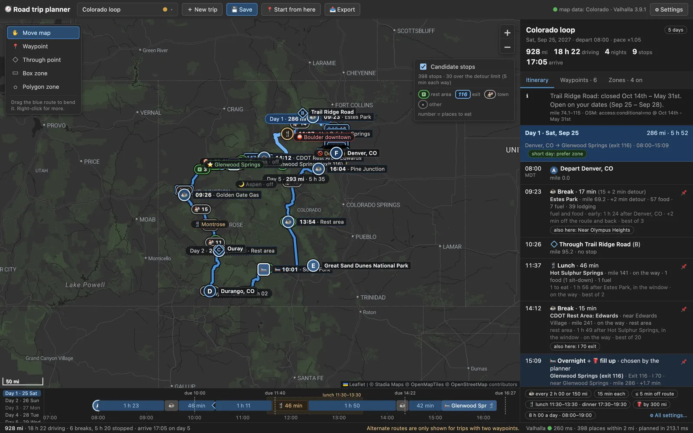
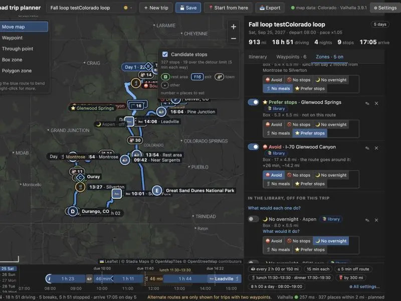
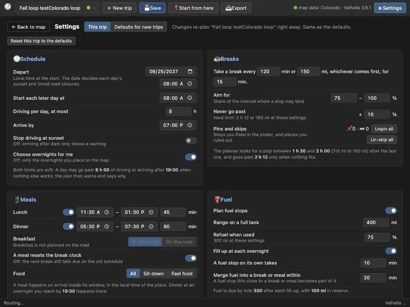
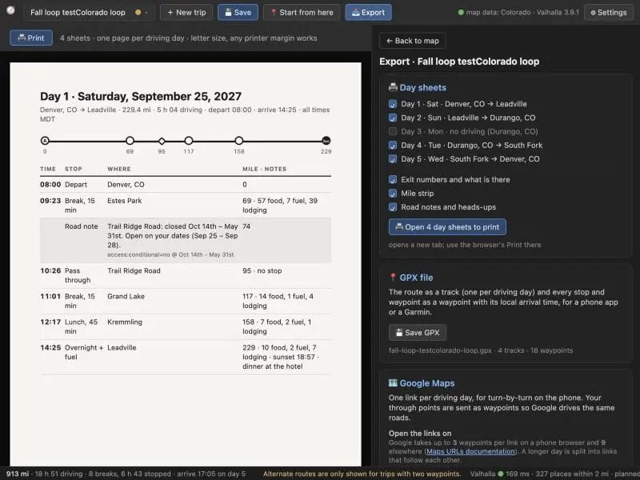

# Road-trip planner

An offline desktop road-trip planner that does what Microsoft Streets & Trips did for multi-day trips, and a bit more. Python backend, Valhalla routing, Leaflet frontend, everything in Docker. The plan is in [PLAN.md](PLAN.md); UI mockups are in [design/index.html](design/index.html).

**Status:** complete for daily use on Colorado (phases 0–5). Phase 6, the full US, is optional and not started. It runs locally only: the GitHub Pages copy of this folder shows screenshots and the design, not a running app.



| zone library | settings | export |
| --- | --- | --- |
|  |  |  |

## What it does

- **Routes** A → B → C → D with through points (shape the road, no stop), timed stops and overnights. Add points by clicking the map, searching a place, pasting coordinates, or dragging the route line. Up to 2 alternate routes.
- **Plans the days.** A break every N minutes or M miles at real rest areas, exits and towns; lunch and dinner in their windows; fuel before the tank runs low; automatic overnights near the daily driving limit at places with enough lodging; local clock times with time zone changes; sunset for each day. Every stop says why it was chosen and offers its alternatives (click it on the map).
- **Zones** drawn on the map: avoid driving through, no stops, no meals, no overnight, prefer stops. They live in a shared **library**; each trip switches them on or off, and off zones can say what turning them on would do. Import and export GeoJSON.
- **Settings page** (⚙ Settings) for every rule: schedule, breaks, meals, fuel, the order of places to stop, lodging brands, roads and pace, for this trip or as the defaults for new trips.
- **Trips are files.** Save, Save as, a trip picker with unsaved-changes guard, two read-only examples (Colorado loop, Denver → Durango) you can copy.
- **Exports** (📤 Export): printable **day sheets** (one page per driving day), a **GPX** file (a track per driving day, a waypoint per stop), and **Google Maps links** per day (split when a day has more points than Google takes per link).
- **During the trip:** 📍 Start from here makes your position (GPS, or a click on the route) the new start, leaving now, and drops what you have passed.

## Run

Needs Docker and nothing else.

```bash
make up       # first run downloads Colorado (~370 MB) and builds routing tiles; takes a while
make logs     # watch the build
make import   # once, after `make up` has downloaded the OSM file: builds data/pois.sqlite (about 15 s)
open http://localhost:8000   # the planner
make test     # pytest inside the api container (300 tests)
make down
```

Other targets: `make calibrate` (Valhalla's times against real drives), `make spike` (phase 0 routing experiments), `make rebuild-tiles` (rebuild routing tiles from the downloaded PBF), `make clean-data` (deletes `./data` after asking; trips are kept). Copy `.env.example` to `.env` to change the region or ports.

## Where things are stored

| what | where | in git |
| --- | --- | --- |
| your trips | `trips/<name>.json`, plain JSON (see [notes/phase-5.md](notes/phase-5.md) for the format) | no (`trips/` is ignored) |
| the zone library | `trips/zones.json` (starts as `examples/zones.json`) | no |
| defaults for new trips | `trips/defaults.json` | no |
| example trips and the starting library | `examples/` | yes |
| the working draft | your browser's `localStorage`, so a reload keeps unsaved work | |
| map data | `data/` (OSM extract, routing tiles, `pois.sqlite`) | no |

Updating the map data is done on the host: `make import` rebuilds the places database, `make rebuild-tiles` the routing tiles. The app container has no access to Docker, on purpose; the settings page lists the commands.

## Phases

The plan and the UI mockups came out of one planning conversation ([prompt.md](prompt.md)). Each phase was then built by its own Claude Code session, briefed by that conversation and checked by it afterwards. Each phase has notes on what was built and found, and a record of its session: the brief, the replies, screenshots, model and cost.

| phase | what | notes | session record | model |
| --- | --- | --- | --- | --- |
| 0 | Docker stack, Valhalla spike | [phase-0](notes/phase-0.md) | [record](prompts/phase-0/prompt.md) | Sonnet 5.5 · high |
| 1 | Speed calibration, map and routing | [phase-1](notes/phase-1.md) | [record](prompts/phase-1/prompt.md) | Opus 5.5 · high |
| 2 | Stop data, candidates, detours, closures, search | [phase-2](notes/phase-2.md) | [record](prompts/phase-2/prompt.md) | Sonnet 5.5 · high |
| 3 | Breaks, pins and skips, stop picker, day strip | [phase-3](notes/phase-3.md) | [record](prompts/phase-3/prompt.md) | Opus 5.5 · high |
| 4 | Days, meals, fuel, time zones, sunset, zone types | [phase-4](notes/phase-4.md) | [record](prompts/phase-4/prompt.md) | Opus 5.5 · high |
| 5 | Trip files, zone library, settings, exports, start from here | [phase-5](notes/phase-5.md) | [record](prompts/phase-5/prompt.md) | Sonnet 5.5 · high |
| 6 | Full-US data | optional, not started | | |
