# Prompts

- **Model:** claude-opus-5-5
- **Effort:** medium, xhigh
- **Session(s):** 27bcf8ed-f26c-4700-b7c2-f06a27a5f6e0
- **Tokens:** input 336, output 394420, cache read 66087268, cache write 1981579
- **Cost (tokscale estimate):** $36.96

## You

Lets start a new project. I want to build an application that can help plan a road trip. Getting from point A to point B is easy enough with something like Google Maps, but there is a feature in an old application - Microsoft Streets and Trips - that I miss and cannot find anywhere else - the ability to plan stops across multiple days and to plan rest stops every N minutes or M miles. Now, what it did not take into account was lining these stops up with highway rest areas, or populated places that would have food or hotels. It also had the ability to draw boxes around areas to avoid traveling through - we could extend that to areas that are ok to drive through, but to skip for meals or lodging purposes. Finally, in addition to just point A to B routing, having the ability to route A-B-C-D would be helpful - even if B and C are not stops, indicating a preferred route would be beneficial.

I am vaguely aware of there being datasets and libraries built on top of them to do routing with open-source. Lets use that if at all possible. Since this is just for me, I am ok with this being an offline application, run on a desktop.

I want to be able to read the code, so I would prefer the backend be written in Python. The front-end is less important, as long as I have something visual to work with. I would prefer to do as much of the input and manipulation on the map itself.

I am sure there are things I am overlooking. Grill me, and lets work together to build a plan before actually implementing anything.

Lets put this under `route-planner-opus-5.5-extra`

## Claude

Nothing written yet. This is the plan stage.

**Machine check:** M4 Max, 36 GB RAM, 93 GB free disk, Docker and uv installed. That's enough to build a routing graph for the whole US, but disk is tight-ish, so start with one region.

## Proposed stack

- **Routing: Valhalla through `pyvalhalla`.** It installs with pip (v3.9.1 has a macOS arm64 wheel, needs Python 3.12+) and runs inside the Python process. It builds its own routing tiles with `python -m valhalla valhalla_build_tiles`, so no Docker and no Java. I picked it over OSRM and GraphHopper because it already does what you asked for:
  - `exclude_polygons`: the avoid boxes.
  - `through` locations: B/C shaping points with no stop and no U-turn. `break` locations are real stops.
  - Matrix API: the real detour time to a candidate stop.
  - OSRM can't avoid arbitrary polygons. GraphHopper is a Java server. Pure Python (OSMnx/NetworkX) is too slow for cross-country routes.
- **Data:** a Geofabrik OpenStreetMap extract (`.pbf`). The same file feeds Valhalla and a POI import done with pyosmium:
  - rest areas (`highway=rest_area`) and service plazas (`highway=services`)
  - numbered exits (`highway=motorway_junction`)
  - fuel, food, lodging
  - towns (`place=*` plus population)

  These go into SQLite. Later, if OSM is thin on rural restaurants and motels, Overture Maps Places has better coverage.
- **Backend:** FastAPI. The stop planner is plain Python: shapely to measure where things sit along the route, timezonefinder for time zones, astral for sunset.
- **Frontend:** Leaflet plus Leaflet-Geoman: drag markers, draw and edit rectangles and polygons, drag the route line. Plain JS, no build step.
- **Shell:** local server, opened in a browser tab.

## How the planner would work (context for the questions)
1. Turn the route into a timeline of miles and minutes along the way.
2. Gather candidate stops: rest areas and exits with services within a buffer of the route. Place each one on the timeline with its detour time, amenities and zone flags.
3. Apply the constraints: no more than N minutes or M miles between breaks, meals inside their time windows, fuel range, and each day ending at the daily limit.
4. Pick stops with dynamic programming, minimizing a penalty made of off-target timing, detour time and poor amenities.

Stops you pin stay fixed, and the other stops re-plan around them.

## Things you may be overlooking
- **Direction of travel.** Most interstate rest areas serve only one direction, so an eastbound rest area is useless going west. Reachability has to be checked by actual routing, not straight-line distance. Texas frontage roads raise the same problem.
- **Rest areas rarely have food.** Meal stops have to be exits or towns, while breaks can use rest areas. Merge the two when they fall close together.
- **Time zones.** Lunch at noon means local noon, and crossing a zone shifts the schedule.
- **Darkness.** Option for no driving after sunset, or arriving before dark.
- **Fuel range** is a separate constraint from breaks (Streets & Trips had it). An EV is a completely different problem.
- **Stale OSM data.** Closed rest areas, missing rural motels. You'll need a manual "skip this candidate".
- **Handoff to navigation.** This app plans; your phone does the turn-by-turn. That means you need exports.

## Questions
My default is in [brackets]. Answer only the ones you care about.

**Scope and data**
1. What region do your trips usually cover? Lower 48, Canada, Mexico? [Build one state for development; full US later]
2. Does "offline" mean it must work with no internet at all (in the car, at a hotel), or just that it runs on your machine? [Routing and POIs offline; background map from free online tiles. A fully offline background map is a multi-GB PMTiles file: doable, later]
3. Will you use it only before a trip, or also during one ("I'm here now, re-plan the rest")? [Both, with a "start from here, now" button]

**Vehicle**
4. Gas or EV? [Gas.] Fuel settings: tank range, and when to refuel? [Range in miles; refuel after 75% is used]
5. Towing, RV or height limits? [No, just a car]
6. Avoid tolls / ferries / unpaved roads as per-trip toggles? [Yes]
7. OSM speeds are roughly posted limits. Is one time multiplier enough, or do you want per-road-class speeds like Streets & Trips? [One multiplier, e.g. 1.05]

**Breaks**
8. Is the rule "every N minutes or M miles, whichever comes first"? How long is a break? [Whichever first; 15 min]
9. How early or late can a break be to land on a good stop, and what's the hard maximum? [Window of 75–100% of N; never more than N + 10%]
10. Is the preference order rest area, then service plaza, then exit with fuel and food, then any exit? Maximum detour? [That order; 5 min off the route each way]
11. If a fuel stop and a break fall within about 20 min of each other, merge them? [Yes]

**Meals**
12. Meal windows and lengths? [Lunch 11:30–13:30 for 45 min, dinner 17:30–19:30 for 60 min, breakfast at the hotel.] Does a meal count as a break? [Yes, it resets the break clock]
13. Food filters: fast food vs sit-down, brands to prefer or avoid? [Category filter only; brand filter later]

**Days and lodging**
14. Daily limits: maximum driving hours and/or miles, start time, latest arrival? [8 h, start 08:00, arrive by 19:00, all soft]
15. What counts as a place worth staying: a town over population X, or any exit with at least K hotels within Y miles? [Exit or town with at least 2 lodgings within 2 mi]
16. Hotel chain preference (loyalty programs)? [Optional brand filter using the OSM `brand` tag]
17. Time spent at waypoints, e.g. 3 h at the Grand Canyon or 2 nights at C? [Each waypoint is one of: through, stop for N minutes, or N nights]
18. Booking, prices or availability? These need online APIs. [Out of scope]

**Waypoints and zones**
19. Drag the route line to create a through point (like Google Maps)? Right-click the map for a start/end/via/stop menu? [Both]
20. Zone shapes: rectangle, polygon, circle? [Rectangle and polygon]
21. Zone types: avoid, no stops, no overnight, no meals, prefer stops? [All five]
22. Valhalla can only avoid an area completely. Do you need a "soft avoid" (prefer not to, but allow it if much shorter)? [No; compare two routes by hand if needed]
23. Should zones be a shared library you reuse across trips ("never stay overnight in X"), or per trip? [Shared library, switched on or off per trip]
24. Reorder waypoints automatically (traveling-salesman style), or keep your order? Loop trips? [Keep your order; loops allowed]
25. Show alternate routes? [Up to 2, click to choose]

**Output and storage**
26. Exports: a printable day-by-day itinerary, GPX for phone or Garmin, a Google Maps link per day (Google caps it at about 10 waypoints)? [All three]
27. Store trips as JSON files in a folder (readable, diffable) or in SQLite? [JSON]
28. Does the departure date matter (daylight saving time, sunset, weekday)? [Yes: date and time per trip]

**Repo**
29. The big data (PBF, tiles, POI database) goes in a gitignored `data/` folder and is rebuilt by a setup script. The landing card goes in the `tools` section and points to the README, since this can't run on GitHub Pages. OK? [Yes]

## Phases (draft)
0. **Spike:** install pyvalhalla, build one state, and from Python route A→B with a `through` point and `exclude_polygons`.
1. **Map and routing:** click and drag waypoints, through vs stop, drag the line to add a shaping point, avoid zones, route stats.
2. **POIs:** import them and show them along the route, with direction-aware reachability.
3. **Break planner:** every N min / M mi, dynamic-programming stop choice, pinned stops with re-planning.
4. **Days:** daily limits, meals, lodging, time zones, sunset, no-stop and no-overnight zones.
5. **Output:** save and load, itinerary, GPX, Google Maps links.
6. **Scale:** full US, and Overture POIs if OSM coverage is weak.

Once you answer, I'll write `route-planner-opus-5.5-extra/PLAN.md` and start phase 0.

Sources:
- [pyvalhalla on PyPI](https://pypi.org/project/pyvalhalla/)
- [Valhalla route API reference](https://valhalla.github.io/valhalla/api/turn-by-turn/api-reference)
- [Stadia Maps: getting the best routes with Valhalla](https://docs.stadiamaps.com/guides/getting-the-best-routes-with-valhalla-turn-by-turn-directions-apis/)

## You

I am ok with all of the defaults. For github pages - we will just be showing some screenshots, not running the actual application (like we do on a couple of the existing tools).

Lets make a few changes

1. Use Docker as much as possible to keep the local environment clean, especially if we are using a backend to serve up a browser-based application
2. Draw me a design of what the UI can look like, with some screens for setting various options or what a simple and a fairly more complex route would look like

## Claude

PLAN.md written. Now building the UI mockup page.

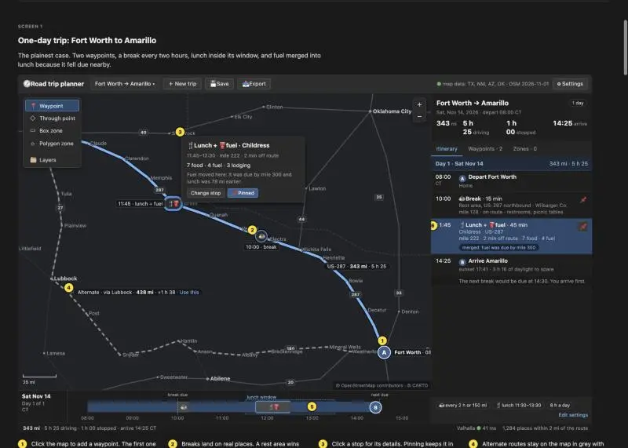

Mockup page renders. Checking each screen for layout bugs now.

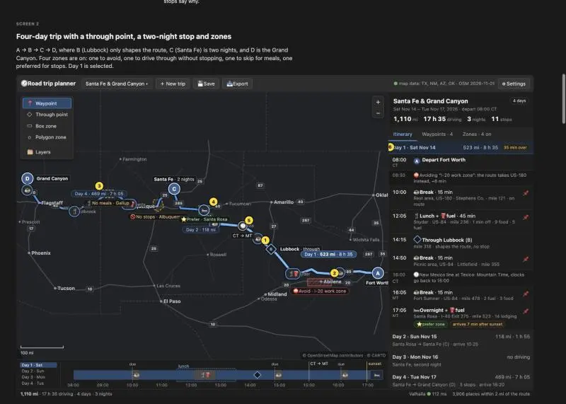

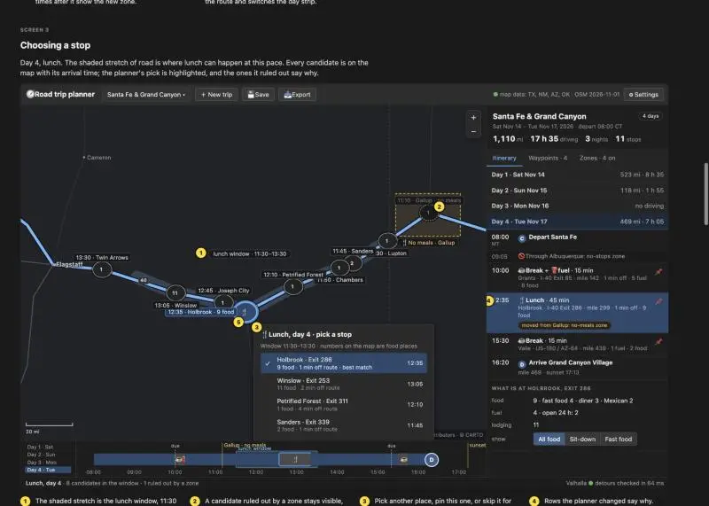

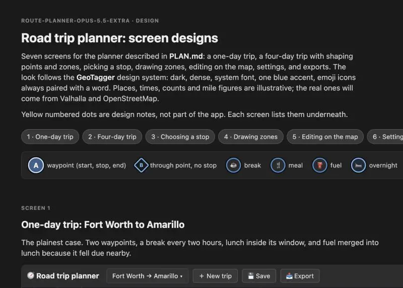

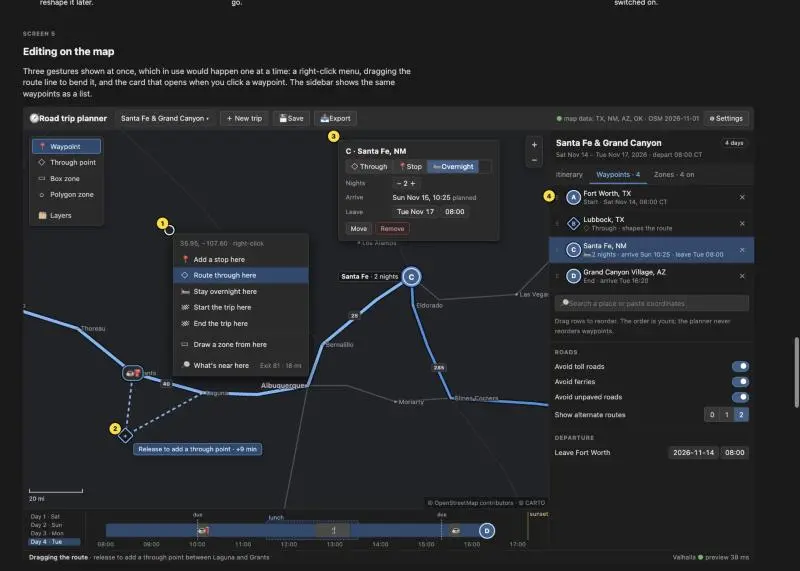

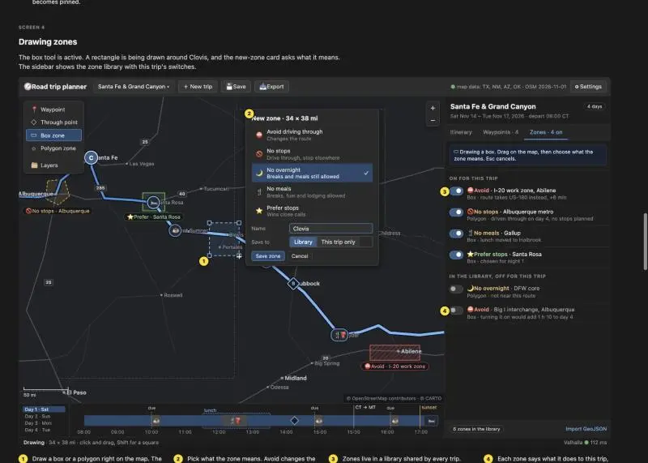

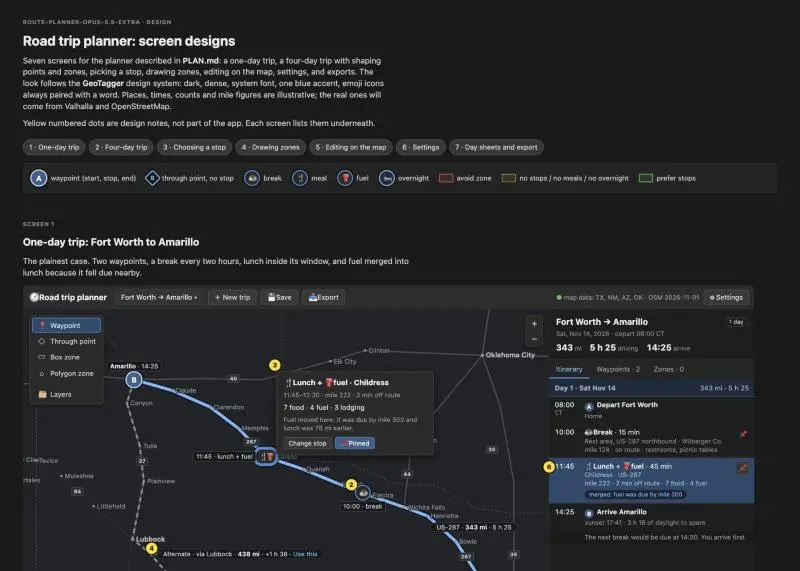

Fixing overlaps found in the screenshots; checking remaining screens.

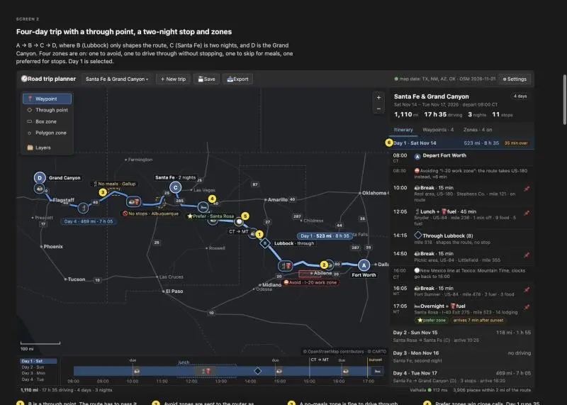

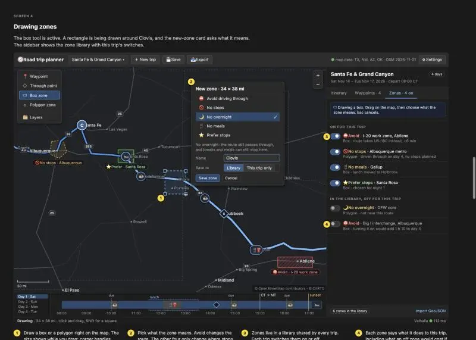

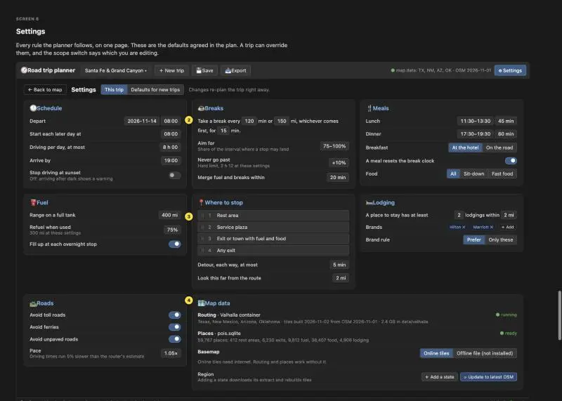

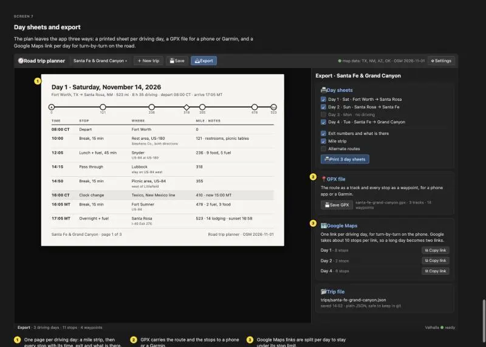

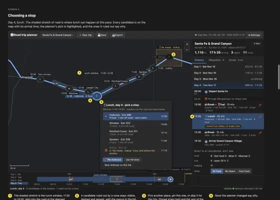

I've switched the plan to run in Docker and drawn seven screen designs. There's no app code yet, and nothing is committed.

**Design:** [design/index.html](design/index.html), also published as a private page you can open on your phone: https://claude.ai/artifact/RAsFQ7rvkGpxTDe4L2mzk7

It uses your GeoTagger design system: dark and dense, one blue accent, emoji icons always paired with a word. The places, times and counts are made up for illustration. Yellow numbered dots mark design notes, and each screen lists them underneath.

1. **One-day trip, Fort Worth → Amarillo:**
   - a break at a rest area;
   - lunch with fuel folded in, and the row says why;
   - an alternate route shown in grey;
   - a day strip under the map showing when each break is due.
2. **Four-day trip, A → B → C → D:**
   - Lubbock is a through point, Santa Fe is a two-night stop;
   - four zones are on: avoid, no stops, no meals, prefer stops;
   - a time-zone change at the New Mexico line gets its own row;
   - Day 1 runs 35 minutes over the 8-hour limit, with a warning saying why.
3. **Choosing a stop:** the lunch window is shaded on the road, and every candidate has an arrival time. Gallup is greyed out by its no-meals zone. You can pin a stop, pick another, or skip a place.
4. **Drawing zones:** a box is being drawn on the map, with a card to choose its type. The sidebar holds a zone library you switch on per trip, and each zone says what it costs this trip.
5. **Editing on the map:** a right-click menu, dragging the route line to add a through point, and the card for a waypoint (through / stop / overnight, number of nights).
6. **Settings:** all the agreed defaults as editable rules. A "Map data" card shows the state of the Docker services and the downloaded map data.
7. **Day sheets and export:** a printable sheet per driving day, a GPX file, and a Google Maps link per day.

**Plan:** [PLAN.md](PLAN.md) now uses Docker for everything, so nothing gets installed on your Mac except what's already there:
- **valhalla:** the official image (it has an ARM build for your Mac). It downloads the map extracts and builds the routing data on first start.
- **api:** the Python backend. It serves the browser page on `localhost:8000` and reloads when the code changes.
- **importer:** a one-off job that pulls rest areas, exits, fuel, food and lodging from the same map files.
- A `Makefile` wraps it all: `make up`, `make import`, `make test`.
- All data lives in a gitignored `data/` folder inside the project, not inside Docker's own disk.

Docker Desktop is set to about 8 GB of memory. That's enough for the four-state development area (Texas, New Mexico, Arizona, Oklahoma). Building the whole US later will need 16 GB or more.

## You

One small change - maybe Texas is the wrong state to use. Even though I live there, its big, so it will result in big datafiles. Maybe instead lets go with a slightly smaller state, but one that would have a reasonable number of stops for a multi-day trip. Maybe a sight seeing trip in Colorado?

## Claude

Plan updated. Now redrawing the seven screens around Colorado (Denver → Durango day trip, five-day Colorado loop).

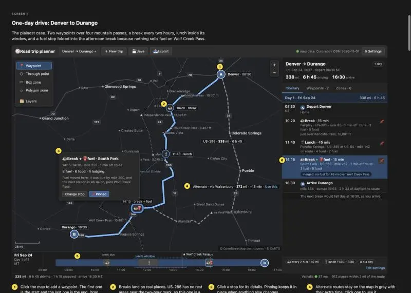

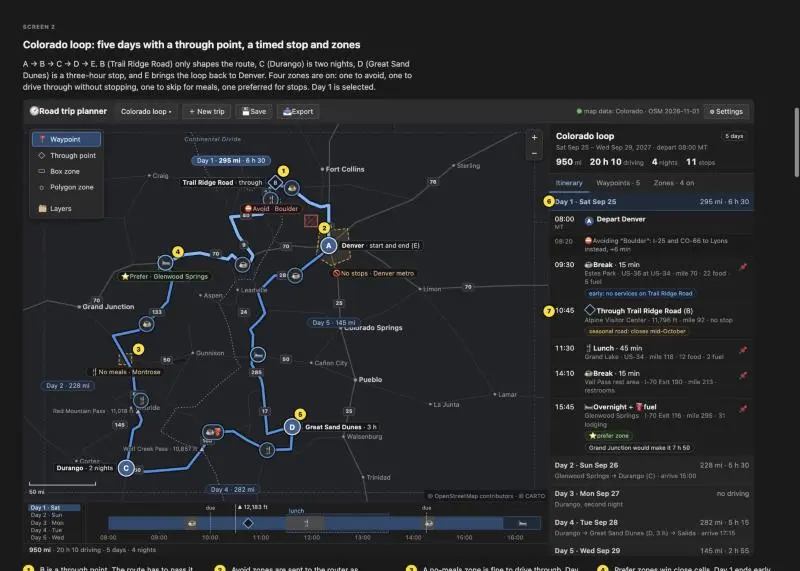

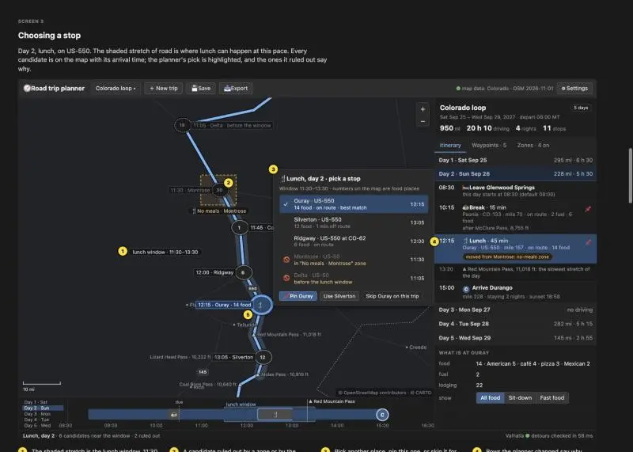

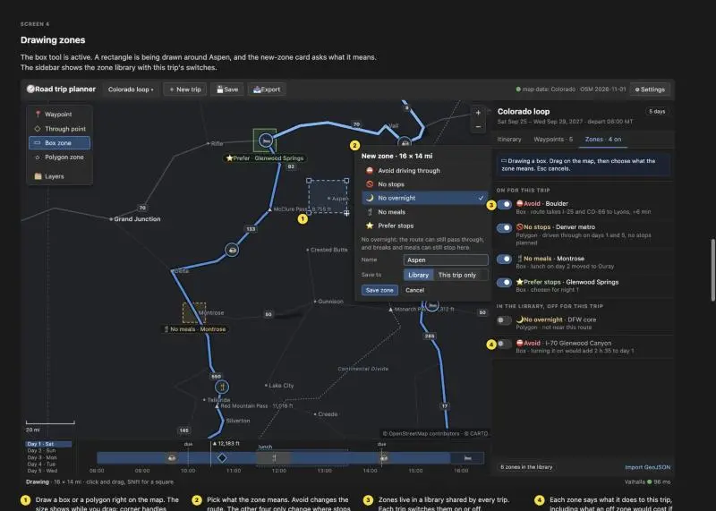

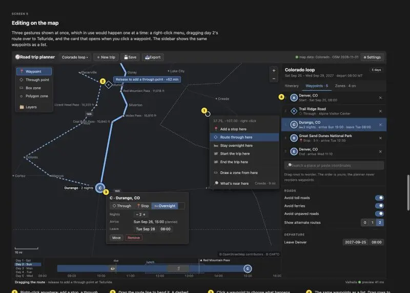

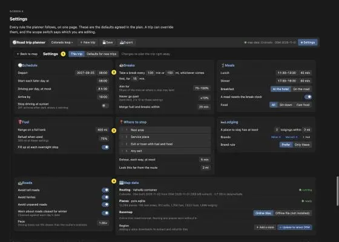

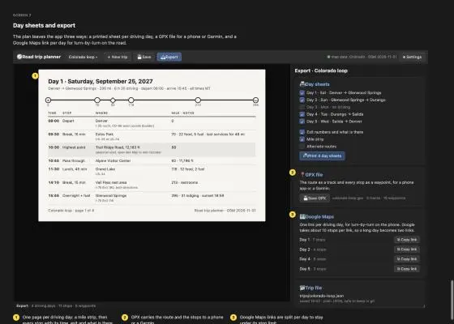

Screens redrawn and checked. Republishing the design page.

Switched the development region to Colorado. The map download is 369 MB, compared with 693 MB for Texas alone and 1.3 GB for the Texas, New Mexico, Arizona and Oklahoma set we had before.

**Example trips** (now in [PLAN.md](PLAN.md); the mockups, tests and README screenshots will all use them):
- **Denver → Durango, one day.** About 338 mi over Kenosha, Trout Creek, Poncha and Wolf Creek passes:
  - break at Fairplay;
  - lunch at Poncha Springs;
  - a break plus fuel at South Fork, because there's no fuel for 46 mi over Wolf Creek Pass.

  A grey alternate via I-25 and Walsenburg shows the extra time.
- **Colorado loop, five days** (Sep 25–29, 2027), about 950 mi:
  - **A Denver:** start.
  - **B Trail Ridge Road:** through point, pulls Day 1 over Rocky Mountain National Park instead of I-70.
  - **C Durango:** 2 nights.
  - **D Great Sand Dunes:** a 3-hour stop with no food on site, so lunch moves to Alamosa before it.
  - **E Denver:** end of the loop.
  - **Zones:** avoid Boulder, no stops in metro Denver, no meals in Montrose (lunch moves to Ouray), prefer Glenwood Springs for the first night. Aspen is the zone being drawn in screen 4.

**Mockups:** all seven screens are redrawn for these trips, in [design/index.html](design/index.html) and the same link as before: https://claude.ai/artifact/RAsFQ7rvkGpxTDe4L2mzk7
- The maps now show mountain passes with their elevations and the Continental Divide.
- The printed day sheet highlights the day's high point: Trail Ridge Road, 12,183 ft.

**What Colorado brings up:**
- **Roads closed for winter.** Trail Ridge Road and Independence Pass close in October or November. I set the loop in late September so they're open. The plan now flags these roads against the trip date, and Settings has a switch for the warning. The phase 0 test will check whether the Colorado map data marks the closures and whether Valhalla (the routing engine) respects them.
- **Mountain driving is slower than the map data assumes.** If the single 1.05× pace adjustment can't fit both I-70 and the Million Dollar Highway, the plan allows a second adjustment just for mountain roads.
- **No time-zone crossing.** Colorado is all Mountain Time, so that logic gets tested on made-up routes until there's a trip outside the state.

Phase 0, the first Docker test, now builds Colorado and routes Denver → Durango with Ouray as a through point and one avoid box.

## You

Alright. Lets start phase 0

I want each phase to be run in its own worker. It does not need to be Opus 5.5 Extra, a smaller model or smaller effort can be used as you see fit. At the end of each subworker, run the prompt-md script so we can get a sharable record of what each worker did.

## Claude

Phase 0 is running in its own session: [Route planner phase 0: Docker + Valhalla spike](#local_0aaa64df-0fa9-4ba6-a969-08b98974d400). It's on Sonnet 5.5 at high effort, since this phase is mostly Docker setup and testing.

- **Builds:** the Docker setup (the Valhalla routing container plus a basic Python API container), a `Makefile`, and a short README.
- **Tests on Colorado:**
  - Denver → Durango with and without the Ouray through point;
  - an avoid box on the route;
  - whether the map data marks Trail Ridge Road and Independence Pass as closed in winter, and whether Valhalla avoids them in January.
- **Writes up:** the measurements and findings in `notes/phase-0.md`, and changes to PLAN.md only where a fact turned out different.
- **Leaves alone:** it doesn't commit and doesn't touch your other uncommitted changes under `politics/`.
- **Record:** it finishes by running `scripts/prompt-md.sh` into `route-planner-opus-5.5-extra/prompts/phase-0/`. Each phase gets its own folder there, so the records don't overwrite each other's `prompt.md`.

When it finishes, I'll check its work before reporting back to you.

Phase 0 is still running. The Colorado map download was slow (about 66 of 369 MB when it last checked in), and Valhalla builds its routing data after that. The session should pick up again on its own once Valhalla is up, run the route tests, and then write its record. I'll check its work when it's done.

The Colorado map has finished downloading and Valhalla is now building its routing data from it. Phase 0 continues on its own once Valhalla reports healthy.

Phase 0 is done. Checking its work now: running the tests and the route test script, and fixing its record, which left out the brief I gave it.

Phase 0 is done and I checked it myself: `make test` passes (4 tests), `make spike` runs cleanly in about 45 s, and both containers are healthy. The phase's findings are in [notes/phase-0.md](route-planner-opus-5.5-extra/notes/phase-0.md) and its record is in [prompts/phase-0/prompt.md](route-planner-opus-5.5-extra/prompts/phase-0/prompt.md). Nothing is committed.

**What works**
- Valhalla 3.9.1 runs on your Mac. First start took about 10 minutes, mostly a slow download of the Colorado map; a restart takes 7 seconds.
- Colorado uses 1.5 GB of disk. Valhalla peaked at about 3.3 GB of memory while building and uses about 0.9 GB while running.
- Routing requests take 0.03 to 0.2 s, including alternates.
- Through points and avoid boxes both change the route as expected.
- The phase also raised Valhalla's limit on avoid-box size. The default only allowed a box about 2.5 km across, which is useless for zones drawn on a map.

**What changes the plan**
1. **Valhalla's driving times look much too slow on rural roads.** It has US-285 and US-160 averaging 36–38 mph, so it puts Denver → Durango via US-285 at 8:58. Google says about 6 hours for that drive, so this needs fixing before break planning means anything. The plan's single 1.05× pace setting won't cover a gap this size. I'd add a calibration step at the start of phase 1: find out why (missing speed limits in the map data, or Valhalla's built-in default speeds), then fix it in the config or with a separate adjustment per road type.
2. **The Denver → Durango example goes the wrong way.** Because of the slow US-285 times, Valhalla's fastest route is I-70, US-50 and US-550 (405 mi). That route already passes through Ouray, so the Ouray through point test showed nothing. A through point at Saguache, on US-285, does reshape the route. Once speeds are fixed, US-285 will probably win on its own, so I'd decide this after calibration.
3. **Winter closures are only half handled by Valhalla.** It closes Independence Pass on the right dates. It does not close Trail Ridge Road, because that road's dates are written in a format Valhalla doesn't read ("Oct 14th - May 31st"). The working approach the session found is to flag those roads during the phase 2 data import, then check each planned route against them and show the closure dates as a warning.
4. **A waypoint inside an avoid zone gives a vague error.** Valhalla just says "No path could be found". The check that names the zone, already in the plan, is needed.

I changed one file outside the project, `scripts/prompt-md.sh`. It was leaving out the brief a phase session gets, because that message doesn't come from you. It now includes it, so each phase's record starts with its task.

## You

Yes, start phase 1

## Claude

I'll review phase 1 when its session finishes and report back here: [Route planner phase 1: speed calibration + map UI](#local_ce4b9c65-9fc8-4a4c-8119-58efd5ca0d96).

Tests (45) and calibration check out. Fixing a small misattribution in the notes, then checking the UI in the browser.

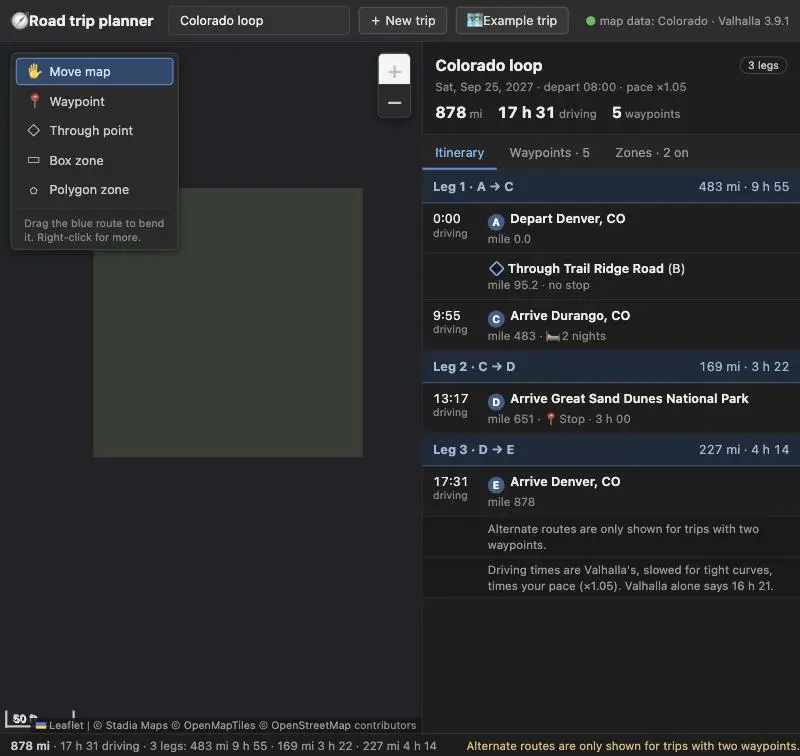

Map came up at full zoom in the hidden browser pane. Checking whether that's just the hidden pane or a real bug.

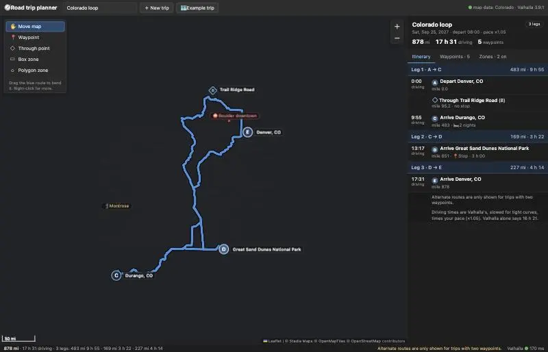

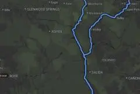

Phase 1 is done and I checked it. `make test` passes (45 tests), and `make calibrate` reproduces the speed table. The app loads at http://localhost:8000 with the Colorado loop on the map. Details are in [notes/phase-1.md](route-planner-opus-5.5-extra/notes/phase-1.md); the record, with 30 screenshots, is in [prompts/phase-1/prompt.md](route-planner-opus-5.5-extra/prompts/phase-1/prompt.md).

**Speed fix**
- **Cause:** the Valhalla image applies a built-in table of average speeds on top of the posted limits in the map data. Its Colorado-only extract also lacks the US country boundary, so it couldn't tell it was in the US and used its worldwide defaults: about 38 mph on US-285 where the posted limit is 65.
- **Fix, part 1:** that table is turned off, so Valhalla now uses the posted limits.
- **Fix, part 2:** a small Python correction slows the route down on tight curves. Without it, US-550 and Trail Ridge Road come out too fast at posted limits.
- **Result:** 8 of 9 Colorado reference drives land within 10% of published times. Denver → Durango now takes US-285 on its own, about 6 h 22 at your 1.05 pace. The one miss, Glenwood Springs → Ouray at −14%, is checked against a rounded "3.5 hours" from a tourism site.

**The map app**
- Waypoints: click to add, drag to move, reorder in a list, and a card to set each one to through / stop / overnight.
- A right-click menu, and dragging the route line to add a through point.
- Avoid zones as boxes or polygons. When a waypoint sits inside one, the error names the zone and the waypoint instead of Valhalla's bare message.
- Alternate routes, shown only when there are two waypoints, because Valhalla returns them only then. Picking one locks it in with a through point.
- The trip is kept in the browser, so a reload doesn't lose it.

**Surprises**
- CARTO's free dark map tiles now need an API key, so the app uses Stadia Maps' dark style instead. It needs no key on `localhost`, but it is very dark.
- Giving a departure date switches off Valhalla's alternates, so the app makes a second request without the date just for them.
- Clicks sometimes snapped through points to farm tracks hundreds of meters away, adding hours to the trip. Through points now only snap to proper roads.

**Two things I fixed or noticed while checking**
- The record script only picked up the brief when it was the very first text in the session. It now finds it anywhere in that first message, and I regenerated the phase 0 and phase 1 records.
- The notes credited the "about 6 hours on Google" Denver → Durango time to you. That figure was my own estimate from planning, so I relabeled it as unchecked.
- When the page loaded inside the hidden browser pane, the map started at maximum zoom. With a normal window it fits the trip correctly. It's a small robustness fix (re-fit once the map has a size), and I'll add it to the next phase's brief.

**Cost so far:** phase 0 was $1.68 on Sonnet 5.5, phase 1 was $16.45 on Opus 5.5. Phase 2 is mostly data plumbing: importing rest areas, exits, fuel, food, lodging and towns, plus the seasonal-road flags, then showing candidate stops along the route. Sonnet 5.5 at high effort should do.

## You

Start phase 2

## Claude

I'll review phase 2 when its session finishes and report back here: [Route planner phase 2: stop data and candidates](#local_6097cc37-97fb-4456-80b4-07c9d1e35820).

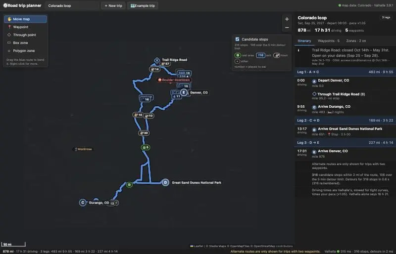

Phase 2 is done and I checked it: 109 tests pass, place search answers, and the app shows the Colorado loop with candidate stops and the Trail Ridge Road warning. Notes are in [notes/phase-2.md](route-planner-opus-5.5-extra/notes/phase-2.md), and the record (22 screenshots, $5.13 on Sonnet 5.5) is in [prompts/phase-2/prompt.md](route-planner-opus-5.5-extra/prompts/phase-2/prompt.md). Nothing is committed.

**What it built**
- **Importer:** `make import` builds `data/pois.sqlite` from the Colorado map data in about 16 seconds. It holds about 17,000 places (10,726 food, 1,985 fuel, 1,687 lodging, 1,332 exits, 46 rest areas), grouped into 1,739 candidate stops. It also flags 413 road segments marked as seasonal or closed by date.
- **Candidate stops:** the Colorado loop gets 316 stops within 2 mi of the route, each with its mile, its time along the trip and its detour. Detours for the whole loop take 3.6 s the first time, and after an edit only the changed stops are recalculated.
- **Direction check:**
  - **Edwards rest area on I-70:** 0.2 min eastbound but 6.7 min westbound, so detours really do depend on the direction of travel.
  - **Glenwood Canyon rest area:** can't be reached from the route at all.
- **Trail Ridge Road warning:** "closed Oct 14th – May 31st", judged against the trip's dates. In September it says open; in January it says closed.
- **On screen:** a "Candidate stops" layer you can toggle, a detail card when you click a stop, and place search in the Waypoints tab.

**Coverage:** OpenStreetMap is good enough for Colorado. Every town in the mockups is there with believable counts (Ouray has 15 food, 1 fuel, 26 lodging). The gaps are in the details: only 45% of lodging has a brand tagged, and only 13 of 46 rest areas say whether they have toilets.

**Settled for phase 3**
- **Detour limit:** phase 2 used 5 minutes there and back, so 106 of the 316 stops count as over the limit. The plan you agreed to says 5 minutes each way, which is 10 there and back. I'll have phase 3 use 10.
- **Glenwood Springs counts twice:** it shows up both as the town and as I-70 Exit 116, a mile apart. Phase 3 should treat stops a few miles apart as one choice.
- **Big unnamed clusters:** the outskirts of big cities come out as large groups named after the nearest hamlet ("Near Redmond", with 134 food places). That's fine for now, but phase 3 should split them if one gets picked as a stop.

Phase 3 is the core algorithm: choosing breaks and meals, pinning a stop and re-planning around it, plus the stop picker from screen 3. I'd run it on Opus 5.5, since it's the part you most want to read and get right.

## You

Start phase 3

## Claude

I'll review phase 3 when its session finishes and report back here: [Route planner phase 3: break planner and stop picker](#local_d93477e3-55de-4a6a-b182-acd171a3aed8).

Valhalla is using 6.5 of the 8 GB Docker has: 14 worker threads, each with a 1 GB tile cache. That explains the restart phase 3 saw. Capping it now.

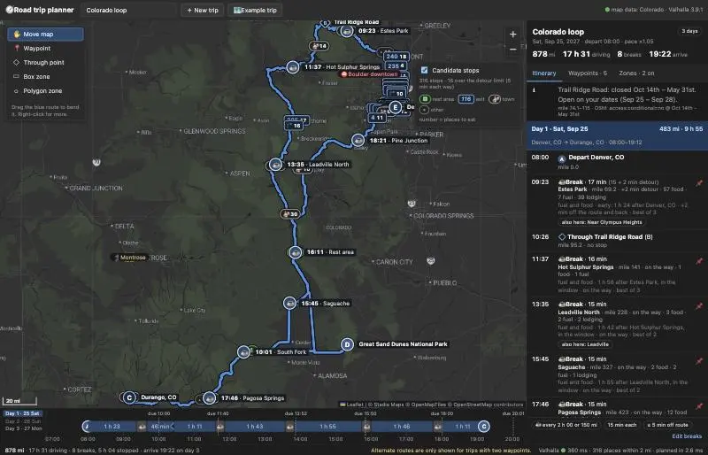

Phase 3 is done and I checked it: 150 tests pass, and the app shows the Colorado loop with breaks at real places, clock times, the day strip and the stop picker. Notes are in [notes/phase-3.md](route-planner-opus-5.5-extra/notes/phase-3.md); the record ($13.40 on Opus 5.5, 11 screenshots) is in [prompts/phase-3/prompt.md](route-planner-opus-5.5-extra/prompts/phase-3/prompt.md). Nothing is committed.

**What the planner does**
- **Denver → Durango:** three breaks, at Fairplay, Saguache and Pagosa Springs, each 1 h 38–1 h 46 after the last stop. Leaving at 08:00 gets you in at 15:07.
- **Colorado loop:** the first break is at Estes Park, early on purpose, because there's nothing on Trail Ridge Road. A timed stop like the 3 hours at Great Sand Dunes starts the break clock over.
- **Pin, skip, "use this one", or dragging a break marker:** all re-plan in 15–40 ms without asking Valhalla again.
- **Long empty stretches:** when nothing fits, it bends the rules a step at a time and warns, naming the stretch. For example: "no stop between South Fork and Near Treasure within 38 min; longest gap 46 min".
- **Detour limit:** now the agreed 5 minutes each way.
- **Readable code:** the algorithm is spelled out in plain words in the notes, and the planner code lives in a few small modules under `backend/app/planner/`.

**Fixed during review**

Valhalla was using 6.7 GB of the 8 GB Docker has, which is most likely why it restarted once during phase 3's tests. The image starts one worker thread per CPU (14 here), and each thread keeps a 1 GB tile cache. I set it to 4 threads with a 256 MB cache each, in `docker-compose.yml` and `valhalla/start.sh`. After a full test run it sits at about 2 GB, all 150 tests still pass, and the loop still plans in under 3 s from a cold start.

**For phase 4**
- **The loop's first day is 9 h 55 of driving.** Without a through point Valhalla takes the loop down US-285 and US-160 to Durango instead of over to Glenwood Springs and Ouray, as PLAN.md describes. Phase 4's automatic overnights and daily limit will split the day. I'd also add a through point at Ouray to the example loop so it follows the route in PLAN.md.
- **South Fork:** phase 3 picks Pagosa Springs rather than South Fork on cost alone. Fuel rules come in phase 4, and those are what should bring back South Fork as the last fuel before Wolf Creek Pass.

Phase 4 is the second big piece of the planner: meals, fuel, automatic overnights and daily limits, time zones, sunset, and the other zone types. I'd run it on Opus 5.5 again.

## You

All right, let’s work on phase 4

## Claude

I'll review phase 4 when its session finishes and report back here: [Route planner phase 4: days, meals, fuel and zones](#local_3f4e2441-07a1-4390-9200-d09f196986ae).

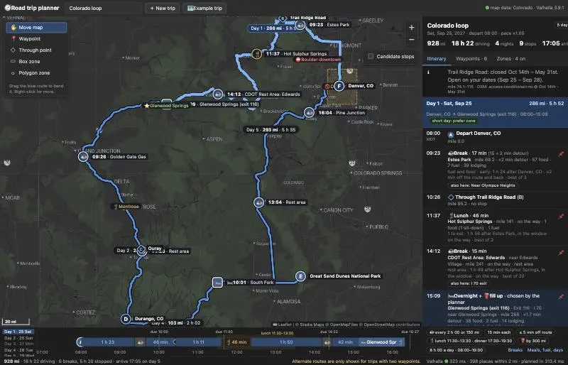

Phase 4 is done and I checked it: 200 tests pass, Valhalla has stayed up with no restarts at about 2.7 GB, and the app shows the five-day Colorado loop. Notes are in [notes/phase-4.md](route-planner-opus-5.5-extra/notes/phase-4.md), and the record ($15.05 on Opus 5.5, 19 screenshots) is in [prompts/phase-4/prompt.md](route-planner-opus-5.5-extra/prompts/phase-4/prompt.md). Nothing is committed.

**What the planner now does**
- **Overnights:** it picks where each day ends, only at places with at least 2 lodgings. It keeps the number of days to a minimum and evens out their length. Going over the 8 hours or arriving after 19:00 is allowed with a warning that says why and what the alternative was. "Stay here instead", pin and skip work for nights too.
- **Meals:** lunch and dinner fall inside their windows at places with food that matches the filter, and a meal resets the break clock. If you arrive at the hotel before or during the dinner window, dinner happens near the hotel. A timed stop that spans lunch, like the 3 hours at Great Sand Dunes, counts as lunch.
- **Fuel:** refuel by mile 300 and fill up at each overnight. The fuel stop merges into a nearby break or meal when one falls within 20 minutes.
- **Zones:** all five types work, and each zone says what it did ("moved from Saguache: no-meals zone", "driven through on days 1 and 5, no stops planned").
- **Clock and closures:**
  - Times are local wherever the stop is, with a row where the route crosses a time zone. Colorado has none, so that's proven with a made-up route across the Texas–New Mexico line.
  - Sunset is shown per day.
  - "Avoid this road" on a winter-closed road reroutes around it: Estes Park → Grand Lake in January goes over Berthoud Pass instead of Trail Ridge Road.

**On the example trips**
- **Denver → Durango:**
  - break at Fairplay;
  - lunch at Saguache;
  - break plus fuel at Pagosa Springs ("fuel was due by mile 300");
  - arrival at 15:37.
- **Colorado loop:** with the Ouray through point it now crosses the Western Slope. Day 1 ends at Glenwood Springs because of your prefer zone; without the zone it would stop at Eagle, the evener split.
- **Where it differs from the mockups:**
  - **Montrose:** the loop passes it around 10:40, before the lunch window, so the no-meals zone changes nothing on this trip. It does work when lunch would land there.
  - **Fuel:** no fuel stop on the loop at all, because every day is under 300 mi and each night fills the tank.
  - **Day 4:** only 2 hours, ending at South Fork. Durango → Great Sand Dunes → Denver in one day would arrive about 19:50, and the map data has almost no lodging along US-285 after the dunes.

**Cost so far:** $51.71 across the five phases.

Phase 5 is trip files, the shared zone library, the full settings page, and exports: day sheets, GPX, and Google Maps links per day. It's mostly UI and file handling, so I'd run it on Sonnet 5.5 at high effort.

Should I start phase 5 now, or do you want to change anything first?

## You

Start phase 5

## Claude

Phase 5 is running in [Route planner phase 5: trip files, settings, exports](#local_eecd4ac6-b90c-485f-b956-049833aaa1e1) on Sonnet 5.5 at high effort. I also gave it the "start from here, now" button: the plan's decisions call for using the app during a trip, and no earlier phase built it. I'll check its work when it finishes and report back here.

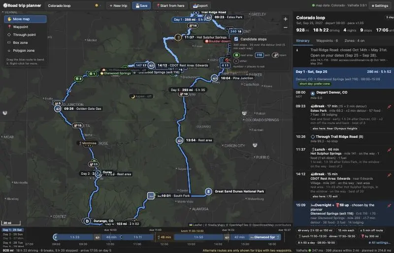

Phase 5 is done and I checked it: 300 tests pass, both containers have run with no restarts, and the app loads the Colorado loop with the zone library switched on. Notes are in [notes/phase-5.md](route-planner-opus-5.5-extra/notes/phase-5.md), and the record ($10.45 on Sonnet 5.5, 32 screenshots) is in [prompts/phase-5/prompt.md](route-planner-opus-5.5-extra/prompts/phase-5/prompt.md). Nothing is committed.

**What it built**
- **Trip files:**
  - Trips save as plain JSON in `trips/<name>.json`.
  - A trip picker in the toolbar shows a dot when there are unsaved changes, and asks before throwing them away.
  - The two example trips are committed in `examples/` with a "Copy to my trips" button.
  - A reload still keeps unsaved work.
- **Zone library:** shared zones are kept in `trips/zones.json`, and each trip switches them on or off. Zones can also belong to one trip only. "What would it do?" answers on request for zones that are off: turning on the I-70 Glenwood Canyon zone adds 29 min. GeoJSON import and export work.
- **Settings page:** one page edits every rule the planner reads, for this trip or as defaults for new trips. Five settings in the mockup weren't wired into the planner yet (stop-type order, search distance, lodging brands, closure warnings, "a meal resets the break clock"), so phase 5 wired them in.
- **Exports:**
  - **Day sheets:** a print-ready page per driving day. A test print to PDF gave four pages, one per driving day.
  - **GPX:** one track per day with every stop as a waypoint.
  - **Google Maps links:** one per day, split up to fit Google's waypoint limit.
- **Start from here:** uses your location, or a point you click on the route, as the new start with departure now. It drops what's already passed and keeps the rest.
- **README** now explains how to run it, and two leftovers from phase 4 are fixed: sunset is now worked out for each day's own date, and the hotel detour now counts toward the day's arrival time.

**Things to know**
- **Google's limit is small:** 3 waypoints per link on a phone browser, 9 on a computer, according to Google's Maps URLs docs. With the phone limit the loop needs 6 links over its 4 driving days. Google has no way to mark a through point as "don't stop", so through points show up as stops in Google Maps.
- **No highest point on the day sheets:** the Valhalla build has no elevation data.
- **Not tested on a phone:** "Use my position" hasn't been tried on one. The app also only runs on `localhost`, so a phone can't reach it as things stand.

**Cost so far:** about $62 across six phases (two on Opus 5.5 at $13–16 each, the rest on Sonnet 5.5).

**What's left**
- **Phase 6:** the full US. That's tens of GB of map data, and Docker would need 16 GB of memory or more. It's optional; the app is complete for Colorado.
- **Wrapping up:**
  - screenshots for the README;
  - the landing-page card in the `tools` section of `demos.js`;
  - a `prompt.md` for this planning session;
  - a commit. That commit would also include the fix to `scripts/prompt-md.sh`. I'd leave out your unrelated changes under `politics/` and the `watt-logo-variations/` folder.

## You

Wrap up now

## Claude

Taking screenshots for the README and landing card with a headless Chrome.

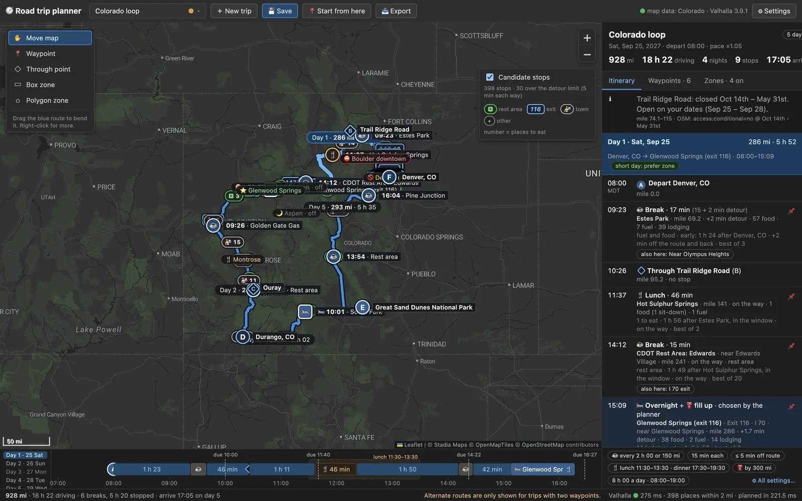

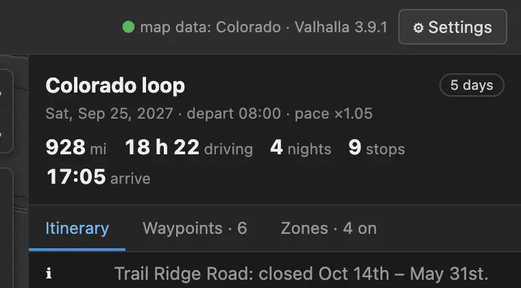

Screenshot done and a small sidebar overflow fixed. Making the landing-card and README images now.

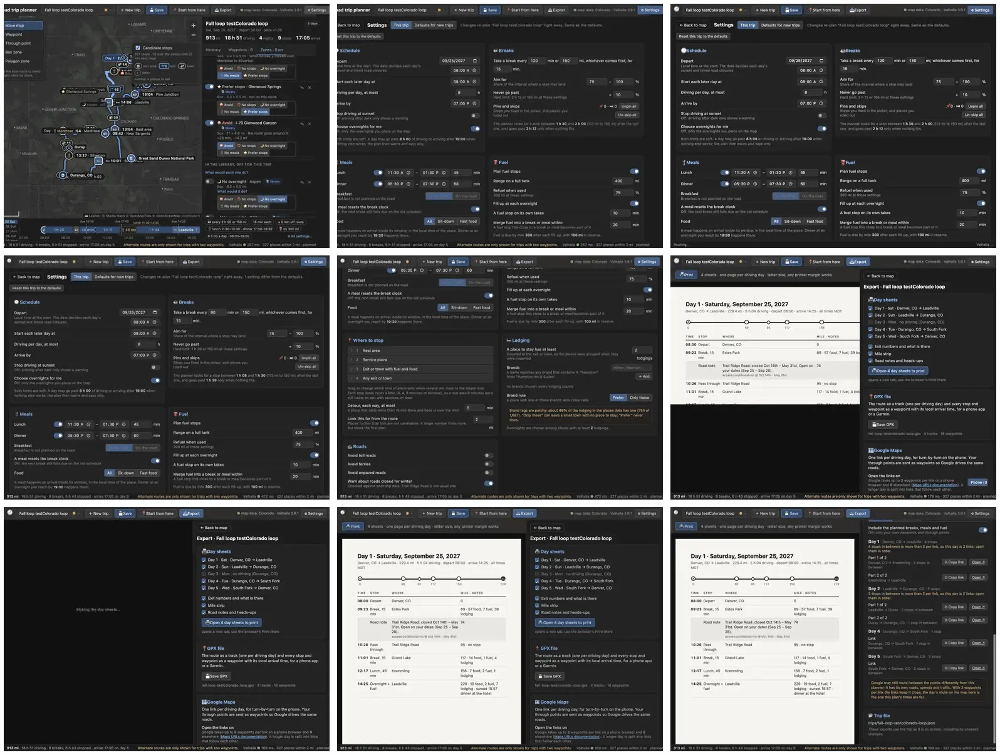

README and screenshots done. Writing this session's prompt.md, then the landing card.

The road trip planner is committed as `1efbc11` on a new local branch, `route-planner-opus-5.5-extra`. I branched rather than committing to master directly, so the commit doesn't land there without your OK. Nothing is pushed. Your changes under `politics/` and the `watt-logo-variations/` folder stay uncommitted and untouched.

**What's in the commit**
- **The whole project** (268 files, 5.6 MB). Map data and trip files stay out because they're gitignored.
- **README:** a screenshot of the Colorado loop plus three smaller ones (zone library, settings, export), how to run it, and a table of the six phases linking each one's notes and session record.
- **[prompt.md](route-planner-opus-5.5-extra/prompt.md)** for this planning session: your 10 prompts and 31 screenshots. It recorded Opus 5.5 at xhigh effort, $33.60.
- **Landing card** in the `tools` section of `demos.js`. It links the README, the prompt and the design mockups, with the image in `screenshots/projects/`. I checked that `demos.js` still loads, but couldn't check the card on the rendered landing page: the in-app browser opens local pages without running their scripts.
- **The fix to `scripts/prompt-md.sh`,** so a record from a session started by another session opens with its brief.

**Fixed while taking screenshots:** at normal window widths the sidebar's trip summary overflowed and cut off "5 days" and "arrive". The numbers now wrap onto a second line.

**Total cost:** about $96, of which $33.60 was this session and $62.16 the six phase sessions.

**Still running:** both Docker containers are up, with Valhalla using about 2.9 GB. `make down` in `route-planner-opus-5.5-extra/` stops them; the data stays in `data/` for the next `make up`.

## You

Yes, merge to master

## Claude

Master now includes the road trip planner (`1efbc11`), and I deleted the temporary branch. Master is one commit ahead of `origin/master` and nothing is pushed. Pushing master will trigger the GitHub Pages build and add the new card to the landing page. Your changes under `politics/` and the `watt-logo-variations/` folder are still uncommitted, as before.

## You

Please serve the app locally

## Claude

The app is running at http://localhost:8000, and I've opened it in the browser pane. You can also open that address in your own browser.

Valhalla and the places database were already up. `make up` restarted the API container, which answered again within a few seconds. Run `make down` in `route-planner-opus-5.5-extra/` when you want to stop it.

## You

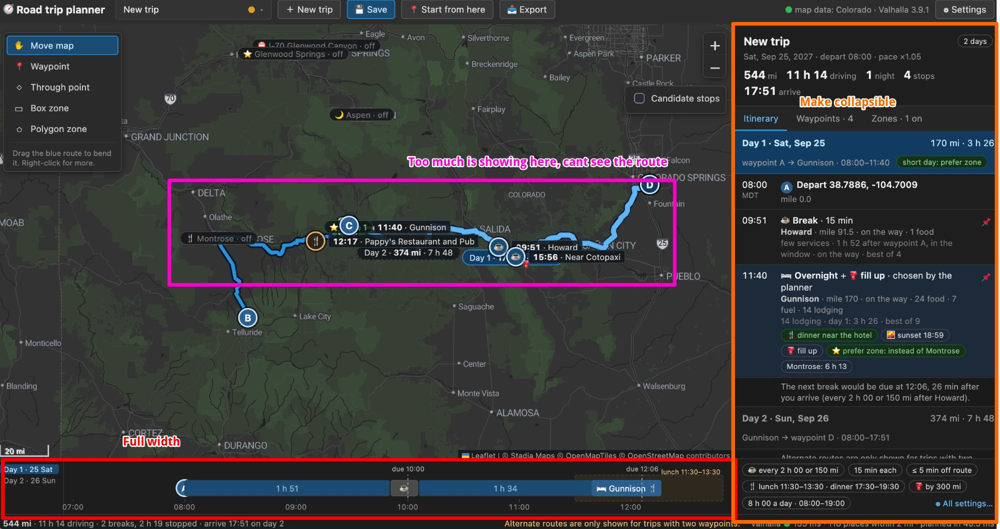

We need to make some visual updates. here are my annotations

## Claude

Making the three changes now: collapsible side panel, fewer overlapping map labels, full-width day strip.

Now the edits.

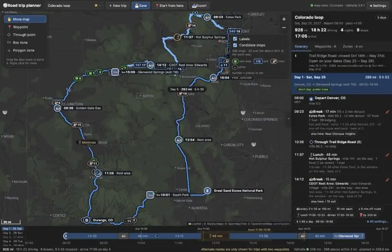

Changes are in; checking the panel toggle in the browser.

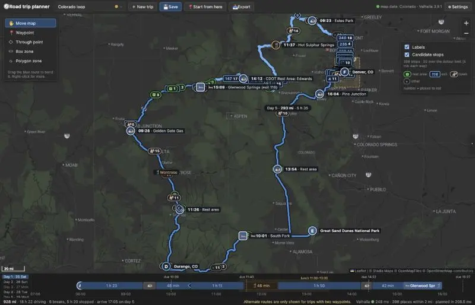
