# Prompts

- **Model:** claude-opus-5-5
- **Effort:** high
- **Session(s):** edb17435-ca4e-4d70-9d31-4ac236f0cbb6
- **Tokens:** input 360, output 184697, cache read 50205667, cache write 376790
- **Cost (tokscale estimate):** $16.75

## You

Background (from the session that started this one):
Project: an offline desktop road-trip planner in `route-planner-opus-5.5-extra/` inside the `ai-experiments` repo. It plans multi-day trips with breaks every N minutes / M miles, places stops at real rest areas, exits and towns, supports A→B→C→D routing with through points (shaping only), and supports zones drawn on the map (avoid / no stops / no meals / no overnight / prefer). The backend is Python, which the user wants to be able to read. Everything runs in Docker: `valhalla` (ghcr.io/valhalla/valhalla-scripted:3.9.1, Colorado tiles already built in `data/valhalla`, port 127.0.0.1:8002) and `api` (FastAPI, `uvicorn --reload` on the bind-mounted `backend/`, port 127.0.0.1:8000). Both containers are up and healthy now. The frontend is plain HTML/CSS/JS with Leaflet and Leaflet-Geoman, no build step, served by the api, styled after the user's GeoTagger design system (dark, dense, system font, one blue accent, emoji icons always paired with a word). Read `route-planner-opus-5.5-extra/PLAN.md` (decisions, architecture, phases), `route-planner-opus-5.5-extra/notes/phase-0.md` (what phase 0 built and found) and the mockups in `route-planner-opus-5.5-extra/design/index.html` (screens 1, 2 and 5 matter most here). Phase 0 found: Valhalla's times on rural two-lane roads look far too slow. US-285 and US-160 average 36–38 mph, which puts Denver → Durango via US-285 at 8:58 where Google Maps says about 6 hours (338 mi). As a result the fastest route goes I-70/US-50/US-550 instead. Phase 0 also found that a waypoint inside an exclusion polygon returns a bare error 442, and that exclusion limits had to be raised (`valhalla/start.sh`). Each phase runs in its own session and leaves a record under `route-planner-opus-5.5-extra/prompts/phase-N/`. This is phase 1 of 6.

Task:
Do phase 1 of `route-planner-opus-5.5-extra/PLAN.md`, with a speed calibration step added at the start. Read PLAN.md, `notes/phase-0.md` and `design/index.html` first.

## Part A: speed calibration (do this first)

Valhalla's drive times have to be believable before break planning (phase 3) means anything.

1. Find out why rural highways are slow. Use `/trace_attributes` with `edge.speed`, `edge.speed_type` (or whatever Valhalla 3.9.1 exposes; check the docs), `edge.road_class`, `edge.way_id` and `edge.names` on Denver → Durango via US-285 (put a through point at Saguache). Check, with pyosmium in the api container, which of those ways carry `maxspeed` in OSM. Check whether the scripted image builds with a `default_speeds_config` (`data/valhalla/default_speeds.json`) and what it says for rural primary and secondary roads. Look at the costing options too (`top_speed`, `fixed_speed`, turn penalties) and what `date_time` does to speeds.
2. Build a small reference set of 5–8 Colorado drives with real-world times: Denver → Durango via US-285, Denver → Grand Junction via I-70, Denver → Estes Park, Glenwood Springs → Durango via US-550, Alamosa → Salida, Durango → Pagosa Springs, and similar. Look the times up (web search is fine) and note the source. Compare them with Valhalla's.
3. Fix it at the right layer, in this order of preference: a Valhalla build or config setting (rebuilding tiles from the local PBF takes about 2 minutes; the download is already done), then a costing option, then a planner-side correction by road class in Python. Pick whatever gets most of the reference set within about 10% and keeps the code readable. Keep the plan's single user-facing pace multiplier on top of that.
4. Write `backend/spikes/calibration.py` (run with `make calibrate`) that prints the reference table, before and after. Then re-check Denver → Durango: does the default route now take US-285? Update the PLAN.md Example trips text to match reality, and fix the stale phase 0 line that says Ouray pulls the route onto US-550.

## Part B: map and routing

Build what PLAN.md phase 1 lists, following the mockups (screens 1, 2 and 5) for layout and look:

- **Layout:** top toolbar, Leaflet map, right sidebar (tabs: Itinerary, Waypoints, Zones), status bar. Leave the day strip out for now. Basemap: online CARTO dark raster tiles with attribution. Vendor Leaflet and Leaflet-Geoman as pinned files in `frontend/vendor/`, so nothing loads from a CDN at runtime except tiles.
- **Waypoints:**
  - Click the map (Waypoint tool) to add one; drag to move.
  - The Waypoints tab lists them in order, with drag to reorder and ✕ to remove, plus a box that accepts pasted coordinates. Place-name search comes in phase 2, when there is a places table.
  - Clicking a waypoint opens a card to set its type: through, stop with minutes, or overnight with nights. These map to Valhalla `through` / `break` locations. The minutes and nights are only stored for now.
- **Editing on the map:**
  - Right-click menu: add a stop / through point / overnight here, make this the start or end, draw a zone from here, and show the coordinates.
  - Drag the route line to insert a through point into the right leg, with a dashed preview while dragging.
- **Avoid zones:**
  - Draw rectangles and polygons with Geoman, and edit or delete them.
  - Store them with a type field already, but only `avoid` does anything in this phase (other types come in phase 4).
  - Before routing, the API checks whether any waypoint sits inside an avoid zone. If one does, it returns an error naming the zone and the waypoint, never Valhalla's bare 442.
  - Reject zones larger than the raised Valhalla limits, with a clear message.
- **Route display:**
  - Show the route with distance and time per leg and in total, in the sidebar and the status bar.
  - Road options: avoid tolls / ferries / unpaved.
  - Alternate routes in grey, with their extra time, when the trip has exactly two waypoints (check whether Valhalla supports alternates with more). Clicking an alternate adopts it by adding a through point at a point that only that alternate passes, so the choice survives later edits.
- **API:** a `POST /api/route` that takes the trip's waypoints, zones and options and returns GeoJSON geometry, per-leg summaries, alternates and warnings. Keep the Python readable: small modules, as in the PLAN.md layout (`valhalla.py`, `geometry.py`, `zones.py`, …).
- **State:** keep the current trip in the browser, and save it to `localStorage` so a reload keeps it. Trip files come in phase 5.
- **Seed:** load the Colorado loop from PLAN.md (Example trips) as the starting trip when nothing is saved. Waypoints only; zones are optional.
- **Tests:** pytest for the request building, the zone pre-check and the type mapping, with Valhalla mocked, plus an integration test against the running Valhalla that skips when it is down. `make test` runs them.

Verify in the browser at http://localhost:8000 (the built-in browser can open localhost). Exercise each interaction, and take screenshots of:
- the Colorado loop;
- a drag-to-insert in progress;
- the waypoint card;
- an avoid zone changing the route;
- the zone-holds-a-waypoint error.

Those screenshots become part of the phase record.

## Write up

- `notes/phase-1.md`: the calibration findings and fix (with the before/after table), what was built, what is left, and anything phases 2–5 should know.
- Update PLAN.md where facts changed: the speed handling, the example trips, the phase 0 line. Don't rewrite it.

## Rules

- Do not commit, branch or push. Leave every change in the working tree. This checkout is shared, and it has unrelated uncommitted changes under `politics/`; do not touch or stage them.
- Edit only inside `route-planner-opus-5.5-extra/`, apart from the record step.
- Install nothing on the host. Python deps go in the api image. Downloading the vendored JS files into the project is fine.
- Leave the containers running at the end.

## Done when

- Calibration puts most reference drives within about 10%.
- The UI does every interaction listed above in the browser.
- `make test` passes, and the notes exist.

## Last step: record

After your final summary, run from the repo root:

```bash
mkdir -p route-planner-opus-5.5-extra/prompts/phase-1
scripts/prompt-md.sh route-planner-opus-5.5-extra/prompts/phase-1 <your-session-id>
```

Your session id is the last path component of your scratchpad directory; pass it explicitly, since other sessions share this repo. Check that the output covers only this session, includes your screenshots, and says whether the cost is available. Then end with a short report: done or not, the calibration result, surprises, and what phase 2 needs to know.

Shared notes folder for this group of sessions (outside the repo; read siblings' notes there, leave hand-over notes or large findings there instead of pasting them into messages): /Users/danwatt/Library/Application Support/Claude/side-session-notes/local_e3f2f033-dc70-46e4-b2e2-53821eaee896

## Claude

Reading mockup screens 1, 2, 5 next, then speed diagnosis.

Speed table found (CO rural secondary = 60 km/h). Now tracing US-285 edges.

Found it: almost every US-285/160 way has `maxspeed` (50–65 mph) but Valhalla uses flat class speeds (trunk 62 km/h). Checking Valhalla source for why.

Checking build log: did default speeds load?

Tile itself stores 62 km/h for a 65 mph trunk. Reading SpeedTable parsing.

Root cause narrowing: tiles match the *global* fallback table (rural trunk 62), so the US/CO lookup failed. Checking admin DB codes.

Reference times gathered (fuzzy, mostly aggregators citing Google). Simulating speed models on fixed routes before rebuilding tiles.

Simulation: both fixing the admin lookup (CO table) and using tagged `maxspeed` fix US-285/160 (+3–4%); mountain US-550 stays too fast. Checking image build options.

Writing `calibration.py` skeleton now so "before" numbers are measured on the current tiles, then rebuilding.

Now editing compose, start.sh, Makefile for the speed fix.

While tiles rebuild: vendoring Leaflet 1.9.4 and Geoman.

Rebuilt in ~70 s; US-285 edge now 105 km/h tagged. Running calibration.

Big improvement: 7 of 9 within 10% with pace. Mountain roads (US-550, Glenwood→Ouray) still 15–18% fast. Prototyping a curve-speed correction.

Curve cap (25 m steps, ±50 m window, 1.5 m/s² lateral) gives 8/9 within 10% with pace. Checking `date_time` and costing effects, and alternates with >2 locations.

Limits are summed over all polygons (length and vertex count). Now writing the backend.

Calibration: 8 of 9 within 10%. Now models, zones, routing, API.

API works on the Colorado loop (878 mi, 3 legs, positions for drag-insert). Now the frontend: HTML/CSS first.

Now the stylesheet, using the mockup's GeoTagger tokens.

Now JS: state + API + seed.

Now `map.js` (markers, route, drag-insert, context menu, Geoman zones, cards).

Now `sidebar.js`.

Now `app.js` glue.

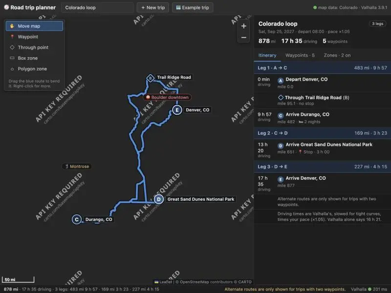

CARTO tiles carry an "API KEY REQUIRED" watermark. Investigating.


CARTO raster tiles now need an API key (watermark on every tile). Testing keyless dark alternatives.

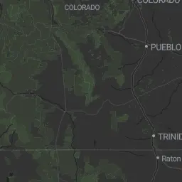

Stadia's `alidade_smooth_dark` works keyless on localhost. Switching basemap, noting CARTO's key requirement.

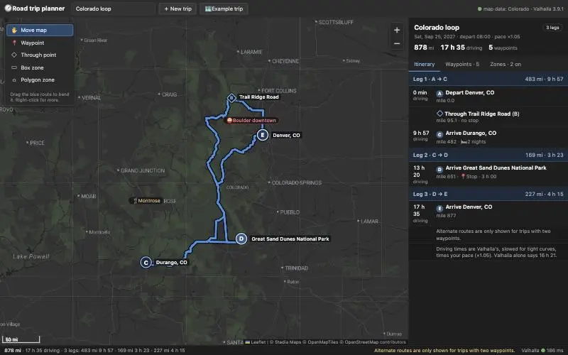

Map loads with Stadia dark tiles and the Colorado loop. Tightening the time column, then exercising interactions.

Now testing the waypoint card (click C · Durango marker).

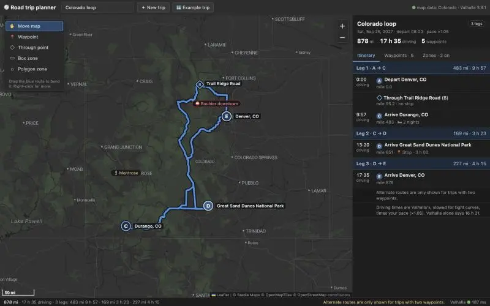

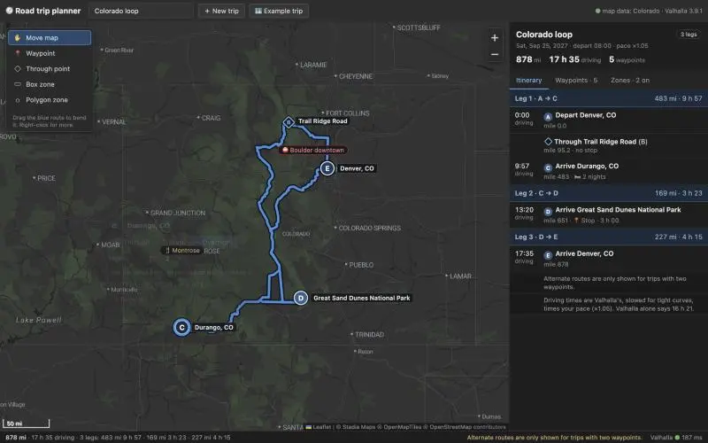

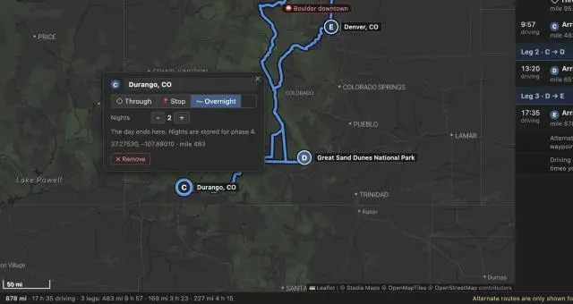

Card works. Switching C to Stop, then back to Overnight.

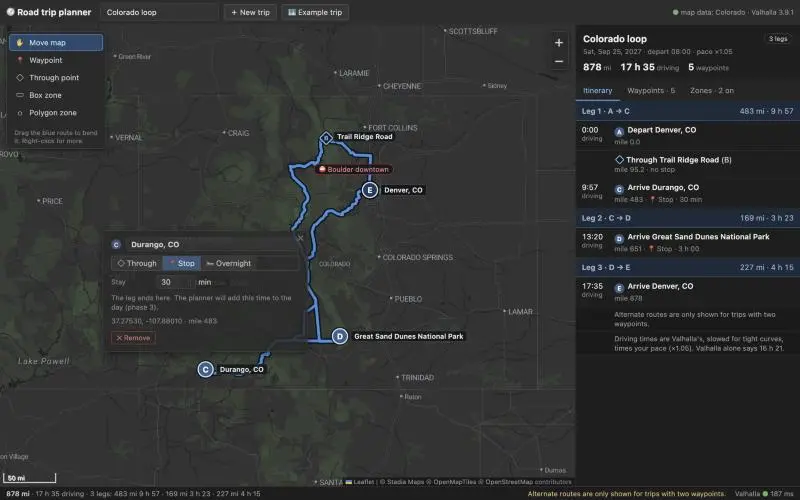


Debugging popup clicks: popup vanishes from DOM after a click. Checking.


Cause: card re-renders on click, the clicked button detaches, Leaflet treats the click as a map click and closes the popup. Fix: stop click bubbling at the popup.

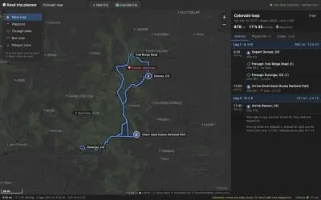

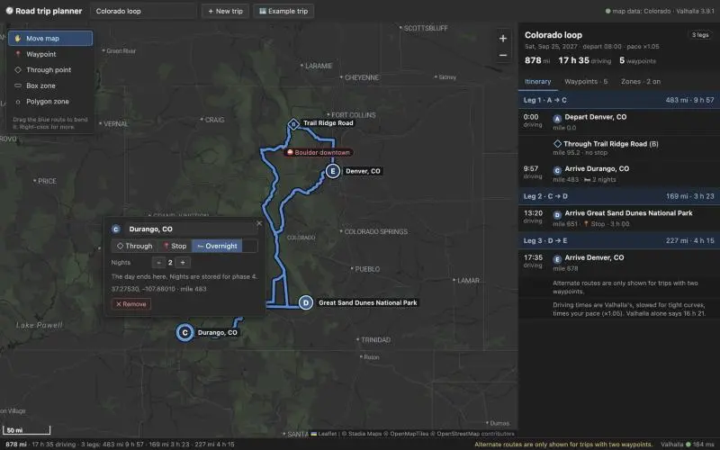

Card confirmed working (screenshot above). Now simulating a route drag mid-gesture for the screenshot.

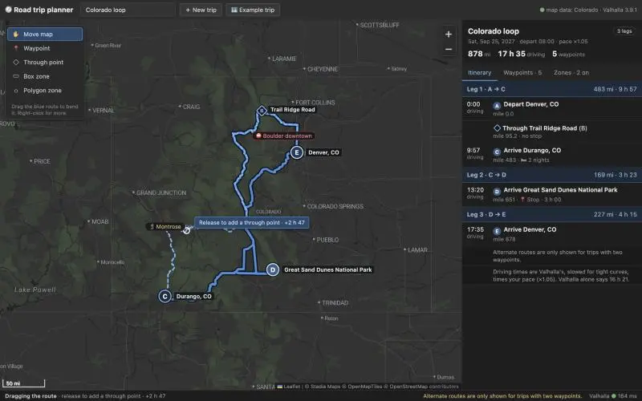

Drag preview works (dashed real-road ghost, "+2 h 47" tip). Releasing to insert.

Inserted into leg A→C as expected. Now right-click menu.

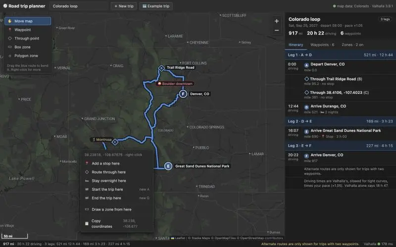

Menu works. Testing "Draw a zone from here" (first corner = right-click point).

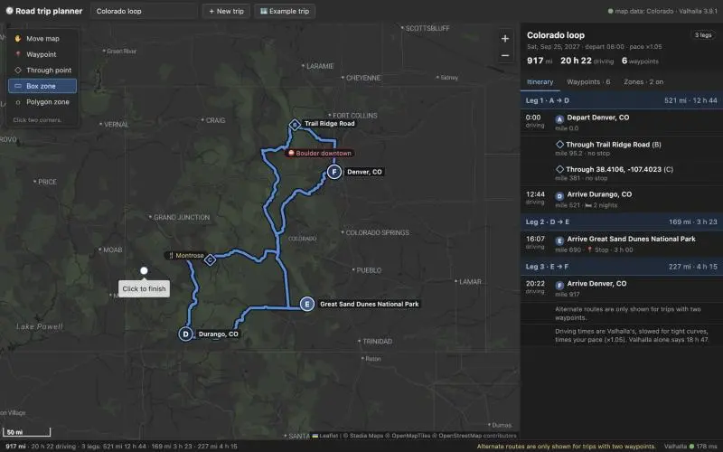

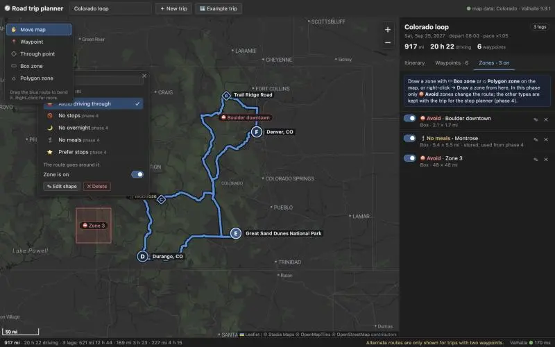

Zone drawn from the right-click corner. Deleting it, then testing a 2-waypoint trip via paste (alternates).

Now adding Durango with the Waypoint tool (map click).

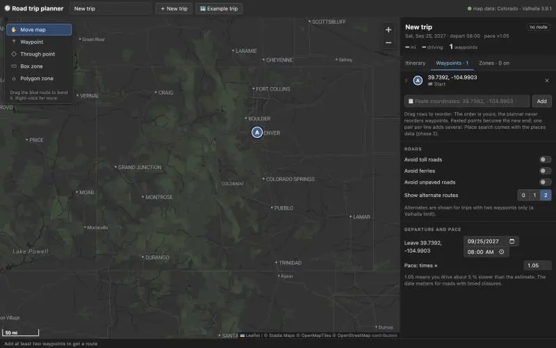

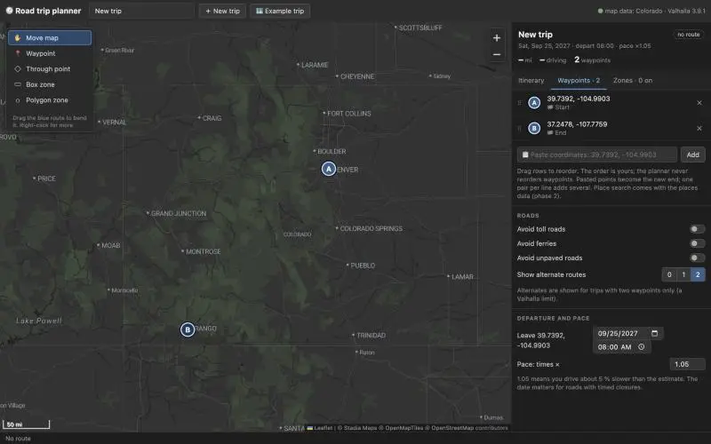

Two waypoints but "No route". Checking network.

Route arrives (330 mi, 6:17) but no alternates. Testing whether `date_time` suppresses them.

Valhalla drops alternates whenever `date_time` is set (time-dependent search). Fix: for 2-waypoint trips with a departure, ask alternates in a second, undated request.

Alternates back (+20 min via I-70, +18 min via I-25). Reloading browser.

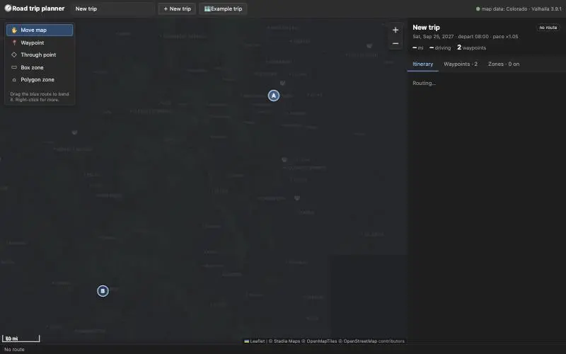

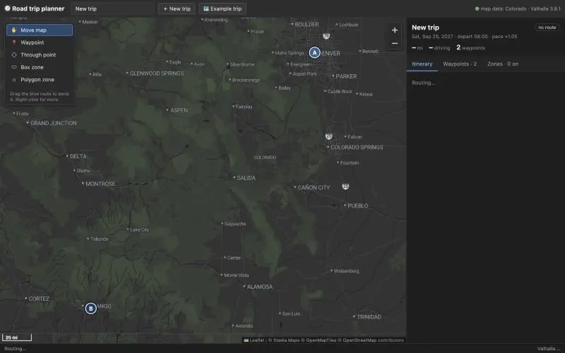

Pane is hidden, so timers are throttled; not an app issue. Screenshotting alternates.

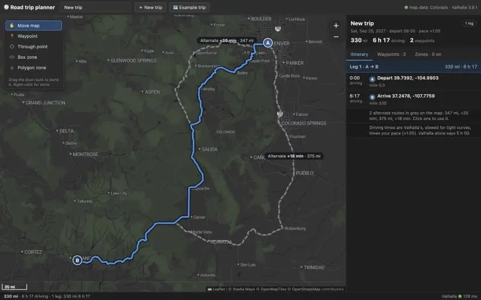

Alternates render in grey with extra time. Now drawing an avoid box over US-285 near Bailey/Kenosha Pass.

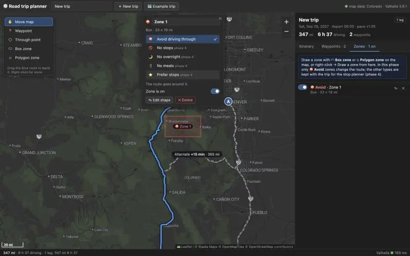

Avoid box moved the route onto I-70/CO-9 (347 mi, 6:37). Naming the zone and taking a clean screenshot.

Zone name lost: the card re-rendered (route arrival) while typing. Fix: don't rebuild the card while focus is inside it.

Still debugging the zone-name field with real typing.

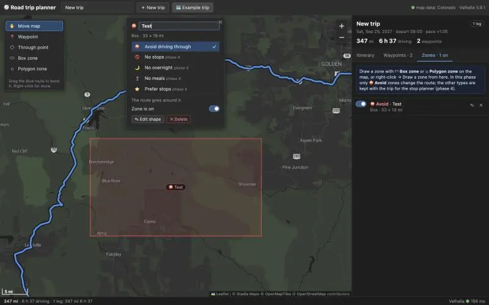

Zone name saves. Reloading for a clean "avoid zone changes route" screenshot.

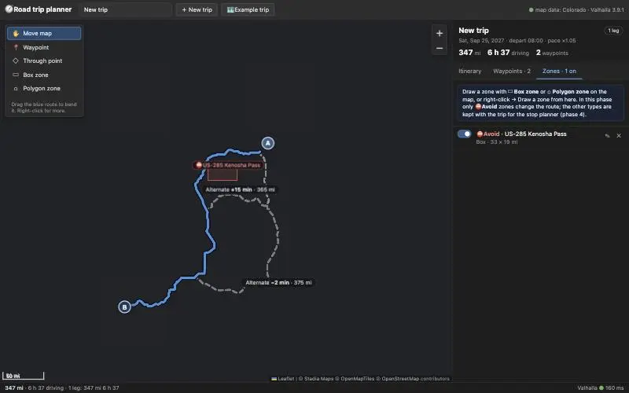

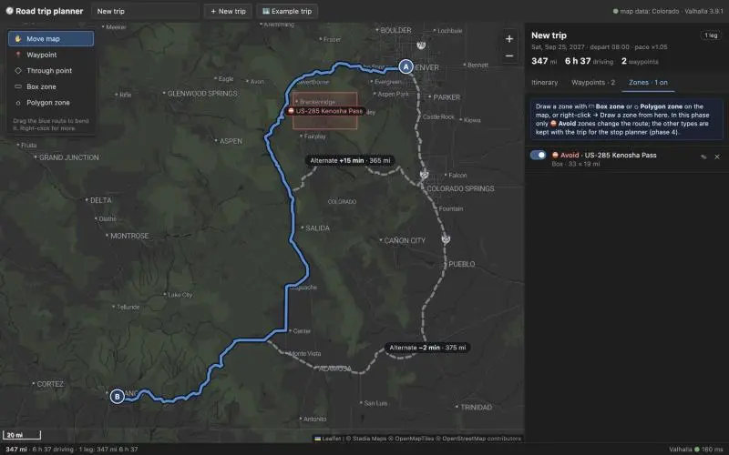

Avoid zone screenshot captured. Now adopting the I-25 alternate by clicking its chip.

Alternate adopted via a through point near Walsenburg (375 mi, matches). Next: avoid zone around waypoint B for the error case.

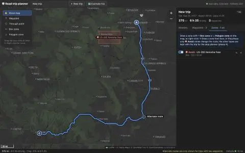

Drawing a polygon avoid zone around Durango (also tests the polygon tool).

Error names zone and waypoint. Screenshot:

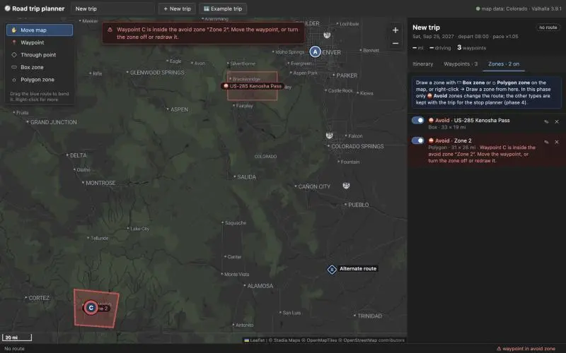

Error screenshot done. Now dragging marker C out of the zone (marker drag).

Marker drag works, error clears. Testing list reorder (drag rows), remove, road toggles, zone toggle/edit/delete via the UI handlers.

Reorder, remove and road options work. Loading the example trip to test zone toggle/edit/delete.

Edit mode shows 4 vertex handles. Dragging one corner.

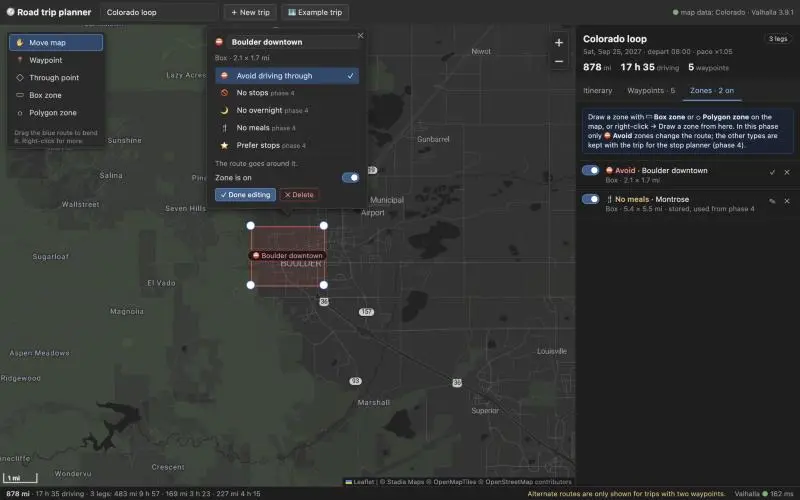

Zone edit persists. Testing delete, then restoring the example trip.

Quick check of Through-point tool and menu "Add a stop here".

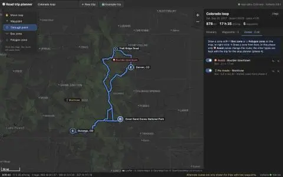

Through tool inserted into the right leg, but the leg became 314 mi / 12 h 17, suspiciously slow. Checking.

Point snapped to a 2 km/h farm track 600 m away. For through points (shaping only), I'll restrict snapping to residential-class roads and up via Valhalla's `search_filter`.

Through point now 5:45 instead of 12 h. Writing tests.

Edge bug in curve detection: at a maneuver's first sample the "previous heading" is undefined and reads as a 90° bend. Fixing, then recalibrating.

45 tests pass. Final Colorado loop screenshot with example trip restored.

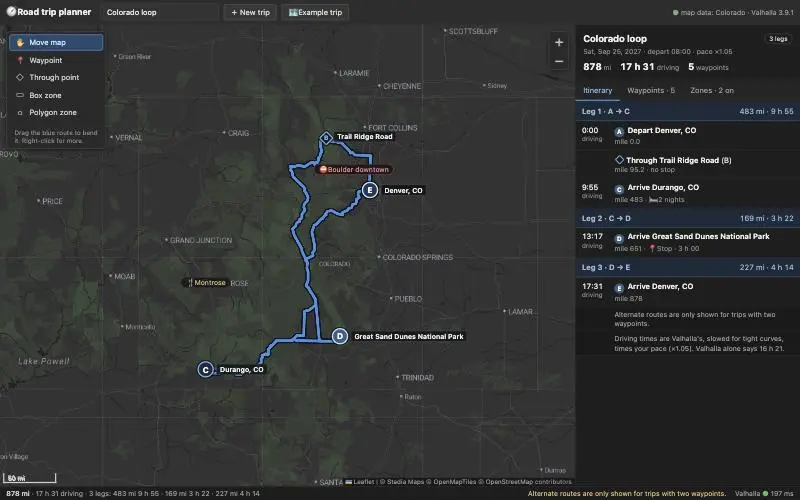

Colorado loop screenshot done. Resetting viewport, small CSS fix, then write-up.

Writing `notes/phase-1.md`.

Now PLAN.md updates (targeted edits only).

Valhalla container still carries `force_rebuild=True` from the rebuild; a restart would rebuild again. Making `make rebuild-tiles` finish the job itself, then recreating.

Shell checker tripped on `$$` in the heredoc. Using Edit instead.

Phase 1 is done and everything is left uncommitted in `route-planner-opus-5.5-extra/`; I didn't touch `politics/`. Calibration puts 8 of 9 reference drives within 10%, every listed interaction works in the browser, `make test` passes (45 tests), and both containers are still running.

**Calibration**
- **Why rural roads were slow:** the Valhalla image builds with a table of speeds per road class, and that table replaces every road's speed, even where OSM tags a speed limit (`maxspeed`). On top of that, the Colorado extract has no US country boundary, so Valhalla's admin database comes out empty. The lookup then falls back to the world row of the table, which puts US-285 at 62 km/h even though OSM tags it 50–65 mph.
- **Fix at the build layer:** the table is switched off, so speeds now come from the OSM speed limits. New `make rebuild-tiles` (the rebuild took about 70 s).
- **Fix in Python:** `speeds.py` slows the route in tight curves based on the curve radius. Then the 1.05 pace applies. This only changes times, not which route Valhalla picks.
- **Result (`make calibrate`):** 8 of 9 within 10%. The miss is Glenwood Springs → Ouray at −14%, and its reference is a round "3.5 hours" from a visitor site. US-550 sits right at −10%.
- **Denver → Durango:** the default route now takes US-285: 337 mi, about 6:20 with the curve correction and pace. The I-25/Walsenburg alternate is about 20 min longer.
- **Plan updates:** the Example trips text and the stale phase 0 line in `PLAN.md` are fixed. Ouray now really does pull the route onto US-550.

**Surprises**
- **Basemap:** CARTO raster tiles now need an API key; every tile shows an "API KEY REQUIRED" watermark. I used Stadia's dark tiles instead, which load without a key from localhost. If the app is ever served from another host, Stadia will need a key too.
- **Alternates:** Valhalla returns none when the request has a departure date. For two-waypoint trips with a date, the API makes a second, undated request just for the alternates.
- **Through points:** a click near a farm track snapped onto it (2 km/h) and added 8 hours. Through points now only snap to residential-class roads or bigger.

**What phase 2 needs to know**
- Valhalla's admin info is empty for a single-state extract, so don't rely on it for state or country data.
- `/trace_attributes` needs the route cut into chunks under 200 km, and `map_snap` works where `edge_walk` failed.
- `/api/route` returns `waypoint_positions` on the route line; candidate stops can be projected onto the same line.
- Use `speeds.leg_seconds` so the break planner's clock matches the sidebar.
- For phase 6, keep the speed table off. A full-US extract has the country boundary, so the table would come back and override speed limits everywhere.

**Record:** `prompts/phase-1/prompt.md` covers only this session, includes 32 screenshots, and the cost is available ($16.45). The phase 1 task message is missing from it: the transcript starts at my first reply, probably because the task came from another session.

Full findings, the before/after table and the hand-over notes are in `notes/phase-1.md`.
