# Prompts

- **Model:** claude-sonnet-5-5
- **Effort:** high
- **Session(s):** 3e098900-f643-45a2-bef1-2cc4c108bebe
- **Tokens:** input 196, output 143462, cache read 24937878, cache write 301466
- **Cost (tokscale estimate):** $5.13

## You

Background (from the session that started this one):
Project: an offline desktop road-trip planner in `route-planner-opus-5.5-extra/` inside the `ai-experiments` repo. It plans multi-day trips with breaks every N minutes / M miles and puts stops at real rest areas, exits and towns. It supports A→B→C→D routing with through points and zones drawn on the map. The backend is Python, which the user wants to be able to read.

Everything runs in Docker: `valhalla` (valhalla-scripted 3.9.1, Colorado tiles in `data/valhalla`, 127.0.0.1:8002) and `api` (FastAPI, `uvicorn --reload` on the bind-mounted `backend/`, 127.0.0.1:8000, also serves the plain HTML/JS Leaflet frontend in `frontend/`). Both are up and healthy.

Phases 0 and 1 are done:
- Phase 0: the Docker stack and a routing spike.
- Phase 1: speed calibration, which turned off Valhalla's default speeds table so it uses OSM `maxspeed`, plus a curve-radius correction in `backend/app/speeds.py`. Also the map UI: waypoints, through points, drag-to-insert, avoid zones, alternates, and `POST /api/route`.

Read `route-planner-opus-5.5-extra/PLAN.md`, `notes/phase-0.md`, `notes/phase-1.md` and the mockups in `design/index.html` (screens 1–3 show how stops look). Phase 0 found that Valhalla does not enforce Trail Ridge Road's winter closure, because its `access:conditional` dates are written in non-standard text ("Oct 14th - May 31st"). The agreed approach: the importer flags every way with `seasonal` or `*:conditional` access tags, and the API checks a route's OSM way ids (from `/trace_attributes`, in chunks under its 200 km limit) against those flags. Valhalla's admin database is empty for a single-state extract, so don't rely on it. Each phase runs in its own session and leaves a record under `route-planner-opus-5.5-extra/prompts/phase-N/`. This is phase 2 of 6.

Task:
Do phase 2 of `route-planner-opus-5.5-extra/PLAN.md` (stop data). Read PLAN.md (especially Stop data, Planner steps 1–3, Phases, Risks), `notes/phase-0.md`, `notes/phase-1.md`, and screens 1–3 of `design/index.html` first. Look at the existing code in `backend/app/` and `frontend/` before adding to it, and follow its style.

## 1. Importer

- Add the `importer` service to `docker-compose.yml`: the same image as `api`, under the compose profile `tools`, run with `make import`. It reads the Colorado PBF Valhalla already downloaded (in `data/valhalla/`) and writes `data/pois.sqlite`. Code goes in `backend/app/pois/` (`extract.py` with the pyosmium handler, `db.py` with schema and queries, `clusters.py`).
- Keep what PLAN.md's Stop data table lists:
  - rest areas (`highway=rest_area`) and service plazas (`highway=services`), with toilets and picnic flags where tagged;
  - numbered exits (`highway=motorway_junction`, with `ref` and `name`);
  - fuel; food (`restaurant`, `fast_food`, `cafe`, with cuisine, brand, and sit-down vs fast food);
  - lodging (`hotel`, `motel`, `guest_house`, with brand);
  - places (`city`, `town`, `village`, `hamlet`, with population).

  Nodes and closed ways both count; use a way's centroid.
- Use SQLite with an R*Tree index for spatial queries, and FTS5 for name search.
- **Clusters.** Attach each fuel, food and lodging row to the nearest exit within 1 mi on a limited-access highway, otherwise to the nearest town or village within about 2 mi. A group of amenities near neither becomes its own small cluster. Rest areas and service plazas are clusters of their own. Store the counts per cluster (food by kind, fuel, lodging) and the names and brands for the detail card.
- **Seasonal ways.** Store every highway way with `seasonal=*` or any `*:conditional` access tag (`access`, `motor_vehicle`, `vehicle`), with its name, ref and the raw tag text.
- Print counts at the end and record them in the notes. Spot-check a few places against the mockups (Fairplay, Poncha Springs, South Fork, Ouray, Glenwood Springs, Estes Park, Grand Lake) and the Vail Pass rest area, and note whether OSM coverage looks good enough or Overture Places would be worth it later.

## 2. API

- **Candidates along the route.** For a planned route, find the clusters within 2 mi of the line and project each onto it, giving its mile and its minute. Take the minute from the same time model the sidebar uses (`speeds.py`), so the clock matches. Either include the candidates in the `/api/route` response or add an endpoint; choose and say why.
- **Direction-aware detours.** For each candidate: (time from a point a few miles before it on the route, to the candidate, to a point a few miles after) minus (the direct time). Rest areas on the far side of a divided highway should come out with a large detour. Use Valhalla's matrix (`/sources_to_targets`) in batches rather than one route per candidate. Target: detours for every candidate on the Colorado loop in a few seconds, cached by trip so drags stay fast. Mark candidates over the 5-minute limit rather than dropping them, so later phases can show why.
- **Seasonal warning.** Check the route's way ids against the seasonal table and add warnings with the road name and the raw tag text (for example "Trail Ridge Road: closed Oct 14th – May 31st"). Use the trip's dates when they make a closure certain; otherwise say "check dates".
- **Place search.** `GET /api/search?q=` over places and named clusters (FTS5), ranked with towns first. Wire it to the search box in the Waypoints tab.

## 3. UI

- A layer toggle ("Candidate stops", on by default) showing the clusters along the route as small markers: rest area, exit, town, other, each with a type glyph and a food count, styled like screen 3 of the mockups.
- Clicking one opens a card:
  - what is there: food by kind, fuel, lodging, brands, exit number;
  - the mile and the time along the trip;
  - the detour, with "over the limit" when it is.
- Show the seasonal warning in the Itinerary tab and the status bar.
- Fix a small bug found in review: when the page loads while the map container has no size (a hidden tab or pane), `fitTrip()` fits at maximum zoom. Re-fit once the container has a real size (a `ResizeObserver`, or `invalidateSize` before fitting).

Verify in the browser at http://localhost:8000. Take screenshots of:
- candidates along the Colorado loop;
- a candidate card for a town and one for a rest area;
- the Trail Ridge Road warning;
- place search.

## Tests

`make test` runs:
- importer tests on a tiny hand-written `.osm` XML fixture (pyosmium reads `.osm`);
- clustering rules;
- projection onto the route;
- detour math with the matrix mocked;
- the seasonal match;
- search.

Keep the phase 1 tests passing.

## Write up

- `notes/phase-2.md`: what was built, the counts, coverage spot checks, detour timing, anything surprising, and what phase 3 (the break planner) needs.
- Update PLAN.md only where facts changed.

## Rules

- Do not commit, branch or push. Leave every change in the working tree. This checkout is shared, and it has unrelated uncommitted changes under `politics/` and elsewhere; do not touch or stage them.
- Edit only inside `route-planner-opus-5.5-extra/`, apart from the record step.
- Install nothing on the host. Python deps go in the image.
- Leave the containers running at the end.

## Done when

- `make import` builds `data/pois.sqlite`.
- The Colorado loop shows candidates with detours, the Trail Ridge warning, and working place search.
- `make test` passes, and the notes exist.

## Last step: record

After your final summary, run from the repo root:

```bash
mkdir -p route-planner-opus-5.5-extra/prompts/phase-2
scripts/prompt-md.sh route-planner-opus-5.5-extra/prompts/phase-2 <your-session-id>
```

Your session id is the last path component of your scratchpad directory; pass it explicitly. Check that the output starts with your brief, covers only this session, includes your screenshots, and says whether the cost is available. Then end with a short report: done or not, counts, detour timing, surprises, and what phase 3 needs to know.

Shared notes folder for this group of sessions (outside the repo; read siblings' notes there, leave hand-over notes or large findings there instead of pasting them into messages): /Users/danwatt/Library/Application Support/Claude/side-session-notes/local_e3f2f033-dc70-46e4-b2e2-53821eaee896

## Claude

Read PLAN and notes; now reading the frontend code before building the importer.

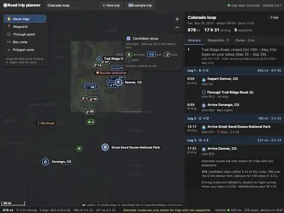

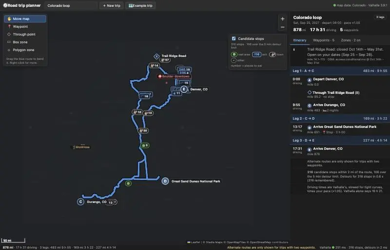

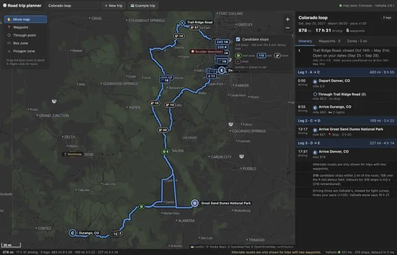

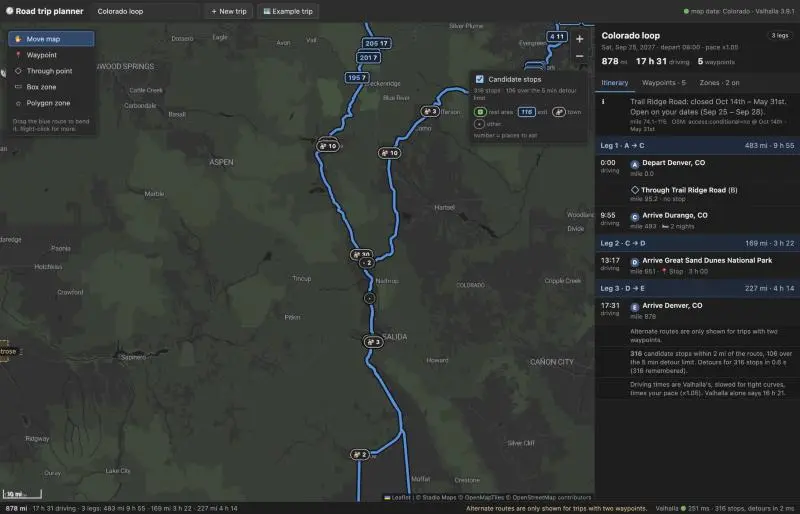

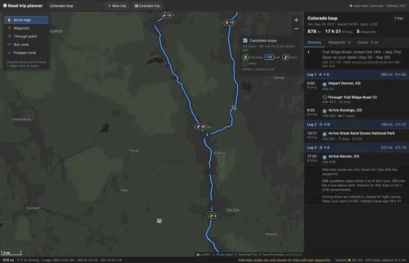

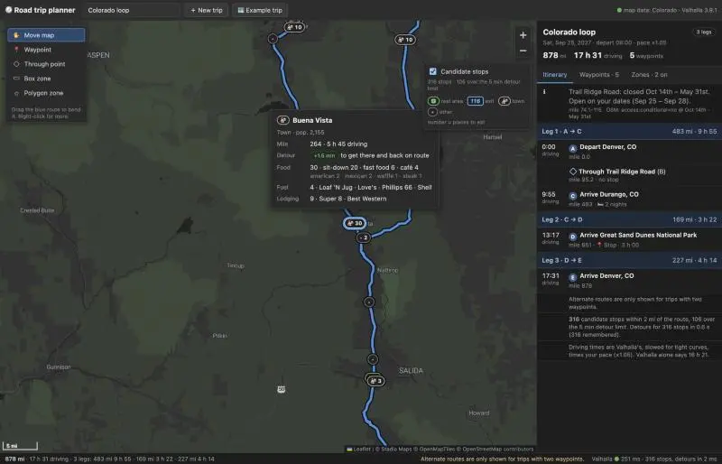

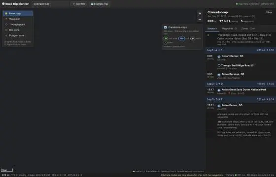

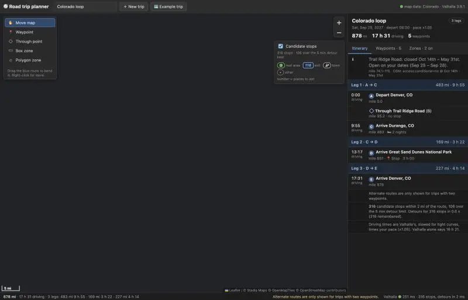

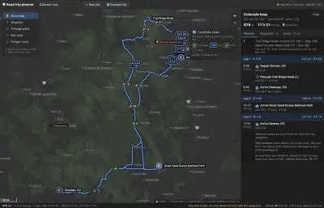

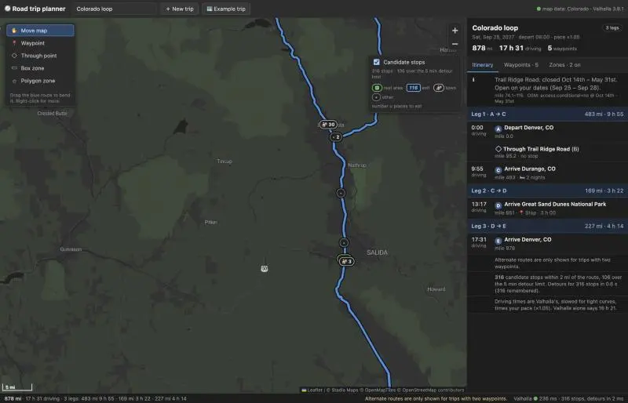

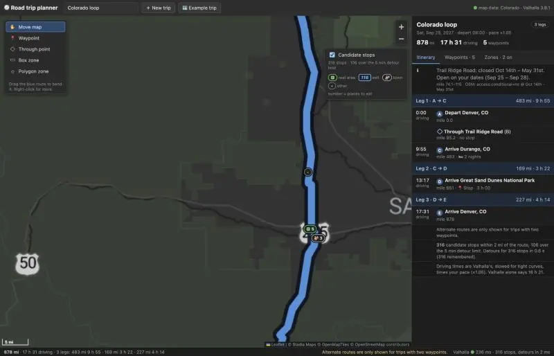

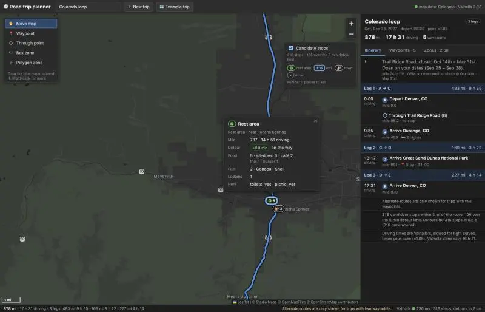

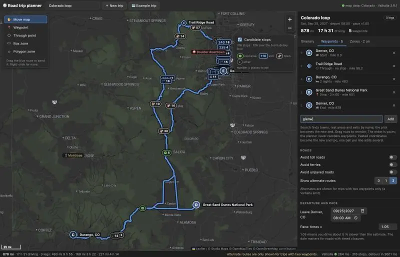

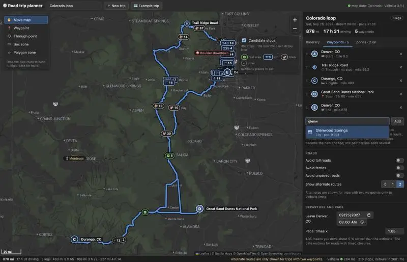


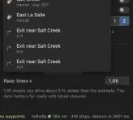

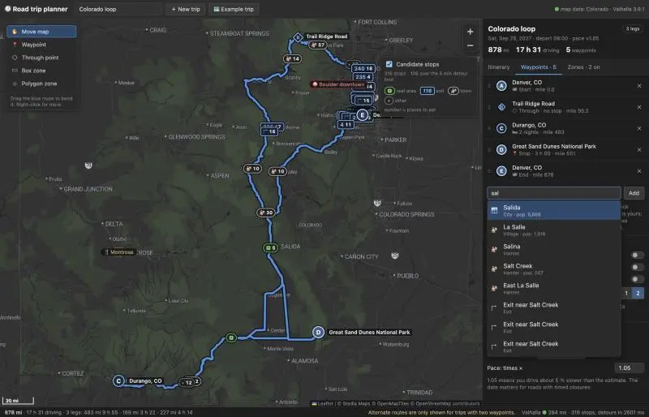

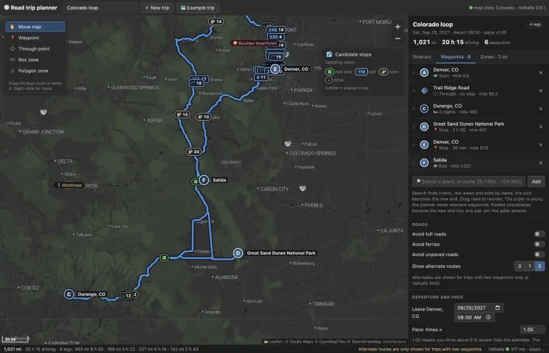

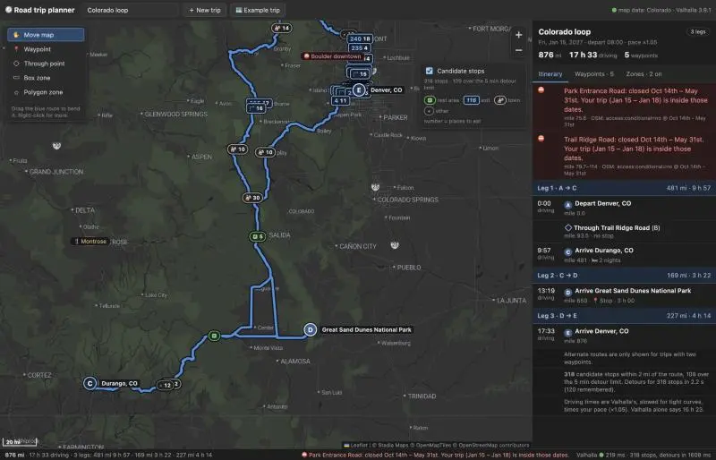

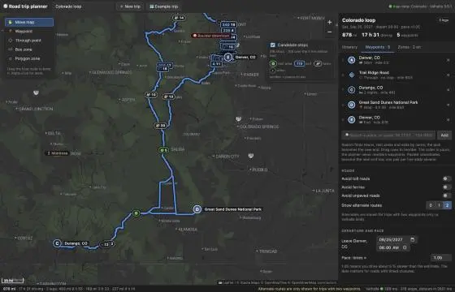


