# Prompts

- **Model:** claude-opus-5-5
- **Effort:** high
- **Session(s):** 92cddc51-cd7b-420a-8e3f-40aae4f8ba0b
- **Tokens:** input 232, output 135280, cache read 29397463, cache write 602088
- **Cost (tokscale estimate):** $13.4

## You

Background (from the session that started this one):
Project: an offline desktop road-trip planner in `route-planner-opus-5.5-extra/` inside the `ai-experiments` repo, rebuilding what Microsoft Streets & Trips did for multi-day trips: breaks every N minutes or M miles, placed at real rest areas, exits and towns rather than at arbitrary points. The backend is Python, and the user wants to be able to read it, so the planner especially must be clear, small functions with tests.

Everything runs in Docker: `valhalla` (Colorado tiles, 127.0.0.1:8002) and `api` (FastAPI, `uvicorn --reload` on the bind-mounted `backend/`, 127.0.0.1:8000, also serves the plain HTML/JS Leaflet frontend in `frontend/`). Both are up and healthy, and `data/pois.sqlite` is built.

Done so far:
- Phase 0: the Docker stack.
- Phase 1: speed calibration (`backend/app/speeds.py`, curve correction plus a pace multiplier) and the map UI with `POST /api/route`.
- Phase 2: the stop data importer, plus `POST /api/route/stops`, which returns candidates along the route. Each candidate has a mile, a driving minute on the sidebar's clock, its kind, amenity counts, a direction-aware detour from Valhalla's matrix, and seasonal-closure warnings. Phase 2 also added place search.

Read `route-planner-opus-5.5-extra/PLAN.md` (Decisions, Planner, Phases), `notes/phase-1.md`, `notes/phase-2.md` (especially "What phase 3 needs") and the mockups in `design/index.html` (screens 1–3 show the itinerary with clock times, the day strip and the stop picker). The user accepted these defaults: a break every 120 min or 150 mi, whichever comes first; 15 min long; landing at 75–100% of the interval; never more than 110%; stop preference rest area > service plaza > exit or town with fuel and food > any exit; maximum detour 5 min EACH WAY. Phase 2 implemented the detour limit as 5 min in total, which is wrong; this phase fixes it. Each phase runs in its own session and leaves a record under `route-planner-opus-5.5-extra/prompts/phase-N/`. This is phase 3 of 6. Phase 4 adds automatic overnights, daily limits, meals, fuel, time zones, sunset and the other zone types. Phase 5 adds trip files, the settings page and exports.

Task:
Do phase 3 of `route-planner-opus-5.5-extra/PLAN.md`: plan breaks along the route, show them with clock times, and let the user pin, change and skip stops. Read PLAN.md, `notes/phase-2.md` ("What phase 3 needs"), the existing `backend/app/planner/` and `frontend/` code, and screens 1–3 of `design/index.html` first.

## 1. Planner (`backend/app/planner/schedule.py` and friends)

**Segments.** Split the trip into driving segments at hard stops:
- the start;
- timed-stop waypoints (their minutes count as a break and reset the break clock);
- overnight waypoints (the next day starts at the day-start time, 08:00 by default, after the nights);
- the end.

Through points do not split anything. Automatic overnights come in phase 4; design so they slot in.

**Candidates.** Take phase 2's candidates.
- Merge entries within about 2 miles of each other along the route into one choice, keeping the best. Glenwood Springs, the town and I-70 Exit 116, is the known case.
- Drop candidates within about 2 miles of a waypoint the route stops at.
- Change the detour limit to the agreed 5 minutes each way, so 10 minutes for the matrix's there-and-back figure. Fix it where phase 2 put it (`DETOUR_LIMIT_MIN`), and update the UI text.
- Huge "other" groups (the "Near Redmond" kind, from city outskirts) should not become a stop whose position means nothing. Either split them along the road or use the member nearest the route; your call, explained in the notes.

**Choosing breaks.** Within each segment, find a shortest path through a graph:
- **Nodes:** segment start → candidates in route order → segment end.
- **Edges:** an edge is allowed when the drive between its two ends stays at or under the hard maximum in minutes (N × 1.1) and in miles (M × 1.1).
- **Cost:** how far the gap lands from the 75–100% window, plus the stop's own cost (kind rank from the preference order, its detour, thin amenities).

Keep it a few small functions, with docstrings that explain the rule in plain words. The user will read this file.

**When no plan fits.** If no path meets the hard maximum (long empty stretches), relax it step by step: over-limit detours first, then a longer gap. Report it as a warning with the stretch named ("no stop between Saguache and Del Norte within 2 h 12; longest gap 2 h 30"). Never fail.

**Pins and skips.**
- A pinned candidate is a node the path must pass through.
- A skipped candidate is removed for this trip.
- Both live in the trip state, keyed by the candidate's cluster id plus a pass number, so they survive small route changes, or are dropped with a notice when the place is no longer on the route.

**Schedule.** Clock times come from the departure date and time, driving minutes on the same clock as the sidebar (`speeds.py`), each stop's minutes plus its detour, and waypoint dwell times. Return, per stop:
- the chosen place, mile, arrival and departure times, detour, and the reason it won;
- the window it was chosen from (earliest and latest minute);
- its alternatives ranked by score, including the ruled-out ones with the reason why (over the detour limit, outside the window, skipped).

Add the "next break due" times too.

**API.** `POST /api/plan` (or extend `/api/route/stops`; your call, say why). It takes the trip plus settings, pins and skips, and returns route, candidates, schedule and warnings. Keep the drag preview fast: plan after the route settles, as stops do now. Re-planning after a pin or skip must not call Valhalla again; it should reuse the cached candidates and detours.

## 2. UI (follow the mockups)

- **Itinerary tab** (screen 1): rows with clock times for depart, each break (place, mile, detour, what is there), waypoints and arrival, plus day headers where user-set overnights split the trip. A "next break would be due at …" note at the end of each day.
- **Map:** break markers with time labels. Clicking a break opens the stop picker (screen 3). The picker shows a shaded band on the route for the stop's window, and a popover with the ranked alternatives: time, detour, amenities, the ruled-out ones greyed with the reason, and "Pin", "Use this one" and "Skip on this trip".
- **Dragging a break marker** along the route snaps it to the nearest candidate and pins it.
- **Day strip** under the map (screens 1–2): driving blocks, stop blocks, "due" markers, and a chip per day when there are several days.
- **Break settings:** a small editor for every N min or M mi, length, window, hard maximum and detour limit, reached from the sidebar footer chips. Keep it in the trip state. The full settings page is phase 5.

Verify in the browser at http://localhost:8000 with Denver → Durango (the example trip in PLAN.md) and the Colorado loop. Check that:
- breaks land at believable places and times;
- a pin re-plans the rest;
- a skip removes the place;
- a long empty stretch gives a sensible warning.

Take screenshots of the itinerary with times, the stop picker with its band, the day strip, and a pinned stop.

## Tests

`make test` runs:
- graph tests on hand-made candidate lists (dense, sparse, none, pins, skips, a loop passing a place twice, merges, the relaxed fallback);
- schedule clock maths (dwell, detours, overnight waypoints);
- the detour limit change;
- the API.

Add an integration test: Denver → Durango gets three breaks spaced within the rules. Keep the existing 109 tests passing.

## Write up

- `notes/phase-3.md`: the algorithm in plain words, what was built, the results on the two example trips (a table of the chosen stops), anything surprising, and what phase 4 (meals, fuel, automatic overnights, daily limits, time zones, other zone types) needs from this design.
- Update PLAN.md only where facts changed.

## Rules

- Do not commit, branch or push. Leave every change in the working tree. This checkout is shared, and it has unrelated uncommitted changes outside the project; do not touch or stage them.
- Edit only inside `route-planner-opus-5.5-extra/`, apart from the record step.
- Install nothing on the host.
- Leave the containers running.

## Done when

- Both example trips get sensible breaks with clock times.
- Pin, skip and drag re-plan without another Valhalla call.
- The stop picker and day strip work in the browser.
- `make test` passes, and the notes exist.

## Last step: record

After your final summary, run from the repo root:

```bash
mkdir -p route-planner-opus-5.5-extra/prompts/phase-3
scripts/prompt-md.sh route-planner-opus-5.5-extra/prompts/phase-3 <your-session-id>
```

Your session id is the last path component of your scratchpad directory; pass it explicitly. Check that the output starts with your brief, covers only this session, includes your screenshots, and says whether the cost is available. Then end with a short report: done or not, the chosen stops on both trips, surprises, and what phase 4 needs to know.

Shared notes folder for this group of sessions (outside the repo; read siblings' notes there, leave hand-over notes or large findings there instead of pasting them into messages): /Users/danwatt/Library/Application Support/Claude/side-session-notes/local_e3f2f033-dc70-46e4-b2e2-53821eaee896

## Claude

Reading code; planner design next. Now frontend.

Reading mockups screens 1–3 now.

Code read. Checking detour tests, then live data to design the planner.

Design settled. Writing backend: models, detour limit fix, timeline helpers.

Fix detour limit first.

Now models.

Writing choices.py (keys, skips, merge, stop cost).

Now the graph (shortest path).

Now picker (alternatives) and schedule (clock).

First live run of /api/plan; fixing a return bug.

Denver→Durango: Fairplay, Saguache, Pagosa Springs. Fixing due-time clamp, then Colorado loop.

Loop plans sensibly (Estes Park early before Trail Ridge, South Fork, Sand Dunes reset). Testing a long-empty-stretch warning and pin/skip without Valhalla.

Backend works end to end. Writing tests now.

Planner tests nearly green; one expected-value fix.

Backend tests passing. Adding loose-group and integration tests.

Valhalla restarted mid-test (restart policy brought it back). Rerunning to see if it repeats.

150 passed. Now frontend: state (plan fetch, pins/skips), then itinerary, map picker, day strip, settings editor.

Now the itinerary tab.

Now CSS additions.

Now the map: break markers, drag-to-snap, picker popover, window band.

Frontend wired. Opening the app in the browser to verify.

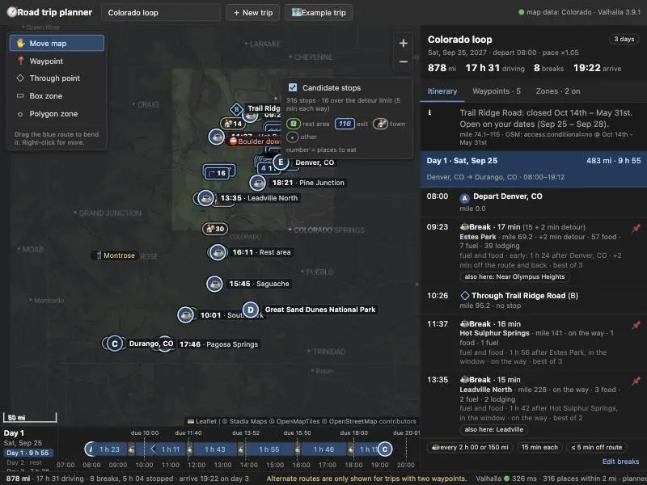

App renders plan, breaks, day strip. Switching to Denver→Durango at a larger viewport.

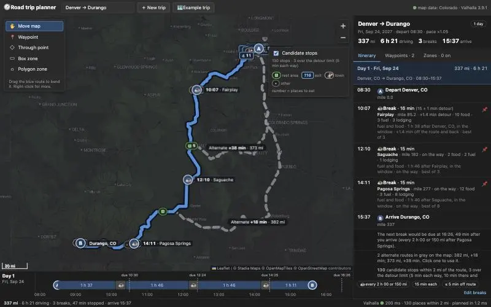

Itinerary with clock times, map labels and day strip look right. Opening the stop picker.

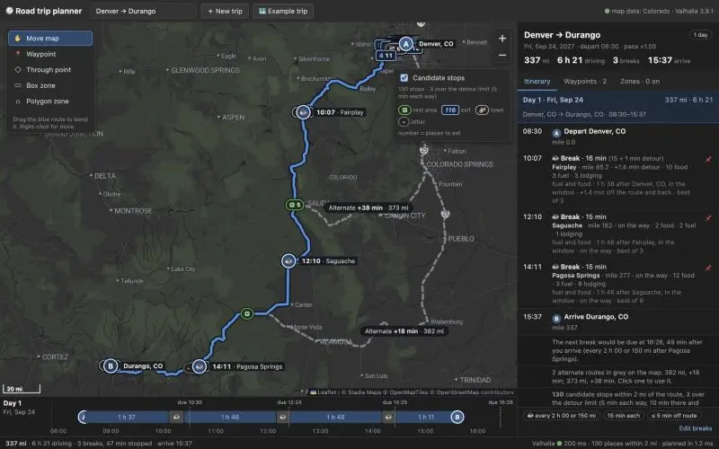

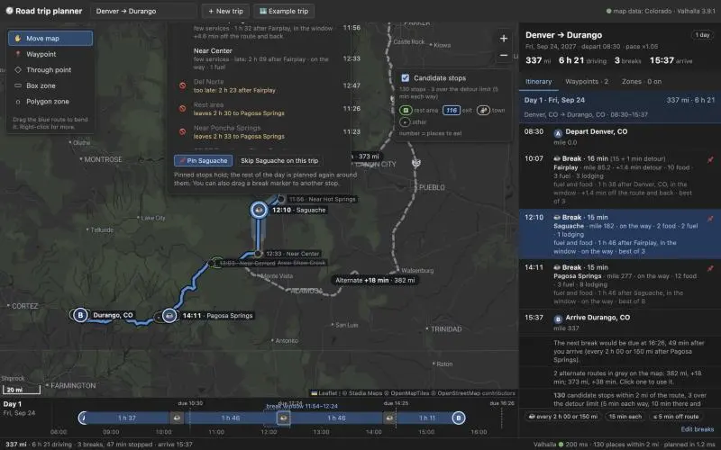

Picker works but its popup overflows the map top. Fitting the map to the picker on open and capping list height.

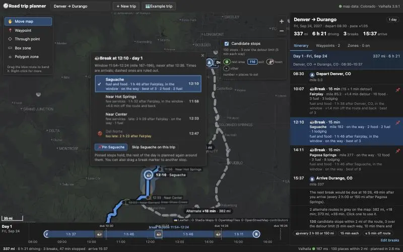

Picker shows window, ranked alternatives, ruled-out reasons. Testing "Use this one" (re-plan) and checking network.

Pin click missed (scaled viewport). Testing via direct DOM click.

Pin re-planned via /api/plan only (22 ms, cached). Screenshot of pinned state.

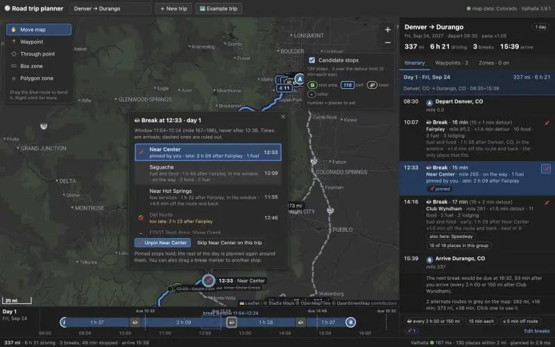

Pin works. Now skip, then drag-to-snap.

Skip works (Club Wyndham → Near Dyke). Now a real mouse drag of the Fairplay marker.

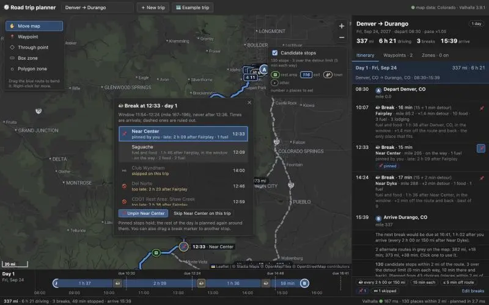

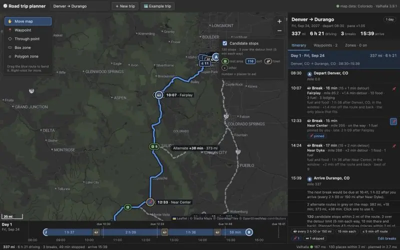

Drag snapped to Shawnee and pinned it, /api/plan only. Now the long-gap warning via the settings editor.

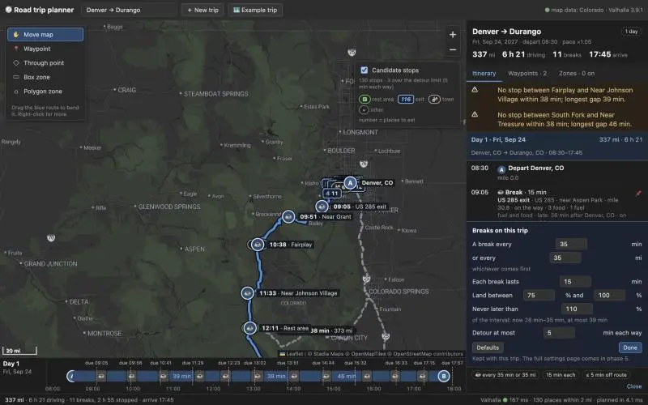

Warning names the stretches. Restoring defaults; checking the Colorado loop (multi-day strip).

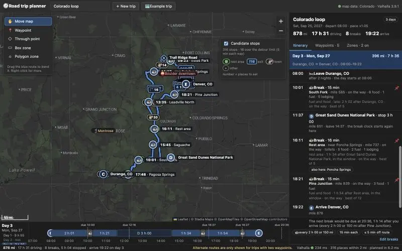

Multi-day works. Folding non-selected days (as in mockup) and tightening strip day chips.

Adding pin/skip buttons to the candidate card too.

You've hit your 5-hour limit · resets 7pm (America/Chicago)

## You

Resume

## Claude

Reloading to verify fold, strip chips, candidate card.

Folding works. Opening a picker on the loop (Estes Park, early before Trail Ridge) for the multi-day screenshot.

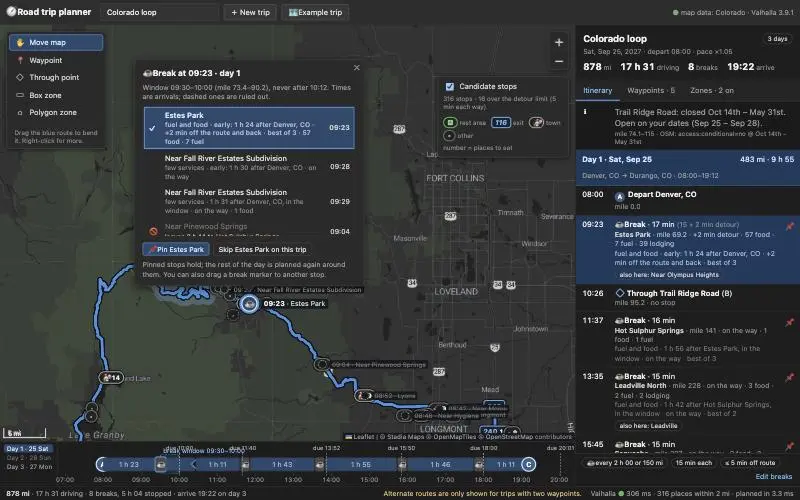

Browser checks done. Final test run and console check.

150 passing. Writing notes and PLAN.md updates.

Now the phase 3 notes.
