# Prompts

- **Model:** claude-opus-5-5
- **Effort:** high
- **Session(s):** 0d16bb3e-48aa-4edc-8cd3-f4c8e6eb711e
- **Tokens:** input 236, output 200139, cache read 38574115, cache write 416933
- **Cost (tokscale estimate):** $15.05

## You

Background (from the session that started this one):
Project: an offline desktop road-trip planner in `route-planner-opus-5.5-extra/` inside the `ai-experiments` repo, rebuilding what Microsoft Streets & Trips did for multi-day trips: breaks every N minutes or M miles at real rest areas, exits and towns, plus meals, fuel and overnights, and zones drawn on the map that change the route or where stops go. The backend is Python, and the user wants to be able to read it, so the planner must stay small, clear functions with plain-word docstrings and tests.

Everything runs in Docker: `valhalla` (Colorado tiles, 127.0.0.1:8002) and `api` (FastAPI, `uvicorn --reload` on the bind-mounted `backend/`, 127.0.0.1:8000, also serves the plain HTML/JS Leaflet frontend in `frontend/`). `data/pois.sqlite` is built. Valhalla now runs 4 worker threads with a 256 MB tile cache each (`server_threads` in `docker-compose.yml`, `max_cache_size` in `valhalla/start.sh`), because the defaults filled the 8 GB Docker VM.

Done so far:
- Phase 0: the stack.
- Phase 1: speed calibration and the map UI.
- Phase 2: stop data, candidates with direction-aware detours, seasonal-closure warnings, place search.
- Phase 3: the break planner. Segments at waypoint stops, a shortest-path graph over the candidates, pins and skips, `POST /api/plan`, the itinerary with clock times, the stop picker, the day strip and break settings.

Read `route-planner-opus-5.5-extra/PLAN.md`, `notes/phase-2.md` and `notes/phase-3.md` (especially "What phase 4 needs from this design"), and the mockups in `design/index.html` (screens 2–4 show days, meals, fuel, overnights and zone types).

The user accepted these defaults:
- **Meals:** lunch 11:30–13:30, 45 min; dinner 17:30–19:30, 60 min; breakfast at the hotel. A meal resets the break clock. Food filter: all / sit-down / fast food.
- **Fuel:** range 400 mi; refuel after 75% (300 mi); fill up at each overnight. A fuel stop and a break within 20 min of each other merge.
- **Days:** 8 h driving per day, start 08:00, arrive by 19:00. All soft limits, with a warning that says why when one is exceeded.
- **Lodging:** a place to stay has at least 2 lodgings within 2 mi.
- **Zones:** avoid (hard, sent to Valhalla), no stops, no meals, no overnight, prefer stops (wins close calls).
- **Time zones:** clock changes get their own row.
- **Sunset:** an option to stop driving at sunset, off by default; arriving after dark shows a warning.

Each phase runs in its own session and leaves a record under `route-planner-opus-5.5-extra/prompts/phase-N/`. This is phase 4 of 6. Phase 5 adds trip files, a shared zone library, the full settings page and exports.

Task:
Do phase 4 of `route-planner-opus-5.5-extra/PLAN.md`: days, meals, fuel, time zones, sunset and the other zone types. Read PLAN.md, `notes/phase-3.md` ("What phase 4 needs from this design"), the code in `backend/app/planner/` and `frontend/`, and screens 2–4 of `design/index.html` first. Build on phase 3's design rather than replacing it.

## 1. Planner

- **Automatic overnights.**
  - Before the break pass, choose where each driving day ends. Choose from lodging-worthy choices (at least 2 lodgings within 2 mi) near the daily limit (8 h driving, arriving by 19:00), and prefer a choice that leaves the following days balanced.
  - Over-limit days are allowed, with a warning that says why and what the alternative was ("Grand Junction would make it 7 h 50").
  - User-set overnight waypoints stay fixed.
  - An automatic overnight is a pinnable, skippable stop like a break: "stay here instead", pin, skip.
- **Meals.**
  - Lunch and dinner each fall inside their window on the clock, at places with food that matches the trip's food filter.
  - A meal resets the break clock.
  - Dinner at an overnight that arrives before or during the dinner window happens there ("dinner near the hotel").
  - Extend phase 3's shortest path to carry the state it needs: the clock, lunch done, dinner done, and miles since the last fuel. Keep it readable, and explain the state and the costs in plain words in the docstrings.
- **Fuel.**
  - Refuel by 300 mi at a place with fuel, and fill up at each overnight.
  - Fuel carries across days and through timed stops.
  - Merge a fuel stop with a break or meal within 20 min.
  - Mark merged stops and say why ("merged: fuel was due by mile 300").
- **Zones.** Apply all types in choice preparation, using each candidate's `lat`/`lon`:
  - no stops: no break, meal, fuel or overnight;
  - no meals: no meal;
  - no overnight: no overnight;
  - prefer stops: a cost bonus that wins close calls.

  Avoid is unchanged. Every stop moved by a zone says so ("moved from Montrose: no-meals zone").
- **Time zones.** Use `timezonefinder` and `zoneinfo` (both inside the image). Each row's clock is local time where it happens. Put a clock-change row where the route crosses a zone boundary. Colorado has no crossing, so prove it with unit tests on a hand-made route (for example, across the Texas / New Mexico line).
- **Sunset.** Use `astral` for each day's arrival place. Warn when arriving after sunset. Add an optional "stop driving at sunset" setting, off by default; when on, it is a soft limit on the day's end.
- **Seasonal closures.** When a closure is certain on the trip's dates, offer "avoid this road": it adds an avoid zone around the closed ways, and the route changes. The warning stays as now otherwise.
- **Settings.** Meals, fuel, days, food filter and sunset go in the trip state next to the break settings, with a compact editor reached from the sidebar, as phase 3 did for breaks. The full settings page is phase 5.

## 2. UI (follow screens 2–4)

- **Itinerary:**
  - day headers with each day's miles and driving time, plus chips (over the limit, short day: prefer zone);
  - rows for meals, fuel, merged stops, overnights (with "dinner near the hotel", sunset and arrival-after-dark chips) and clock changes;
  - collapsed days fold, and the selected day highlights on the map and in the day strip.
- **Map:** meal, fuel and overnight markers with time labels, and day chips along the route. The stop picker works for meals and overnights too, with their own windows and alternatives.
- **Day strip:** meal blocks, the lunch and dinner windows, overnight blocks, and one chip per day.
- **Zones tab:** set each drawn zone's type (avoid / no stops / no meals / no overnight / prefer), with colours and labels as in screen 4. Each zone says what it did to this trip.

## 3. Example loop

Make the default example trip in `frontend/` and PLAN.md's Example trips match the design:
- add a through point at Ouray, so the loop crosses the Western Slope (Denver → Trail Ridge Road → Glenwood Springs → US-550 → Durango);
- seed the example zones: avoid Boulder, no stops in metro Denver, no meals in Montrose, prefer Glenwood Springs.

Check what the planner then does, and report it honestly: where day 1 ends, where lunches fall, whether Montrose is skipped for lunch, and where fuel happens. Do not tune costs just to reproduce the mockup. If the result is sensible but different, say so.

## Tests

`make test` runs:
- overnight choice (limit, balance, prefer zone, no-overnight zone, user overnights fixed, over-limit warning);
- meal windows (dinner at the overnight, no-meals zone, food filter);
- fuel (range, refuel at an overnight, merging, across days);
- each zone type;
- a time-zone crossing on a hand-made route;
- sunset;
- the closure "avoid this road" zone;
- the API.

Add an integration test on the example loop. Keep the existing 150 tests passing.

Verify in the browser at http://localhost:8000 with the example loop and Denver → Durango. Take screenshots of:
- a multi-day itinerary;
- lunch moved by a zone;
- an automatic overnight with its alternatives;
- fuel merged into a break;
- the zone type editor;
- the day strip with meals.

## Write up

- `notes/phase-4.md`: the extended algorithm in plain words, what was built, the results on both example trips (a table per day), surprises, and what phase 5 (trip files, zone library, settings page, exports) needs.
- Update PLAN.md where facts changed, including the Example trips.

## Rules

- Do not commit, branch or push. Leave every change in the working tree. This checkout is shared, and it has unrelated uncommitted changes outside the project; do not touch or stage them.
- Edit only inside `route-planner-opus-5.5-extra/`, apart from the record step.
- Install nothing on the host. Python deps go in the image (rebuild it).
- Keep Valhalla's memory settings.
- Leave the containers running.

## Done when

- Both example trips plan sensible days, meals and fuel with local clock times.
- Every zone type works.
- The UI shows it all.
- `make test` passes, and the notes exist.

## Last step: record

After your final summary, run from the repo root:

```bash
mkdir -p route-planner-opus-5.5-extra/prompts/phase-4
scripts/prompt-md.sh route-planner-opus-5.5-extra/prompts/phase-4 <your-session-id>
```

Your session id is the last path component of your scratchpad directory; pass it explicitly. Check that the output starts with your brief, covers only this session, includes your screenshots, and says whether the cost is available. Then end with a short report: done or not, the per-day results on both trips, surprises, and what phase 5 needs to know.

Shared notes folder for this group of sessions (outside the repo; read siblings' notes there, leave hand-over notes or large findings there instead of pasting them into messages): /Users/danwatt/Library/Application Support/Claude/side-session-notes/local_e3f2f033-dc70-46e4-b2e2-53821eaee896

## Claude

Reading phase-3 planner code; next picker, models, zones, then design and frontend.

Still reading: design done, now frontend code (state, sidebar, map, timeline).

Now map.js (big).

Image rebuilt with timezonefinder/astral/tzdata. Design settled; now writing backend: models, zones, clock, overnights, stateful stop path.

Writing the stateful stop path (stops.py): breaks, lunch, dinner, fuel labels.

Picker extended for meals. Now rewriting schedule.py to orchestrate days → stops → clock with time zones.

Schedule tests pass. Fixing the remaining API and integration expectations.

Frontend state/edits done. Now the sidebar itinerary rows, settings editor, and zones tab.

Map done. Now the day strip (meal blocks, windows, overnights, clock and sunset marks).

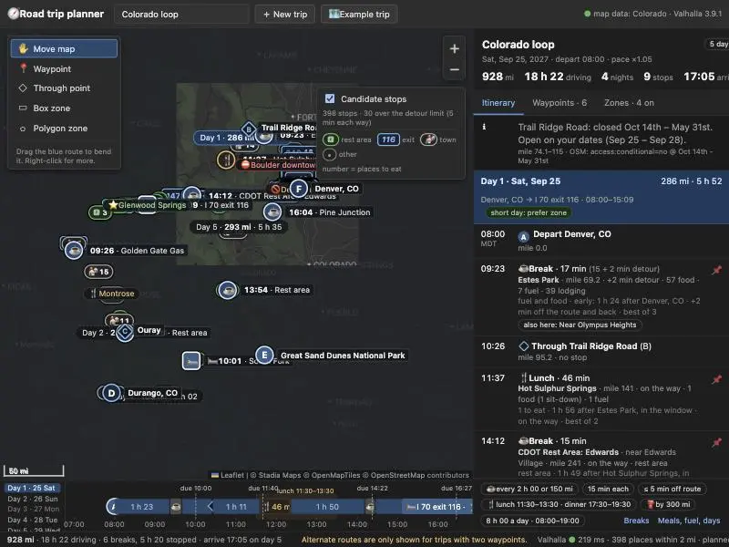

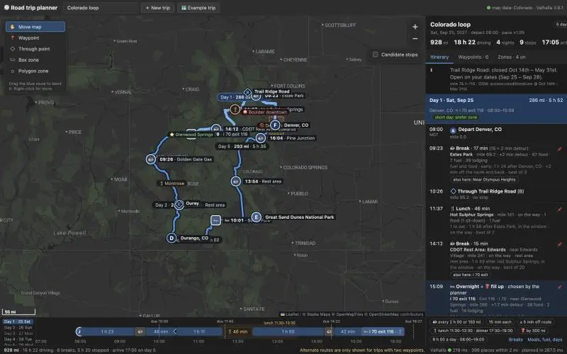

Writing the phase-4 tests now (days, meals, fuel, zones, time zones, sunset, closures, API, loop).

Days tests pass. Now meals, fuel, zones, stops-equivalence tests.

Now zones, clock/time-zone, sunset and closure tests.

Tests: 200 pass. Now checking the UI in the browser.

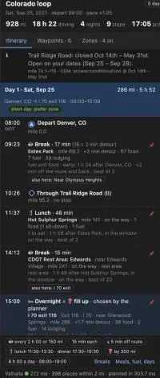

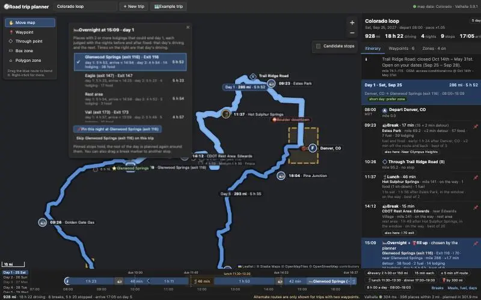

Loop UI verified (overnight picker works). Now checking Denver → Durango with a no-meals zone over Saguache.

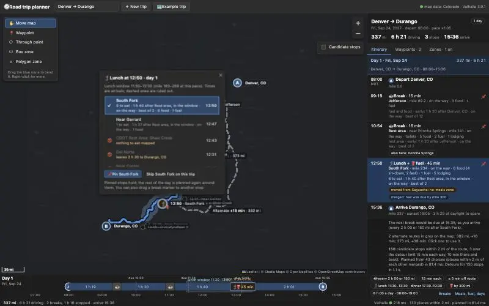

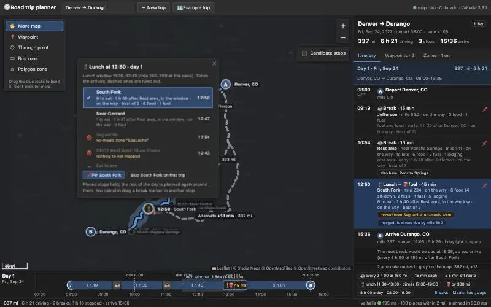

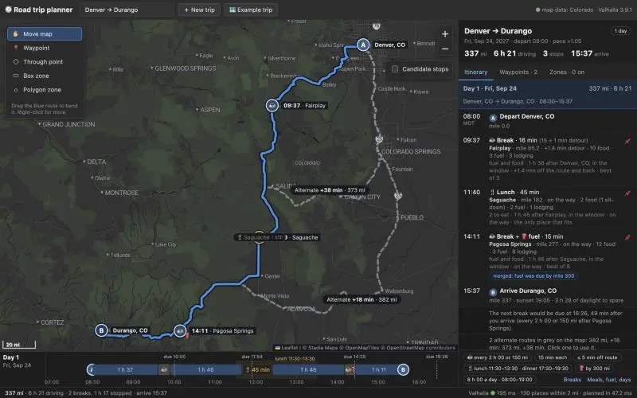

Lunch-moved and fuel-merged views work. Selecting the merged Pagosa row for the screenshot.

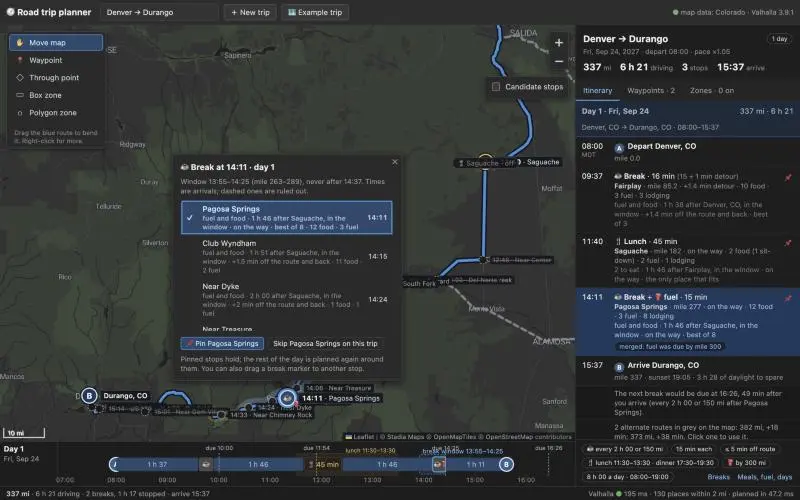

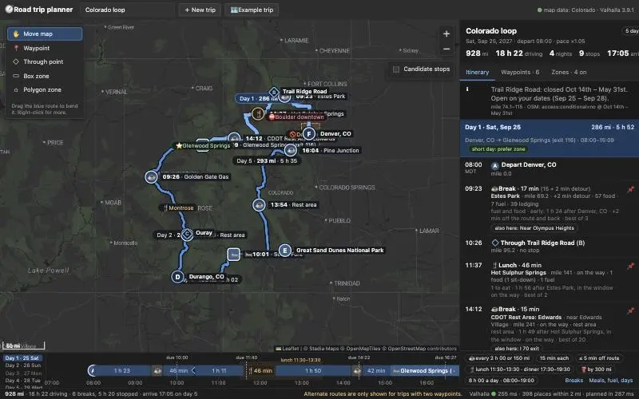


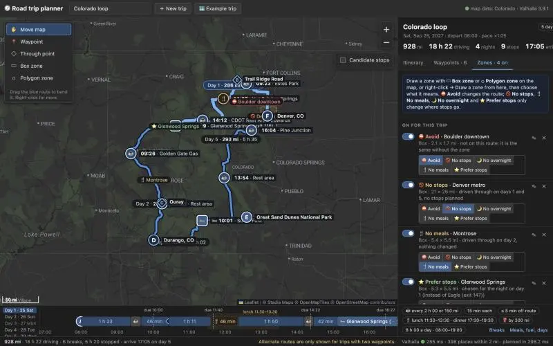

Zone type switching works with plan-only calls. Re-taking the day-2 screenshot.

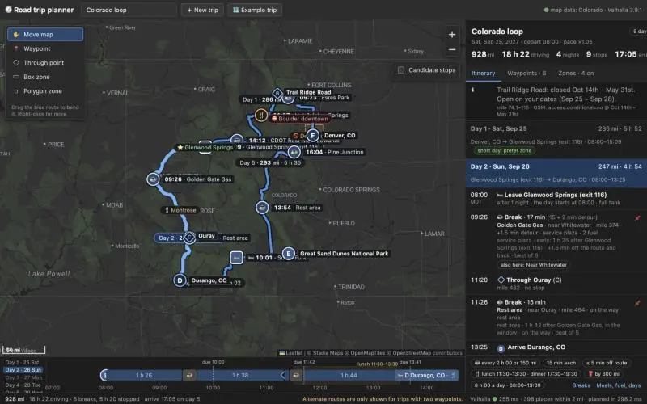

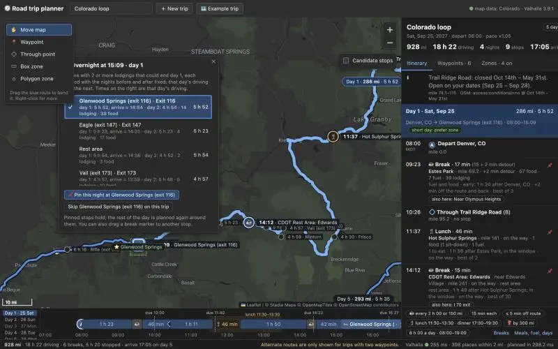

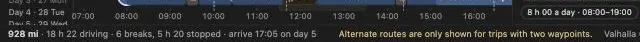

Overnight pin/unpin verified. Capturing the day strip with meals.

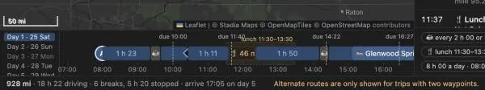

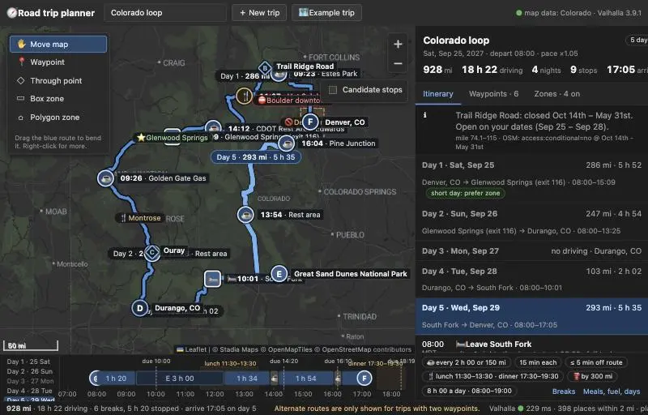

"Avoid this road" works in the browser (Estes Park → Grand Lake in January: 47 mi → 145 mi around the park). Taking the day-strip screenshot on Denver → Durango.

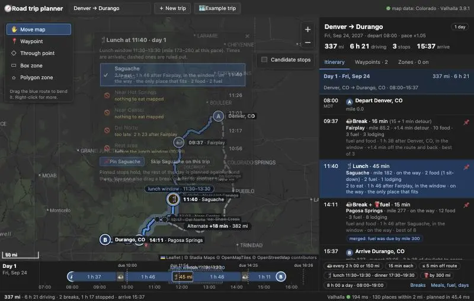

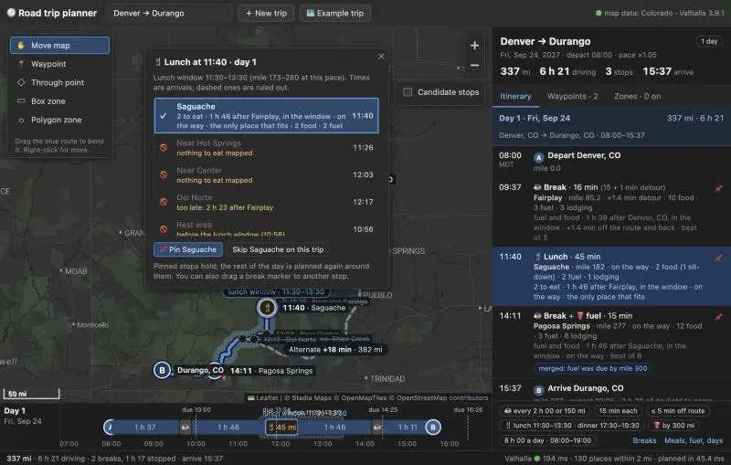

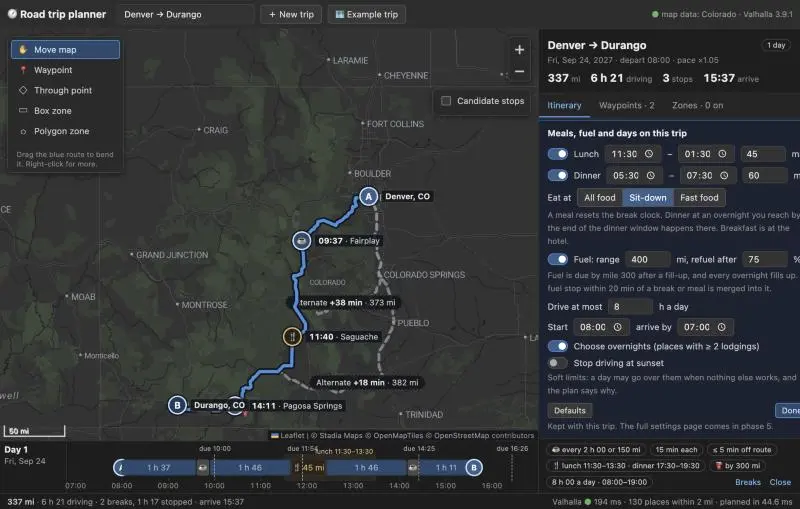

200 tests pass; screenshots taken. Writing notes/phase-4.md and updating PLAN.md.

Now PLAN.md updates.
