# Prompts

- **Model:** claude-opus-5-5
- **Effort:** medium
- **Session(s):** 63f745a2-f8f4-4cff-ac4f-16758b9e8a75
- **Tokens:** input 374, output 174387, cache read 51226683, cache write 405254
- **Cost (tokscale estimate):** $16.98

## You

New experiment. 

I want to see charts on the income / expenses of Texas' public hospital systesm. I am not sure of how many there are, but I am aware of JPS (Tarrant County), Parkland (Dallas County), Ben Taub (Harris County), and I assume there are others. 10 years of data if possible.

Use the Bluebonnet design system, like we have in other texas related projects

## Claude

Finding uniform data source. CMS hospital cost reports cover every Texas hospital, filterable by government ownership. Checking it.

Data found: CMS cost reports, ~105 local-government hospitals in Texas, FY2011–2024. Now validating chart colors, then writing build script.

Data built: 109 local-government hospitals, FY2015–2024. Some small rural districts show huge "other income" from their nursing homes. Page will flag that. Writing page now.

Fix markup to use `bb-field__label`/`__control` and `bb-choice__text`.

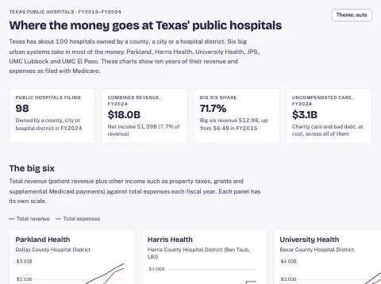

Page renders, no console errors. Checking charts below the fold.

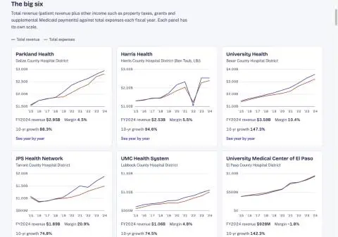

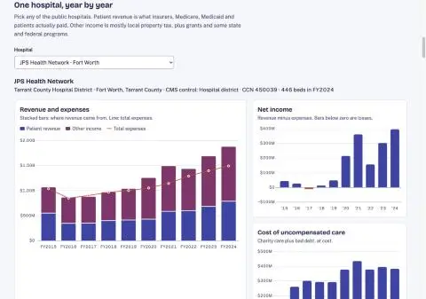

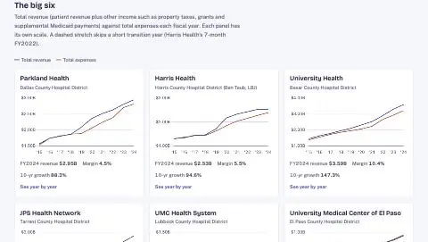

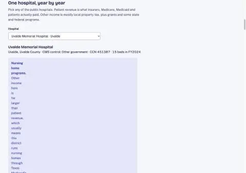

Alert layout broken (missing icon column). Fixing with proper Bluebonnet alert markup.

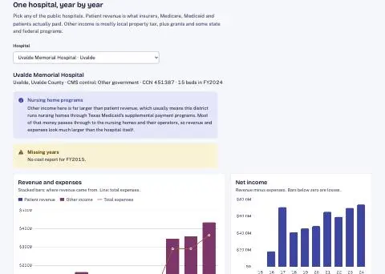

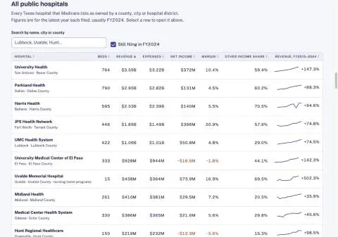

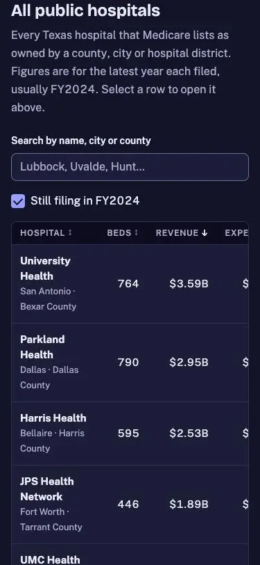

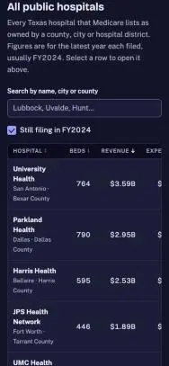

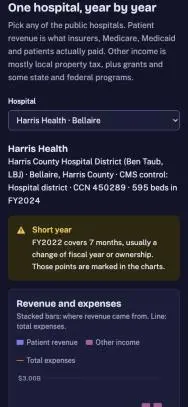

Dark + mobile OK. Grabbing landing-page screenshot and adding demos.js entry.

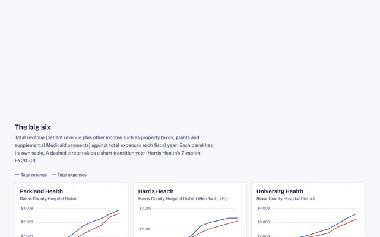

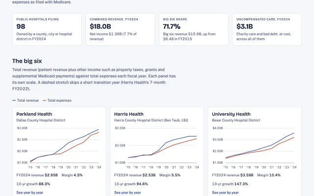

Landing card added. Final check: landing page and renamed demo load, then regenerate prompt.md.

Served file has it; likely browser cache.

Was cache. Card renders. Regenerating prompt.md, then done.

I built the page at [texas-public-hospitals-opus-5.5-medium/](texas-public-hospitals-opus-5.5-medium/index.html). It covers fiscal years 2015 to 2024 and uses the Bluebonnet styling. It loads with no console errors in light, dark and phone layouts, and the card now shows on the landing page. Nothing is committed yet.

**How many there are:** 98 Texas hospitals owned by a county, city or hospital district filed reports for 2024. Counting ones that have since closed or changed hands, there are 109 over the ten years. Six big urban systems take in about 72% of the combined $18.0B in revenue:
- University Health (San Antonio)
- Parkland (Dallas)
- Harris Health (Ben Taub and LBJ)
- JPS (Fort Worth)
- UMC Lubbock
- UMC El Paso

The rest are mostly small rural hospital districts. Midland, Odessa, Hunt, OakBend and Citizens are the mid-sized ones.

**Source:** the yearly cost report every hospital files with Medicare, downloaded from data.cms.gov. It's the same set of figures for every hospital, so they compare fairly. [build_data.py](texas-public-hospitals-opus-5.5-medium/build_data.py) turns the downloaded files into `data.js`.

**What's on the page:**
- **Summary figures:** number of hospitals, combined revenue and net income, the big six's share, and the cost of uncompensated care.
- **The big six:** one small chart each, revenue against expenses over ten years.
- **Any hospital, year by year:** where its revenue came from (patient revenue vs. other income such as property tax) with expenses as a line, plus net income, uncompensated care and a full table of the numbers.
- **All hospitals:** a sortable, searchable table with a ten-year sparkline. Clicking a row opens that hospital above.
- **Notes** on how to read the data.

**Things to know when reading it:**
- **These figures are for the hospital, not the whole district.** Audited district statements can differ. They may include clinics and the districts' Medicaid health plans, and they book property tax their own way.
- **Harris Health has a short year.** It switched fiscal years in 2022 and filed a 7-month report. The big-six chart skips that point with a dashed line, and the detail view marks it.
- **Some small rural districts show huge revenue.** Uvalde, Coryell and Limestone are examples. That's money for nursing homes they own through Texas Medicaid programs, which passes through their books. Those hospitals carry a note on the page.
- **Left out:** state-owned hospitals (UT Southwestern, UTMB, MD Anderson) and districts with no hospital of their own, like Central Health in Travis County and Nueces County.

## You

Yes, add tax data

## Claude

Comptroller levy spreadsheets online only 2021–2025. Checking Wayback Machine for older years.

Got Comptroller levy files for tax years 2013–2025 (archive.org for older ones). Headers vary by year; normalizing parser.

Matched ~95 hospitals to their tax districts. Wiring levy parsing into build script.

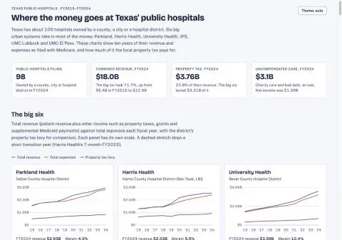

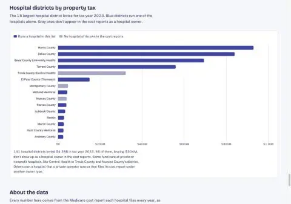

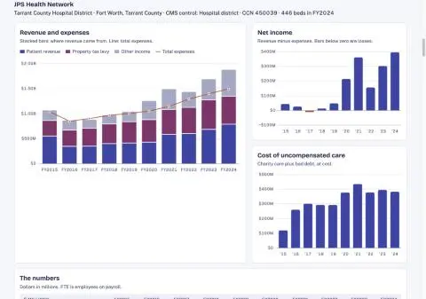

I added property tax to the page. In FY2024 the public hospital districts levied about $3.76B in tax, equal to 21% of these hospitals' $18.0B revenue. The big six account for $3.21B of that. The page loads with no errors.

**Where the numbers come from:** the Texas Comptroller's yearly Special District Rates and Levies spreadsheets, for tax years 2013–2025. The Comptroller's site only links 2021 onward, so I took 2013–2020 from the Internet Archive. Hospital districts are their own class in those files.

**Matching tax to hospitals:** I linked 96 hospitals to the district that owns them. Each district's tax bill is due January 31, so a tax year is matched to the fiscal year that contains that date. Tax year 2023 pays for FY2024.

**On the page:**
- **Summary figures:** a new property tax figure.
- **Big six charts:** a third line for the tax levy, and a "tax share" figure under each.
- **One hospital, year by year:** revenue is now split into patient revenue, property tax and other income. The year-by-year table shows the levy and which tax year it came from.
- **All hospitals table:** property tax and tax share columns replace "other income share." Hospitals owned by a county or city get no tax figure, because they're funded from the county or city budget.
- **New "Hospital districts by property tax" chart:** the 15 biggest levies for tax year 2023. 141 districts levied $4.28B in all. 46 of them ($504M) don't appear as a hospital owner in the Medicare reports. Central Health in Travis County ($322M), Montgomery County and Nueces County are the big ones; they pay for care at other hospitals.

**Things to know when reading it:**
- **These are levies, not collections.** A levy is taxable value times the tax rate. Hospitals usually collect about 97–99% of it.
- **A few years are blank on purpose.** Where a district's reported rate was off by 3x or more from its usual rate, it was almost always a typing error in the state's file. Examples are Montgomery 2016, Wilson 2021 and Reeves 2016.
- **Harris Health's 7-month FY2022 has no tax figure.** Its short reporting period doesn't include a January 31 due date.
- **Midland's bars don't add up in some years.** Its tax levy is bigger than the non-patient income on its Medicare report, so part of the tax is recorded elsewhere. The bars come out taller than reported revenue, and the tooltip says so.
- **Big cut at JPS:** Tarrant County's levy dropped from $591M to $493M over tax years 2022–2025 as the tax rate was cut.

I also updated the card on the landing page and regenerated `prompt.md`. Nothing is committed.

Sources:
- [Texas Comptroller, Tax Rates and Levies](https://comptroller.texas.gov/taxes/property-tax/rates/)
- [Internet Archive copy of that page (older years)](http://web.archive.org/web/20201016190458/https://comptroller.texas.gov/taxes/property-tax/rates/)

## You

Lets focus on JPS Health Network for a moment - we don't need to update the chart just yet. It has a net income above $100 Million since 2000, and near $400M in 2024. SOmething about that feels off. Are we missing something?

## Claude

Fine — reading the audited statements via WebFetch instead.

Saved the PDF locally. Extracting text.

The surplus is real. JPS's audited statements show the same thing, so we aren't missing a hidden cost. (I'm reading "since 2000" as since 2020. Before that, the Medicare reports show $13–58M a year.)

**Medicare report vs. audited statements, net income:**

| FY | Medicare report (on the page) | Audited statements |
|---|---|---|
| 2022 | $157M | $113M |
| 2023 | $302M | $252M |
| 2024 | $396M | $336M |

The Medicare report runs about $45–60M higher than the audit, because it covers a slightly different slice of JPS. The pattern is the same in both.

**Where the surplus comes from (audited FY2024):**
- **Patient care loses about $309M.** Operating revenue was $1.29B: $856M from patients, $293M in extra Medicaid payments and $142M other. Operating expenses were $1.60B. The audit notes JPS has lost money on operations every year, which is normal for a hospital built to serve low-income patients.
- **Property tax brings in $539M.** That covers the operating loss with about $230M to spare.
- **Investment income adds $124M**, up from about nothing in 2022. JPS sold $437M of bonds in 2023 and has had the money invested at high interest rates while it waits to build.
- Interest on its debt costs $21M.

**Why it builds up cash on purpose:**
- **A surplus here isn't spending money.** Net income only counts a building's yearly wear and tear, not the year it's paid for. So money saved for construction looks like profit. The board has set aside $819M of its reserves for construction under its building plan (a new psychiatric emergency center, clinics, a parking garage and more). JPS spent $138M on buildings and equipment in 2024.
- **Cash and investments:** about $2.4B at September 2024, up $336M in 2024 and $677M in 2023, the 2023 jump mostly from the bond sale. Its reserves not tied to anything specific are $1.82B.
- **The tax rate has been cut.** It held at 22.4¢ per $100 through tax year 2022, then fell to 19.45¢, 18.25¢ and 16.5¢ (tax year 2025). The levy dropped from $591M to $493M even as property values rose. A local report says the latest cut came during a budget dispute between the county and JPS, and Moody's moved JPS's credit outlook to negative. I've only seen the headlines on those two, not the articles.

**What the page doesn't show:**
- How much patient care loses on its own. The page puts the extra Medicaid payments in "other income", so the hospital's own operations look better than they are. In the audit they're operating revenue, and the operating line still shows a loss.
- Investment income. It's buried in "other income", but in FY2024 it was a quarter of JPS's surplus.
- Where the surplus goes: construction spending, bond payments and the reserves set aside.

The big six all publish audited statements, so their numbers could sit next to the Medicare figures on the page: operating loss, tax, investment income and change in net position. I haven't changed the page.

Sources:
- [JPS FY2024 audited financial statements](https://www.jpshealthnet.org/sites/default/files/2024-12/Tarrant-Co-Hosp-Dist-JPS-Health-Network-2024-FS.pdf)
- [JPS FY2025 audited financial statements](https://jpshealthnet.org/sites/default/files/2026-04/JPS-Health-Network-09-2025-FS.pdf)
- [Becker's: Moody's revises Tarrant County Hospital District outlook to negative](https://beckershospitalreview.com/finance/moody-s-revises-tarrant-county-hospital-district-s-outlook-to-negative.html)
- [Commissioners cut Tarrant County Hospital District tax rate to 0.165 amid JPS budget dispute](https://cpo.soar.com/articles/5970573/Tarrant-County/Texas/Commissioners-cut-Tarrant-County-Hospital-District-tax-rate-to-0165-amid-JPS-budget-dispute)

## You

Yes, add audited data

## Claude

JPS audits for FY2015–2024 are pulled and the numbers check out. Saving them, then moving on to Parkland.

Downloaded 24 single-audit reports from the Federal Audit Clearinghouse for the other five systems. Now pulling the income statements from them.

Parkland's income statements are pulled. Now its capital spending, then I'll save it.

Parkland and JPS are saved and their totals add up. Next is Harris Health, which has a February fiscal year end, a 7-month transition year, and a health plan in its statements.

Harris Health is done. Next is University Health in San Antonio.

University Health saved; both its years check out once a $30M transfer from its health plan is counted. Now UMC El Paso and UMC Lubbock.

UMC El Paso is saved. Last is UMC Lubbock; the federal clearinghouse only has its 2019–2024 reports.

Lubbock's 2015–2018 audits aren't online (not on its site, the federal clearinghouse or the Internet Archive), so it will cover FY2019–2024. Saving it.

Audited data is saved for all six systems, and every year adds up. Wiring it into the build and the page.

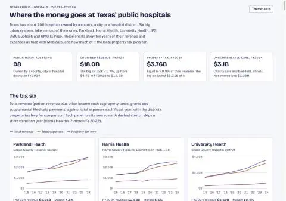

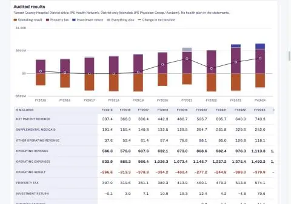

The big six now have their audited results on the page: FY2015–2024 for five of them, and FY2019–2024 for UMC Lubbock. I entered the figures by hand from each district's audit reports, and a small script confirms every year adds up. The page loads with no errors.

**FY2024, and totals over all audited years:**

| System | Operating result FY24 | Property tax FY24 | Net position change FY24 | 10-yr operating result | 10-yr property tax | 10-yr net position change |
|---|---|---|---|---|---|---|
| Parkland | −$783M | $816M | $141M | −$5.97B | $6.75B | $1.34B |
| Harris Health | −$816M | $874M | $140M | −$6.18B | $6.85B | $979M |
| University Health | −$407M | $678M | $368M | −$3.21B | $4.81B | $1.74B |
| JPS | −$309M | $539M | $336M | −$3.36B | $4.34B | $1.32B |
| UMC Lubbock (FY19–24) | −$28M | $36M | $44M | +$110M | $171M | $439M |
| UMC El Paso | −$173M | $148M | −$29M | −$1.24B | $1.15B | −$62M |

"Operating result" is what's left after running the hospitals; "net position change" is the audited equivalent of net income.

**What this shows:**
- **JPS's surplus isn't unusual for its size.** Its operating loss is the smallest of the four big tax-funded systems, so its tax covers more of it. University Health saw a bigger surplus over the decade.
- **Parkland and Harris have losses about twice JPS's**, and their taxes cover them with less to spare.
- **UMC El Paso is the only one running behind.** Over the decade its tax hasn't fully covered its operating losses.
- **UMC Lubbock is the outlier.** Its hospitals roughly break even and it collects only about $36M in tax.
- **Investment income grew a lot after 2022** as interest rates rose: $77–124M a year now at Parkland, Harris, University Health and JPS.

**What's on the page:**
- A new "What the audits say" section after the big six, with the table above. Selecting a row opens that system below.
- In the one-hospital view for those six, a new audited results panel: a bar chart of operating result, property tax, investment return and everything else, with the change in net position as a line. Under it is a year-by-year table that includes capital spending and the Medicare report's net income for comparison. The sources are linked in the note.
- An "Audited operating result" figure in each big-six panel.

**How I made them comparable:**
- **District hospitals only.** I left out the health plans every system except JPS and UMC Lubbock runs, plus UMC El Paso's children's hospital and the foundations.
- **University Health doesn't report its supplemental Medicaid money separately**, so for it that's inside patient revenue.
- **Investment income is partly worked out by me** for University Health, and for Parkland's 2017, because their statements don't list it on its own line.

**Gaps:**
- UMC Lubbock's audits before 2019 aren't online. I checked the federal audit clearinghouse, UMC's own site and the Internet Archive.
- UMC El Paso's FY2024 leaves out a transfer between it and its health plan, because I couldn't read that column reliably in the report.
- Harris Health's FY2022 covers only 7 months and shows a loss, because its property tax is booked in the following year.

The source files are in [audited/](texas-public-hospitals-opus-5.5-medium/audited). The landing-page card and `prompt.md` are updated. Nothing is committed.

Sources:
- [Federal Audit Clearinghouse](https://app.fac.gov/dissemination/search/) (single audit reports for Parkland, Harris Health, University Health, UMC El Paso, UMC Lubbock)
- [JPS audited financial statements](https://www.jpshealthnet.org/node/13)
- [UMC Health System audited financial statements (2024)](https://www.umchealthsystem.com/wp-content/uploads/2025/09/2024-Audited-Financial-Statements.pdf)

## You

Ok, so for someone who doesnt really understand detailed financials like this - for any of these systems, are they in the red, or are their operating reserves increasing - that is, are they losing money every year?

## Claude

No, mostly the opposite. Five of the six end most years with more money than they started with. UMC El Paso is the only one that is really in the red.

Think of each one like a household:
- **The day job (running the hospitals) loses money every year.** Patients and insurers pay less than the care costs. That's expected, since these hospitals exist to treat people who can't pay.
- **Property tax is a large, steady allowance from the county's taxpayers.**
- **The bottom line is whether the allowance plus investment income covers the loss.** That's the "change in net position," roughly "did savings go up or down this year."

**Did they end the year ahead? (FY2015–2024)**

| System | Years behind | Years ahead | Net over the decade |
|---|---|---|---|
| University Health (San Antonio) | 0 | 10 | +$1.74B |
| Parkland (Dallas) | 2, both tiny (2016, 2018) | 8 | +$1.34B |
| JPS (Fort Worth) | 2, both small (2017, 2018) | 8 | +$1.32B |
| Harris Health (Houston) | 2 (2017, and the odd 7-month 2022) | 8 | +$979M |
| UMC Lubbock (2019–2024 only) | 0 | 6 | +$439M |
| UMC El Paso | 6 | 4 | −$62M |

**What it means for each:**
- **Parkland, JPS and Harris** roughly broke even in 2015–2019. Since 2020 they've added $100–330M a year each. That came from a mix of COVID relief money, rising property values, extra Medicaid payments and, lately, interest on their savings.
- **University Health** has grown every year, and the gains keep getting bigger ($368M in FY2024).
- **UMC Lubbock** is the oddball. Its hospitals roughly break even on their own, so it needs very little tax and still ends ahead.
- **UMC El Paso** is the only one actually losing money. It was behind in 6 of 10 years and lost $29M in FY2024. That's a few percent of a roughly $900M budget, so it's tight rather than a crisis, but its tax doesn't fully cover what its hospitals lose.

**Ending ahead doesn't mean money sitting idle:**
- **Construction:** a new tower or clinic gets paid for over many years, and only a slice of its cost counts as an expense each year. So a system saving up for one, or just finishing one, looks like it's making money. JPS has set aside $819M for building projects. University Health spent $391M on buildings and equipment in FY2024 alone.
- **Savings vs. cash:** "net position" counts buildings and equipment, not just cash in the bank. The one cash number I pulled is JPS: about $2.4B in cash and investments, a figure that includes $437M it borrowed in 2023 to build.

**Bottom line:** four of the big six have been building up money every year since about 2020. That's why there's local debate over whether their tax rates are too high; Tarrant County, for example, has cut JPS's rate three years in a row. UMC Lubbock is healthy on a much smaller tax. UMC El Paso is the one running a deficit.

The page doesn't put it this plainly yet. A short summary near the top could show "ended ahead / ended behind" by year for each system.

## You

Is there enough data in these report to add a sankey diagram, at least for the big 6?

## Claude

Yes, the audit reports have enough for all six, for any year from FY2015 to FY2024 (Lubbock from FY2019). Money would flow from where it comes from, into the system, out to what it pays for.

**Where the money comes from (left):**
- Patient revenue (what insurers, Medicare, Medicaid and patients paid)
- Supplemental Medicaid payments. University Health doesn't report these separately, so for it they stay inside patient revenue.
- Property tax
- Investment income
- COVID relief (2020–2023), and other, smaller sources
- "Drawn from savings," in years a system ended behind (UMC El Paso in most years)

**Where it goes (right):**
- Salaries and benefits
- Supplies, drugs, purchased services and doctors' fees
- Depreciation (the yearly slice of building and equipment costs)
- Interest on debt
- UMC El Paso's payments to the state to unlock extra federal Medicaid money (through 2019)
- "Added to savings," in years a system ended ahead

**Limits:**
- **I'd need to go back to the reports for the expense lines.** I only saved total expenses so far. Salaries and benefits is listed on its own everywhere. The rest is grouped differently by each system: Harris Health before 2022, University Health and UMC Lubbock lump purchased services, supplies and other together. So "Supplies, services and other" would have to be one band for everyone, with Parkland, JPS, UMC El Paso and Harris Health from 2022 split finer.
- **Capital spending can't go in the same diagram.** Spending on buildings is cash out the door, while the Sankey is built on the yearly-expense view where only depreciation counts. Mixing them would double-count. It can sit beside the diagram as a separate figure, such as "plus $391M spent on buildings and equipment."
- **Health plans stay out**, the same as in the audit figures already on the page. Including them would add another $0.9–1.8B of premium money flowing in and out for some systems and swamp the picture.

It would fit in the audited-results panel of the one-hospital view, with a year picker, so the diagram matches the table under it.

## You

Yes, build it

## Claude

Expense breakdown added for all six; totals still check. Building the Sankey.

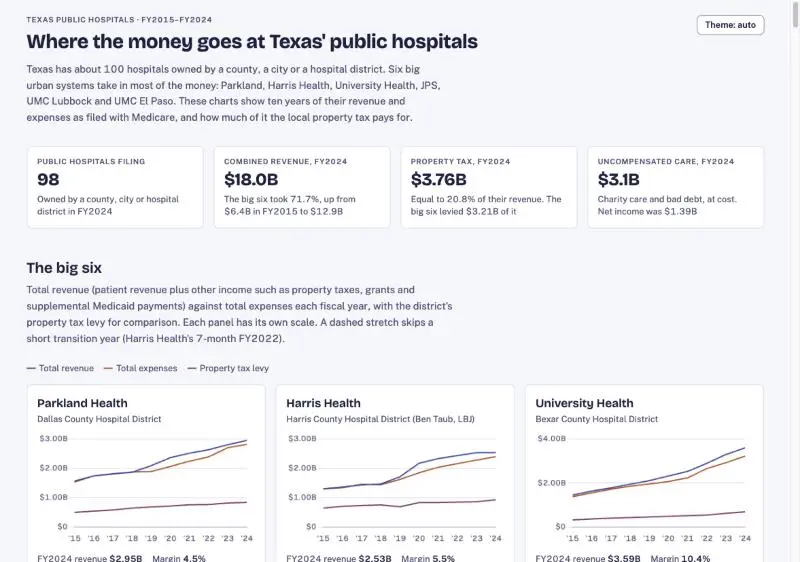

Scroll didn't stick in the screenshot. Retrying with an explicit offset.

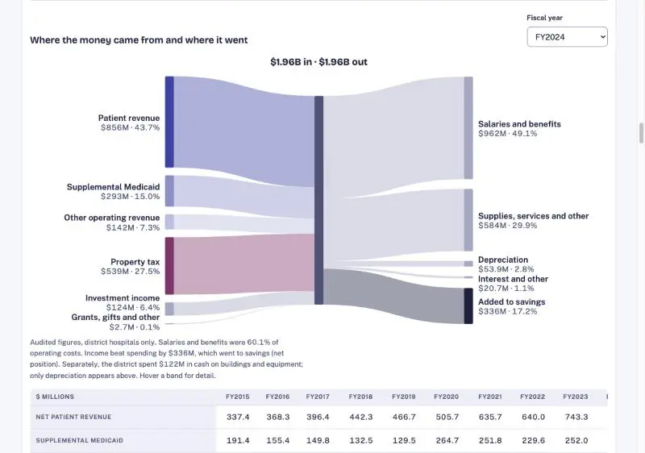

Sankey renders well for JPS. Checking a deficit year (UMC El Paso) and dark mode.

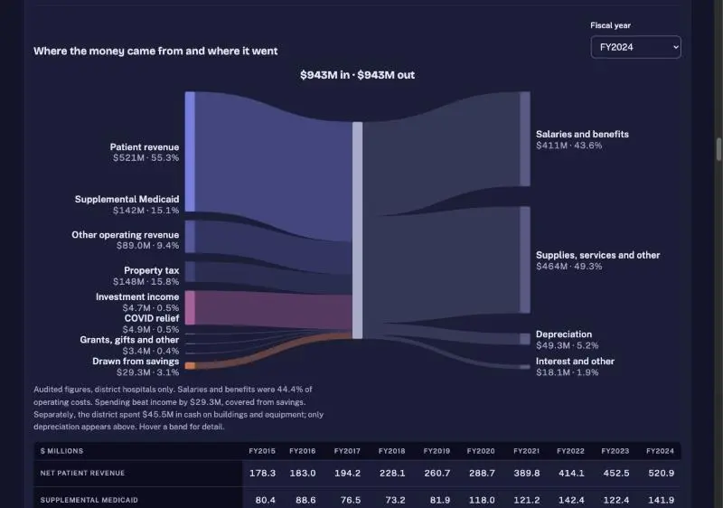

Labels drift away from their bars when there are many small flows. Fixing the layout so every bar gets its own slot with its label beside it.

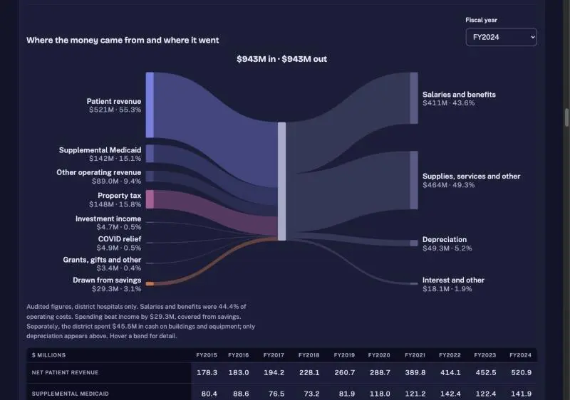

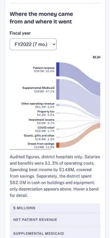

The Sankey diagram is in. It appears in the audited-results panel when you pick one of the big six in the one-hospital view. There's a year picker, so you can look at FY2015–2024 (Lubbock FY2019–2024). It works in light, dark and phone layouts, and loads with no errors.

**How to read it:**
- **Left side, where the money came from:** patient revenue, supplemental Medicaid, other operating revenue, property tax, investment income, COVID relief, and grants and other. In a year that ended behind, there's an orange "Drawn from savings" band.
- **Middle:** total money in, which always equals total money out.
- **Right side, where it went:** salaries and benefits, supplies and services, depreciation, and interest. UMC El Paso through 2019 also has "Payments to the state" (money sent to the state to unlock extra federal Medicaid). In a year that ended ahead, there's a dark "Added to savings" band.
- **Hovering a band** shows its dollar amount and a one-line explanation.
- **The note under the diagram** gives the salary share of costs, the surplus or deficit, and the cash spent on buildings and equipment. That cash is kept out of the diagram because only depreciation counts as a yearly expense.

**FY2024 examples:**
- **JPS:** $1.96B in. Property tax was 28% of it, and $336M (17%) went to savings.
- **UMC El Paso:** $943M in. Property tax was 16%, and it drew $29M (3%) from savings.

**Things to know:**
- **Expense detail is partly grouped.** I pulled salaries and depreciation from each audit report, and everything else goes in "supplies, services and other." Harris Health before 2022, University Health and UMC Lubbock only report those costs as one line, so a finer split wasn't possible for everyone.
- **Harris Health's 7-month FY2022 looks like a big deficit** ($148M drawn from savings). Its property tax is recorded in the following year, so almost none of it falls in that short period. The note under the diagram says so when you pick that year.

`prompt.md` is regenerated. Nothing is committed.

## You

JPS for 2024 is showing salaries and benefits of $962M in the sankey, but in the detail chart shows salaries of $600.2M. Where is the $362M difference coming from?

## Claude

The two numbers measure different things, and the detail table's label makes them look like the same thing.

- **$600.2M (detail table)** comes from the hospital's Medicare report, and it's wages only.
- **$961.5M (Sankey)** comes from JPS's audit. It's "salaries and related expenses" for the whole district.

**Where the $362M goes, FY2024:**

| Piece | Amount | Source |
|---|---|---|
| Hospital wages | $600M | Medicare report |
| Employee benefits (payroll tax, health insurance, retirement) | +$121M | Medicare report, listed separately as "wage-related costs" |
| Benefits for medical residents | +$2.5M | Medicare report |
| **Hospital pay and benefits** | **≈ $723M** | |
| Acclaim Physician Group (JPS's own doctors' group) | ≈ +$190M (estimate) | Audit |
| Accounting differences, mostly pension expense | ≈ +$45M (estimate) | Audit |
| **Audited salaries and related expenses** | **$962M** | |

**The two estimated pieces:**
- **Acclaim Physician Group** files no Medicare report of its own but is counted in JPS's audit. Its total costs were $209M in FY2024, mostly doctors' pay. The audit doesn't break Acclaim's costs into salaries vs. other, so I can only estimate its pay at about $190M. In the hospital's Medicare report, those doctors show up as purchased services, because the hospital buys their time from Acclaim.
- **The last ~$45M is my best explanation, not something I could trace line by line.** The audit books pension cost using an actuarial estimate, which JPS says rose in 2024. The Medicare report generally counts what was actually paid in. Paid-time-off accruals can also differ.

**The scopes do match otherwise.** The audit's hospital-only column shows $1.475B of operating expenses, almost exactly the Medicare report's $1.472B. So the two sources agree on the hospital; the audit just adds Acclaim and groups costs differently.

The real problem is that the detail table's row just says "Salaries," so it reads as directly comparable to the Sankey. It should say "Wages (Medicare report)" and have a benefits row beneath it.

## You

Yes, fix labels

## Claude

The salary row is fixed: the detail table now shows wages, benefits and a combined total as three separate rows. The page loads with no errors.

**What changed:**
- **The single "Salaries" row is now three rows:** "Wages (cost report)", "Benefits (cost report)" and a bold "Wages and benefits" total. Benefits here means payroll taxes, insurance and retirement, which the Medicare report lists apart from wages. I added that figure to the data for every hospital, not just JPS.
- **The table heading now says "The numbers, from the Medicare cost report."** The text under it explains why the audit's salaries and benefits run higher: the audit covers the whole district, including any physician group the district owns.
- **The note under the Sankey says the same thing** and points to the table.

**JPS FY2024 now reads:** wages $600.2M + benefits $123.1M = $723.3M in the table, next to $962M of salaries and benefits in the Sankey. The remaining roughly $238M is mostly Acclaim Physician Group, JPS's own doctors' group. The rest is pension accounting.

`prompt.md` is regenerated. Nothing is committed.

## You

Can we add a county map? The main metric I would want to see is a gradation on margin, but maybe some of the other values would be good to show as well.

## Claude

Building the county map. Outlines came out suspiciously small (8 KB); checking them.

Map code is written. Loading it in the browser.

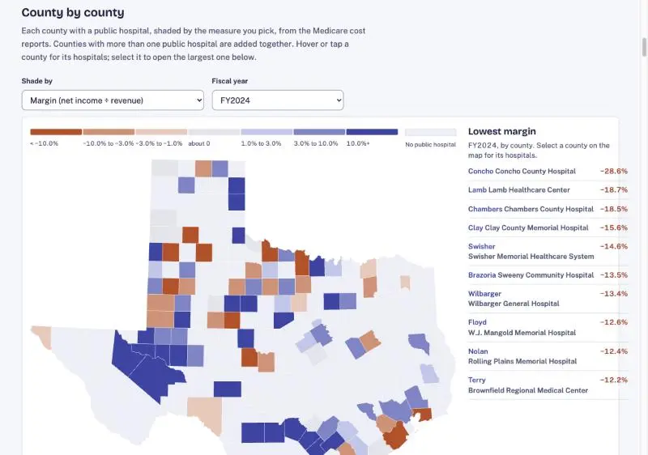

Map works. Two fixes: "about 0" gray looks like "no hospital", and the side list runs county and hospital names together.

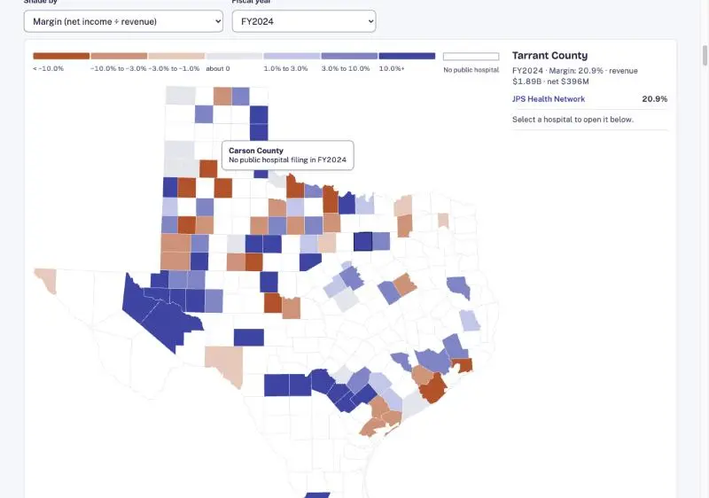

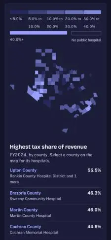

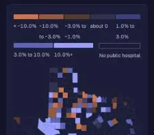
