# Prompts

- **Model:** claude-opus-5-5
- **Effort:** medium
- **Session(s):** b7ccef0b-65ad-4eb8-a775-f14bbc035d16
- **Tokens:** input 102, output 82702, cache read 7703112, cache write 182909
- **Cost (tokscale estimate):** $4.66

## You

Make a motion graphic explainer with a voiceover that can run in the browser that shows what a topology preserving geometry simplification does, vs not using topology preserving.

Lets use the dark version of the bluebonnet design system for this (or make it toggleable)

## Claude

Checking for local Voicebox TTS server to pre-render narration.

Voicebox up (Kokoro voices). Plan: canvas animation driven by real Douglas–Peucker + arc-based simplifier, narration pre-rendered per scene with Heart voice. Checking component classes.

Writing geometry module first, tune shapes with node.

Map clean now (0 crossings). Adding the three single-shape failure cases.

Inlet case found (D=170, rx=26, S=50, wy=95). Setting defaults, then narration script + voice build.

Now narration source + voice build script.

Writing the page while voice renders.

Voice done (~2:45). Now the animation engine.

Root server already up on 8817. Checking each scene.

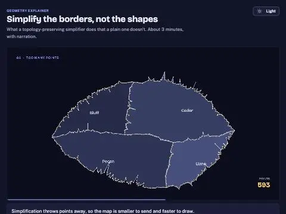

Spikes from guide-curve pull at deep levels. Fix: displace on straight line, then add bend offset.

Make cameras fit computed bbox instead of hardcoding.

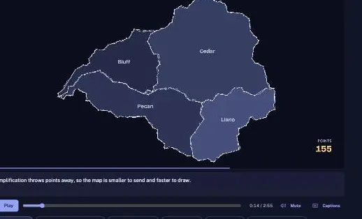

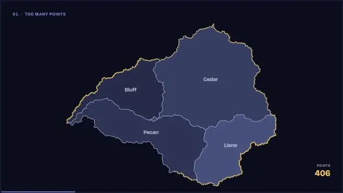

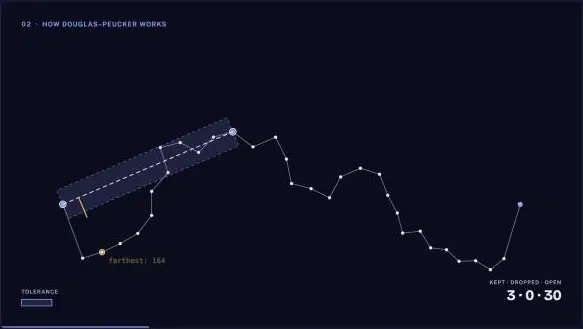

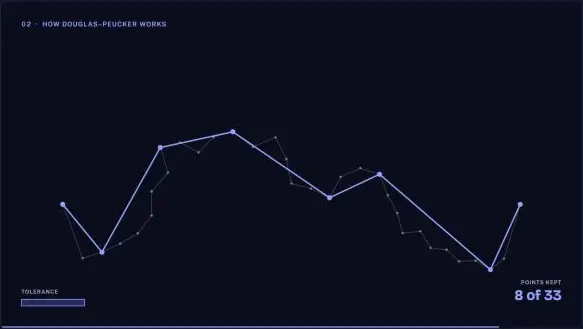

DP step pacing too fast at start. Rework schedule to align to narration cues.

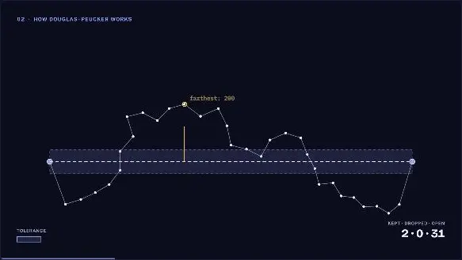

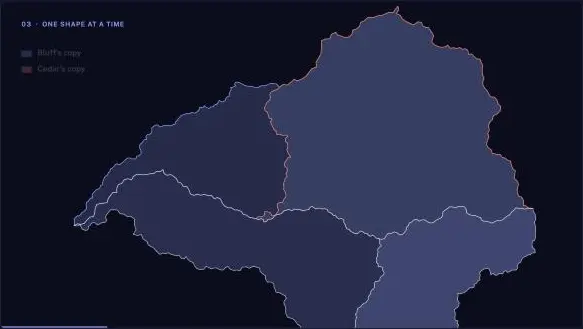

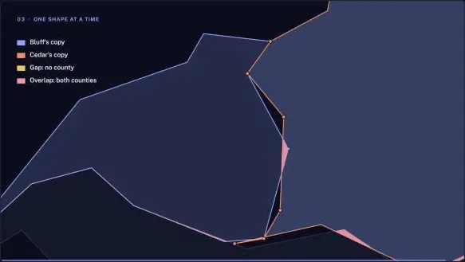

Gap mask bug: sequential destination-in intersects rings instead of union. Use coast outline.

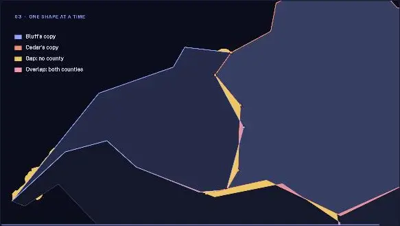

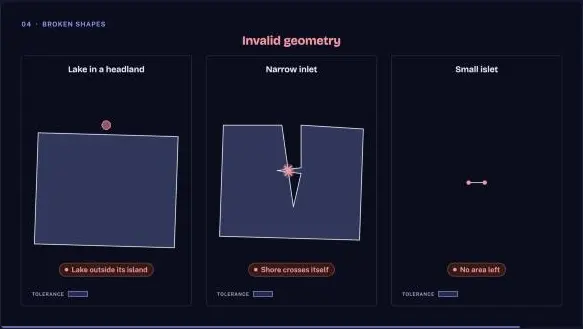

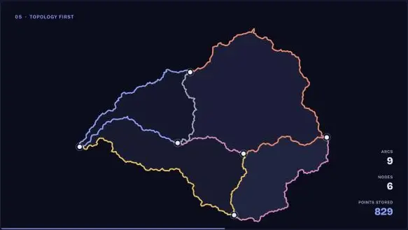

Gaps work. Adding faint original outline in shape panels and non-clashing arc colors.

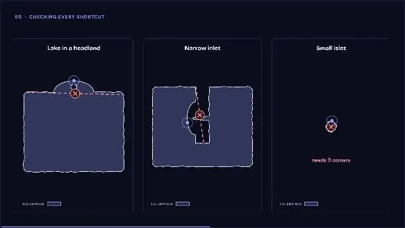

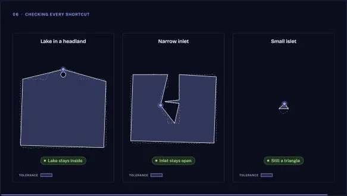

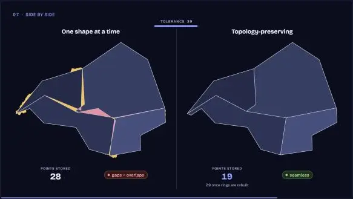

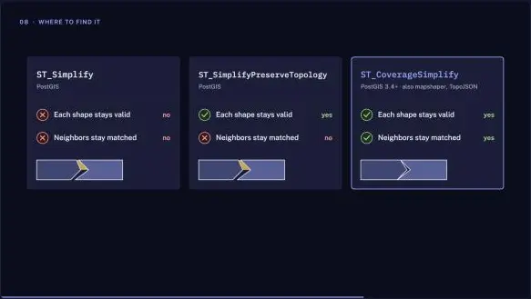

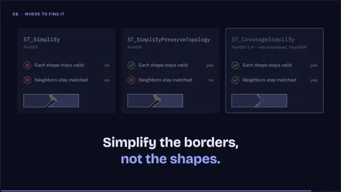

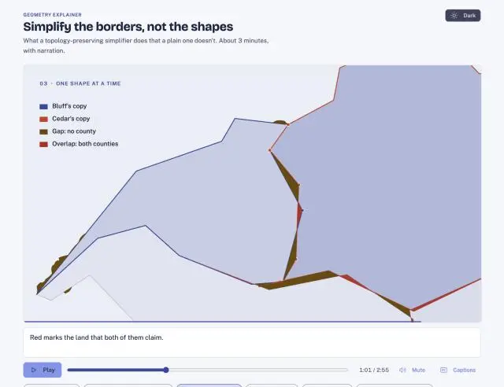

Light theme "gold" renders brown (warning token). Swap gaps to firewheel.

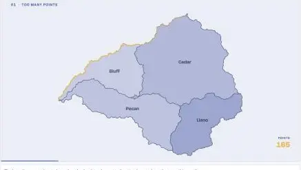

Playback + audio clock work. Mobile layout check, and reset theme to dark.

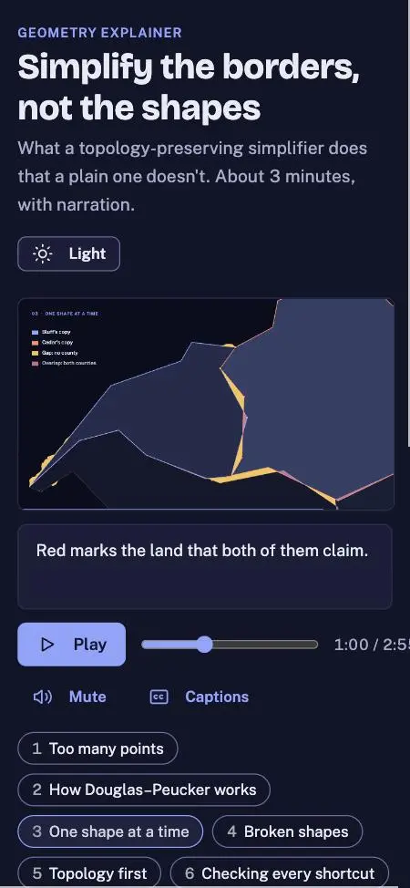

Time label clipped on phone. Fix, then landing-page entry and screenshot.

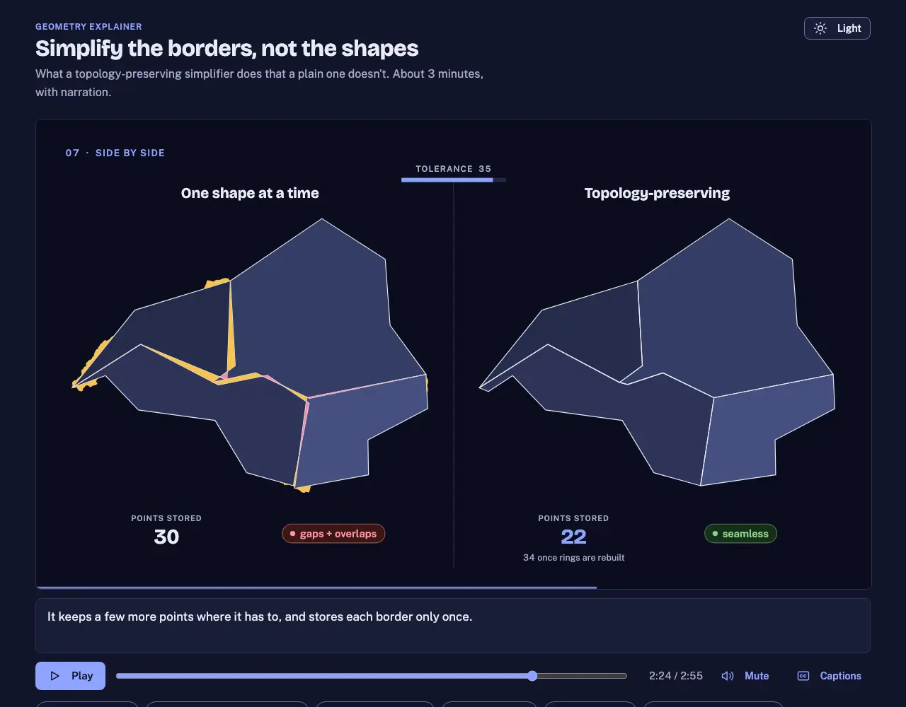

Counters confusing (stored vs drawn). Show drawn on both sides, stored as subline.

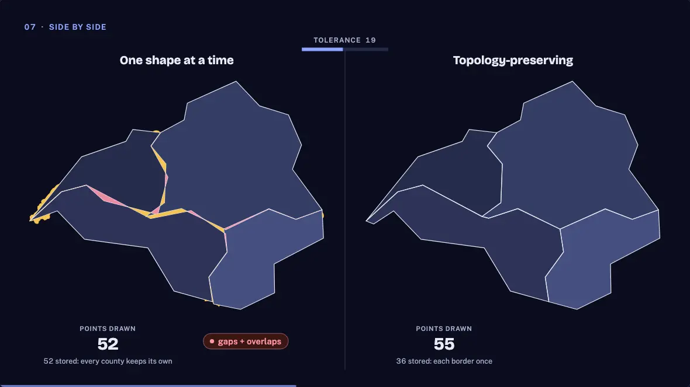

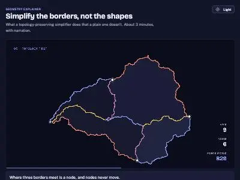

The explainer is built: [topology-simplify-opus-5.5/index.html](topology-simplify-opus-5.5/index.html), about 2:55 long. Open it at `http://localhost:8817/topology-simplify-opus-5.5/` on the site-root server that's already running. I checked every scene in the browser pane at desktop and phone width, and there were no console errors. I couldn't listen to the voiceover, so the audio quality hasn't been checked by ear.

**What it shows.** Nothing is a canned drawing. A seeded map of 4 counties is stored as 9 shared borders that meet at 6 junction points, and every frame is computed live:
1. **Too many points:** the map with all 1,152 points, then simplified.
2. **How Douglas–Peucker works:** the algorithm step by step on one line. You see the shortcut, the tolerance band and the farthest point, then the keep-or-drop decision, then a tolerance sweep.
3. **One shape at a time:** each county simplifies its own copy of the shared border. Gaps fill in gold and overlaps in red.
4. **Broken shapes:** three ways a single shape goes invalid. A lake ends up outside its island, an inlet's shore crosses itself, and a small islet collapses into a line.
5. **Topology first:** the shared borders are drawn one by one, the junctions are pinned, and each border is simplified once. The result has no gaps or overlaps.
6. **Checking every shortcut:** the rejected shortcuts are crossed out, and the point that has to stay is highlighted.
7. **Side by side:** the plain method and the topology-preserving one together while the tolerance climbs, with point counts.
8. **Where to find it:** `ST_Simplify`, `ST_SimplifyPreserveTopology` and `ST_CoverageSimplify`, then a closing line.

**Look.** It uses Bluebonnet and opens in dark mode. The Light button switches themes and remembers the choice. Gaps use the firewheel gold in both themes because the warning color turned brown in light mode.

**Voice.** I rendered the narration with Kokoro's Heart voice on your local Voicebox. Each sentence is generated separately, so the captions and the animation cues line up with the speech. To change the script, edit `narration.json` and run `python3 build_voice.py`.

**Controls.** Play, a scrubber, chapter buttons, mute and captions. Space pauses and the arrow keys skip scenes.

**Files:**
- `geo.js`: the map, the simplification math and the validity checks
- `app.js`: the scenes and the player
- `narration.json`: the script
- `narration.js` and `audio/*.mp3`: generated by the build script

I added a card to `demos.js` in Educational tools and saved a screenshot to `screenshots/projects/topology-simplify-opus-5.5.webp`. I put the card next to "Within 10 Miles," a ZIP-radius explainer already in `demos.js` that wasn't in the starting git status. It's probably another session's work, so I left it alone.

Nothing is committed yet, and `prompt.md` isn't written.

## You

Done, write prompt.md
