# Prompts

- **Model:** claude-opus-5-5
- **Effort:** high
- **Session(s):** 194c6b90-9759-426a-a6c6-815c94d8e8df
- **Tokens:** input 258, output 166677, cache read 30771253, cache write 978209
- **Cost (tokscale estimate):** $14.38

## You

Lets create a new subfolder - lets call it -tx-lege.

What I want to do is look at the legislative history of a Texas Legislature bill. Lets write a python script that can pull this.
Example:
https://legiscan.com/TX/drafts/SB17/2025

I want the original text of the bill, and all of the votes. I want to see amendments.

Basically, I want to see the sequence of events, starting with the initial introduction, to see who voted for certain amendments and who didnt, who consistently voted one way or another.

## Claude

Data source confirmed: Texas Legislature Online (no key needed) has full action history plus HTML journals with roll-call names. LegiScan blocks scraping. Now checking journal vote format.

Sources mapped. Writing code now: `tx-lege/` package with fetch, TLO pages, journal vote parser, people/party matcher, analysis, HTML report.

Writing journal parser (sections by bill header, record votes, statements of vote).

Writing assembly + analysis module.

Core fetch works (26 record votes found). Fixing party lookup: switching to Legislative Reference Library, which has party for every member of every session.

Data checks out: 26 record votes (4 Senate, 22 House), all linked to their amendments. Now writing HTML report and timeline.

Report generated. Checking it in browser.

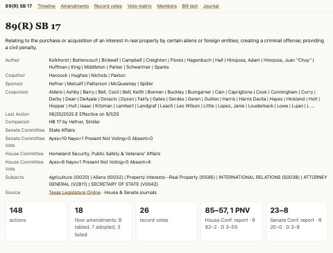

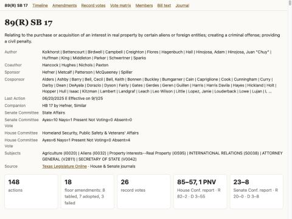

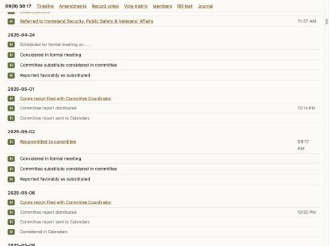

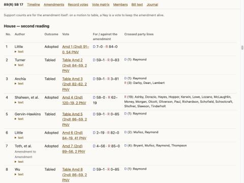

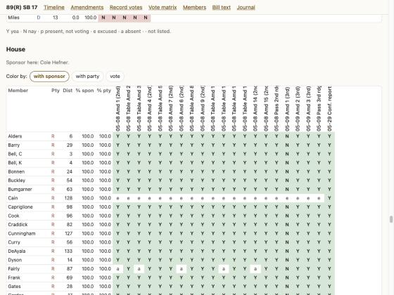

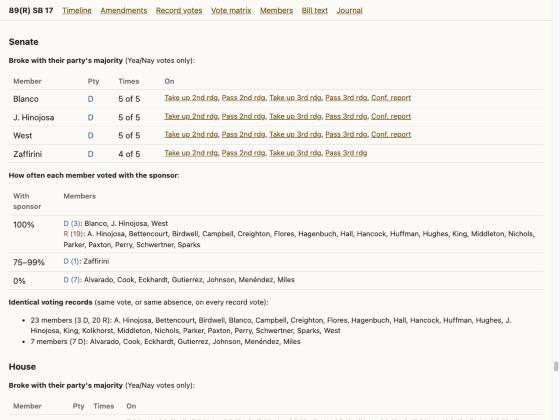

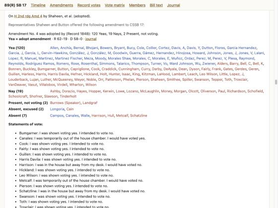

SB17 report renders correctly. Now testing other bills (Senate floor amendments, House-origin bill, older session) to shake out parser edge cases.

Found gaps: Senate "deemed" votes (viva voce with listed dissenters), section breaks at "AT EASE", reading lost after "REMARKS" headers. Fixing.

Fixing name matching for renamed members and Speaker lookup (LRL has a Speaker filter).

Senate voice votes with "deemed" members now captured (HB 2: 18→26 votes, SB 2: 83→88). Re-validating.

All amendments now link to votes (only withdrawn ones lack them). Adding "voice vote, deemed" labeling to the report, then tests and README.

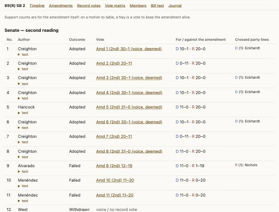

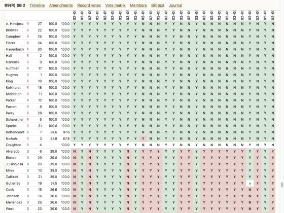

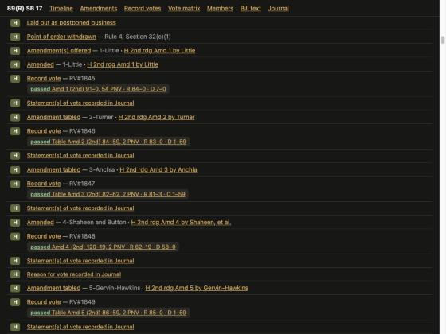

Dark mode fine. Writing unit tests.

TLO history has data errors (RV#456 listed for ~70 different House votes). Making House vote capture section-based too, with smarter action linking.

House used "Record No. 456" for 70 amendments by rule suspension — TLO was right. Fixing: allow reused RVs, map amendments to reused vote, and don't stop at "RULES SUSPENDED".

Journal HTML markup differs before 2013 (83rd Lege). Adding a fallback parser for older journals.

Tally check passes on all 6 test bills (parsed names match official Yea/Nay counts for every vote). Updating README and adding an old-format test.

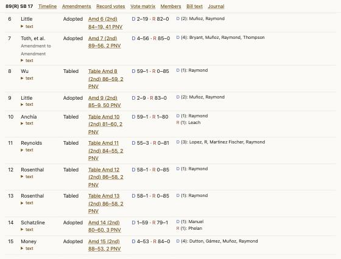

## You

Don't commit yet; I'll review the report first.

## Claude

Nothing committed. Notes for your review:

**Where to look**
- Report: [output/89R-SB17/report.html](tx-lege/output/89R-SB17/report.html). It's also open in the browser pane at `http://localhost:8790/89R-SB17/report.html`.
- Other bills I tested are next to it in `output/`: `89R-SB2`, `89R-HB2`, `87R-SB8`, `85R-SB4` and `82R-SB14`. 85R SB 4 is the big one, with 185 amendments.
- Code is in [txlege/](tx-lege/txlege). Usage notes are in [README.md](tx-lege/README.md).

**Things to know**
- **Data source:** the script doesn't use LegiScan. Its site blocks scripts and its API needs a key. Instead it pulls from the official sources LegiScan itself uses: Texas Legislature Online for the bill history, text and amendments, the House and Senate journals for each member's vote, and the Legislative Reference Library for party.
- **Tables:** many amendments die on a "motion to table", where a Yea is a vote against the amendment. The amendments table flips those so its for/against columns are about the amendment itself.
- **Senate voice votes:** when the journal lists only the dissenters ("deemed"), I count everyone else present as voting the stated way, and mark the vote "(voice, deemed)".
- **Reused votes:** in 85R SB 4 the House suspended its rules to apply Record No. 456 to about 70 amendments. Those amendments link to that vote.
- **Older sessions:** member-by-member votes only work back to about 2005. Before that, the journals exist only as scanned PDFs. Committee votes are counts only, with no names.

**Changes outside the brief**
- I named the folder `tx-lege` instead of `-tx-lege`, because a name starting with a dash gets read as an option by `cd`, `ls` and other shell commands. Rename it if you want the dash.
- I added a `tx-lege-report` entry to the repo-root `.claude/launch.json` so the report can be previewed in the browser pane.
- `.cache/` (45 MB) and `output/` are gitignored.

## You

Lets run this for HB 128 89 and SB 1349 89

## Claude

Both bills now fully captured. Running regression on earlier bills + tests.

No regressions. Adding tests for the two new formats.

Both reports are generated. For every vote, the member-by-member Yeas and Nays add up to the official totals. Neither bill had a party-split amendment fight, so the reports are short.

**HB 128: sister-city agreements with foreign countries** (Orr in the House, Kolkhorst in the Senate). Effective 9/1/25.
- House 2nd reading passed 97–41: R 84–0, D 13–41.
- House 3rd reading passed 104–32: R 83–0, D 21–32. Eight more Democrats voted yes on the second vote.
- The Democrats who voted yes both times were Raymond, Muñoz, Longoria, Guerra, Cortez and Bhojani.
- In the Senate it passed both readings 29–2 by voice vote, on the calendar for uncontested bills. Cook and Eckhardt voted Nay.
- There were no floor amendments.

**SB 1349: transnational repression offenses** (Hughes in the Senate, Janie Lopez in the House). Effective 9/1/25.
- In the Senate, Gutierrez offered the only amendment, a foreign misinformation offense. It failed 11–20, a straight party-line vote.
- Every other Senate vote was 30–1, with Cook as the lone Nay throughout.
- House 2nd reading passed 135–4; 3rd reading passed 125–15. All 15 Nays were Democrats, including Reynolds, Collier, Vo, Talarico and J. Jones.

**Parser changes.** At first the script missed some Senate votes on these two bills, because the Senate journals recorded them in two formats it didn't handle yet:
- HB 128 passed the Senate in a bulk list of uncontested bills that just reads `(29-2) "Nays" Cook, Eckhardt`.
- On SB 1349, one voice vote was recorded only as "Senator Cook asked to be recorded as voting Nay."

I added parsing for both, plus a test for each. The 6 earlier bills give the same results as before.

Reports:
- [output/89R-HB128/report.html](tx-lege/output/89R-HB128/report.html), also at `http://localhost:8790/89R-HB128/report.html`
- [output/89R-SB1349/report.html](tx-lege/output/89R-SB1349/report.html), also at `http://localhost:8790/89R-SB1349/report.html`

## You

Can we update the text changes to look more like a github diff?

## Claude

Paragraph text works. Now GitHub-style diff renderer.

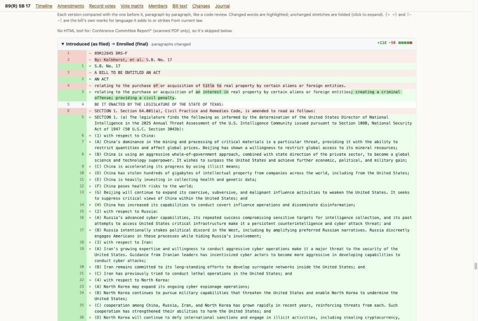

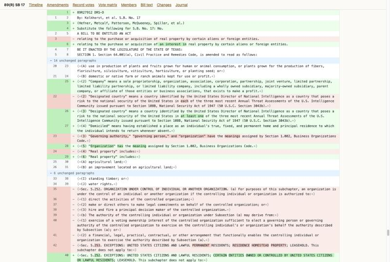

Diff renders GitHub-style with word highlights. Checking expand button, styled full text, dark mode.

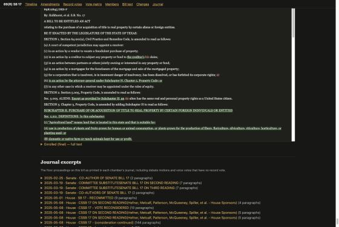

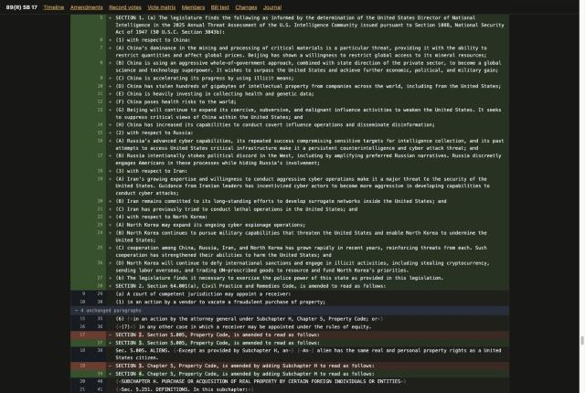

Dark mode good. Adding diff tests, regenerating all reports.

Version changes in the report now look like a GitHub diff. Open them with the new **Changes** link in the nav bar, e.g. `http://localhost:8790/89R-SB17/report.html#changes`. I checked SB 17 in the browser in light and dark mode, and all reports are regenerated.

**What it looks like**
- Each version gets a collapsible block with a header like GitHub's: `+53 −37`, the red/green squares, and "Engrossed → House Committee Report".
- Removed paragraphs are red and added ones green, with old and new paragraph numbers in the left columns. Within a changed paragraph, the exact words that changed are highlighted (for example "an interest in" or "at least one").
- Long unchanged stretches fold into a "⋯ 14 unchanged paragraphs" row that expands when clicked.
- The first block compares the bill as filed with its final version and is open by default. Then come the step-by-step diffs: Introduced → Senate Committee Report → Engrossed → House Committee Report → Enrolled.
- Versions that exist only as scanned PDFs, like SB 17's Conference Committee Report, are skipped with a note.
- In the full text and the amendment text, the bill's own changes to current law now show as green underline for added language and red strikethrough for struck language, instead of raw `{+ +}` / `[- -]` marks. Inside the diffs those marks are kept but dimmed, like source code.

**Behind it**
- The bill text used to be one printed line per row, so a single added word re-wrapped every line after it and the whole rest of the paragraph showed as changed. The text is now rebuilt into whole paragraphs, so diffs show only real edits. The `text/*.txt` and `.diff` files are now one paragraph per line too.
- The diff code is in [txlege/diff.py](tx-lege/txlege/diff.py), with a new test.
- Large bills give large reports: HB 2 is about 4.6 MB. They still load fine.

## You

When it says 89(R) or 89R - what do the 89 and the R stand for?

## Claude

**89** means the 89th Texas Legislature. Each Legislature lasts two years, starting with the January after an election. The 89th covers 2025–2026; its members were elected in November 2024 and convened in January 2025. The 1st Legislature met in 1846, so the number for a given year is (year − 1847) ÷ 2, rounded down. For 2025: (2025 − 1847) ÷ 2 = 89. That's how the script turns a LegiScan URL ending in `/2025` into 89.

**R** means the regular session. Texas holds one per Legislature: 140 days, starting in January of the odd year (2025 here) and ending around June.

**Numbers in place of R** are called sessions, also known as special sessions. Only the governor can call one, it can last up to 30 days, and it covers only the topics the governor names:
- `89(1)` is the first called session of the 89th Legislature.
- `89(2)` is the second.

Both called sessions happened in summer 2025.

In the tool, `89R`, `891` and `892` are the codes Texas Legislature Online uses for these sessions. `89(R)`, `89(1)` and `89(2)` are how the same sessions are written for people. Bill numbers start over each session, so HB 3 in 89(R) and HB 3 in 89(1) are different bills. That's why `--session` matters.

## You

Lets run the scripts/prompt-md on this conversation
