# Prompts

- **Model:** claude-sonnet-5-5
- **Effort:** high
- **Session(s):** 0a4f8fa8-492e-44cd-bca9-0a77efb4f284
- **Tokens:** input 208, output 331478, cache read 29043348, cache write 1721999
- **Cost (tokscale estimate):** $10.52

## You

Build for me a ui mockup for a worship planner. Put this in subfolder "worship-planner-sonnet-5.5". Do not reference any code already in this workspace, they are not relevant.
The focus is on the order of a service - prayers, hymns, etc, with a strong emphasis on searching a database of power-point ready slides of sheet music hymns. The target will be a cross platform desktop app, and a slightly less feature rich mobile app (likely wont have the full sheet music, but will have metadata). The mockup can be contained in a html/js/css app, but just know this will likely target native builds. The target denomination is churches of Christ.

## Claude

Data and shared helpers are done. Next is the sheet-music slide renderer.

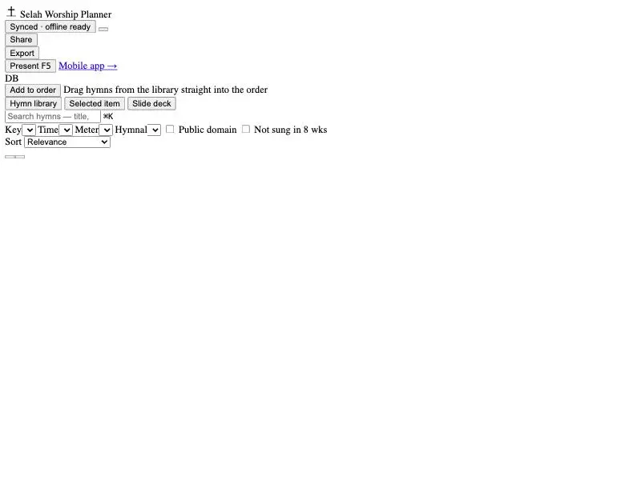

Browser pane only rendered a static snapshot, so I'm starting a local server to test properly.

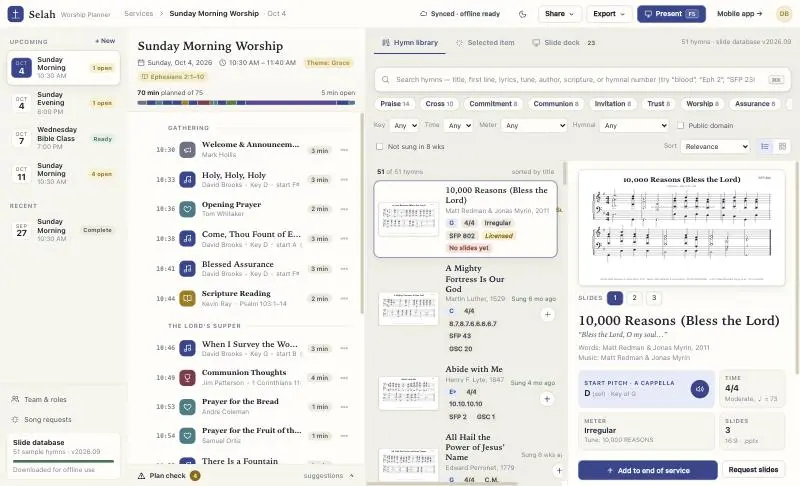

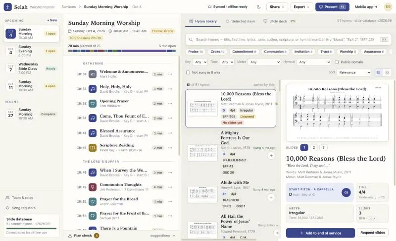

Layout tweak applied. Now checking how the sheet-music slides render at full size.

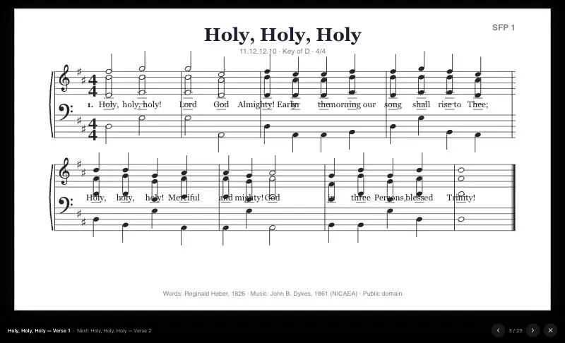

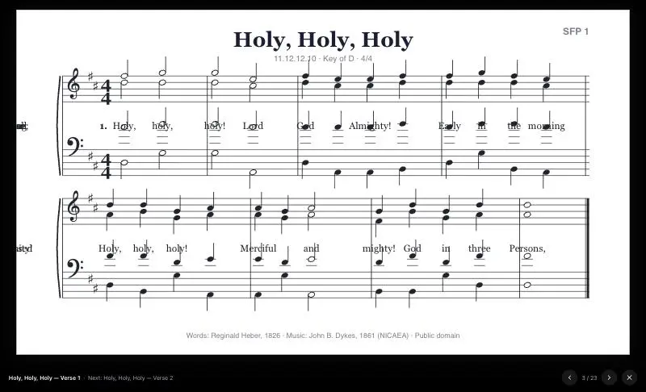

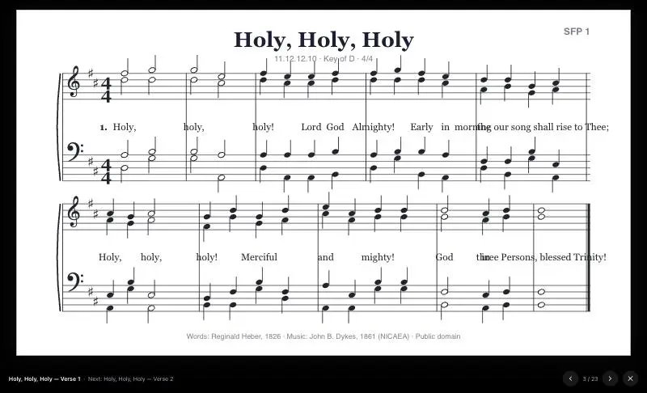

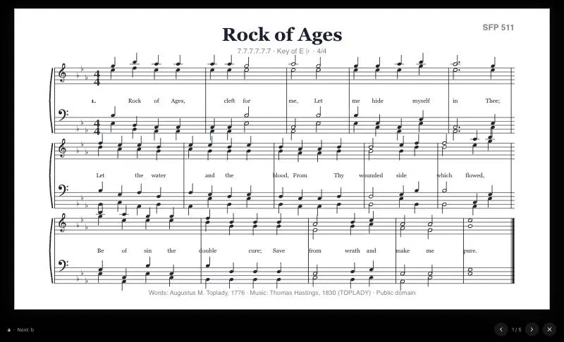

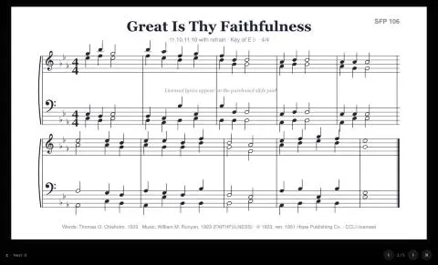

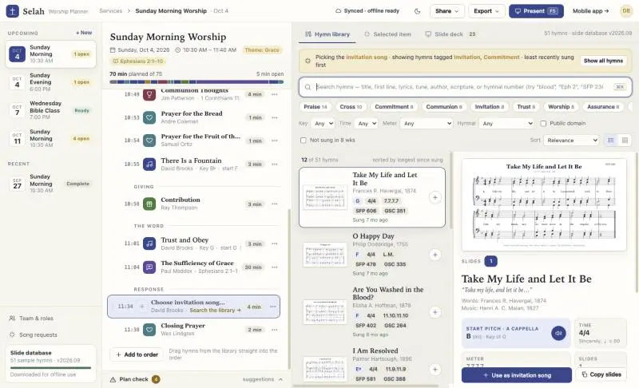

Testing the search flow next — typing into the box and checking highlights and matches.

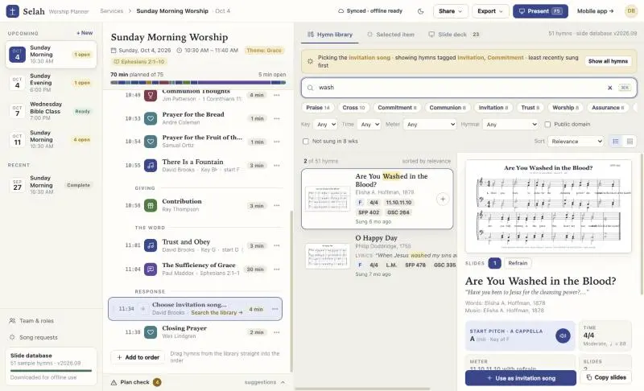

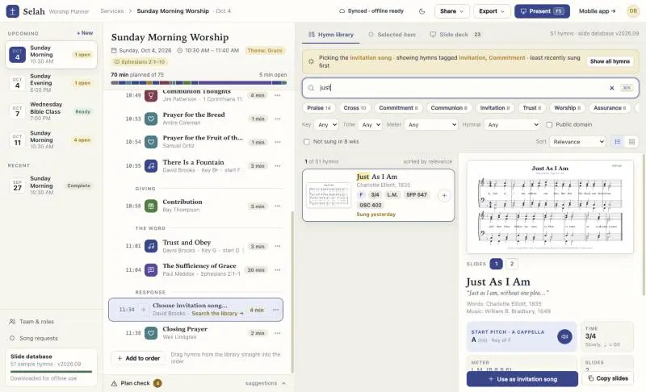

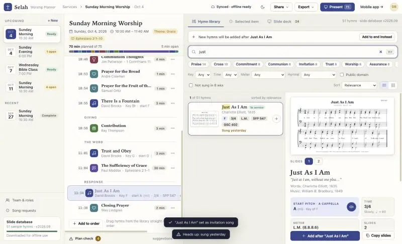

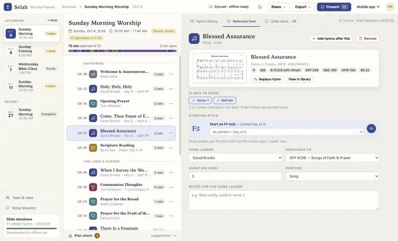

Screenshot lags one step behind; grabbing another.

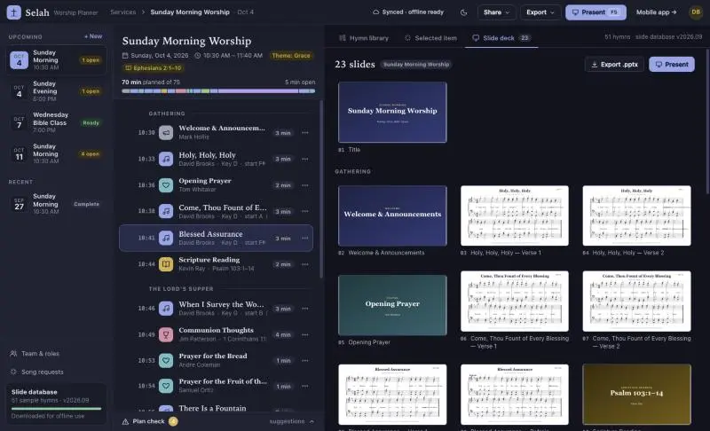

Now the mobile companion: HTML, styles, and script.

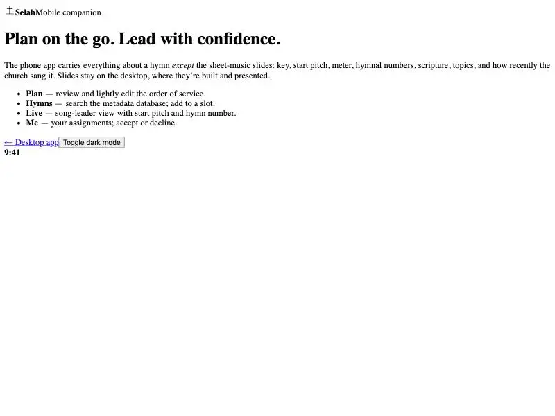

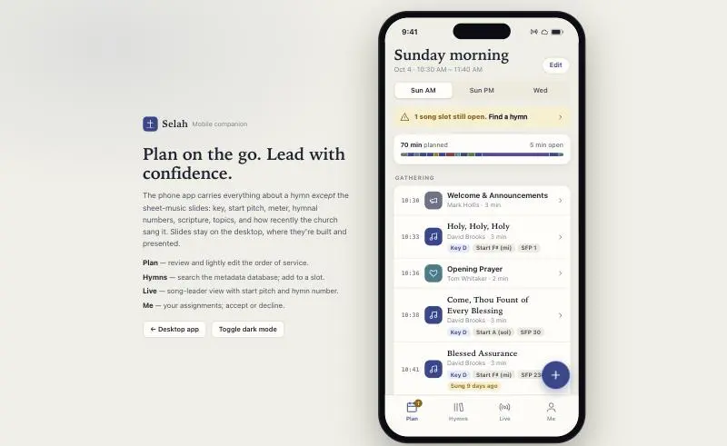

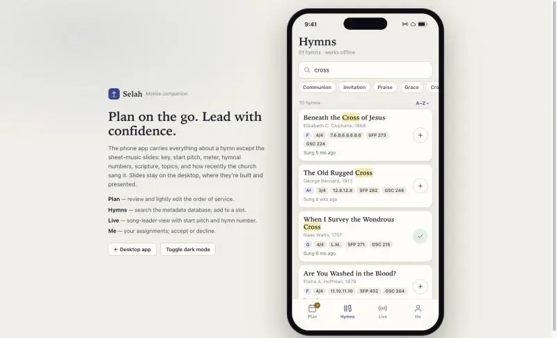

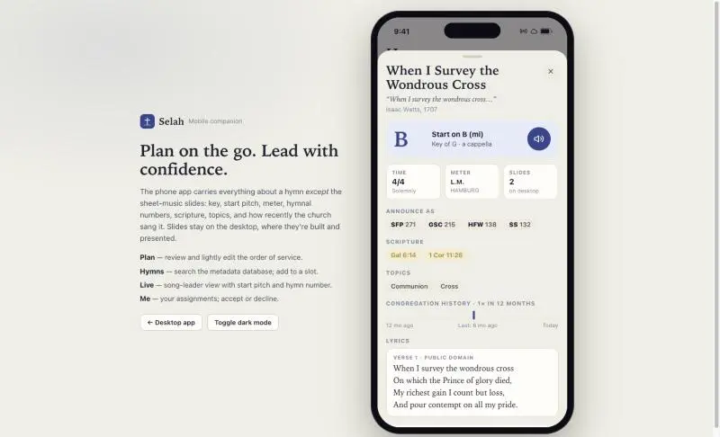

Sheet looks right. Checking the Live (leader) and Me tabs.

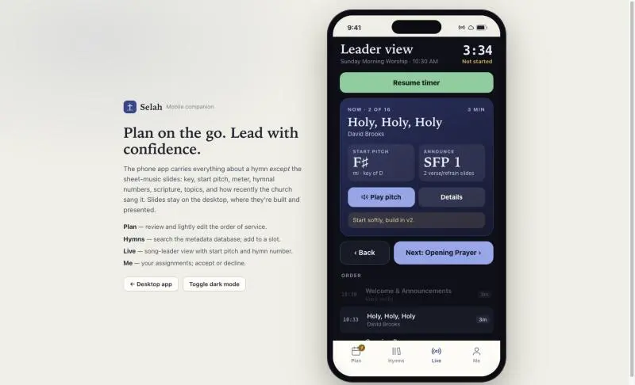

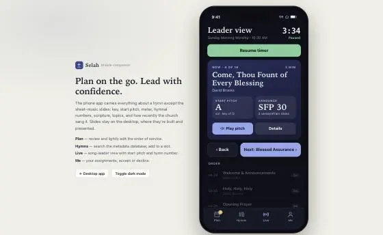

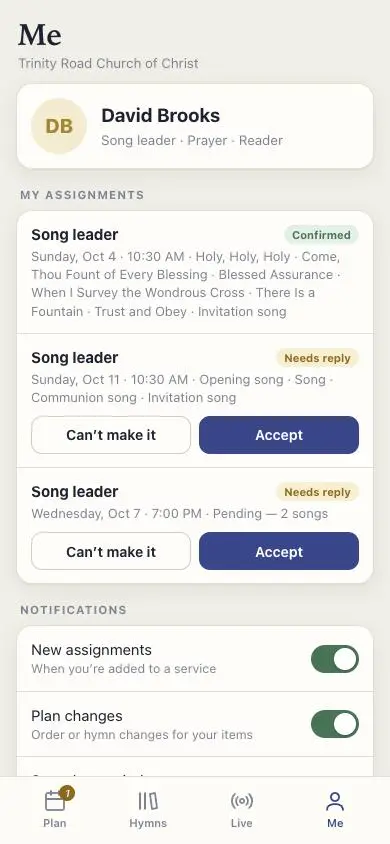

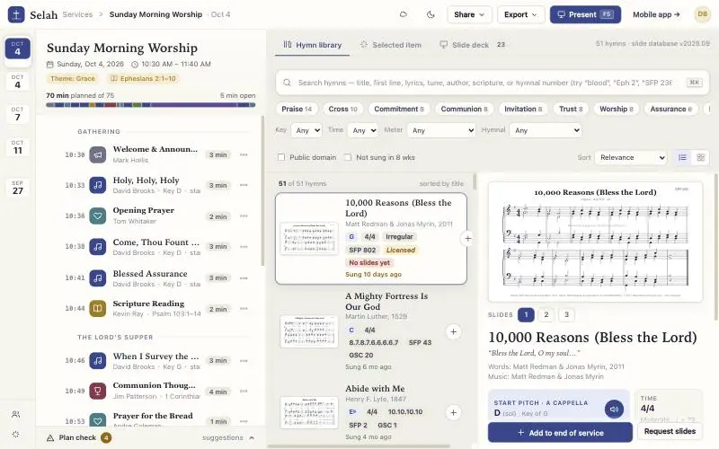

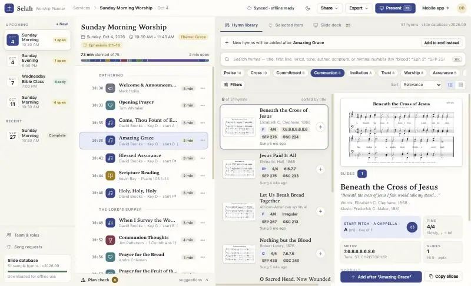

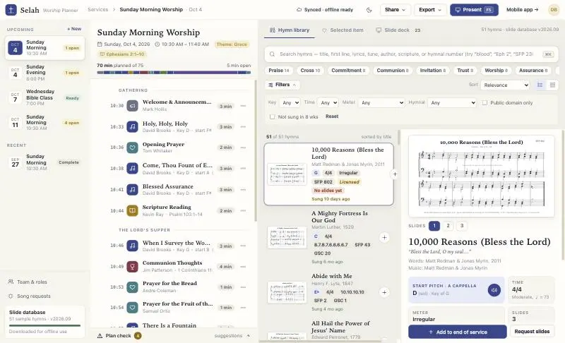

Smoke test clean: no errors across menus, deck, presenter, service switching, and grid view. Taking a last look at the grid view, then cleaning up.

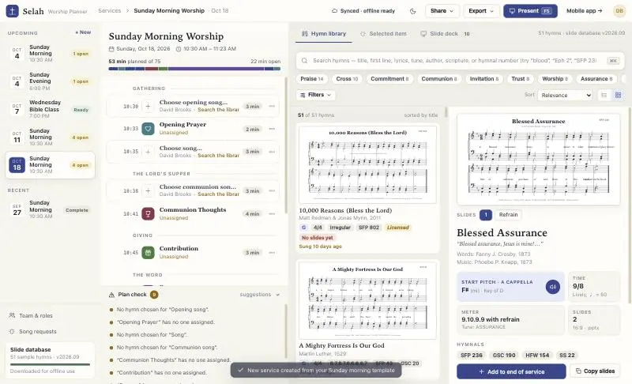

Mockup done in `worship-planner-sonnet-5.5/`. Open `index.html` for desktop, `mobile.html` for phone. No build step; I tested both in the browser pane, and the scripted smoke test (menus, deck, presenter, service switching, drag-and-drop) threw no errors.

**Desktop**
- **Order of service:** drag to reorder, with a running time budget. Sections are Gathering, The Lord's Supper, Giving, The Word, Response. Each song row shows key, start pitch, hymnal number and how recently it was sung.
- **Hymn search:** the emphasis you asked for. It's full-text over title, first line, lyrics, tune, author, scripture and hymnal number (`blood`, `Eph 2`, `SFP 236`), with matches highlighted.
  - Filters: topic chips, key, time, meter, hymnal, public domain, "not sung in 8 wks". Sort and list/slide-grid views.
  - Arrow keys plus Enter add a hymn, or drag a result into the order.
- **Empty song slots:** click "Choose invitation song…" and the library filters to that purpose, longest-since-sung first.
- **Preview:** a sheet-music slide per verse/refrain, plus a playable start-pitch tone, meter, tune, scripture, topics, 12-month usage and license.
- **Plan check:** flags open slots, recently sung hymns, big key jumps between songs, unassigned people and going over time.
- **Deck and present:** an assembled slide deck with a `F5` full-screen present mode. Light/dark toggle.

**Mobile** (metadata only, sheet-music slides are locked and marked desktop-only): Plan, Hymns, Live (song-leader view with start pitch, hymnal number to announce and a timer), and Me (accept/decline assignments).

- **Sample data:** hymnal numbers, usage history and slide counts are illustrative. Only public-domain hymns have lyrics.
- **Generated slides:** the sheet-music slides are generated procedurally to show layout. They use Unicode clef glyphs, so they need a system music font.
- **Stubbed:** export, share, sync and team management only show a confirmation toast.
- **Git:** a commit (`e02a07a` "fluent") made partway through this session captured an earlier snapshot of some of these files. Later edits and the new files are uncommitted; I didn't commit anything.

`README.md` in the folder has a walkthrough of what to try.

## You

Ok, I am really liking this.

Can you write up a plan for the mobile app, so I can export it and implement this in an app I already have?

1. I dont need to know the last time it was led
2. I don't need to know the timing (at least, not yet)
3. I don't need leader assignments.
4. This will be a public, security-through-obscurity link that has read-only data. I just need the "plan" view with title, who is assigned, key, starting note, and hymnal number (if available). I do like the pop-up view that has more details, including the time signature, starting note, and an audible pitch.

## Claude

Plan written to [MOBILE-PLAN.md](worship-planner-sonnet-5.5/MOBILE-PLAN.md). It's self-contained markdown, so you can copy it straight into your other project.

I applied your four cuts. Last-sung, timing, leader assignments and the whole Hymns/Live/Me/edit side of the mockup are gone. What's left is the plan list, the detail sheet and the audible pitch, all read-only.

The plan covers:
- **Screens:** row layout for the plan view (title, assignee, key, start note, hymnal number) and the detail sheet (time signature, start note, Play button, meter, tune, hymnal numbers, scripture, topics).
- **Data contract:** a JSON snapshot published from the desktop app with the start note precomputed. The phone only needs `freq = 440·2^((midi−69)/12)`. It includes seven test vectors for checking the pitch math.
- **Public link:** unguessable token of at least 128 bits, GET-only, not indexable, revocable, with optional expiry.
- **Implementation:** client architecture, phases, display-mapping rules to unit test, acceptance checklist, and the small publish/share changes needed on the desktop side.

Two things to check:
- **"Who is assigned":** I read this as a display-only name on each non-song item, with no accept/decline and no song leader. Tell me if you meant something different.
- **Minor keys:** the mockup's pitch math only handles major keys. The plan says to store an explicit start note for any hymn that isn't.

Section 7 lists open questions that shape the build:
- One link per service or a rolling "this Sunday" link.
- Full names or first name plus initial in a public link.
- Whether non-song rows should be tappable.
- Your target stack, which only affects how the tone is generated and how the plan is cached.

If you want, I can also trim `mobile.html` in the mockup to match this reduced scope, so the visual reference matches the plan.

## You

Some minor tweaks

* Drop the timing information. I like it as a concept, however, we do not time our services down to the minute, so its not needed now.

## Claude

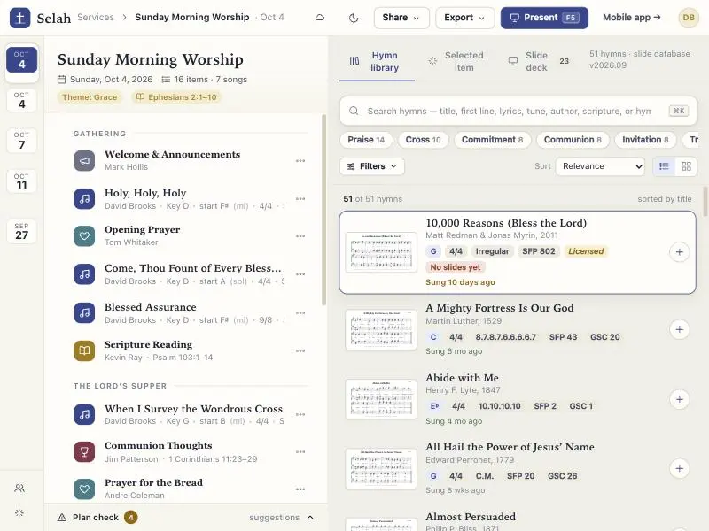

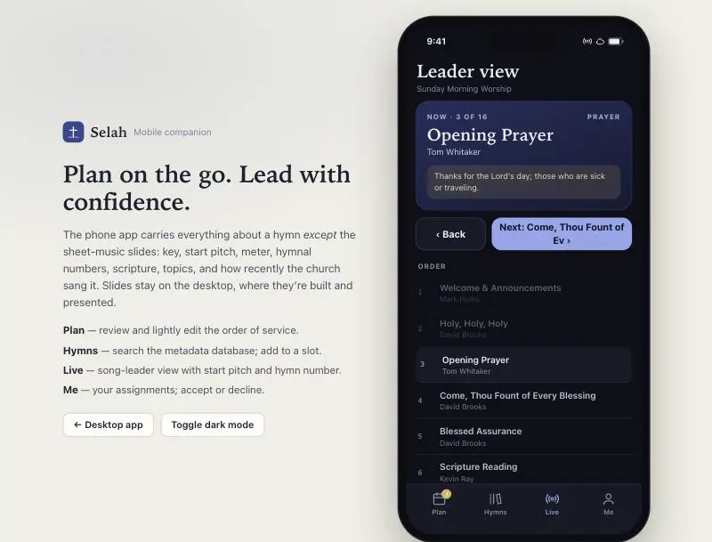

Timing is removed from the desktop mockup, the mobile mockup, the sample data and both docs. I ran the app in the browser after the change and hit no errors. A search of the page text for durations, "min" and clock times found nothing.

- **Desktop:** the per-item clock times and duration pills are gone, along with the Duration fields and the duration menu. The time-budget bar and the "over target" plan check are gone too. The service header now shows the date plus "16 items · 7 songs". The sidebar shows the service name and an item count instead of a start time.
- **Mobile:** the Plan rows have no times or "3 min" text and no budget card. On the Live tab I removed the clock, the Start/Pause button, the "behind plan" indicator and the per-item minutes. It's now just current item, next item and the order.
- **Sample data:** durations, service start times and time targets are deleted.
- **Docs:** `MOBILE-PLAN.md` now says timing isn't part of the product, and I removed "durations/timing" from its Later phase. `README.md` no longer mentions timing.

I also dropped the service start time, not just the per-item times. If you'd rather keep "10:30 AM" on the service itself, that's a small change.

I left the hymn tempo (♩ = 76) alone, since it's musical rather than service timing.

## You

Ok, this all looks really good.

Can we copy the desktop version, and make a version of it using the Uno Fluent design system?

The developers have chosen the .NET Uno framework, and I suspect they will be using the "fluent" style (https://platform.uno/docs/articles/external/uno.themes/doc/fluent-getting-started.html), so lets iterate with that

## Claude

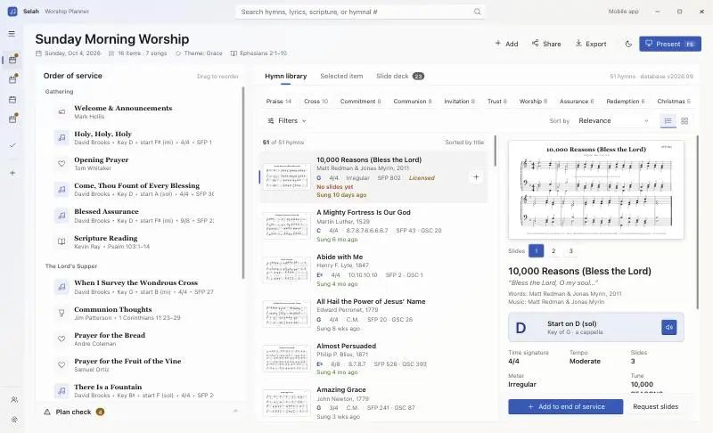

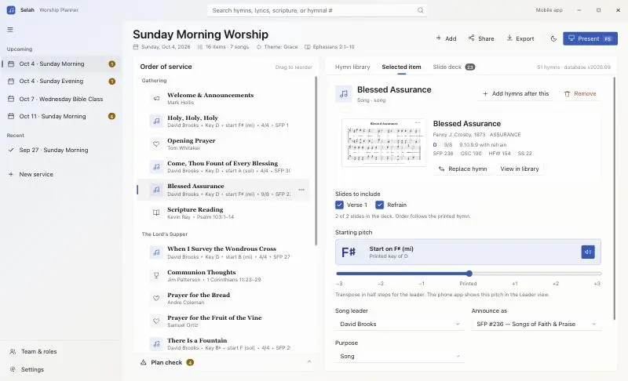

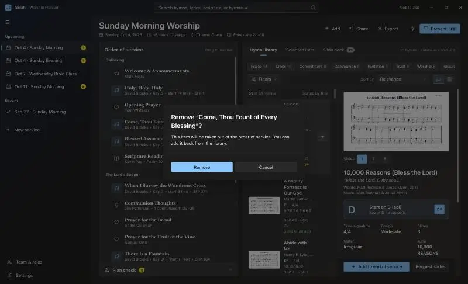

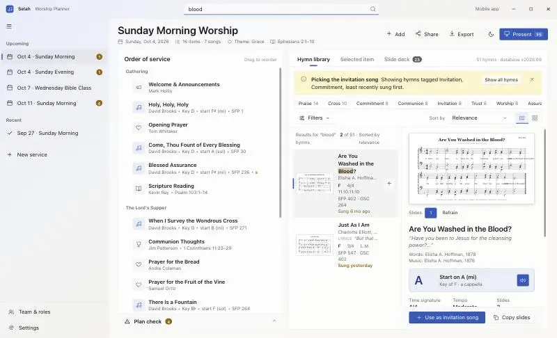

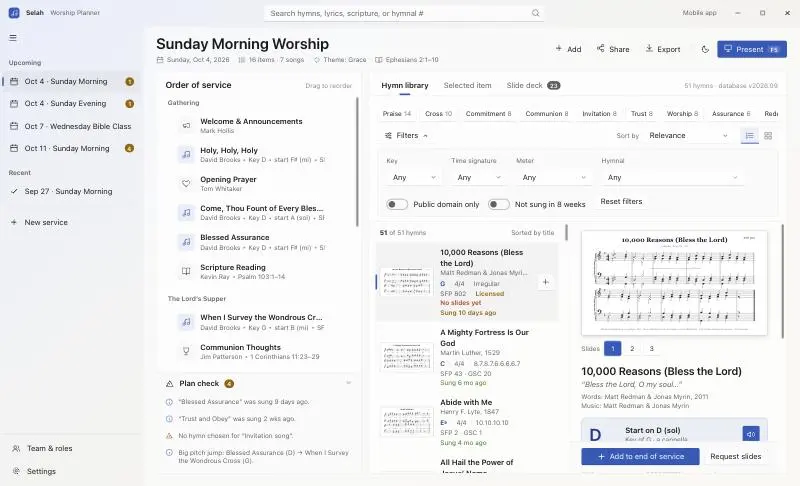

Now linking the variants together and updating the README.

The Fluent version is built and tested in the browser. The smoke test passed with no errors: menus, dialog, deck, presenter, service switching, drag-and-drop, and light and dark. Open `fluent/index.html`. It's a separate copy, so the original desktop mockup is unchanged apart from the title-font fix below. There's a "Fluent version →" link in the original's top bar.

**How it maps to WinUI.** The styling follows how WinUI renders on Windows 11 (the Uno Platform docs page says Uno uses the same Fluent styles). That page turned out to be a short setup note with no design values, so I took the colors, radii and type sizes from WinUI's standard Fluent theme. The mapping doc marks anything I'm unsure of as "verify".

| Area | Fluent equivalent |
|---|---|
| Window | Title bar with the hymn search box in it, then a `NavigationView` pane holding the services list |
| Command bar | Add, Share, Export and Theme buttons, plus an accent-colored Present button |
| Order of service | `ListView` with a 3px accent bar on the selected row, and a "Plan check" section at the bottom |
| Workspace tabs | Tab bar styled like `SelectorBar` |
| Library filters | Collapsible `Expander` with `ToggleSwitch`, `ComboBox` and `ToggleButton` topic filters |
| Banners and toasts | `InfoBar` |
| Remove item | `ContentDialog` confirmation |
| Menus | `MenuFlyout` |
| Editor | `CheckBox` for which slides to include, a `Slider` to transpose by half steps |

- **Toning down:** the earlier mockup's colored tiles and pill chips are gone. Icon tiles are neutral, only songs get an accent tint, and hymn titles use the Fluent sans-serif instead of the serif.
- **Tokens:** the CSS variables in `fluent/css/fluent.css` use WinUI's theme resource names (for example `--CardBackgroundFillColorDefault`). Developers can map each one straight to `{ThemeResource …Brush}` in XAML.
- **Handoff doc:** [UNO-FLUENT-MAPPING.md](worship-planner-sonnet-5.5/fluent/UNO-FLUENT-MAPPING.md) maps every screen element to its XAML control, style and resource, with an icon table and a suggested build order. It also lists Uno-specific decisions:
  - fonts and icons off Windows
  - Mica backdrop support
  - drag-and-drop support across Uno targets
  - the tone generator for the audible pitch
  - title bar and search behavior on macOS and Linux

**Original mockup change:** the slide artwork's styles were leaking into the page, which turned every non-song title in the original desktop mockup serif. I scoped them, so those titles are now sans-serif as intended; this applies to both versions.

**Decision for you:** the search box now lives in the title bar, as in Windows 11 apps. If the Uno developers would rather keep it at the top of the library pane, that's a small change.

## You

Ok, I really like how the non-fluent interface works. Can you write up a technical handoff document for it, including description of the general layout, what elements are on the screen, how the various interactions work?  I want to hand this off to an implementation against an existing app and database.

## Claude

The handoff doc is written: [HANDOFF-DESKTOP.md](HANDOFF-DESKTOP.md). It describes the non-Fluent desktop mockup and is written to stand alone, so the implementing team doesn't need to run the mockup, though it can still serve as a live reference.

- **Layout:** a wireframe of the top bar, sidebar, order column and workspace, plus how each column scrolls and how the layout changes at narrower widths.
- **Every element on screen:** the top bar, sidebar, order rows, and library pane with its results and preview. It also covers the item editor, slide deck, presenter, menus and toasts, with each element's states and contents.
- **UI state and selection rules:** what is stored on the client, and exactly what happens when you click an open song slot, click another row, or use the "Add hymns after this" and "Add to end instead" buttons.
- **Interactions:** the rules for adding a hymn, drag and drop, editing an item, presenting/exporting, and playing the pitch.
- **Business rules:** the exact search behavior (matching, field weights, filters, sort modes), how recently a hymn was sung is classified, the starting-pitch math with test values, the plan-check rules, and how the slide deck is built.
- **Data model and integration notes:** the fields the UI needs on hymns, services and items, the usage history it depends on, and a suggested list of operations. Notes on running search server-side and on persisting changes.
- **Mockup shortcuts not to copy:** sample data and the hard-coded "today", the procedural sheet music, stubbed actions, and a few known quirks.
- **Acceptance scenarios and open questions:** 15 scenarios, plus 8 questions for the implementing team.

I found one weakness while writing it. Searching for `SFP 236` scores the code and the number separately, so it can return a hymn that is in SFP under a different number. The doc says a real implementation should match code plus number as a pair, and the acceptance scenario is written to that standard rather than the mockup's behavior.

The doc also lists a few unresolved items for you or the team to decide:
- Whether services planned for the future count toward "sung recently".
- Whether the key-jump warning should use transposed keys.
- Whether removing an item should be undoable.
- Whether crossing a section boundary should move an item into its new neighbor's section.

## You

Lets run the scripts/prompt-md on this conversation
