# Prompts

- **Model:** claude-opus-5-5
- **Effort:** high
- **Session(s):** 871f1836-7e4f-49fd-9bd8-c87690aedfb1
- **Tokens:** input 138, output 292644, cache read 17703702, cache write 1204046
- **Cost (tokscale estimate):** $15.41

## You

Build for me a ui mockup for a worship planner. The focus is on the order of a service - prayers, hymns, etc, with a strong emphasis on searching a database of power-point ready slides of sheet music hymns. The target will be a cross platform desktop app, and a slightly less feature rich mobile app (likely wont have the full sheet music, but will have metadata). The mockup can be contained in a html/js/css app, but just know this will likely target native builds.

## Claude

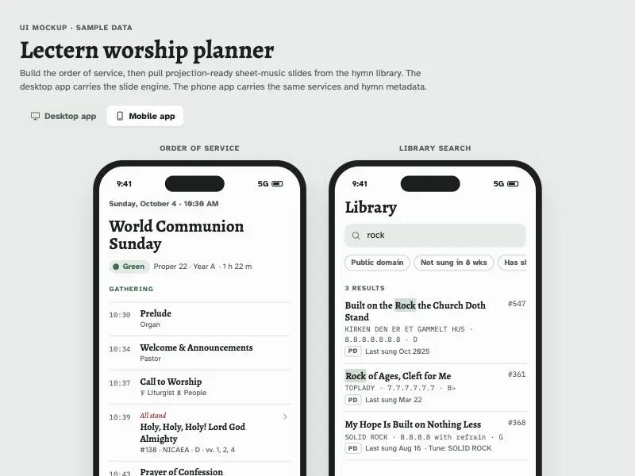

Mockup built; checking desktop render once.

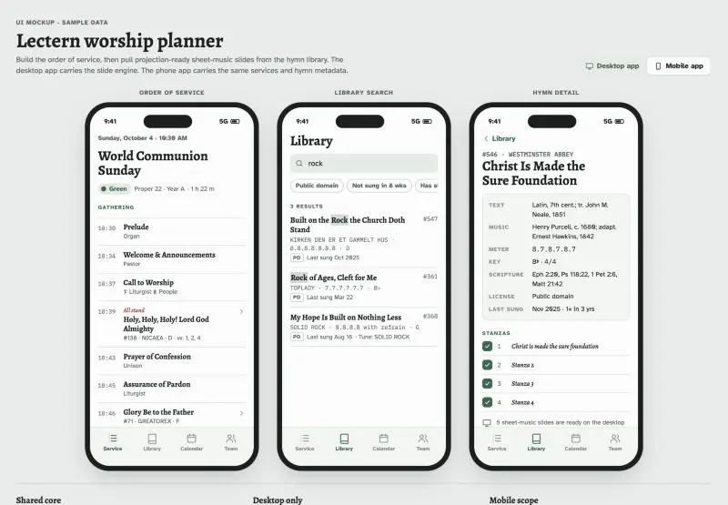

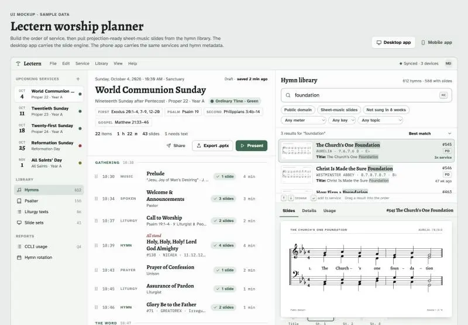

Fixes applied. Publishing.

I built the mockup as one HTML/JS/CSS file and published it: https://claude.ai/artifact/8qfxDjunRmZwsJgkTm5qkT (private until you share it). The source is [worship-planner/index.html](index.html). I checked it once in the browser at desktop and phone widths with no console errors. After that I fixed a cramped results list and a lyric that split badly, and I didn't re-check those two fixes.

There's a **Desktop app / Mobile app** toggle at the top. The app is called "Lectern" in the mockup. The sample service is Sunday, October 4, 2026: World Communion Sunday, Proper 22, Year A.

**Desktop window, three panes:**
- **Services list (left):** the next five Sundays, each with a dot in its liturgical color. The screen's accent color changes with the open service (green for Ordinary Time, red for Reformation Sunday).
- **Order of service (middle):**
  - Grouped into Gathering, The Word, The Table and Sending, with a start time for each item.
  - Instructions like "All stand" appear in red italics, as in a printed bulletin.
  - Each item shows how many slides it has. Items missing text get a "Needs text" flag, and open hymn slots show as dashed boxes.
  - Items can be dragged to reorder.
  - A header shows the readings and totals (items, length, slides, songs to report to CCLI), with Share, Export .pptx and Present buttons.
- **Hymn library (right), the main focus:**
  - One search box covers title, first line, tune, meter, author, topic and scripture. Scripture works in short or long form ("Ps 118" finds Psalm 118).
  - Each result says why it matched, and matching words are highlighted.
  - Filters: public domain, has sheet music, not sung in 8 weeks, meter, key, topic.
  - With an empty search, it suggests hymns that pair with that Sunday's readings.
  - Keyboard: ⌘K to search, ↑/↓ to browse, Enter to add. Results can also be dragged into the order or dropped into an empty slot.
  - Undo is available.
- **Slide preview:** a large sheet-music slide (treble and bass staves, key signature, lyrics under the notes) with a strip of per-verse thumbnails. You can toggle which verses to include and change the key. Details and Usage tabs sit alongside.
- **Presenter view:** current slide, next slide and the order list, with arrow keys to step through.

**Mobile, three phones:** the service order, library search and hymn detail. They show metadata only. The detail screen says the sheet-music slides live on the desktop, and you can choose verses and add a hymn to the service there. Changes show up in the desktop view, which is how the sync would behave.

**Things to know:**
- **Hymn data:** 24 real hymns with correct tunes, meters and credits. The three copyrighted ones (Great Is Thy Faithfulness, Here I Am, Lord and In Christ Alone) show gray bars instead of lyrics.
- **Sheet music:** the notes are random placeholders drawn in code, not the real tunes. In the real app these slides would come from your stored slide files.
- **Mockup-only numbers:** hymn numbers, last-sung dates and team names are made up.
- **Native build notes:** these are at the bottom of the page. They cover a shared data model, an offline search index, desktop-only slide files, and moving the in-window menu to the system menu bar on macOS.

## You

ok, this is a good start. lets make this less catholic feeling and more church of christ

## Claude

Main changes, based on how a typical Church of Christ runs its service:
- Remove the church calendar: no Pentecost, lectionary readings, season colors, or Gloria Patri.
- Keep singing a cappella, with no organ, choir, or handbells.
- Add a weekly Lord's Supper, a separate contribution, and an invitation song.
- Use a song leader and "Bro." assignments.
- Default to shape-note slides.

Rewriting the file.

Main script written. Merging it in and checking the render once.

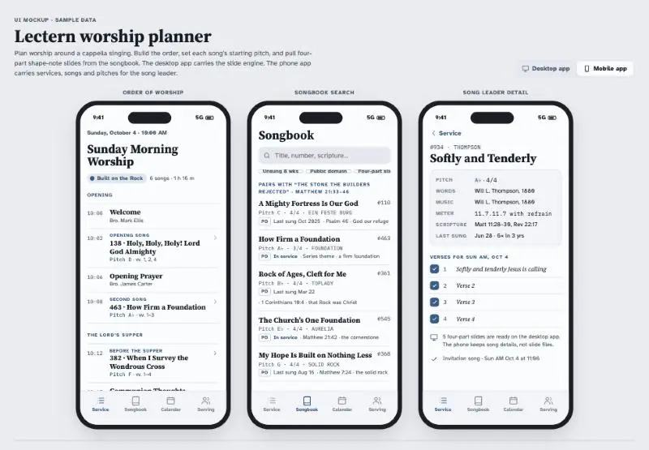

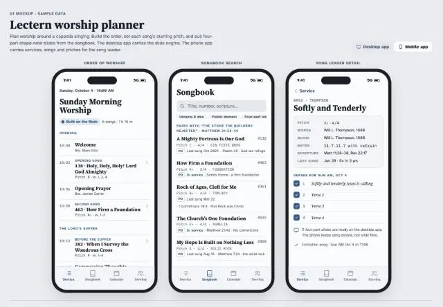

Preview pane only shows a static snapshot, so I'm starting a small local server to test the interactive desktop view.

Adding a matching entry to the root launch config for this mockup.

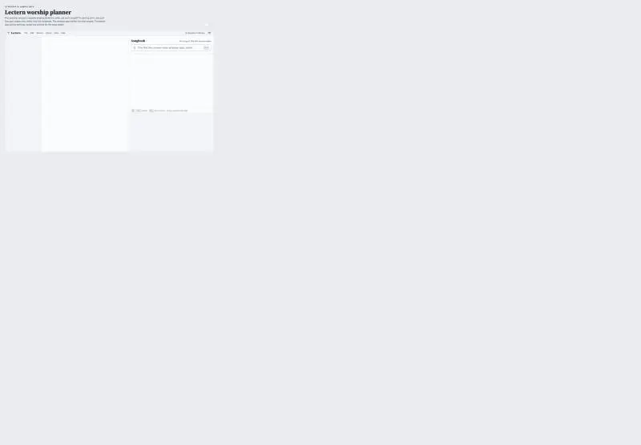

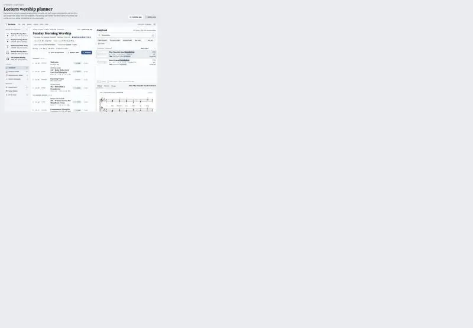

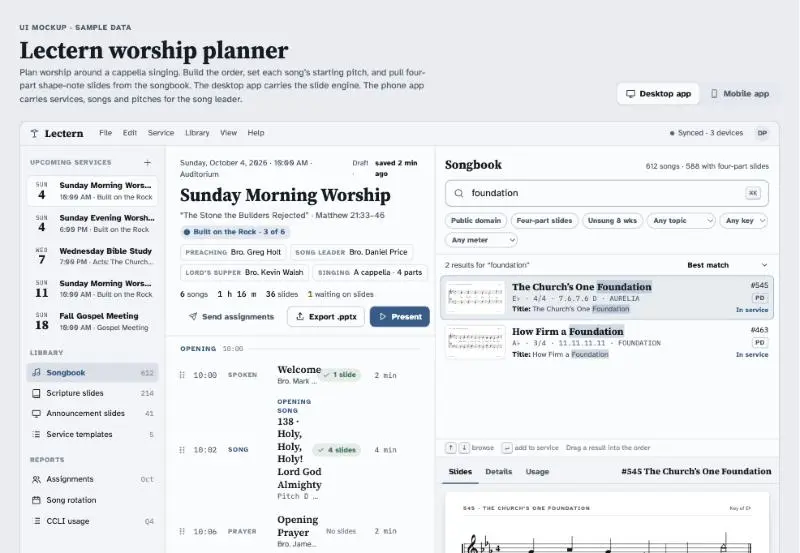

Center column too cramped at laptop widths. Widening it.

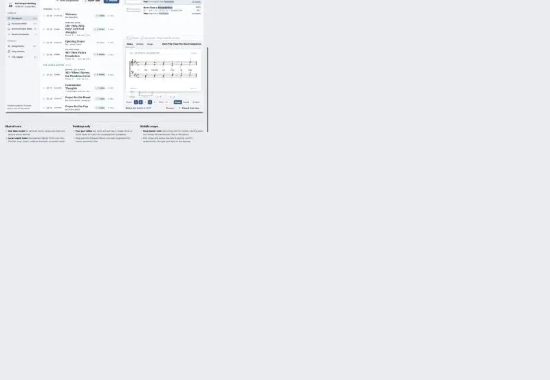

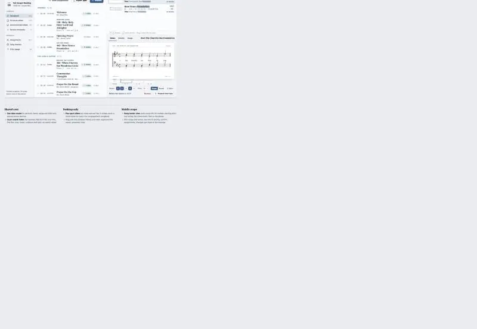

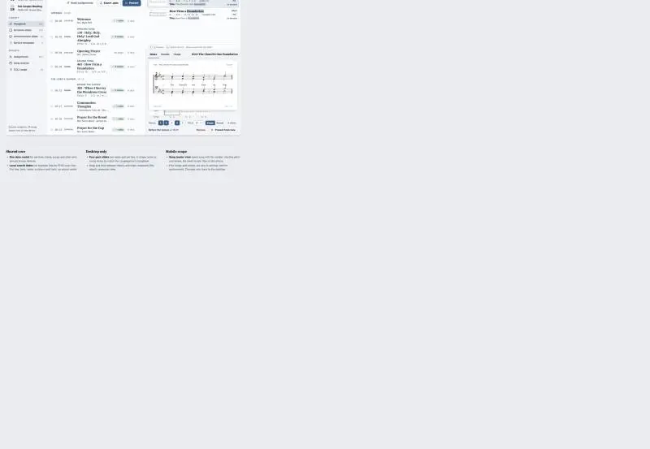

Features check out. Republishing.

I reworked the mockup for Church of Christ worship and updated it at the same link: https://claude.ai/artifact/8qfxDjunRmZwsJgkTm5qkT

In the local test server I confirmed that the four-part slides draw shape notes. I also confirmed that the invitation song slot suggests invitation songs and the gospel meeting suggests songs that fit its lesson. The pane's screenshots stopped updating partway through, so I didn't get a final look at the new desktop layout. The phone views looked right.

**Removed:**
- The church calendar: Pentecost Sundays, lectionary readings, season colors, Reformation Sunday and All Saints.
- Anything liturgical: Call to Worship, Confession, Gloria Patri, Great Thanksgiving, Benediction, and the red "All stand" cues.
- All instruments: organ prelude and postlude, choir anthem, handbells.
- "Pastor" and "Rev."
- The accent color that changed with the season. There's now one steady blue.

**Order of worship** follows the usual pattern:
1. **Opening:** welcome, songs and a prayer.
2. **The Lord's Supper**, every Sunday: communion thoughts, a prayer for the bread and a prayer for the cup, served by the men.
3. **Contribution:** its own section, separate from the Supper.
4. **The Lesson:** a song, the scripture reading, then the sermon.
5. **Invitation & Closing:** invitation song, announcements, closing song and prayer.

Each song slot is labeled with its role, such as "Opening song", "Before the Supper" or "Invitation song". The header lists who is preaching, leading singing and presiding at the Supper, plus a sermon series chip ("Built on the Rock · 3 of 6").

**Services list:** Sunday morning, Sunday evening (with the Supper offered for those who missed the morning), Wednesday Bible study, the next Sunday, and a Fall Gospel Meeting.

**Songbook:**
- It says "songs" and song numbers throughout, and shows the starting pitch and time signature for each.
- With an empty search, the suggestions depend on which slot is selected. The invitation slot suggests invitation songs, the Supper slot suggests cross and Supper songs, and anything else suggests songs that fit the sermon text.
- The song list is now songs these congregations commonly sing: Amazing Grace, It Is Well, Blessed Assurance, Softly and Tenderly, Just As I Am, 'Tis Midnight, The Old Rugged Cross, When We All Get to Heaven, and others.

**Slides:** four-part slides now default to shape notes, with a Shape/Round toggle. Title slides read "Song 934".

**Phone:** it's now aimed at the song leader, with song numbers, pitches and verses. The team tab is now "Serving" and lists the men assigned: prayers, the Supper, serving, reading, sound and slides.

**Unverified data:** I didn't check the keys, time signatures, meters or tune names for the new songs, and some are guesses. The song numbers are made up. Fix any of these against your songbook before anyone relies on them.

**File changes outside the mockup:**
- Top of [index.html](index.html): a `<meta charset>` line so the page displays correctly from a local server.
- `.claude/launch.json` at the repo root: a new `worship-planner` entry that serves the mockup locally on port 8765.

## You

Ok, I'd like the desktop mockup to look a bit more like a desktop application. But, lets copy what we have to a new page, because I still like what we have here. The developers have chosen the .NET Uno framework, and I suspect they will be using the "fluent" style (https://platform.uno/docs/articles/external/uno.themes/doc/fluent-getting-started.html), so lets iterate with that

## Claude

Assembling the new page. Fixing a token-table syntax slip in the build script.

Now add link from original page, then test in browser.

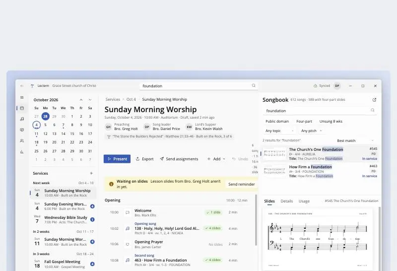

Mostly right. The stats text wraps inside the command bar, so I'm moving it into the caption line.

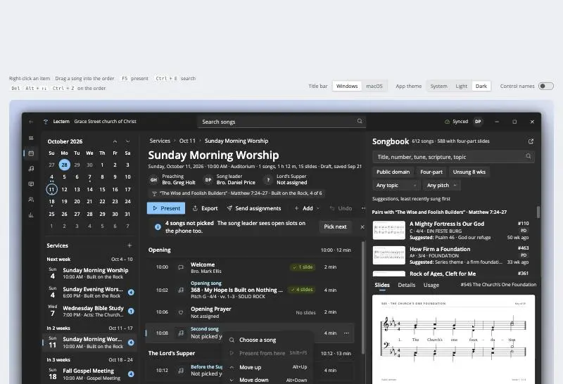

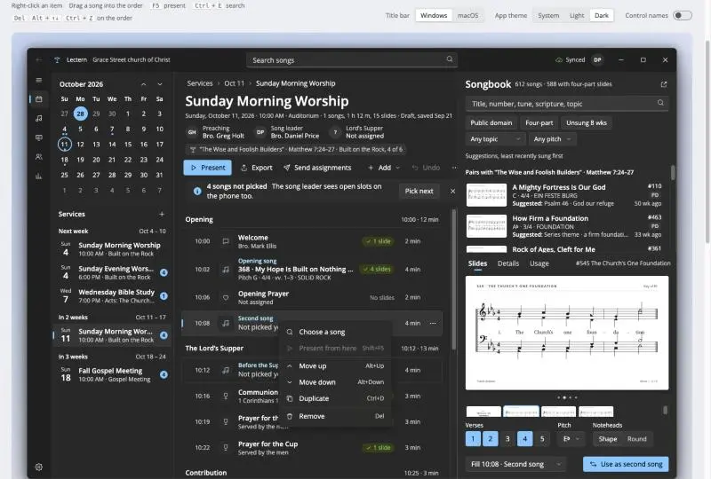

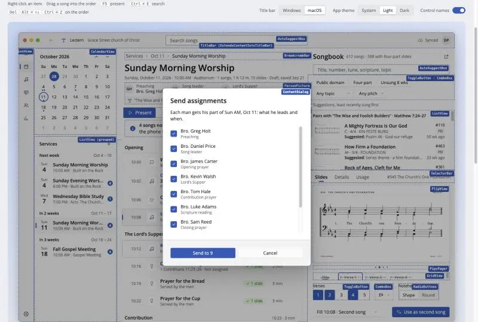

Checks pass. Publishing both pages to the same artifact.

I built the Fluent version as a new page, [worship-planner/fluent.html](fluent.html), and left the original as it was. Both pages are in the same published link and link to each other: https://claude.ai/artifact/8qfxDjunRmZwsJgkTm5qkT

I tested it in the local browser: no console errors, and dark theme, the right-click menu, the macOS title bar, the control-names overlay and the dialog all worked.

The Uno page you linked only covers turning Fluent on (`XamlControlsResources`, same as WinUI), not styling details. So I used WinUI's standard Fluent colors, type sizes and corner radii.

**What makes it feel like a desktop app:**
- **Window:** a Windows 11-style frame with the app name, a search box in the title bar, and minimize/maximize/close buttons. A toggle switches to macOS traffic lights.
- **Left rail:** a compact navigation bar that the hamburger button expands.
- **Services column:** a month calendar with service days marked (today filled, the open service ringed), and a service list grouped by week with a badge counting songs not yet picked.
- **Order of worship:**
  - Breadcrumbs, a title, and small avatars for who's preaching, leading singing and presiding at the Supper.
  - A toolbar with an accent Present button, Export, Send assignments, an Add dropdown and Undo.
  - A banner for open song slots or slides still owed by the preacher.
  - The list of items: grouped and reorderable, with a selection marker and an icon for each item type.
  - Right-click or the "…" button opens a menu with shortcuts: Show slides, Present from here, Move up/down, Duplicate, Remove.
- **Songbook pane:**
  - Search, filter toggles, dropdowns, and results with slide thumbnails.
  - Slides / Details / Usage tabs.
  - The slide preview: arrows to flip, dot indicators, a thumbnail strip, verse toggles, a pitch picker and a Shape/Round switch.
- **Dialogs and notifications:** "Send assignments" opens a modal with a checkbox for each man. Changes show a success notification with Undo.
- **Keyboard:**
  - F5 presents; Shift+F5 presents from the selected item.
  - Ctrl+E, Ctrl+K or Ctrl+F jumps to search.
  - With the order list focused: Del removes, Alt+↑/↓ moves an item, arrow keys change the selection, and Ctrl+Z / Ctrl+D undo and duplicate.
- **Presenter:** styled as the console you'd see on the laptop, with the slides going to the projector as a second window.

**For the developers:**
- **App theme:** System / Light / Dark switches the app window independently of the page.
- **Control names:** this switch labels every part of the window with its Uno/WinUI control (NavigationView, CalendarView, CommandBar, InfoBar, SelectorBar, FlipView, PipsPager, MenuFlyout, ContentDialog, and so on).
- **Control map:** a table below the window lists each region with its control, key properties, and the named color and text styles the page uses.

**Things to know:**
- **Fonts:** the page uses Segoe UI Variable on Windows and falls back to Open Sans elsewhere. I believe Open Sans is Uno's default font outside Windows, but I haven't checked.
- **Preview tabs:** SelectorBar is a newer WinUI control, so the table says to check your Uno version supports it, with the Uno Toolkit's TabBar as an alternative.
- **Shared code:** `fluent.html` includes a copy of the song data, search and slide drawing from `index.html`, made by a build script in my scratch folder, not the repo. If you edit songs or services in `index.html`, the Fluent page won't pick them up. I can move the script into the repo, or split the shared code into a separate `.js` file both pages load.
- **Deploy:** your GitHub Pages workflow already publishes the whole folder, so `fluent.html` will go out with it.

Nothing is committed.

## You

Looking good. Lets make the following tweaks.

1. Drop the "Bro." in front of names. We dont do that.
2. Lets drop the timings - we don't time our services down to the minute.
3. We can drop the tag "Four-part". Thats going to apply to 99% of hymns.
4. Drop the dropdown for "Pitch". The way the notation works, the pitch is fixed. Also noteheads are fixed, so drop the toggle for that.

## Claude

I'll apply all four to both pages. They're facts about how your congregation does things, not styling choices. The Fluent page is rebuilt from the original's shared code, so fixing the data in one place covers both.

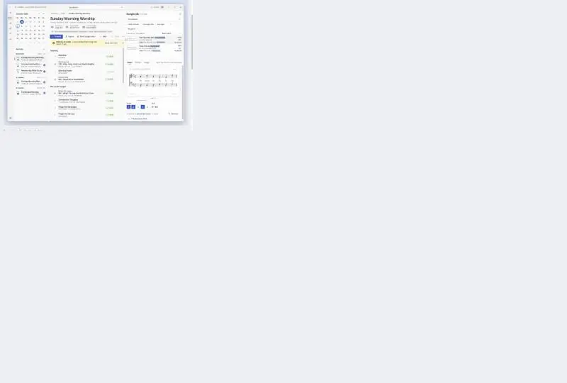

Both pages load clean with all four changes. Republishing.

I made all four changes on both pages, the Fluent one and the original, since they're facts about how your church does things. Both pages load without errors and I confirmed each change was applied, but I didn't get a clean screenshot this time. The update is live at the same link: https://claude.ai/artifact/8qfxDjunRmZwsJgkTm5qkT

1. **"Bro." is gone** everywhere: people chips, item details, the Serving list, the Send assignments dialog, and notifications.
2. **Timings are gone:**
   - Items no longer show clock times or minutes.
   - Section headers no longer show a start time.
   - The total service length is gone from the header and the phone.
   - The presenter list, the position dropdown, and the "In service at 11:02" line no longer show times.
   - I kept each service's start time (10:00 AM, 6:00 PM), since that's the schedule, not minute-by-minute timing.
3. **The "Four-part" filter is gone** from the desktop and phone filters. The songbook header just says "612 songs".
4. **No pitch or notehead choice:**
   - The pitch dropdown and the Shape/Round toggle are removed, and the slides always use shape notes.
   - The preview shows pitch as plain text (for example "E♭ · 4/4"), and song rows still say "Pitch E♭" for the song leader.
   - The control map was updated to match.

The "Any pitch" filter in the songbook is still there. It only narrows search results rather than changing a song's pitch, so I left it. Say if you want it removed too.

If you'd rather keep the original page exactly as it was, I can revert it and keep these changes on the Fluent page only.
